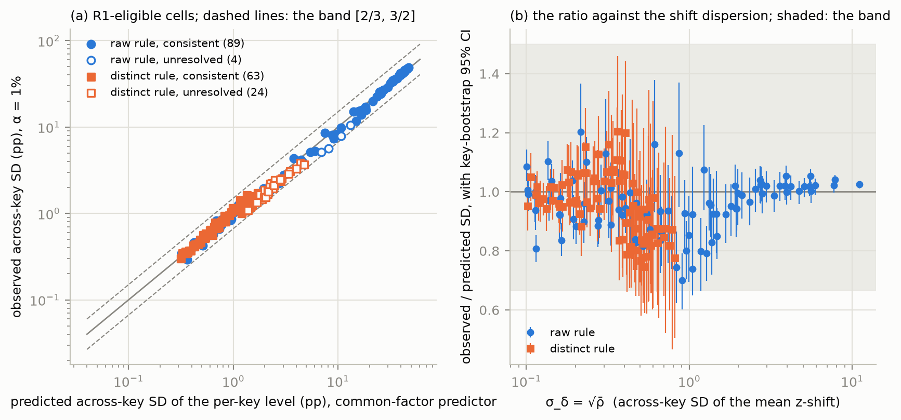
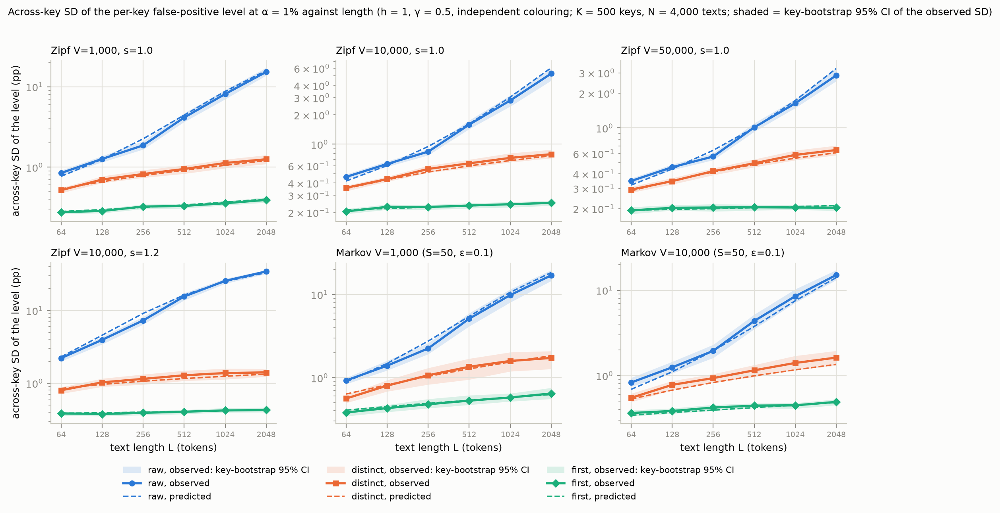
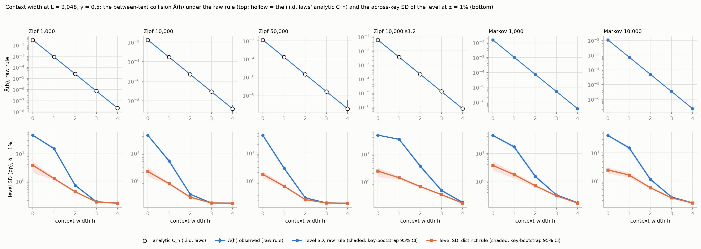
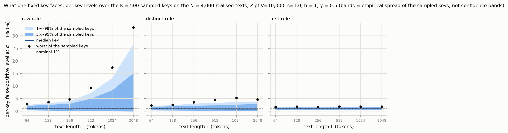
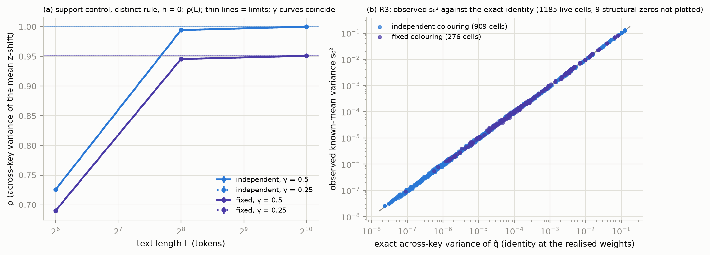

# Study 1 — report v0.1: theory and simulation of the across-key dispersion of a red–green watermark test's false-positive rate

Date: 2026-10-10 (Milestone 2). Protocol: [`STUDY1_PROTOCOL_v0.3.md`](STUDY1_PROTOCOL_v0.3.md) (LOCKED 2026-10-10 before outcomes; R03 agreed at round 4). Lock: [`outputs/study1_v0.3/PRE_RUN_LOCK.json`](../outputs/study1_v0.3/PRE_RUN_LOCK.json) (SHA-256 ff265b500f0dbd0c…). Run manifest: [`outputs/study1_v0.3/RUN_MANIFEST.json`](../outputs/study1_v0.3/RUN_MANIFEST.json). Results: [`outputs/study1_v0.3/results.json`](../outputs/study1_v0.3/results.json) (SHA-256 d9427321d27ebcb3…; label STUDY). **This file is built by** `research/study1/s1_report.py`, **which re-computes the rules from the per-cell files with its own code, asserts equality with `results.json`, and inserts every table, figure and number; no number is typed by hand.** Tables and figures: `outputs/study1_v0.3/report/` (`tables.md`, `tables_curves_full.md`, `tables_fixed_subset_full.md`, `tables_r1_diagnostics_full.md`, `checks.json`, `prose_values.json`, `fig1`–`fig5`). Sections 5–8 are the conductor's reading of the generated tables (inference, labelled); every number in them is a filled placeholder.

## 1. Run
- **Run:** 2026-10-10T03:26:16Z to 2026-10-10T04:55:50Z UTC, 1.49 h against the validation's projection of 2.01 h (sum of the chain times 1.49 h; restarts 0; chains skipped on resume 0); launched at commit efa548c with swap "total = 3072.00M  used = 1955.44M  free = 1116.56M  (encrypted)"; `PYTHONHASHSEED=0`; one process, Apple M5, 16 GB. The runner verified the lock before the first cell and the analyzer verified it again before any decision; the manifest (written 2026-10-10T04:56:18Z) verified it a third time. The held-out corpus partition was not touched (`final: false`). Deviations in execution: none. One discrepancy between the protocol's text and its locked code (R4b's tolerance) is disclosed in §5 and Table 8b.
- **Inventory:** 1248 cells exactly as the grid expects (1194 live, 54 degenerate markers, 0 with no detection possible); inventory digest a9fd2cf88b76d76a…. Core laws 6, illustration laws 4; K = 500 keys for the core cells (200 for the fixed colouring on the core subset), N = 4,000 texts per law shared across widths.
- **Independent re-computation (the builder):** from the recorded per-key levels and q̂ values of every live cell it recomputed the key-mean and across-key SD at every α (3582 level blocks), the two-sided KL-Chernoff bound of every R2 check, the known-mean estimator and R3's decision for every cell, R1's eligibility, status and counts (primary and every secondary block), R4's and R5's chain decisions and R4b's analytic limits, and asserted that all equal `results.json` (all equal; `checks.json`).
- **Process and disclosure:** conductor Claude (Fable 5.1, in Claude Code); independent reviewer Codex (rule A7 of the research-project-guide); Yichen Zhao decides every lock, run and judgement, reads every word and carries responsibility for the work. The pre-lock pilot (protocol §11) used validation laws, validation text seeds and validation keys (1,000,000 and above), disjoint from the production keys (20,000–21,999). After the lock the report builder was exercised on that pilot's analysis file in a fixture mode that can write only outside the repository, to test the tables' and figures' layout; its fixture figures were viewed; no pilot number appears in this report. The builder and the manifest script are not pinned by the lock; the analyzer, the runner, the core, the grid, the validation record and the protocol are. Checkpoint R04 status at this build: open; the latest review on file is REVIEW_codex_r2.md (VERDICT: AGREE); this build answers it and is not an approval.

| Chain (the five longest) | \|D\| tuples | Build (s) | Colouring (s) | Cells | Chain (s) measured | Chain (s) projected |
|---|---|---|---|---|---|---|
| zipf_V10000_s1.0__h4 | 8,158,271 | 3.6 | 45.8 | 36 | 426.2 | 499.4 |
| zipf_V10000_s1.0__h1 | 2,498,490 | 3.1 | 265.2 | 48 | 425.0 | 447.4 |
| zipf_V10000_s1.0__h3 | 7,935,738 | 3.5 | 44.1 | 36 | 410.5 | 488.7 |
| markov_V10000_S50_eps0.1_s1.0__h4 | 7,299,069 | 3.7 | 40.9 | 36 | 372.5 | 458.0 |
| zipf_V50000_s1.0__h1 | 3,852,681 | 3.2 | 244.0 | 24 | 351.0 | 324.2 |

## 2. Pre-registered results (protocol §9)
### Table 1 — Pre-registered rules against the observed results

| Rule (protocol §9) | Pre-registered criterion | Observed | Verdict |
|---|---|---|---|
| R1 adequacy of the common-factor predictor (primary; α = 0.01, γ = 0.5, raw and distinct rules, independent colouring, core laws) | ≥ 30 resolved cells and ≥ 80% of the resolved cells consistent (ratio interval inside [2/3, 3/2]) | candidates 360; eligible 180 (mean M ≥ 30, theory share ≥ 0.75); resolved 152; consistent 152; inconsistent 0; unresolved 28; share consistent 100.0% | **PASS** |
| R2 simulator validity (independent colouring, distinct rule; every α, every K) | no check with a two-sided KL-Chernoff bound below 1e-06 (per-check false audit ≤ 1e-06; union bound over the checks) | 891 checks (18 structural zeros counted separately); flagged 0; smallest bound 0.274; union bound 8.91e-04; normal \|dev\|/SE median 0.747, 99% 2.53, max 11.2 (diagnostic) | **PASS** |
| R3 exact identities (every live cell, both colourings; the core fixed subset reported, not decided on) | no gross failure: \|s₀² − σ²_exact\| ≤ 6·SE + τ; structural zeros ≤ τ | 1098 checks (9 structural zeros); gross failures 0; \|dev\|/SE median 0.665, 99% 2.77, max 1,158,962; nominal-95% coverage 94.3% of 1089 (diagnostic) | **PASS** |
| R3 statement: fixed-size reduction below 1% for V ≥ 10,000 (core cells, exact ratio at the realised weights) | every core cell with V ≥ 10,000 has (I − Var)/I < 1% | 540 cells; largest reduction 28.305% | **refuted** |
| R4 H-length under the raw rule (core chains, independent colouring) | ρ̄ non-decreasing in L within 2(se_L + se_L′) in every (law, h, γ) chain | 40 chains; non-decreasing 100.0%; failing: none | **PASS** |
| R4b saturation (support control, distinct rule, h = 0, longest L) | ρ̄ within 3 text-bootstrap SEs of the analytic limit, both colourings and both γ | 4 cells at the longest L | **reproduced** |
| R5 H-width under the raw rule (core chains, independent colouring) | Ã non-increasing in h within 2(se_h + se_h+1) in every (law, L, γ) chain | 48 chains; non-increasing 100.0%; failing: none | **PASS** |

**In words (evidence; every number is filled from the locked outputs):**
- **R1, adequacy of the common-factor predictor:** PASS. Of 360 candidate cells (core laws, independent colouring, γ = 0.5, raw and distinct rules, α = 0.01), 180 were eligible (mean M ≥ 30 and a theory share ≥ 0.75), 152 were resolved by their key-bootstrap interval and 152 of those were consistent (the interval inside [2/3, 3/2]); 0 inconsistent, 28 unresolved; share consistent 100.0% against the pre-registered 80% with at least 30 resolved. Over the resolved cells the observed-to-predicted ratio ranged from 0.792 to 1.20 (median 0.978); over all eligible cells its 10th and 90th percentiles were 0.818 and 1.07.
- **R2, simulator validity:** PASS. 891 checks (independent colouring, distinct rule, every α and K; 18 structural zeros counted separately): 0 flagged; the smallest two-sided KL bound was 0.274 against the 10⁻⁶ threshold (union bound over the checks 8.91e-04). The normal diagnostic |dev|/SE had median 0.747, 90% 1.68, 99% 2.53 and maximum 11.2 (4 checks with a zero normal SE; §5).
- **R3, the exact identities:** PASS. 1098 checks (9 structural zeros): 0 gross failures; |dev|/SE median 0.665, 90% 1.61, 99% 2.77, maximum 1,158,962 as recorded by the analyzer (these quantiles include 6 checks whose SE is at or below the tolerance, where the tolerance decides and the standardised deviation is not meaningful; over the 1083 checks with a material SE the median is 0.660, the 99% point 2.47 and the maximum 3.50); the nominal-95% key-bootstrap intervals covered the exact value in 94.3% of 1089 cells (a diagnostic, expected about 95%). The statement that the fixed-size reduction is below 1% for V ≥ 10,000 is **refuted**: over 540 core cells the largest relative reduction (I − Var)/I at the realised weights was 28.305% (Table 6 gives the breakdown by rule and width). On the core fixed subset (96 cells, K = 200, reported and not decided on) the exact ratio fixed/independent ranged from 0.184 to 0.999; its known-mean estimator showed 0 gross failures, a largest |dev|/SE of 2.52 and nominal-95% coverage in 88 of 96 cells (Table 7).
- **R4, H-length under the raw rule:** PASS. 40 core chains (law, h, γ); ρ̄ non-decreasing in L within the tolerance in 100.0% of them (failing: none). Under the distinct rule ρ̄ was non-decreasing within the same tolerance in 40 of 40 chains and under the first rule in 40 of 40 (descriptive; no rule is stated for these rules).
- **R4b, saturation on the support control:** reproduced (4 cells at the longest length; Table 13). The locked analyzer decides with 3 text-bootstrap SEs plus 10⁻⁹, where the protocol's text says 3 SEs; the residuals are floating-point remainders (at most 1.3e-13) against SEs whose triple is at most 1.1e-14, so the literal text passes in 0 of 4 cells and the implemented rule in all of them (§5, Table 8b).
- **R5, H-width under the raw rule:** PASS. 48 core chains (law, L, γ); Ã non-increasing in h within the tolerance in 100.0% of them (failing: none).

### Table 2 — R1 by law and rule (primary block)

| Law | Rule | Eligible | Resolved | Consistent | Inconsistent | Unresolved | Ratio range (resolved) | Median ratio | Widths present |
|---|---|---|---|---|---|---|---|---|---|
| Zipf V=1,000, s=1.0 | raw | 15 | 15 | 15 | 0 | 0 | 0.829–1.10 | 0.960 | h = 0–2 |
| Zipf V=1,000, s=1.0 | distinct | 14 | 8 | 8 | 0 | 6 | 0.962–1.07 | 1.04 | h = 0–2 |
| Zipf V=10,000, s=1.0 | raw | 13 | 12 | 12 | 0 | 1 | 0.849–1.10 | 0.997 | h = 0–2 |
| Zipf V=10,000, s=1.0 | distinct | 12 | 8 | 8 | 0 | 4 | 0.815–1.07 | 1.03 | h = 0–1 |
| Zipf V=50,000, s=1.0 | raw | 12 | 11 | 11 | 0 | 1 | 0.792–1.09 | 1.00 | h = 0–1 |
| Zipf V=50,000, s=1.0 | distinct | 11 | 11 | 11 | 0 | 0 | 0.836–1.07 | 0.990 | h = 0–1 |
| Zipf V=10,000, s=1.2 | raw | 20 | 20 | 20 | 0 | 0 | 0.800–1.05 | 0.962 | h = 0–3 |
| Zipf V=10,000, s=1.2 | distinct | 18 | 13 | 13 | 0 | 5 | 0.925–1.11 | 0.976 | h = 0–3 |
| Markov V=1,000 (S=50, ε=0.1) | raw | 17 | 17 | 17 | 0 | 0 | 0.817–1.04 | 0.936 | h = 0–3 |
| Markov V=1,000 (S=50, ε=0.1) | distinct | 16 | 11 | 11 | 0 | 5 | 0.824–1.06 | 0.972 | h = 0–2 |
| Markov V=10,000 (S=50, ε=0.1) | raw | 16 | 14 | 14 | 0 | 2 | 0.899–1.20 | 0.992 | h = 0–2 |
| Markov V=10,000 (S=50, ε=0.1) | distinct | 16 | 12 | 12 | 0 | 4 | 0.806–1.20 | 0.997 | h = 0–2 |

### Table 3 — R1: where the eligible cells lie (width by length)

| Width | L = 64 | L = 128 | L = 256 | L = 512 | L = 1024 | L = 2048 |
|---|---|---|---|---|---|---|
| h = 0 | 6/6/12 | 7/7/12 | 9/9/12 | 7/7/12 | 8/8/12 | 7/7/12 |
| h = 1 | 11/11/11 | 12/12/12 | 12/12/12 | 12/12/12 | 12/12/12 | 12/12/12 |
| h = 2 | 1/1/1 | 2/2/2 | 6/6/6 | 7/7/7 | 8/8/8 | 9/9/9 |
| h = 3 | — | — | — | — | 1/1/1 | 3/3/3 |
| h = 4 | — | — | — | — | — | — |

Each cell: consistent / resolved / eligible over the laws and the two rules (an eligible cell needs mean M ≥ 30 and a theory share ≥ 0.75; cells absent from the eligible set are mostly short, wide-context cells where the finite-text term dominates).

### Table 4 — R1: the inconsistent and unresolved cells with the protocol's diagnostics (28 rows; both pairwise subsamples; every non-consistent occurrence of every block, 212 rows over 141 cells, is in [the diagnostic supplement](../outputs/study1_v0.3/report/tables_r1_diagnostics_full.md); the α column gives each block's level)

| Law | Rule | h | L | Colouring | γ | α | Status | Ratio [95% CI] | SD obs (pp) | SD pred (pp) | σ_δ = √ρ̄ | Mean M | Theory share | σ² predictor / identities / observed | Key-mean level obs / pred (%) | Pairwise ratio, subsample 1 / 2 | Pairwise subsampling difference (pp) | Pair-cov CV | Pair-corr q50 / q90 / q99 / max |
|---|---|---|---|---|---|---|---|---|---|---|---|---|---|---|---|---|---|---|---|
| Markov 1,000 | distinct | 0 | 128 | independent | 0.5 | 0.01 | unresolved | 0.818 [0.656, 0.962] | 1.96 | 2.39 | 0.583 | 83 | 0.996 | 0.660 / 0.660 / 0.661 | 0.879 / 1.00 | 0.813 / 0.803 | 0.031 | 0.119 | 0.339 / 0.393 / 0.435 / 0.527 |
| Markov 1,000 | distinct | 0 | 256 | independent | 0.5 | 0.01 | unresolved | 0.827 [0.618, 1.02] | 2.35 | 2.83 | 0.640 | 137 | 0.997 | 0.590 / 0.590 / 0.590 | 0.874 / 1.00 | 0.823 / 0.826 | 0.013 | 0.079 | 0.410 / 0.452 / 0.487 / 0.543 |
| Markov 1,000 | distinct | 0 | 512 | independent | 0.5 | 0.01 | unresolved | 0.846 [0.647, 1.10] | 2.85 | 3.37 | 0.698 | 218 | 0.998 | 0.513 / 0.513 / 0.512 | 0.860 / 1.00 | 0.845 / 0.844 | 3.32e-03 | 0.052 | 0.487 / 0.520 / 0.546 / 0.597 |
| Markov 1,000 | distinct | 0 | 1024 | independent | 0.5 | 0.01 | unresolved | 0.817 [0.599, 1.05] | 3.28 | 4.02 | 0.758 | 330 | 0.999 | 0.425 / 0.425 / 0.426 | 0.843 / 1.00 | 0.815 / 0.820 | 0.022 | 0.033 | 0.575 / 0.600 / 0.620 / 0.658 |
| Markov 1,000 | distinct | 0 | 2048 | independent | 0.5 | 0.01 | unresolved | 0.775 [0.505, 1.05] | 3.70 | 4.77 | 0.816 | 471 | 0.999 | 0.334 / 0.334 / 0.334 | 0.821 / 1.00 | 0.775 / 0.774 | 3.71e-03 | 0.022 | 0.666 / 0.685 / 0.700 / 0.722 |
| Markov 10,000 | distinct | 0 | 128 | independent | 0.5 | 0.01 | unresolved | 0.802 [0.647, 0.960] | 1.35 | 1.68 | 0.471 | 95 | 0.991 | 0.778 / 0.778 / 0.778 | 0.864 / 1.00 | 0.791 / 0.804 | 0.028 | 0.155 | 0.222 / 0.269 / 0.309 / 0.381 |
| Markov 10,000 | distinct | 0 | 512 | independent | 0.5 | 0.01 | unresolved | 0.835 [0.664, 0.996] | 1.80 | 2.15 | 0.549 | 296 | 0.995 | 0.698 / 0.698 / 0.698 | 0.892 / 1.00 | 0.833 / 0.830 | 9.19e-03 | 0.067 | 0.302 / 0.328 / 0.350 / 0.404 |
| Markov 10,000 | distinct | 0 | 1024 | independent | 0.5 | 0.01 | unresolved | 0.856 [0.656, 1.05] | 2.10 | 2.46 | 0.592 | 502 | 0.996 | 0.649 / 0.649 / 0.649 | 0.908 / 1.00 | 0.856 / 0.855 | 2.30e-03 | 0.045 | 0.351 / 0.371 / 0.388 / 0.420 |
| Markov 10,000 | distinct | 0 | 2048 | independent | 0.5 | 0.01 | unresolved | 0.876 [0.660, 1.08] | 2.46 | 2.81 | 0.637 | 828 | 0.997 | 0.594 / 0.594 / 0.592 | 0.926 / 1.00 | 0.875 / 0.876 | 3.89e-03 | 0.031 | 0.406 / 0.423 / 0.436 / 0.454 |
| Markov 10,000 | raw | 0 | 64 | independent | 0.5 | 0.01 | unresolved | 0.744 [0.622, 0.865] | 5.15 | 6.92 | 0.832 | 64 | 0.998 | 0.993 / 0.993 / 0.991 | 2.96 / 3.66 | 0.714 / 0.722 | 0.075 | 0.383 | 0.408 / 0.544 / 0.643 / 0.793 |
| Markov 10,000 | raw | 0 | 128 | independent | 0.5 | 0.01 | unresolved | 0.798 [0.666, 0.911] | 10.5 | 13.1 | 1.18 | 128 | 0.999 | 0.994 / 0.994 / 0.992 | 5.44 / 6.60 | 0.780 / 0.812 | 0.533 | 0.262 | 0.596 / 0.691 / 0.747 / 0.815 |
| Zipf 1,000 | distinct | 0 | 64 | independent | 0.5 | 0.01 | unresolved | 0.767 [0.581, 0.916] | 1.45 | 1.89 | 0.508 | 44 | 0.993 | 0.742 / 0.742 / 0.744 | 0.841 / 1.00 | 0.756 / 0.754 | 5.56e-03 | 0.194 | 0.256 / 0.323 / 0.378 / 0.462 |
| Zipf 1,000 | distinct | 0 | 128 | independent | 0.5 | 0.01 | unresolved | 0.781 [0.588, 0.953] | 1.68 | 2.14 | 0.548 | 77 | 0.995 | 0.700 / 0.700 / 0.700 | 0.820 / 1.00 | 0.778 / 0.777 | 4.27e-03 | 0.130 | 0.299 / 0.349 / 0.392 / 0.471 |
| Zipf 1,000 | distinct | 0 | 256 | independent | 0.5 | 0.01 | unresolved | 0.855 [0.601, 1.07] | 2.11 | 2.47 | 0.594 | 130 | 0.996 | 0.648 / 0.648 / 0.647 | 0.839 / 1.00 | 0.850 / 0.855 | 0.015 | 0.087 | 0.353 / 0.393 / 0.426 / 0.489 |
| Zipf 1,000 | distinct | 0 | 512 | independent | 0.5 | 0.01 | unresolved | 0.875 [0.571, 1.13] | 2.54 | 2.90 | 0.648 | 214 | 0.997 | 0.581 / 0.581 / 0.581 | 0.834 / 1.00 | 0.876 / 0.870 | 0.023 | 0.058 | 0.418 / 0.449 / 0.474 / 0.521 |
| Zipf 1,000 | distinct | 0 | 1024 | independent | 0.5 | 0.01 | unresolved | 0.876 [0.522, 1.22] | 3.07 | 3.51 | 0.712 | 339 | 0.998 | 0.493 / 0.493 / 0.493 | 0.836 / 1.00 | 0.874 / 0.874 | 1.24e-03 | 0.038 | 0.508 / 0.533 / 0.553 / 0.590 |
| Zipf 1,000 | distinct | 0 | 2048 | independent | 0.5 | 0.01 | unresolved | 0.873 [0.466, 1.19] | 3.82 | 4.38 | 0.787 | 506 | 0.999 | 0.380 / 0.380 / 0.381 | 0.815 / 1.00 | 0.870 / 0.873 | 0.011 | 0.024 | 0.621 / 0.639 / 0.654 / 0.680 |
| Zipf 10,000 | distinct | 0 | 64 | independent | 0.5 | 0.01 | unresolved | 0.788 [0.662, 0.932] | 1.10 | 1.39 | 0.414 | 50 | 0.987 | 0.829 / 0.829 / 0.828 | 0.876 / 1.00 | 0.775 / 0.757 | 0.034 | 0.235 | 0.170 / 0.225 / 0.272 / 0.396 |
| Zipf 10,000 | distinct | 0 | 512 | independent | 0.5 | 0.01 | unresolved | 0.917 [0.647, 1.11] | 1.65 | 1.80 | 0.492 | 296 | 0.993 | 0.758 / 0.758 / 0.759 | 0.923 / 1.00 | 0.914 / 0.915 | 2.09e-03 | 0.077 | 0.243 / 0.267 / 0.286 / 0.317 |
| Zipf 10,000 | distinct | 0 | 1024 | independent | 0.5 | 0.01 | unresolved | 0.942 [0.649, 1.22] | 1.87 | 1.99 | 0.524 | 521 | 0.994 | 0.725 / 0.725 / 0.726 | 0.935 / 1.00 | 0.941 / 0.943 | 5.13e-03 | 0.052 | 0.275 / 0.293 / 0.309 / 0.328 |
| Zipf 10,000 | distinct | 0 | 2048 | independent | 0.5 | 0.01 | unresolved | 0.975 [0.630, 1.35] | 2.19 | 2.25 | 0.563 | 899 | 0.995 | 0.683 / 0.683 / 0.684 | 0.940 / 1.00 | 0.974 / 0.975 | 1.08e-03 | 0.036 | 0.317 / 0.332 / 0.344 / 0.366 |
| Zipf 10,000 | raw | 0 | 64 | independent | 0.5 | 0.01 | unresolved | 0.739 [0.649, 0.838] | 7.92 | 10.7 | 1.05 | 64 | 0.999 | 0.983 / 0.983 / 0.983 | 4.55 / 5.35 | 0.752 / 0.719 | 0.488 | 0.335 | 0.523 / 0.643 / 0.726 / 0.814 |
| Zipf 10,000 s1.2 | distinct | 0 | 64 | independent | 0.5 | 0.01 | unresolved | 0.778 [0.623, 0.948] | 1.54 | 1.98 | 0.522 | 37 | 0.994 | 0.727 / 0.727 / 0.728 | 0.874 / 1.00 | 0.767 / 0.763 | 0.011 | 0.196 | 0.270 / 0.342 / 0.406 / 0.502 |
| Zipf 10,000 s1.2 | distinct | 0 | 128 | independent | 0.5 | 0.01 | unresolved | 0.746 [0.590, 0.916] | 1.53 | 2.05 | 0.534 | 64 | 0.994 | 0.715 / 0.715 / 0.715 | 0.806 / 1.00 | 0.739 / 0.738 | 9.36e-04 | 0.137 | 0.284 / 0.336 / 0.380 / 0.450 |
| Zipf 10,000 s1.2 | distinct | 0 | 256 | independent | 0.5 | 0.01 | unresolved | 0.847 [0.625, 1.03] | 1.81 | 2.14 | 0.547 | 110 | 0.995 | 0.701 / 0.701 / 0.701 | 0.869 / 1.00 | 0.842 / 0.846 | 9.63e-03 | 0.109 | 0.300 / 0.342 / 0.377 / 0.441 |
| Zipf 10,000 s1.2 | distinct | 0 | 512 | independent | 0.5 | 0.01 | unresolved | 0.906 [0.628, 1.19] | 2.02 | 2.23 | 0.561 | 188 | 0.995 | 0.685 / 0.685 / 0.685 | 0.894 / 1.00 | 0.905 / 0.900 | 0.013 | 0.074 | 0.314 / 0.344 / 0.369 / 0.405 |
| Zipf 10,000 s1.2 | distinct | 0 | 2048 | independent | 0.5 | 0.01 | unresolved | 0.979 [0.607, 1.31] | 2.44 | 2.49 | 0.597 | 527 | 0.996 | 0.643 / 0.643 / 0.644 | 0.927 / 1.00 | 0.980 / 0.979 | 2.51e-03 | 0.041 | 0.356 / 0.375 / 0.390 / 0.415 |
| Zipf 50,000 | raw | 0 | 64 | independent | 0.5 | 0.01 | unresolved | 0.700 [0.601, 0.792] | 5.66 | 8.09 | 0.903 | 64 | 0.999 | 0.984 / 0.984 / 0.984 | 3.43 / 4.14 | 0.719 / 0.704 | 0.164 | 0.373 | 0.441 / 0.576 / 0.666 / 0.777 |

**What the diagnostics say (descriptive):** on the eligible primary cells the pairwise Gaussian predictor (the full exact covariance structure on two 300-text subsamples, no common-factor assumption) gave ratios with median 0.952 (10th–90th percentiles 0.809–1.06; 180 of 180 point ratios inside the band, against 180 for the common-factor predictor); the coefficient of variation of the pairwise covariances had median 0.181 and maximum 1.79. The population diagnostic (the two-way estimate s_K² − MS_E/N against the mixture's Var(α_k)) over 360 cells with a positive mixture variance: ratio median 0.924 (10th–90th −0.571–2.41); 309 of 360 within two bootstrap SEs; 40 negative two-way estimates.

### Table 5 — Secondary R1 blocks (the same statistic; descriptive)

| Block (descriptive; the same statistic) | Candidates | Eligible | Resolved | Consistent | Inconsistent | Unresolved | Share consistent |
|---|---|---|---|---|---|---|---|
| **primary: α = 0.01, γ = 0.5, raw and distinct** | 360 | 180 | 152 | 152 | 0 | 28 | 100.0% |
| α = 0.05 (same cells) | 360 | 204 | 204 | 204 | 0 | 0 | 100.0% |
| α = 0.001 (same cells) | 360 | 135 | 74 | 71 | 3 | 61 | 95.9% |
| the first rule (α = 0.01) | 180 | 26 | 26 | 26 | 0 | 0 | 100.0% |
| γ = 0.25 cells (raw and distinct) | 120 | 57 | 47 | 47 | 0 | 10 | 100.0% |
| the unit-σ predictor (σ = 1) | 360 | 180 | 138 | 136 | 2 | 42 | 98.6% |
| illustration laws (independent colouring) | 126 | 99 | 77 | 74 | 3 | 22 | 96.1% |
| the fixed colouring (core subset and illustration laws) | 190 | 147 | 109 | 106 | 3 | 38 | 97.2% |

### Table 6 — The fixed-size reduction by rule and width (the refuted statement's breakdown)

| Rule | h | Cells (V ≥ 10,000) | Largest reduction (I − Var)/I | Where | Cells at or above 1% |
|---|---|---|---|---|---|
| raw | 0 | 36 | 0.92% | Markov 10,000, L = 1024 | 0 |
| raw | 1 | 36 | 0.58% | Zipf 10,000, L = 128 | 0 |
| raw | 2 | 36 | 0.56% | Zipf 10,000, L = 2048 | 0 |
| raw | 3 | 36 | 0.24% | Zipf 10,000, L = 2048 | 0 |
| raw | 4 | 36 | 0.14% | Zipf 10,000 s1.2, L = 2048 | 0 |
| distinct | 0 | 36 | 28.31% | Zipf 10,000, L = 2048 | 35 |
| distinct | 1 | 36 | 3.07% | Zipf 10,000, L = 2048 | 10 |
| distinct | 2 | 36 | 0.85% | Zipf 10,000, L = 2048 | 0 |
| distinct | 3 | 36 | 0.26% | Zipf 10,000 s1.2, L = 2048 | 0 |
| distinct | 4 | 36 | 0.15% | Zipf 10,000 s1.2, L = 2048 | 0 |
| first | 0 | 36 | 0.87% | Markov 10,000, L = 64 | 0 |
| first | 1 | 36 | 0.55% | Zipf 10,000, L = 2048 | 0 |
| first | 2 | 36 | 0.47% | Zipf 10,000, L = 2048 | 0 |
| first | 3 | 36 | 0.17% | Zipf 10,000, L = 2048 | 0 |
| first | 4 | 36 | 0.11% | Zipf 10,000 s1.2, L = 2048 | 0 |

The relative reduction of the fixed-size across-key variance against the independent-colour value, (1/C_cond − 1)/(V − 1), at the realised q-weights of every core cell with V ≥ 10,000 (both γ).

### Table 7 — The core fixed subset: the exact and the observed fixed/independent variance ratios (γ = 0.5)

| Law | h | L | raw rule: exact → observed ± SE | distinct rule: exact → observed ± SE | first rule: exact → observed ± SE |
|---|---|---|---|---|---|
| Zipf 1,000 | 0 | 256 | 0.967 → 1.06 ± 0.101 | 0.632 → 0.685 ± 0.091 | 0.966 → 1.05 ± 0.098 |
| Zipf 1,000 | 0 | 2048 | 0.967 → 1.06 ± 0.104 | 0.184 → 0.205 ± 0.026 | 0.966 → 1.05 ± 0.097 |
| Zipf 1,000 | 1 | 256 | 0.967 → 1.02 ± 0.099 | 0.924 → 1.01 ± 0.118 | 0.968 → 1.13 ± 0.122 |
| Zipf 1,000 | 1 | 2048 | 0.967 → 1.02 ± 0.101 | 0.824 → 0.936 ± 0.103 | 0.967 → 1.11 ± 0.118 |
| Zipf 10,000 | 0 | 256 | 0.994 → 1.07 ± 0.107 | 0.923 → 0.916 ± 0.113 | 0.995 → 1.06 ± 0.100 |
| Zipf 10,000 | 0 | 2048 | 0.994 → 1.07 ± 0.102 | 0.717 → 0.667 ± 0.080 | 0.995 → 1.06 ± 0.109 |
| Zipf 10,000 | 1 | 256 | 0.994 → 1.06 ± 0.097 | 0.989 → 1.06 ± 0.104 | 0.995 → 1.09 ± 0.122 |
| Zipf 10,000 | 1 | 2048 | 0.994 → 1.06 ± 0.106 | 0.969 → 1.06 ± 0.114 | 0.995 → 1.14 ± 0.124 |
| Zipf 50,000 | 0 | 256 | 0.998 → 1.07 ± 0.101 | 0.978 → 1.00 ± 0.138 | 0.998 → 1.06 ± 0.104 |
| Zipf 50,000 | 0 | 2048 | 0.998 → 1.07 ± 0.099 | 0.905 → 0.855 ± 0.111 | 0.998 → 1.06 ± 0.095 |
| Zipf 50,000 | 1 | 256 | 0.998 → 1.08 ± 0.100 | 0.997 → 1.09 ± 0.118 | 0.999 → 1.15 ± 0.120 |
| Zipf 50,000 | 1 | 2048 | 0.998 → 1.08 ± 0.106 | 0.992 → 1.09 ± 0.122 | 0.999 → 1.11 ± 0.117 |
| Zipf 10,000 s1.2 | 0 | 256 | 0.998 → 1.06 ± 0.084 | 0.963 → 0.978 ± 0.116 | 0.998 → 1.07 ± 0.083 |
| Zipf 10,000 s1.2 | 0 | 2048 | 0.998 → 1.06 ± 0.093 | 0.853 → 0.806 ± 0.102 | 0.998 → 1.07 ± 0.087 |
| Zipf 10,000 s1.2 | 1 | 256 | 0.998 → 1.05 ± 0.092 | 0.993 → 1.06 ± 0.117 | 0.998 → 1.11 ± 0.129 |
| Zipf 10,000 s1.2 | 1 | 2048 | 0.998 → 1.05 ± 0.095 | 0.980 → 1.08 ± 0.111 | 0.998 → 1.10 ± 0.122 |
| Markov 1,000 | 0 | 256 | 0.936 → 1.04 ± 0.117 | 0.667 → 0.685 ± 0.086 | 0.940 → 1.03 ± 0.109 |
| Markov 1,000 | 0 | 2048 | 0.936 → 1.04 ± 0.112 | 0.294 → 0.305 ± 0.034 | 0.940 → 1.03 ± 0.108 |
| Markov 1,000 | 1 | 256 | 0.987 → 0.855 ± 0.097 | 0.978 → 0.869 ± 0.102 | 0.987 → 0.947 ± 0.129 |
| Markov 1,000 | 1 | 2048 | 0.986 → 0.854 ± 0.092 | 0.964 → 0.913 ± 0.106 | 0.987 → 0.962 ± 0.114 |
| Markov 10,000 | 0 | 256 | 0.991 → 1.10 ± 0.127 | 0.935 → 0.977 ± 0.116 | 0.991 → 1.11 ± 0.113 |
| Markov 10,000 | 0 | 2048 | 0.991 → 1.11 ± 0.125 | 0.796 → 0.777 ± 0.088 | 0.991 → 1.11 ± 0.125 |
| Markov 10,000 | 1 | 256 | 0.999 → 0.946 ± 0.112 | 0.998 → 0.972 ± 0.103 | 0.999 → 0.976 ± 0.092 |
| Markov 10,000 | 1 | 2048 | 0.999 → 0.947 ± 0.111 | 0.996 → 0.957 ± 0.103 | 0.999 → 1.02 ± 0.110 |

The exact ratio Var_fixed/Var_indep = (V − 1/C_cond)/(V − 1) at the realised q-weights (the same for both γ), then the observed ratio of the two known-mean variance estimates (fixed, K = 200, over independent, K = 500) with its propagated SE, at γ = 0.5. Every cell, both γ and the R3 checks of the fixed cells are in `outputs/study1_v0.3/report/tables_fixed_subset_full.md`.

### Table 8 — Every inconsistent cell of the secondary blocks (11 rows; the 173 unresolved occurrences of the secondary blocks are in the supplement)

| Block | Law | Rule | h | L | Colouring | γ | α | Status | Ratio [95% CI] | SD obs (pp) | SD pred (pp) | σ_δ = √ρ̄ | Mean M | Theory share | σ² predictor / identities / observed | Key-mean level obs / pred (%) | Pairwise ratio, subsample 1 / 2 | Pairwise subsampling difference (pp) | Pair-cov CV | Pair-corr q50 / q90 / q99 / max |
|---|---|---|---|---|---|---|---|---|---|---|---|---|---|---|---|---|---|---|---|---|
| α = 0.001 (same cells) | Zipf 10,000 | raw | 0 | 64 | independent | 0.5 | 0.001 | inconsistent | 0.507 [0.404, 0.611] | 2.54 | 5.01 | 1.05 | 64 | 0.999 | 0.983 / 0.983 / 0.983 | 1.09 / 1.61 | 0.497 / 0.464 | 0.359 | 0.335 | 0.523 / 0.643 / 0.726 / 0.814 |
| α = 0.001 (same cells) | Zipf 50,000 | raw | 0 | 64 | independent | 0.5 | 0.001 | inconsistent | 0.479 [0.376, 0.582] | 1.56 | 3.26 | 0.903 | 64 | 0.998 | 0.984 / 0.984 / 0.984 | 0.709 / 1.06 | 0.468 / 0.457 | 0.086 | 0.373 | 0.441 / 0.576 / 0.666 / 0.777 |
| α = 0.001 (same cells) | Zipf 10,000 s1.2 | distinct | 0 | 64 | independent | 0.5 | 0.001 | inconsistent | 0.486 [0.347, 0.632] | 0.164 | 0.338 | 0.522 | 37 | 0.978 | 0.727 / 0.727 / 0.728 | 0.061 / 0.100 | 0.470 / 0.467 | 2.66e-03 | 0.196 | 0.270 / 0.342 / 0.406 / 0.502 |
| the unit-σ predictor (σ = 1) | Zipf 1,000 | distinct | 0 | 64 | independent | 0.5 | 0.01 | inconsistent | 0.557 [0.423, 0.666] | 1.45 | 2.60 | 0.508 | 44 | 0.993 | 1.00 / 0.742 / 0.744 | 0.841 / 1.90 | 0.756 / 0.754 | 5.56e-03 | 0.194 | 0.256 / 0.323 / 0.378 / 0.462 |
| the unit-σ predictor (σ = 1) | Zipf 10,000 s1.2 | distinct | 0 | 128 | independent | 0.5 | 0.01 | inconsistent | 0.535 [0.423, 0.657] | 1.53 | 2.86 | 0.534 | 64 | 0.994 | 1.00 / 0.715 / 0.715 | 0.806 / 2.01 | 0.739 / 0.738 | 9.36e-04 | 0.137 | 0.284 / 0.336 / 0.380 / 0.450 |
| illustration laws (independent colouring) | Zipf 10 | raw | 2 | 64 | independent | 0.25 | 0.01 | inconsistent | 2.49 [2.12, 2.84] | 1.11 | 0.446 | 0.561 | 62 | 0.982 | 0.870 / 0.870 / 0.871 | 0.402 / 0.148 | 1.68 / 1.75 | 0.027 | 0.495 | 0.248 / 0.390 / 0.537 / 0.735 |
| illustration laws (independent colouring) | Zipf 10 | distinct | 2 | 64 | independent | 0.25 | 0.01 | inconsistent | 2.19 [1.82, 2.52] | 0.203 | 0.092 | 0.410 | 54 | 0.913 | 0.686 / 0.686 / 0.685 | 0.079 / 0.030 | 2.10 / 2.03 | 3.60e-03 | 0.296 | 0.189 / 0.267 / 0.334 / 0.469 |
| illustration laws (independent colouring) | Zipf 10 | distinct | 2 | 1024 | independent | 0.25 | 0.01 | inconsistent | 0.245 [0, 0.380] | 1.25e-03 | 5.10e-03 | 0.724 | 408 | 0.977 | 0.332 / 0.332 / 0.332 | 3.75e-05 / 2.37e-05 | 0.239 / 0.245 | 1.21e-04 | 0.029 | 0.615 / 0.638 / 0.656 / 0.683 |
| the fixed colouring (core subset and illustration laws) | Zipf 10 | raw | 1 | 64 | fixed | 0.25 | 0.01 | inconsistent | 1.90 [1.63, 2.17] | 5.24 | 2.76 | 0.937 | 63 | 0.998 | 0.872 / 0.872 / 0.881 | 1.89 / 0.711 | 1.64 / 1.56 | 0.169 | 0.470 | 0.503 / 0.678 / 0.790 / 0.910 |
| the fixed colouring (core subset and illustration laws) | Zipf 10 | raw | 2 | 64 | fixed | 0.25 | 0.01 | inconsistent | 3.00 [2.60, 3.34] | 0.447 | 0.149 | 0.397 | 62 | 0.920 | 0.871 / 0.871 / 0.872 | 0.203 / 0.071 | 1.33 / 1.46 | 0.030 | 0.814 | 0.140 / 0.294 / 0.456 / 0.704 |
| the fixed colouring (core subset and illustration laws) | Zipf 10 | distinct | 2 | 1024 | fixed | 0.25 | 0.01 | inconsistent | 0 [0, 0] | 0 | 1.16e-06 | 0.264 | 408 | 0.822 | 0.332 / 0.332 / 0.332 | 0 / 9.60e-12 | 0 / 0 | 1.21e-08 | 0.196 | 0.175 / 0.219 / 0.256 / 0.310 |

### Table 8b — R4b: the locked analyzer's tolerance against the protocol's text (the longest length)

| Colouring | γ | L | ρ̄ | Analytic limit | \|residual\| | Text-bootstrap SE | 3·SE | Within 3·SE (the protocol's text) | Within 3·SE + 10⁻⁹ (the locked analyzer) |
|---|---|---|---|---|---|---|---|---|---|
| fixed | 0.25 | 1024 | 0.950951 | 0.950951 | 1.55e-14 | 1.38e-16 | 4.15e-16 | no | yes |
| fixed | 0.5 | 1024 | 0.950951 | 0.950951 | 1.28e-13 | 2.83e-15 | 8.49e-15 | no | yes |
| independent | 0.25 | 1024 | 1.000000 | 1.000000 | 1.63e-14 | 2.44e-16 | 7.32e-16 | no | yes |
| independent | 0.5 | 1024 | 1.000000 | 1.000000 | 1.34e-13 | 3.56e-15 | 1.07e-14 | no | yes |

R2 flagged checks: _No flagged check._

R3 gross failures: _No gross failure._

## 3. Length, width and the deployer's view (descriptive; protocol §7)
### Table 9 — The across-key SD of the level against length at h = 1 (observed / predicted, pp)

| Law | Rule | L = 64 | L = 128 | L = 256 | L = 512 | L = 1024 | L = 2048 |
|---|---|---|---|---|---|---|---|
| Zipf 1,000 | raw | 0.848 / 0.770 | 1.27 / 1.25 | 1.87 / 2.25 | 4.14 / 4.43 | 8.12 / 8.77 | 15.3 / 15.9 |
| Zipf 1,000 | distinct | 0.518 / 0.538 | 0.702 / 0.660 | 0.822 / 0.786 | 0.949 / 0.917 | 1.13 / 1.06 | 1.25 / 1.21 |
| Zipf 1,000 | first | 0.276 / 0.282 | 0.286 / 0.297 | 0.324 / 0.316 | 0.330 / 0.339 | 0.356 / 0.367 | 0.392 / 0.401 |
| Zipf 10,000 | raw | 0.463 / 0.420 | 0.628 / 0.605 | 0.839 / 0.948 | 1.59 / 1.61 | 2.80 / 3.03 | 5.28 / 6.06 |
| Zipf 10,000 | distinct | 0.358 / 0.352 | 0.439 / 0.433 | 0.558 / 0.519 | 0.637 / 0.600 | 0.724 / 0.680 | 0.790 / 0.762 |
| Zipf 10,000 | first | 0.205 / 0.214 | 0.228 / 0.220 | 0.228 / 0.226 | 0.235 / 0.234 | 0.243 / 0.242 | 0.251 / 0.253 |
| Zipf 50,000 | raw | 0.347 / 0.320 | 0.457 / 0.441 | 0.566 / 0.640 | 1.01 / 1.01 | 1.63 / 1.73 | 2.85 / 3.27 |
| Zipf 50,000 | distinct | 0.292 / 0.285 | 0.346 / 0.350 | 0.422 / 0.415 | 0.494 / 0.483 | 0.584 / 0.547 | 0.644 / 0.610 |
| Zipf 50,000 | first | 0.193 / 0.194 | 0.204 / 0.197 | 0.205 / 0.200 | 0.206 / 0.204 | 0.205 / 0.208 | 0.204 / 0.213 |
| Zipf 10,000 s1.2 | raw | 2.21 / 2.30 | 3.94 / 4.57 | 7.30 / 9.12 | 15.6 / 16.3 | 25.6 / 25.1 | 34.4 / 33.1 |
| Zipf 10,000 s1.2 | distinct | 0.798 / 0.847 | 1.03 / 0.961 | 1.14 / 1.06 | 1.28 / 1.16 | 1.38 / 1.24 | 1.41 / 1.33 |
| Zipf 10,000 s1.2 | first | 0.384 / 0.385 | 0.376 / 0.391 | 0.391 / 0.399 | 0.405 / 0.408 | 0.421 / 0.418 | 0.428 / 0.431 |
| Markov 1,000 | raw | 0.926 / 0.889 | 1.39 / 1.49 | 2.25 / 2.75 | 5.12 / 5.47 | 9.84 / 10.6 | 17.0 / 18.4 |
| Markov 1,000 | distinct | 0.561 / 0.635 | 0.802 / 0.821 | 1.07 / 1.04 | 1.35 / 1.28 | 1.59 / 1.54 | 1.73 / 1.84 |
| Markov 1,000 | first | 0.381 / 0.407 | 0.431 / 0.449 | 0.479 / 0.491 | 0.529 / 0.535 | 0.578 / 0.581 | 0.645 / 0.627 |
| Markov 10,000 | raw | 0.830 / 0.690 | 1.25 / 1.11 | 1.95 / 1.95 | 4.37 / 3.76 | 8.50 / 7.52 | 15.1 / 14.1 |
| Markov 10,000 | distinct | 0.549 / 0.531 | 0.778 / 0.675 | 0.934 / 0.829 | 1.15 / 0.993 | 1.41 / 1.17 | 1.62 / 1.35 |
| Markov 10,000 | first | 0.364 / 0.343 | 0.385 / 0.369 | 0.422 / 0.394 | 0.445 / 0.421 | 0.448 / 0.451 | 0.492 / 0.483 |

Each cell: observed / predicted across-key SD of the per-key level at α = 1% (percentage points), γ = 0.5, independent colouring, h = 1.

### Table 10 — ρ̄ and the mean number of scored positions against length at h = 1

| Law | Rule | L = 64 | L = 128 | L = 256 | L = 512 | L = 1024 | L = 2048 |
|---|---|---|---|---|---|---|---|
| Zipf 1,000 | raw | 0.055 (63.0) | 0.110 (127) | 0.220 (255) | 0.443 (511) | 0.883 (1,023) | 1.76 (2,047) |
| Zipf 1,000 | distinct | 0.034 (61.5) | 0.051 (122) | 0.069 (239) | 0.090 (461) | 0.114 (883) | 0.140 (1,666) |
| Zipf 1,000 | first | 7.53e-03 (43.4) | 8.74e-03 (76.1) | 0.010 (130) | 0.012 (214) | 0.015 (339) | 0.018 (506) |
| Zipf 10,000 | raw | 0.018 (63.0) | 0.037 (127) | 0.075 (255) | 0.151 (511) | 0.302 (1,023) | 0.605 (2,047) |
| Zipf 10,000 | distinct | 0.013 (62.5) | 0.022 (125) | 0.032 (248) | 0.042 (490) | 0.053 (960) | 0.066 (1,869) |
| Zipf 10,000 | first | 2.92e-03 (49.6) | 3.28e-03 (91.3) | 3.70e-03 (166) | 4.16e-03 (296) | 4.72e-03 (521) | 5.45e-03 (899) |
| Zipf 50,000 | raw | 0.010 (63.0) | 0.020 (127) | 0.041 (255) | 0.082 (511) | 0.164 (1,023) | 0.327 (2,047) |
| Zipf 50,000 | distinct | 7.81e-03 (62.7) | 0.013 (126) | 0.020 (251) | 0.027 (498) | 0.035 (984) | 0.044 (1,934) |
| Zipf 50,000 | first | 1.81e-03 (52.2) | 1.97e-03 (97.9) | 2.15e-03 (182) | 2.36e-03 (333) | 2.60e-03 (605) | 2.88e-03 (1,087) |
| Zipf 10,000 s1.2 | raw | 0.224 (63.0) | 0.455 (127) | 0.920 (255) | 1.83 (511) | 3.67 (1,023) | 7.37 (2,047) |
| Zipf 10,000 s1.2 | distinct | 0.079 (58.5) | 0.098 (113) | 0.115 (216) | 0.131 (408) | 0.146 (764) | 0.161 (1,416) |
| Zipf 10,000 s1.2 | first | 0.017 (36.7) | 0.017 (64.0) | 0.018 (110) | 0.019 (187) | 0.020 (316) | 0.021 (527) |
| Markov 1,000 | raw | 0.068 (63.0) | 0.136 (127) | 0.272 (255) | 0.546 (511) | 1.09 (1,023) | 2.17 (2,047) |
| Markov 1,000 | distinct | 0.047 (61.1) | 0.075 (120) | 0.110 (232) | 0.152 (440) | 0.198 (814) | 0.249 (1,467) |
| Markov 1,000 | first | 0.019 (47.2) | 0.023 (82.0) | 0.028 (137) | 0.034 (218) | 0.040 (330) | 0.046 (471) |
| Markov 10,000 | raw | 0.046 (63.0) | 0.094 (127) | 0.189 (255) | 0.377 (511) | 0.753 (1,023) | 1.51 (2,047) |
| Markov 10,000 | distinct | 0.033 (61.7) | 0.053 (122) | 0.076 (239) | 0.103 (461) | 0.133 (876) | 0.165 (1,635) |
| Markov 10,000 | first | 0.013 (51.8) | 0.015 (94.8) | 0.018 (169) | 0.020 (295) | 0.024 (502) | 0.027 (828) |

Each cell: ρ̄ (the population across-key variance of the mean z-shift, without the finite-text floor) with the mean number M of scored positions in parentheses; h = 1, γ = 0.5.

The complete curves for every width are in `outputs/study1_v0.3/report/tables_curves_full.md`.

### Table 11 — Context width: the between-text collision Ã(h) under the raw rule

| Law | h = 0 | h = 1 | h = 2 | h = 3 | h = 4 |
|---|---|---|---|---|---|
| Zipf 1,000 | 0.029 (0.029) | 8.62e-04 (8.61e-04) | 2.53e-05 (2.53e-05) | 7.36e-07 (7.41e-07) | 2.15e-08 (2.17e-08) |
| Zipf 10,000 | 0.017 (0.017) | 2.95e-04 (2.95e-04) | 5.05e-06 (5.06e-06) | 8.58e-08 (8.69e-08) | 1.48e-09 (1.49e-09) |
| Zipf 50,000 | 0.013 (0.013) | 1.60e-04 (1.60e-04) | 2.02e-06 (2.03e-06) | 2.60e-08 (2.57e-08) | 3.36e-10 (3.26e-10) |
| Zipf 10,000 s1.2 | 0.060 (0.060) | 3.60e-03 (3.61e-03) | 2.15e-04 (2.17e-04) | 1.28e-05 (1.30e-05) | 7.64e-07 (7.82e-07) |
| Markov 1,000 | 0.015 | 1.06e-03 | 7.41e-05 | 5.19e-06 | 3.65e-07 |
| Markov 10,000 | 0.011 | 7.38e-04 | 5.01e-05 | 3.39e-06 | 2.29e-07 |

Ã(h): the between-text collision of the retained-tuple weights under the raw rule at L = 2,048, γ = 0.5 (the i.i.d. laws' analytic C_h = C_0^(h+1) in parentheses).

### Table 12 — Context width: the level's across-key SD at the longest length

| Law | Rule | h = 0 | h = 1 | h = 2 | h = 3 | h = 4 |
|---|---|---|---|---|---|---|
| Zipf 1,000 | raw | 46.8 (ρ̄ 60.1) | 15.3 (ρ̄ 1.76) | 0.710 (ρ̄ 0.052) | 0.181 (ρ̄ 1.50e-03) | 0.161 (ρ̄ 4.40e-05) |
| Zipf 1,000 | distinct | 3.82 (ρ̄ 0.620) | 1.25 (ρ̄ 0.140) | 0.416 (ρ̄ 0.021) | 0.179 (ρ̄ 1.27e-03) | 0.160 (ρ̄ 4.22e-05) |
| Zipf 10,000 | raw | 44.9 (ρ̄ 35.3) | 5.28 (ρ̄ 0.605) | 0.325 (ρ̄ 0.010) | 0.156 (ρ̄ 1.75e-04) | 0.156 (ρ̄ 3.02e-06) |
| Zipf 10,000 | distinct | 2.19 (ρ̄ 0.317) | 0.790 (ρ̄ 0.066) | 0.256 (ρ̄ 5.89e-03) | 0.157 (ρ̄ 1.61e-04) | 0.156 (ρ̄ 2.93e-06) |
| Zipf 50,000 | raw | 43.3 (ρ̄ 25.9) | 2.85 (ρ̄ 0.327) | 0.244 (ρ̄ 4.14e-03) | 0.159 (ρ̄ 5.32e-05) | 0.157 (ρ̄ 6.86e-07) |
| Zipf 50,000 | distinct | 1.71 (ρ̄ 0.228) | 0.644 (ρ̄ 0.044) | 0.211 (ρ̄ 2.74e-03) | 0.160 (ρ̄ 5.00e-05) | 0.157 (ρ̄ 6.64e-07) |
| Zipf 10,000 s1.2 | raw | 48.6 (ρ̄ 123) | 34.4 (ρ̄ 7.37) | 3.68 (ρ̄ 0.440) | 0.489 (ρ̄ 0.026) | 0.180 (ρ̄ 1.56e-03) |
| Zipf 10,000 s1.2 | distinct | 2.44 (ρ̄ 0.357) | 1.41 (ρ̄ 0.161) | 0.671 (ρ̄ 0.055) | 0.345 (ρ̄ 0.011) | 0.170 (ρ̄ 1.21e-03) |
| Markov 1,000 | raw | 43.5 (ρ̄ 31.5) | 17.0 (ρ̄ 2.17) | 1.49 (ρ̄ 0.152) | 0.325 (ρ̄ 0.011) | 0.171 (ρ̄ 7.46e-04) |
| Markov 1,000 | distinct | 3.70 (ρ̄ 0.666) | 1.73 (ρ̄ 0.249) | 0.690 (ρ̄ 0.061) | 0.302 (ρ̄ 8.12e-03) | 0.167 (ρ̄ 7.01e-04) |
| Markov 10,000 | raw | 41.8 (ρ̄ 22.2) | 15.1 (ρ̄ 1.51) | 1.15 (ρ̄ 0.103) | 0.267 (ρ̄ 6.94e-03) | 0.164 (ρ̄ 4.68e-04) |
| Markov 10,000 | distinct | 2.46 (ρ̄ 0.406) | 1.62 (ρ̄ 0.165) | 0.572 (ρ̄ 0.041) | 0.249 (ρ̄ 5.47e-03) | 0.163 (ρ̄ 4.49e-04) |

Observed across-key SD of the per-key level at α = 1% (pp) with ρ̄ in parentheses, L = 2,048, γ = 0.5, independent colouring.

### Table 13 — R4b: the support control against its analytic limits

| Colouring | γ | L | Mean M | ρ̄ ± text-bootstrap SE | Analytic limit ρ | q-identity at the realised weights | Analytic limit q |
|---|---|---|---|---|---|---|---|
| fixed | 0.25 | 64 | 36.3 | 0.690 ± 7.18e-04 | 0.951 | 3.57e-03 | 3.57e-03 |
| fixed | 0.25 | 256 | 49.7 | 0.946 ± 1.56e-04 | 0.951 | 3.57e-03 | 3.57e-03 |
| fixed | 0.25 | 1024 | 50.0 | 0.951 ± 1.38e-16 | 0.951 | 3.57e-03 | 3.57e-03 |
| fixed | 0.5 | 64 | 36.3 | 0.690 ± 6.89e-04 | 0.951 | 4.76e-03 | 4.75e-03 |
| fixed | 0.5 | 256 | 49.7 | 0.946 ± 1.84e-04 | 0.951 | 4.75e-03 | 4.75e-03 |
| fixed | 0.5 | 1024 | 50.0 | 0.951 ± 2.83e-15 | 0.951 | 4.75e-03 | 4.75e-03 |
| independent | 0.25 | 64 | 36.3 | 0.726 ± 7.56e-04 | 1.00 | 3.75e-03 | 3.75e-03 |
| independent | 0.25 | 256 | 49.7 | 0.994 ± 1.29e-04 | 1.00 | 3.75e-03 | 3.75e-03 |
| independent | 0.25 | 1024 | 50.0 | 1.000 ± 2.44e-16 | 1.00 | 3.75e-03 | 3.75e-03 |
| independent | 0.5 | 64 | 36.3 | 0.726 ± 5.88e-04 | 1.00 | 5.00e-03 | 5.00e-03 |
| independent | 0.5 | 256 | 49.7 | 0.994 ± 1.56e-04 | 1.00 | 5.00e-03 | 5.00e-03 |
| independent | 0.5 | 1024 | 50.0 | 1.000 ± 3.56e-15 | 1.00 | 5.00e-03 | 5.00e-03 |

### Table 14 — What one fixed key faces: per-key levels at α = 1% (h = 1)

| Law | Rule | L | Mean M | Key-mean (%) | Median key (%) | 95% key (%) | 99% key (%) | Worst sampled key (%) | Keys > 2α | Keys > 5α | SD of the level (pp) [key-bootstrap 95% CI] |
|---|---|---|---|---|---|---|---|---|---|---|---|
| Zipf 1,000 | raw | 256 | 255 | 1.58 | 0.875 | 5.53 | 9.00 | 11.7 | 27.0% | 7.2% | 1.87 [1.66, 2.10] |
| Zipf 1,000 | raw | 2048 | 2,047 | 8.44 | 0.950 | 43.6 | 70.8 | 81.0 | 42.6% | 32.6% | 15.3 [13.8, 17.2] |
| Zipf 1,000 | distinct | 256 | 239 | 1.04 | 0.812 | 2.58 | 4.42 | 5.40 | 10.8% | 0.4% | 0.822 [0.739, 0.921] |
| Zipf 1,000 | distinct | 2048 | 1,666 | 1.08 | 0.675 | 3.98 | 6.00 | 6.48 | 14.0% | 3.2% | 1.25 [1.10, 1.41] |
| Zipf 10,000 | raw | 256 | 255 | 1.10 | 0.875 | 2.85 | 3.90 | 4.67 | 12.6% | 0.0% | 0.839 [0.770, 0.891] |
| Zipf 10,000 | raw | 2048 | 2,047 | 3.30 | 0.950 | 15.0 | 26.4 | 33.3 | 36.8% | 21.6% | 5.28 [4.48, 5.98] |
| Zipf 10,000 | distinct | 256 | 248 | 1.03 | 0.938 | 2.05 | 2.90 | 3.50 | 6.0% | 0.0% | 0.558 [0.510, 0.603] |
| Zipf 10,000 | distinct | 2048 | 1,869 | 1.05 | 0.875 | 2.75 | 3.78 | 4.60 | 10.0% | 0.0% | 0.790 [0.719, 0.879] |
| Zipf 50,000 | raw | 256 | 255 | 0.986 | 0.838 | 2.20 | 2.50 | 3.02 | 7.6% | 0.0% | 0.566 [0.527, 0.605] |
| Zipf 50,000 | raw | 2048 | 2,047 | 2.13 | 0.975 | 7.95 | 14.3 | 18.8 | 32.8% | 13.0% | 2.85 [2.54, 3.32] |
| Zipf 50,000 | distinct | 256 | 251 | 1.00 | 0.950 | 1.80 | 2.15 | 2.67 | 2.4% | 0.0% | 0.422 [0.390, 0.448] |
| Zipf 50,000 | distinct | 2048 | 1,934 | 1.04 | 0.900 | 2.43 | 3.20 | 4.17 | 8.0% | 0.0% | 0.644 [0.580, 0.704] |
| Zipf 10,000 s1.2 | raw | 256 | 255 | 4.22 | 0.825 | 21.9 | 35.9 | 38.2 | 37.4% | 25.8% | 7.30 [6.42, 8.21] |
| Zipf 10,000 s1.2 | raw | 2048 | 2,047 | 22.8 | 1.10 | 98.4 | 100.0 | 100 | 45.6% | 40.8% | 34.4 [31.9, 36.0] |
| Zipf 10,000 s1.2 | distinct | 256 | 216 | 1.05 | 0.675 | 3.35 | 5.85 | 9.93 | 13.4% | 1.4% | 1.14 [0.955, 1.32] |
| Zipf 10,000 s1.2 | distinct | 2048 | 1,416 | 1.09 | 0.600 | 4.13 | 6.75 | 9.12 | 14.8% | 3.4% | 1.41 [1.23, 1.58] |
| Markov 1,000 | raw | 256 | 255 | 1.68 | 0.900 | 5.78 | 10.8 | 16.7 | 27.4% | 7.0% | 2.25 [1.92, 2.60] |
| Markov 1,000 | raw | 2048 | 2,047 | 9.07 | 1.12 | 46.9 | 79.1 | 95.0 | 44.0% | 33.6% | 17.0 [14.6, 19.7] |
| Markov 1,000 | distinct | 256 | 232 | 0.964 | 0.650 | 2.78 | 5.05 | 10.2 | 9.8% | 1.2% | 1.07 [0.827, 1.31] |
| Markov 1,000 | distinct | 2048 | 1,467 | 0.931 | 0.325 | 4.00 | 8.98 | 15.4 | 12.6% | 3.6% | 1.73 [1.27, 2.09] |
| Markov 10,000 | raw | 256 | 255 | 1.51 | 0.875 | 5.33 | 8.83 | 16.5 | 23.6% | 5.4% | 1.95 [1.61, 2.30] |
| Markov 10,000 | raw | 2048 | 2,047 | 7.48 | 0.975 | 42.1 | 72.1 | 95.2 | 42.2% | 30.2% | 15.1 [13.2, 17.2] |
| Markov 10,000 | distinct | 256 | 239 | 1.04 | 0.775 | 2.85 | 4.43 | 7.03 | 11.4% | 0.4% | 0.934 [0.825, 1.04] |
| Markov 10,000 | distinct | 2048 | 1,635 | 1.12 | 0.600 | 4.26 | 7.28 | 16.0 | 14.0% | 3.8% | 1.62 [1.31, 1.95] |

Per-key false-positive levels at α = 1% over the K = 500 sampled production keys on the N = 4,000 realised texts of each law, h = 1, γ = 0.5, independent colouring (the nominal level is 1.00%). The quantiles, the worst sampled key and the shares are empirical summaries of the 500 sampled keys on these fixed texts; the only uncertainty computed for them is the key-bootstrap interval of the SD (last column), conditional on the texts. No crossed key-by-text uncertainty for the quantiles or for the worst key is available from the saved statistics (gate constraint 12), so the worst sampled key is reported as a sample extreme and not as a population extreme.

Across the 540 core cells (independent colouring, γ = 0.5, every width and length) at α = 1%, the worst sampled key reached a level of 100.0% (Zipf 1,000, raw rule, h = 0, L = 256); 214 cells had at least one key above twice the nominal level, and the share of keys above 2α reached 48.4% at most. At the longest length, over the widths, the share of keys above 2α ranged over 0.0%–48.4% (raw rule) and 0.0%–14.8% (distinct rule) across the core laws.

### Table 15 — Integrity checks

| Check | Observed |
|---|---|
| Degenerate marker cells (m = ⌊γV⌋ ∈ {0, V}; enter no rule) | 54 (two-token at γ = 0.25) |
| Cells with N_eff = 0 (no detection possible) | 0 |
| Live cells with texts at M = 0 | 0 |
| Predictor flags (σ² negative or non-finite) | 6 (cell, α) levels in 2 cells: zipf_V10_s1.0__h0__fixed__g0.25__L1024__distinct.json; zipf_V10_s1.0__h0__fixed__g0.25__L256__distinct.json; flags sigma2_negative |
| Two-token chain: realised-weight fixed-size variance at h = 0 and h = 1 (reviewer's population values 0 and 0.08) | 1.28e-06 and 0.080 |
| The first rule at h = 0 (one token per text): structural zeros | 284 of 318 (cell, α) levels |
| R3 cells whose squared estimator was constant over the keys (recorded, never used) | 15 |

## 4. Figures

## 5. Unanticipated observations (labelled; not pre-registered; the conductor's reading of the generated tables)
- **R4b's locked analyzer carries a tolerance the protocol's text does not state (a text/code discrepancy of the locked protocol, disclosed, not changed).** The protocol says "within 3 text-bootstrap SEs of the analytic limit"; the pinned analyzer compares the residual with 3·SE + 10⁻⁹. At the longest length the four residuals are floating-point remainders of an exactly saturated quantity (at most 1.3e-13) and the text-bootstrap SEs are smaller still (three times the largest is 1.1e-14), so the literal text passes in 0 of 4 cells while the implemented rule passes in all (Table 8b). The tolerance was in the analyzer at the lock (commit `b994105`, before any outcome), so the verdict "reproduced" is the locked rule's and no rule was changed after the fact; the protocol's text and code should have agreed, and this report records that they did not. A future formal criterion belongs to a new protocol version.
- **The fixed-size reduction depends on the retention rule; the pre-registered "below 1% for V ≥ 10,000" statement is refuted under the distinct rule only, and the identity behind it is not.** Under the raw rule the largest reduction over 180 cells with V ≥ 10,000 is 0.92% and under the first rule 0.87% (no cell at or above 1%); under the distinct rule 45 of 180 cells reach 1%: 35 of 36 at h = 0 (largest 28.31%) and 10 of 36 at h = 1 (largest 3.07%), none at h ≥ 2 (Table 6). The gate's residual-gap item 2 defines the conditional collision C_cond = A/B for the weights actually scored and gives the reduction (1/C_cond − 1)/(V − 1) exactly, with "of order 1/(V·C_cond)" as its asymptotic form; that identity and that order expression are not refuted. A retrospective explanation of the pre-registered number (no pre-run derivation documents its premise): it is what the order expression gives when C_cond stays near the raw law's unigram collision C_0, as it does for an i.i.d. law scored raw, where A/B = C_0 at every width as a population identity (A = C_0^(h+1), B = C_0^h), not the tuple collision C_h. On the Zipf V = 10,000 law: analytic C_0 = 0.01717, realised h = 0 collision A/B = 0.01721 at L = 2,048, realised A/B at h = 1 = 0.01717, analytic C_1 = 2.948e-04; the order expression 1/(V·C_0) gives 0.58%. Under the distinct rule deduplication flattens the occupancy weights over the covered vocabulary (the gate's residual-gap item 3), so 1/C_cond approaches the size of the covered support: on that law at h = 0 and L = 2,048, 1/C_cond = 2,831 with all 10,000 tokens retained in some text, and the reduction is 28.3%. The identity holds in these cells (R3; on that cell the exact ratio is 0.717 against an observed 0.667 ± 0.080, and on Zipf V = 1,000 0.184 against 0.205 ± 0.026; Table 7). Three collision quantities must stay distinct in the paper: A/B of the scored weights (which sets the reduction), the tuple collision C_h (which the raw rule's between-text collision reproduces, Table 11), and the between-text collision Ã(h) of R5. The statement stays refuted as pre-registered.
- **The 28 unresolved R1 cells are all at h = 0, and their point ratios all lie below 1.** 24 of the 36 distinct-rule cells at h = 0 (ratio median 0.847, range 0.746–0.999) and 4 raw-rule cells (Zipf 10,000 L = 64; Zipf 50,000 L = 64; Markov 10,000 L = 64; Markov 10,000 L = 128; ratios 0.700–0.798) are unresolved; every eligible cell at h ≥ 1 is consistent (108 of 108; ratios 0.800–1.20, median 0.977). In the distinct-rule cells the pairwise Gaussian predictor's two 300-text subsamples give ratios with medians 0.843 and 0.845 (largest subsampling difference 0.034 pp) against the common-factor 0.847: a suggestive sign that the covariance heterogeneity the pairwise form allows for is not what the common-factor form misses here, not an attribution (protocol §3); the observed key-mean levels (0.806–0.968%) sit below the exact binomial key-mean (0.947–1.03%; the normal predictor's mean is 1.00%): the deviation observed − exact lies between −2.24 and −0.412 normal SEs (median −1.24). The same 500 keys enter every cell, so these deviations are one correlated draw of the key sample, not 36 independent ones; R2's per-check bound does not depend on that dependence and was not approached (its smallest value is 0.274). The raw-rule unresolved cells are the four shortest cells of the heavier laws (M = 64, 64, 64, 128; σ_δ = 0.832–1.18), while 8 other raw-rule cells at M ≤ 128 and every longer raw-rule cell at h = 0 are consistent (over the 32 consistent raw-rule cells σ_δ runs from 0.995 to 11.1; over the 24 with M > 128, from 1.67); in the four the prediction exceeds the observation by a factor 1.25–1.43 at α = 1% (key-mean levels 4.55 against 5.35; 3.43 against 4.14; 2.96 against 3.66; 5.44 against 6.60, in %), the pairwise predictor agrees with the common-factor one (0.714–0.780), and at α = 0.001 three short cells of the same kind are inconsistent (prediction over observation 1.97–2.09; both pairwise subsamples as poor, 0.497 / 0.464; 0.468 / 0.457; 0.470 / 0.467; Zipf 10,000 raw h = 0 L = 64; Zipf 50,000 raw h = 0 L = 64; Zipf 10,000 s1.2 distinct h = 0 L = 64; Table 8). This pattern is consistent with the Gaussian score model failing through the discreteness and skew of a 64-token count under a heavy-tailed law, and it is also compatible with the key sample's Monte-Carlo variation; the study does not isolate the cause.
- **At h = 0 under the raw rule the per-key level is nearly binary.** At L = 256 the across-key SD of the level is 20.0–41.7 pp and the worst sampled key's level 95.5%–100.0% across the six core laws; at L = 2,048 the SD is 41.8–48.6 pp, the worst sampled key 100.0%, 44.6%–47.4% of the keys sit above 5α while the median key sits at 0.20%–0.85%. A detector that scores every repeated token against a context-free green list has, for one fixed key, a false-positive level near 0 or near 1 on these laws. Within-text repetition breaking the z-test's calibration is a known mechanism (Fernandez et al. 2023; Kirchenbauer et al. 2024; gate constraint 3), and the key-dependence of the realised false-positive rate is the published record's (Jovanović et al. 2025; Gloaguen et al. 2026; Genhatharan 2026; AutoMark, Gloaguen, Staab and Vechev 2026; the vLLM documentation; constraints 13 and 16); what these cells add is the measurement of that regime per key on fully specified laws, with the three retention rules side by side.
- **Monotonicity held under every rule.** ρ̄ was non-decreasing in L within the tolerance in every chain under the distinct and first rules as well as the raw rule (40 of 40 and 40 of 40); the non-monotone occupancy collisions the gate records as possible (its three-prefix counterexample) did not arise on these laws.
- **Most, not all, h ≥ 3 cells are ineligible.** Of 144 candidate cells at h ≥ 3 (core, independent, γ = 0.5, raw and distinct), 140 fall below the 0.75 theory-share floor and 4 reach it, all at h = 3 and all consistent: Markov 1,000 raw L = 2048 (theory share 0.761, SD 0.325 pp, ratio 0.993, consistent); Zipf 10,000 s1.2 distinct L = 2048 (theory share 0.770, SD 0.345 pp, ratio 1.05, consistent); Zipf 10,000 s1.2 raw L = 1024 (theory share 0.797, SD 0.357 pp, ratio 1.00, consistent); Zipf 10,000 s1.2 raw L = 2048 (theory share 0.893, SD 0.489 pp, ratio 0.978, consistent); no h = 4 cell is eligible (0). The theory share is a variance fraction, and √(α(1−α)/N) = 0.157 pp at N = 4,000 is the Bernoulli benchmark for the finite-text term, not a lower bound on the across-key SD.
- **The unit-σ and small-vocabulary failures are where the protocol expected them.** The unit-σ predictor is inconsistent in 2 cells (Zipf 1,000 distinct h = 0 L = 64 (ratio 0.557; σ² from the identities 0.742); Zipf 10,000 s1.2 distinct h = 0 L = 128 (ratio 0.535; σ² from the identities 0.715)), both distinct-rule cells at h = 0 where σ² from the identities lies in 0.334–0.861; the 6 inconsistent illustration and fixed-colouring cells are all on the Zipf 10 law (ratios 0–3.00), where ten tokens leave a few hundred distinct tuples and the Gaussian structure has little to approximate. The 6 predictor flags are the two V = 10 fixed-colouring cells at γ = 0.25 (m = 2 of 10), where the identity-derived σ² is negative and the σ = 0 limit was used; their standing in the rules: Zipf 10 h = 0 L = 1024 distinct γ = 0.25: R3 structural zero; fixed-colouring block not eligible; Zipf 10 h = 0 L = 256 distinct γ = 0.25: R3 structural zero; fixed-colouring block not eligible.
- **R2's normal diagnostic shows why the KL rule was adopted, and what the rule does not establish.** No check triggered the registered audit; that is not evidence that the key-means equal their exact binomial values (at K = 500 the rule cannot flag under-rejection at α = 0.01 and flags a dead detector only above a key-mean of 2.86%; protocol §9). Its largest standardised deviation, 11.2, is on Zipf 100, distinct rule, h = 0, L = 1024, α = 0.001, where 4 of 500 keys reject any text (key-mean 0.008% against the exact 0.096%; two-sided KL bound 1.00); the 4 checks with a zero normal SE are dead detectors at α = 0.001 whose exact means (Zipf 10 h = 1 L = 1024 α = 0.001 (exact mean 0.001%, K = 2000); Zipf 10 h = 2 L = 1024 α = 0.001 (exact mean 0.000%, K = 2000); support 50/1,000 h = 0 L = 256 α = 0.001 (exact mean 0.116%, K = 500); support 50/1,000 h = 0 L = 1024 α = 0.001 (exact mean 0.130%, K = 500)) lie below that flaggable mean.
- **The population diagnostic is noisy where the across-key variance is small:** 40 of 360 two-way estimates are negative and 309 of 360 lie within two bootstrap SEs of the mixture's population variance (ratio median 0.924).
- **The first rule at h = 0** keeps one token per text, so at γ = 0.5 no text can reject and 284 of the 318 (cell, α) levels of the 106 live cells are structural zeros (exact 0, observed 0; Table 15); the remaining levels are the γ = 0.25 and small-V cells where a single green token crosses the threshold at α = 0.05.
- **Timing:** 1.49 h against the 2.01 h projection, in one unbroken run; the five longest chains and their projections are in §1.

## 6. Interpretation (inference, for the claim gate; not a pre-registered result)
- **Q1, the identities and the simulator.** Both colouring models obey the exact across-key identities at every live cell (R3: 0 gross failures in 1098 checks; coverage 94.3%), and no R2 check triggered the registered audit of the simulator's key-mean level (with the rule's stated power limits). The finite-population correction of KGW's fixed-size lists is set by the conditional collision A/B of the scored weights (gate item 2): it is below 1% at V ≥ 10,000 in every cell that scores every position or the first token after each context, and material for a deduplicating detector at h ≤ 1 (up to 28.31% at V = 10,000; the exact ratio down to 0.184 at V = 1,000 on the longest texts). The paper's theory section should state it through A/B and keep A/B, C_h and Ã(h) distinct.
- **Q2, adequacy of the first-order predictor.** The common-factor predictor with σ² from the identities meets the registered criterion (R1 PASS). Descriptively, the resolved point ratios lie between 0.792 and 1.20 on these laws (a measured range, not an accuracy guarantee for real text); every eligible cell with h ≥ 1 (108 cells) is consistent; at h = 0 two groups are not resolved: 24 distinct-rule cells across every length (L = 64–2,048; point ratios 0.746–0.979, intervals too wide to decide) and the four shortest raw-rule cells of the heavier laws, where the prediction exceeds the observation by a factor 1.25–1.43; in the far tail (α = 0.001) three short cells are inconsistent, with factors 1.97–2.09. The pairwise Gaussian predictor's point ratio is closer to 1 than the common-factor one's in 73 of 180 eligible primary cells, both lie inside the band in all 180, and on one small-vocabulary illustration cell under the fixed colouring the pairwise form is markedly better (Table 8); so the common-factor structure is adequate on the core laws and not in general. The h = 0 pattern is consistent with the Gaussian score model failing through discreteness and skew; the study does not isolate that cause from sampling variation. No theorem is claimed.
- **Q3, length (T1, H-length).** At h = 1, under the raw rule ρ̄ grows in proportion to M (×32.0–32.8 from L = 64 to 2,048 while M grows ×32.5); under the distinct rule it grows ×2.0–5.6 while M grows ×24.0–30.8, and under the first rule ×1.3–2.4 for M ×10.0–20.8: the repeated-context rules replace the proportional growth with a slow drift toward a plateau set by the covered support, the saturation the support control reproduces exactly (ρ̄ = 1.0000 independent and 0.9510 fixed at L = 1,024 against the limits 1.0000 and 0.9510, from 0.726 at L = 64 where M = 36.3 of 50). H-length holds as stated in every raw-rule chain and, descriptively, under both other rules.
- **Q4, width (H-width).** Ã(h) falls by a factor 17–79 per unit of context width on the Zipf laws (C_0^(h+1)) and 14–15 on the Markov chains; the level's across-key SD at L = 2,048 falls from 41.8–48.6 pp at h = 0 to 2.85–34.4 pp at h = 1 and 0.244–3.68 pp at h = 2 under the raw rule (0.644–1.73 and 0.211–0.690 pp under the distinct rule), and at h ≥ 3 it is 0.156–0.489 pp at L = 2,048, where 3 of the 24 candidate cells reach the eligibility floor (over all lengths 4 of 144, all at h = 3 and all consistent, SD 0.325–0.489 pp; §5), and no h = 4 cell does. On these synthetic laws the across-key dispersion is largest at h ≤ 2 and small, though measurable in four h = 3 cells, beyond; whether real text's tuple collisions decay faster or slower with width than these laws' is Study 2's question, not a result here.
- **What one key faces (descriptive; "worst key" is the worst among the 500 sampled keys on the 4,000 realised texts, gate constraint 12; no crossed key-by-text uncertainty for the quantiles or the worst key is available from the saved statistics, Table 14).** At h = 1 and L = 2,048 under the raw rule the median key's level is 0.95%–1.12% but the 95% key's 7.95%–98.41% and the 99% key's 14.32%–99.95% across the core laws, with 32.8%–45.6% of the keys above 2α; the distinct rule brings the 99% key to 3.20%–8.98% and the share above 2α to 8.0%–14.8%; the first rule to 1.50%–2.83% and 0.0%–7.0%. The key-mean level stays at the nominal 1% under the two repeated-context rules (0.93%–1.12% and 0.98%–1.03%) and is far above it under the raw rule (2.13%–22.77%), where within-text repetition breaks the z-test's own calibration before any key enters (a known effect, constraint 3); the key-dependence of the realised rate is the published record's (constraints 13 and 16), and what this study measures is its size per rule, width and length on these laws.
- **For Study 2 (a proposal, not a decision).** Measure with the three rules at the widths that Study 2's own power analysis, fed by cell-specific collision and variance evidence from the frozen corpora, supports (h ∈ {0, 1, 2} are where the dispersion was largest here, and h = 3 was measurable in four cells); use the predictor at h ≥ 1 as the quantitative baseline, with the error range measured here as the prior expectation and not as a guarantee; treat h = 0 with deduplication as the regime where both the finite-population correction and the score's discreteness matter.

## 7. Limitations
- Synthetic laws only (i.i.d. Zipf, a first-order Markov chain with 50-token supports, a two-token chain, a covered support); no real text, no tokenizer, no model; no statement about real-text false-positive rates (Study 2) or about other score families (protocol §12).
- One key sample of 500 keys (2,000 for the small-vocabulary illustration laws), shared across every cell of the grid under the independent colouring (the same seeds; the same token ids hashed across laws), so comparisons across those cells are paired and the key-sampling error is common to all of them; under the fixed colouring the hypergeometric draws are paired across lengths and rules within a chain only (protocol §4). The across-key SD carries a relative Monte-Carlo error of about 3% on the normal benchmark and more for skewed per-key levels (protocol §8).
- The predictor's structure (one common Gaussian shift, one residual variance, conditional independence across texts) is an approximation whose adequacy was measured, not derived; its failures at h = 0 are described, not explained by a theorem.
- The target is conditional on the realised texts: the 4,000 texts per law are fixed and the finite-text term is part of it; the population diagnostic (the two-way decomposition) is noisy and reported as such.
- R3's 6-SE threshold is heuristic (protocol §9); R2 is exact but, at K = 500, cannot flag under-rejection at α = 0.01 and flags a dead detector only above a key-mean of 2.86%.
- The core fixed subset uses K = 200 keys and is reported, not decided on; its observed fixed/independent ratios carry SEs of about 10%.
- The deployer's view (Table 14, Figure 4) carries no crossed key-by-text uncertainty for the per-key quantiles or the worst sampled key; only the key-bootstrap interval of the SD, conditional on the texts, is available. A population-extreme statement would need a separately authorised analysis or a new study.
- Priority and wording: the phenomenon is attributed to the published record (gate constraints 1, 11, 13, 16); the exact identities are elementary; nothing here is a theorem.

## 8. Open items for checkpoint R04
1. The paper's theory section must keep three collision quantities distinct: A/B of the scored weights (which sets the fixed-size reduction; the gate's identity and order expression stand), the tuple collision C_h, and the between-text collision Ã(h); the pre-registered numerical statement is refuted as registered, and its correct reading is through A/B.
2. Whether the h = 0 raw-rule binary-level observation enters the paper as a descriptive finding (framed as the per-key face of the known within-text repetition effect, constraints 3 and 16): a wording judgement for Yichen.
3. The reading of the unresolved cells (one correlated key sample; the score's discreteness and skew at h = 0) is suggestive inference; both pairwise subsamples and every diagnostic are in `tables_r1_diagnostics_full.md`, and the exact binomial key-mean of every h = 0 distinct cell is in its `levels.*.exact_marginal_if_indep_distinct` field.
4. Study 2's widths and rules (a decision for Yichen after R04).
5. Which of Figures 1–5 carry to the paper (2 and 4 are the candidates; the 4–6 figure budget spans Studies 1–4): a Stage 8 decision.
6. R4b's text/code discrepancy (§5) is recorded; whether a future protocol states its tolerances in the text (every rule, every tolerance) is a standing rule for the next protocol, not a change to this one.
