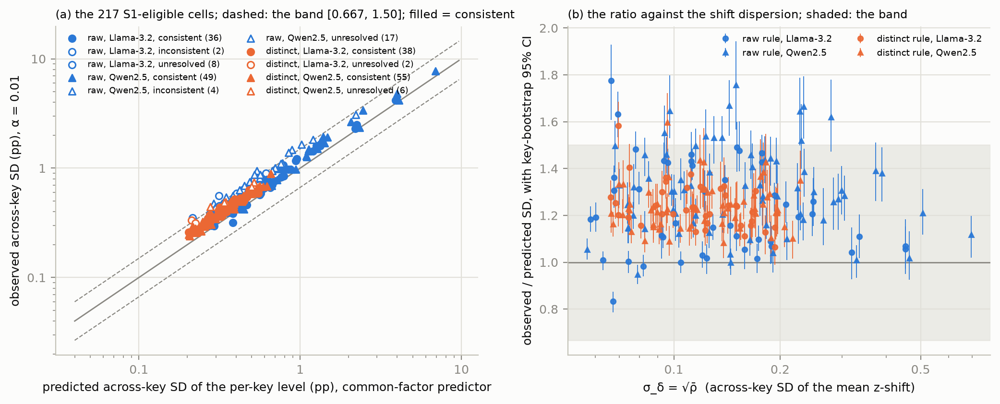
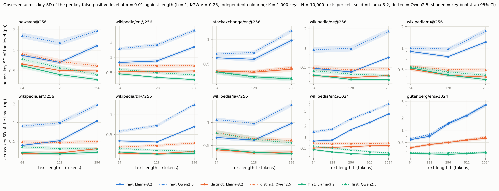
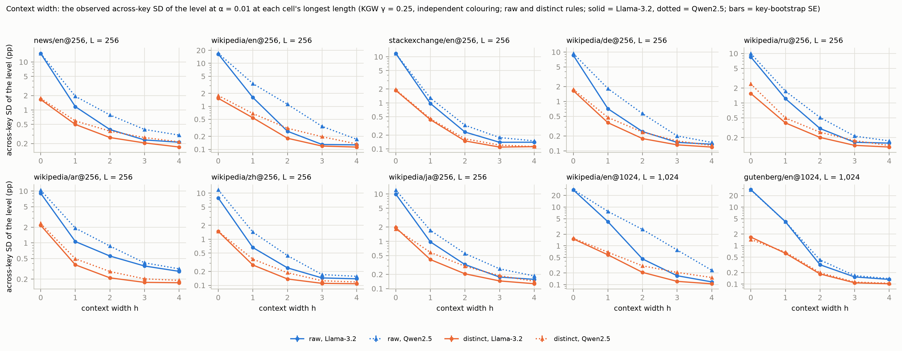
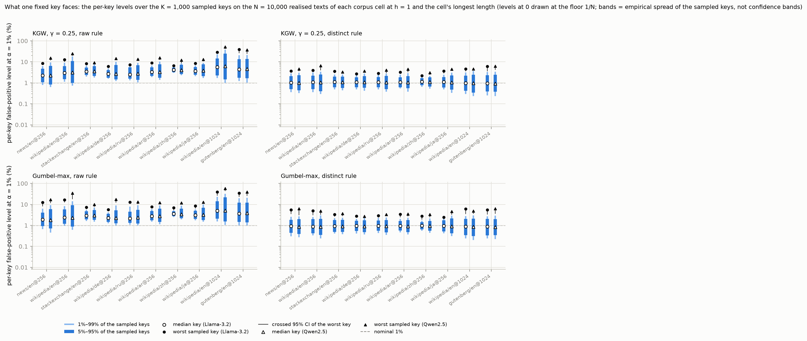
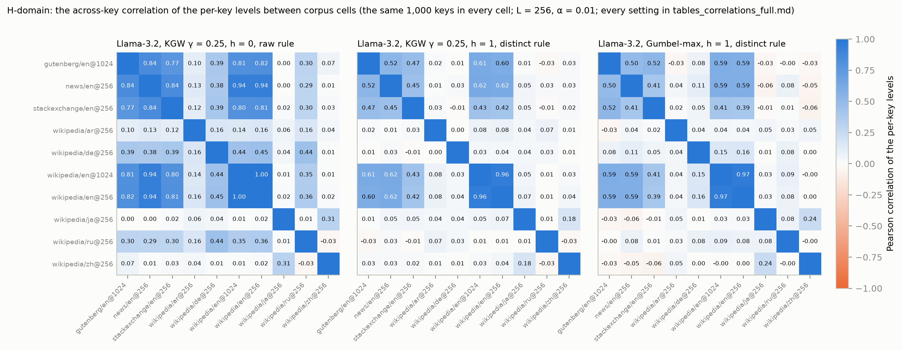
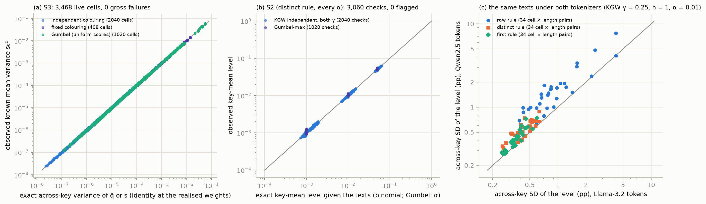

# Study 2 — report v0.1: the across-key dispersion of deployed-style detectors' false-positive rates on real null text

Date: 2026-10-13 (Milestone 4). Protocol: [`STUDY2_PROTOCOL_v0.1.md`](STUDY2_PROTOCOL_v0.1.md) (LOCKED 2026-10-12 before outcomes; R05 agreed at round 3). Lock: [`outputs/study2_v0.1/PRE_RUN_LOCK.json`](../outputs/study2_v0.1/PRE_RUN_LOCK.json) (SHA-256 434d8f3d8210d5ed…). Run manifest: [`outputs/study2_v0.1/RUN_MANIFEST.json`](../outputs/study2_v0.1/RUN_MANIFEST.json). Results: [`outputs/study2_v0.1/results.json`](../outputs/study2_v0.1/results.json) (SHA-256 069ee14def851765…; label STUDY). **This file is built by** `research/study2/s2_report.py`, **which re-computes the rules from the per-cell files with its own code, asserts equality with `results.json`, checks every prediction against the key-free inputs disclosed before the lock, and inserts every table, figure and number; no number is typed by hand.** Tables and figures: `outputs/study2_v0.1/report/` (`tables.md`; the supplements `tables_s1_diagnostics_full.md`, `tables_curves_full.md`, `tables_deployer_full.md`, `tables_correlations_full.md`, `tables_tokenizer_full.md`, `tables_fixed_h0_full.md`, `tables_population_full.md`, `tables_key_counts_full.md`, `tables_pairwise_full.md`; `checks.json`, `prose_values.json`, `fig1`–`fig6`). Sections 5–8 are the conductor's reading of the generated tables (inference, labelled); every number in them is a filled placeholder.

## 1. Run
- **Run:** 2026-10-13T13:45:36Z to 2026-10-13T18:36:36Z UTC, 4.85 h against the validation's fitted projection of 6.08 h and the probe-scaled 8.13 h (sum of the chain times 4.85 h; restarts 0; chains skipped on resume 0; peak resident memory 5.41 GB); launched at commit 74a52e0 with swap "total = 2048.00M  used = 1255.25M  free = 792.75M"; `PYTHONHASHSEED=0`; one process under `nohup caffeinate -i`, Apple M5, 16 GB. The runner verified the lock before the first cell and the analyzer verified it again before any decision; the manifest (written 2026-10-13T18:37:18Z) verified it a third time. The held-out corpus partition was not touched (`final: false`). Deviations in execution: the pre-run checklist's first item (a freshly restarted machine) was not met and Yichen chose to start after quitting the other applications (decision log, 2026-10-13); the run's outputs are deterministic and only its timing depends on the machine's state.
- **Inventory:** 3468 cells exactly as the grid expects (3468 live; every cell has N_eff = N); inventory digest f3b4a0ceb246c015…. 10 corpus cells × 2 tokenizers; K = 1,000 production keys (22,000–22,999); N = 10,000 texts per corpus cell, the same texts across widths, lengths (prefixes), rules, families, γ and both tokenizers.
- **Independent re-computation (the builder):** from the stored integer level counts of every live cell it recomputed the key-mean, across-key SD, quantiles, extrema and exceedance shares at every α (10404 level blocks), the two-sided KL bound of every S2 check, the known-mean estimator (from the 6-decimal values, largest relative difference 1.9e-04) and S3's decision for every cell, S1's eligibility, status and counts (primary and every secondary block), S4's and S5's chain decisions, the deployer subset from the grid, the between-cell, between-tokenizer and language-disparity statistics, and asserted that all equal `results.json` (all equal; `checks.json`). It also checked that the prediction compared with the outcome in every cell is the one disclosed before the lock: 9,180 (cell, α) predictions against `INPUTS.json`, largest difference 0.0e+00 (predicted SD, mean level, theory share), 0.0e+00 (the exact key-mean reference) and 0.0e+00 (ρ̄).
- **Process and disclosure:** conductor Claude (Fable 5.1, in Claude Code); independent reviewer Codex (rule A7 of the research-project-guide); Yichen Zhao decides every lock, run and judgement, reads every word and carries responsibility for the work. The pre-lock validation (protocol §11) used synthetic tokens and validation keys (1,000,000 and above), disjoint from the production keys; no per-key level on real text existed before the lock. During the run the report builder was written and exercised on a synthetic fixture inventory (planted numbers in the run's exact file layout, analysed by the locked analyzer, written outside the repository, every cell marked FIXTURE), to test the independent re-computation, the tables' and the figures' layout before any real number was read; the fixture figures were viewed; no fixture number appears in this report. The builder, the fixture generator and the manifest script are not pinned by the lock; the analyzer, the runner, the core, the data and key modules, the grid, the key-free inputs, the tokens manifest, the validation record and the protocol are. Checkpoint R06 status at this build: agreed (RESOLUTION.md present).

| Chain (the five longest) | \|D\| tuples | Contexts | Build (s) | Key loop (s) | Cells | Cell statistics (s) | Chain (s) measured | Chain (s) projected (fitted model) | Peak RSS so far (GB) |
|---|---|---|---|---|---|---|---|---|---|
| gutenberg_en_1024__llama__h4 | 9,799,419 | 8,830,404 | 4.1 | 623.4 | 45 | 116.8 | 745.9 | 622.2 | 5.41 |
| gutenberg_en_1024__qwen__h4 | 9,691,513 | 8,677,139 | 4.2 | 610.8 | 45 | 113.7 | 730.9 | 619.8 | 5.41 |
| gutenberg_en_1024__llama__h3 | 8,838,542 | 6,086,336 | 3.9 | 577.4 | 45 | 109.4 | 692.7 | 604.9 | 5.41 |
| wikipedia_en_1024__llama__h4 | 9,351,709 | 8,357,975 | 4.0 | 575.2 | 45 | 111.1 | 692.2 | 611.1 | 5.41 |
| gutenberg_en_1024__qwen__h3 | 8,685,216 | 5,969,208 | 4.0 | 572.4 | 45 | 108.8 | 687.1 | 601.2 | 5.41 |

Measured 4.85 h in all (chain times sum to 4.85 h) against the validation's fitted projection of 6.08 h and the probe-scaled 8.13 h (protocol §11); every chain's measured and projected time is in `RUN_MANIFEST.json`.

## 2. Pre-registered results (protocol §9)
### Table 1 — Pre-registered rules against the observed results

| Rule (protocol §9) | Pre-registered criterion | Observed | Verdict |
|---|---|---|---|
| S1 adequacy of the common-factor predictor on real text (primary; KGW, independent colouring, γ = 0.25, raw and distinct rules, h ∈ {1, 2, 3, 4}, every corpus cell, both tokenizers, every length, α = 0.01) | ≥ 30 resolved cells and ≥ 80% of the resolved cells consistent (key-bootstrap ratio interval inside [0.667, 1.50]); eligible when mean M ≥ 30, theory share ≥ 0.75, no σ² flag | candidates 544; eligible 217; resolved 184; consistent 178; inconsistent 6; unresolved 33; share consistent 96.7% | **PASS** |
| S2 the key-mean audit (distinct rule; KGW independent both γ and Gumbel; every α) | no check with a two-sided Hoeffding–KL bound below 1e-06 (per-check false audit ≤ 1e-06; union bound over the checks) | 3,060 checks (0 structural zeros counted separately; KGW 2,040, Gumbel 1,020); flagged 0 (KGW 0, Gumbel 0); smallest bound 1.00; union bound 3.06e-03; normal (ā − μ)/SE: SD 0.985, max \|·\| 3.50, share above 3 0.20% (diagnostic) | **PASS** |
| S3 the exact identities (every live cell; the known-mean variance estimator of q̂ or s̄ against the identity at the realised weights) | no gross failure: \|s₀² − σ²_exact\| ≤ 6·SE + τ; structural zeros ≤ τ | 3,468 checks (0 structural zeros; independent 2,040, fixed 408, Gumbel 1,020); gross failures 0; (s₀² − σ²)/SE: SD 0.944, max \|·\| 3.56; nominal-95% coverage 94.8% of 3468 (diagnostic) | **PASS** |
| S4 H-length on the observed dispersion (per chain: corpus cell × tokenizer × h; KGW independent γ = 0.25, raw rule, α = 0.01) | SD_K(α̂) non-decreasing in L within 2(se_L + se_L′) in every chain (the counts are the result) | 100 chains; holding 76; failing: news/en@256 Llama-3.2 h = 1; news/en@256 Llama-3.2 h = 2; news/en@256 Llama-3.2 h = 3; news/en@256 Llama-3.2 h = 4; news/en@256 Qwen2.5 h = 1; news/en@256 Qwen2.5 h = 4; wikipedia/en@256 Llama-3.2 h = 4; wikipedia/en@256 Qwen2.5 h = 4; stackexchange/en@256 Llama-3.2 h = 4; stackexchange/en@256 Qwen2.5 h = 4; wikipedia/de@256 Llama-3.2 h = 1; wikipedia/de@256 Llama-3.2 h = 4; wikipedia/de@256 Qwen2.5 h = 4; wikipedia/ru@256 Llama-3.2 h = 1; wikipedia/ru@256 Llama-3.2 h = 4; wikipedia/ru@256 Qwen2.5 h = 4; wikipedia/zh@256 Llama-3.2 h = 4; wikipedia/zh@256 Qwen2.5 h = 4; wikipedia/ja@256 Llama-3.2 h = 4; wikipedia/ja@256 Qwen2.5 h = 4; wikipedia/en@1024 Llama-3.2 h = 4; wikipedia/en@1024 Qwen2.5 h = 4; gutenberg/en@1024 Llama-3.2 h = 4; gutenberg/en@1024 Qwen2.5 h = 4 | **FAIL** |
| S5 H-width on the observed dispersion (per chain: corpus cell × tokenizer × rule ∈ {raw, distinct} at the longest length; KGW independent γ = 0.25, α = 0.01) | SD_K(α̂) non-increasing in h within 2(se_h + se_h+1) in every chain (the counts are the result) | 40 chains; holding 40; failing: none | **PASS** |

**In words (evidence; every number is filled from the locked outputs):**
- **S1, adequacy of the common-factor predictor on real text at h ≥ 1:** PASS. Of 544 candidate cells (KGW, independent colouring, γ = 0.25, raw and distinct rules, h ∈ {1, 2, 3, 4}, every corpus cell, both tokenizers, every length, α = 0.01), 217 were eligible (mean M ≥ 30, theory share ≥ 0.75, no σ² flag), 184 were resolved by their key-bootstrap interval and 178 of those were consistent (the interval inside [2/3, 3/2]); 6 inconsistent, 33 unresolved; share consistent 96.7% against the pre-registered 80% with at least 30 resolved. Over the resolved cells the observed-to-predicted ratio ranged from 0.833 to 1.78 (median 1.21); over all eligible cells its 10th and 90th percentiles were 1.09 and 1.46. By width: h = 1, 112 consistent of 136 eligible (of 136 candidates); h = 2, 50 of 60 (136); h = 3, 14 of 15 (136); h = 4, 2 of 6 (136). By rule: raw 85 consistent, 6 inconsistent, 25 unresolved of 116 eligible; distinct 93, 0, 8 of 101. By tokenizer: Llama-3.2 74 of 86; Qwen2.5 104 of 131.
- **S2, the key-mean audit:** PASS. 3,060 checks (distinct rule; KGW independent at both γ, 2,040 checks; Gumbel-max, 1,020; every α; 0 structural zeros counted separately): 0 flagged (KGW 0, Gumbel 0); the smallest two-sided KL bound was 1.00 against the 10⁻⁶ threshold (union bound over the checks 3.06e-03). The normal diagnostic (ā − μ)/SE over the 3060 checks with a positive SE had SD 0.985, largest absolute value 3.50 and a share above 3 of 0.20%; its largest value sits on wikipedia/en@256, Llama-3.2, kgw γ = 0.5, h = 2, L = 128, α = 0.001 (key-mean 0.097% against the exact 0.094%; bound 1.00); 0 checks had a zero SE (every key at the same level; §5).
- **S3, the exact identities:** PASS. 3,468 checks (0 structural zeros; independent colouring 2,040, fixed 408, Gumbel 1,020): 0 gross failures (independent 0, fixed 0, Gumbel 0); (s₀² − σ²)/SE had SD 0.944 and largest absolute value 3.56; the nominal-95% key-bootstrap intervals covered the exact value in 94.8% of 3468 cells (a diagnostic, expected about 95%); 0 cells recorded a constant squared estimator over the keys (recorded, never used). The fixed-size reduction at h = 0 on real text at V ≥ 128k (Table 12): under the raw rule the largest reduction over 68 cells is 0.346% (0 at or above 1%), under the distinct rule 2.101% (7 of 68) and under the first rule 0.139% (0 of 68).
- **S4, H-length on the observed dispersion under the raw rule:** FAIL. 100 chains (corpus cell × tokenizer × h; KGW γ = 0.25, raw rule, α = 0.01); the observed SD non-decreasing in L within the tolerance in 76 of them (failing: news/en@256 Llama-3.2 h = 1; news/en@256 Llama-3.2 h = 2; news/en@256 Llama-3.2 h = 3; news/en@256 Llama-3.2 h = 4; news/en@256 Qwen2.5 h = 1; news/en@256 Qwen2.5 h = 4; wikipedia/en@256 Llama-3.2 h = 4; wikipedia/en@256 Qwen2.5 h = 4; stackexchange/en@256 Llama-3.2 h = 4; stackexchange/en@256 Qwen2.5 h = 4; wikipedia/de@256 Llama-3.2 h = 1; wikipedia/de@256 Llama-3.2 h = 4; wikipedia/de@256 Qwen2.5 h = 4; wikipedia/ru@256 Llama-3.2 h = 1; wikipedia/ru@256 Llama-3.2 h = 4; wikipedia/ru@256 Qwen2.5 h = 4; wikipedia/zh@256 Llama-3.2 h = 4; wikipedia/zh@256 Qwen2.5 h = 4; wikipedia/ja@256 Llama-3.2 h = 4; wikipedia/ja@256 Qwen2.5 h = 4; wikipedia/en@1024 Llama-3.2 h = 4; wikipedia/en@1024 Qwen2.5 h = 4; gutenberg/en@1024 Llama-3.2 h = 4; gutenberg/en@1024 Qwen2.5 h = 4; Table 7). Descriptively, under the distinct rule 71 of 100 chains were non-decreasing within the same tolerance, under the first rule 67 of 100, at γ = 0.5 91 of 100 (raw) and 89 of 100 (distinct), and for Gumbel-max 96 of 100 (raw), 92 of 100 (distinct) and 90 of 100 (first) (Table 8; no rule is stated for these).
- **S5, H-width on the observed dispersion at the longest length:** PASS. 40 chains (corpus cell × tokenizer × rule ∈ {raw, distinct}; KGW γ = 0.25, α = 0.01); the observed SD non-increasing in h within the tolerance in 40 of them (failing: none; Table 9). Descriptively, under the first rule 0 of 20, at γ = 0.5 20 of 20 (raw) and 20 of 20 (distinct), and for Gumbel-max 20 of 20 (raw), 20 of 20 (distinct) and 20 of 20 (first) (Table 10).

### Table 2 — S1 by corpus cell and rule (primary block)

| Corpus cell | Rule | Candidates | Eligible | Resolved | Consistent | Inconsistent | Unresolved | Ratio range (resolved) | Median ratio | Widths with eligible cells |
|---|---|---|---|---|---|---|---|---|---|---|
| news/en@256 | raw | 24 | 20 | 16 | 14 | 2 | 4 | 0.999–1.65 | 1.26 | 1, 2, 3, 4 |
| news/en@256 | distinct | 24 | 20 | 18 | 18 | 0 | 2 | 1.08–1.35 | 1.20 | 1, 2, 3, 4 |
| wikipedia/en@256 | raw | 24 | 10 | 7 | 6 | 1 | 3 | 1.07–1.66 | 1.27 | 1, 2, 3 |
| wikipedia/en@256 | distinct | 24 | 9 | 8 | 8 | 0 | 1 | 1.16–1.32 | 1.23 | 1, 2 |
| stackexchange/en@256 | raw | 24 | 6 | 6 | 6 | 0 | 0 | 1.02–1.41 | 1.13 | 1 |
| stackexchange/en@256 | distinct | 24 | 6 | 6 | 6 | 0 | 0 | 1.17–1.32 | 1.22 | 1 |
| wikipedia/de@256 | raw | 24 | 9 | 7 | 6 | 1 | 2 | 0.999–1.76 | 1.33 | 1, 2 |
| wikipedia/de@256 | distinct | 24 | 8 | 7 | 7 | 0 | 1 | 1.13–1.35 | 1.21 | 1, 2 |
| wikipedia/ru@256 | raw | 24 | 10 | 8 | 8 | 0 | 2 | 1.10–1.36 | 1.21 | 1, 2 |
| wikipedia/ru@256 | distinct | 24 | 9 | 9 | 9 | 0 | 0 | 1.13–1.29 | 1.20 | 1, 2 |
| wikipedia/ar@256 | raw | 24 | 11 | 7 | 5 | 2 | 4 | 1.17–1.78 | 1.35 | 1, 2, 3 |
| wikipedia/ar@256 | distinct | 24 | 9 | 7 | 7 | 0 | 2 | 1.22–1.33 | 1.25 | 1, 2 |
| wikipedia/zh@256 | raw | 24 | 7 | 6 | 6 | 0 | 1 | 1.00–1.36 | 1.20 | 1, 2 |
| wikipedia/zh@256 | distinct | 24 | 6 | 6 | 6 | 0 | 0 | 1.16–1.30 | 1.21 | 1 |
| wikipedia/ja@256 | raw | 24 | 10 | 8 | 8 | 0 | 2 | 1.03–1.30 | 1.18 | 1, 2 |
| wikipedia/ja@256 | distinct | 24 | 9 | 8 | 8 | 0 | 1 | 1.16–1.38 | 1.22 | 1, 2 |
| wikipedia/en@1024 | raw | 40 | 20 | 15 | 15 | 0 | 5 | 0.983–1.32 | 1.20 | 1, 2, 3 |
| wikipedia/en@1024 | distinct | 40 | 15 | 14 | 14 | 0 | 1 | 1.06–1.31 | 1.16 | 1, 2 |
| gutenberg/en@1024 | raw | 40 | 13 | 11 | 11 | 0 | 2 | 0.833–1.19 | 1.05 | 1, 2 |
| gutenberg/en@1024 | distinct | 40 | 10 | 10 | 10 | 0 | 0 | 1.15–1.36 | 1.25 | 1 |

Both tokenizers pooled; candidates = every length of the cell's chain × h ∈ {1, 2, 3, 4}.

### Table 3 — S1 by width, by tokenizer and rule, and where the eligible cells lie (width by length)

| Width | Candidates | Eligible | Resolved | Consistent | Inconsistent | Unresolved | Ratio range (resolved) | Median ratio |
|---|---|---|---|---|---|---|---|---|
| h = 1 | 136 | 136 | 115 | 112 | 3 | 21 | 0.999–1.76 | 1.21 |
| h = 2 | 136 | 60 | 51 | 50 | 1 | 9 | 0.833–1.78 | 1.23 |
| h = 3 | 136 | 15 | 14 | 14 | 0 | 1 | 0.999–1.31 | 1.15 |
| h = 4 | 136 | 6 | 4 | 2 | 2 | 2 | 1.15–1.65 | 1.42 |

Both rules, both tokenizers, every corpus cell and length pooled.

| Tokenizer | Rule | Candidates | Eligible | Resolved | Consistent | Inconsistent | Unresolved | Ratio range (resolved) | Median ratio |
|---|---|---|---|---|---|---|---|---|---|
| Llama-3.2 | raw | 136 | 46 | 38 | 36 | 2 | 8 | 0.833–1.78 | 1.13 |
| Llama-3.2 | distinct | 136 | 40 | 38 | 38 | 0 | 2 | 1.06–1.38 | 1.23 |
| Qwen2.5 | raw | 136 | 70 | 53 | 49 | 4 | 17 | 0.947–1.76 | 1.24 |
| Qwen2.5 | distinct | 136 | 61 | 55 | 55 | 0 | 6 | 1.08–1.36 | 1.22 |

| Width | L = 64 | L = 128 | L = 256 | L = 512 | L = 1,024 |
|---|---|---|---|---|---|
| h = 1 | 18 / 21 / 40 of 40 | 40 / 40 / 40 of 40 | 38 / 38 / 40 of 40 | 8 / 8 / 8 of 8 | 8 / 8 / 8 of 8 |
| h = 2 | 16 / 16 / 16 of 40 | 9 / 9 / 15 of 40 | 16 / 17 / 20 of 40 | 4 / 4 / 4 of 8 | 5 / 5 / 5 of 8 |
| h = 3 | 4 / 4 / 4 of 40 | 4 / 4 / 4 of 40 | 4 / 4 / 5 of 40 | 1 / 1 / 1 of 8 | 1 / 1 / 1 of 8 |
| h = 4 | 0 / 2 / 4 of 40 | 2 / 2 / 2 of 40 | 0 / 0 / 0 of 40 | 0 / 0 / 0 of 8 | 0 / 0 / 0 of 8 |

Each entry: consistent / resolved / eligible of the candidate cells (both rules, both tokenizers, every corpus cell whose chain has that length; the @256 cells stop at L = 256). An eligible cell needs mean M ≥ 30 and a theory share ≥ 0.75.

### Table 4 — S1: the inconsistent and unresolved cells with the protocol's diagnostics (39 rows; every non-consistent occurrence of the primary block, the analyzer's eight secondary blocks and the builder's unit-σ block, 548 rows of which 101 are the unit-σ block's, is in [the diagnostic supplement](../outputs/study2_v0.1/report/tables_s1_diagnostics_full.md); the α column gives each block's level; the key-count resolution of every live cell at every α is in `tables_key_counts_full.md`)

| Block | Corpus cell | Tokenizer | Family | Rule | h | L | Colouring | γ | α | Status | Ratio [95% CI] | SD obs (pp) | SD pred (pp) | σ_δ = √ρ̄ | Mean M | Theory share | σ² predictor / identities / observed | Key-mean level obs / pred / exact-binomial (%) | Pairwise ratio, subsample 1 / 2 | Pairwise subsampling difference (pp) | Pair-cov CV | Pair-corr q50 / q90 / q99 / max | Simulated-shift ratio | Unit-σ ratio | Keys at 0 / at 1 / distinct levels / keys > 5α |
|---|---|---|---|---|---|---|---|---|---|---|---|---|---|---|---|---|---|---|---|---|---|---|---|---|---|
| primary | news/en@256 | Llama-3.2 | kgw | raw | 4 | 64 | independent | 0.25 | 0.01 | inconsistent | 1.63 [1.53, 1.73] | 0.352 | 0.216 | 0.069 | 60 | 0.780 | 1.01 / 1.01 / 1.01 | 1.60 / 1.03 / 1.54 | 1.46 / 1.44 | 3.27e-03 | 4.59 | 0 / 0 / 0.133 / 0.400 | 1.63 | 1.65 | 0 / 0 / 159 / 0 |
| primary | news/en@256 | Qwen2.5 | kgw | raw | 4 | 64 | independent | 0.25 | 0.01 | inconsistent | 1.65 [1.53, 1.80] | 0.478 | 0.290 | 0.097 | 60 | 0.877 | 1.01 / 1.01 / 1.01 | 1.60 / 1.05 / 1.54 | 1.42 / 1.49 | 0.017 | 2.72 | 0 / 0.033 / 0.150 / 0.450 | 1.63 | 1.67 | 0 / 0 / 203 / 0 |
| primary | wikipedia/ar@256 | Llama-3.2 | kgw | raw | 2 | 256 | independent | 0.25 | 0.01 | inconsistent | 1.78 [1.61, 1.93] | 0.558 | 0.314 | 0.067 | 254 | 0.805 | 1.27 / 1.27 / 1.27 | 2.26 / 1.96 / 1.15 | 1.26 / 1.43 | 0.054 | 11.7 | 0 / 5.29e-03 / 0.026 / 0.854 | 1.76 | 2.71 | 0 / 0 / 213 / 3 |
| primary | wikipedia/ar@256 | Qwen2.5 | kgw | raw | 1 | 64 | independent | 0.25 | 0.01 | inconsistent | 1.67 [1.54, 1.78] | 0.870 | 0.522 | 0.144 | 63 | 0.947 | 1.12 / 1.12 / 1.12 | 2.14 / 1.45 / 1.47 | 1.65 / 1.52 | 0.044 | 2.20 | 0 / 0.055 / 0.154 / 0.819 | 1.59 | 2.05 | 0 / 0 / 281 / 15 |
| primary | wikipedia/de@256 | Qwen2.5 | kgw | raw | 1 | 64 | independent | 0.25 | 0.01 | inconsistent | 1.76 [1.57, 1.94] | 0.945 | 0.538 | 0.150 | 63 | 0.951 | 1.11 / 1.11 / 1.11 | 2.11 / 1.43 / 1.47 | 1.57 / 1.45 | 0.051 | 2.12 | 0 / 0.059 / 0.208 / 0.667 | 1.65 | 2.13 | 0 / 0 / 300 / 19 |
| primary | wikipedia/en@256 | Qwen2.5 | kgw | raw | 1 | 64 | independent | 0.25 | 0.01 | inconsistent | 1.66 [1.53, 1.79] | 1.48 | 0.889 | 0.233 | 63 | 0.981 | 1.10 / 1.10 / 1.10 | 2.25 / 1.52 / 1.47 | 1.41 / 1.39 | 0.013 | 1.28 | 0.029 / 0.123 / 0.262 / 0.568 | 1.55 | 1.97 | 0 / 0 / 365 / 57 |
| primary | gutenberg/en@1024 | Llama-3.2 | kgw | raw | 1 | 64 | independent | 0.25 | 0.01 | unresolved | 1.46 [1.37, 1.56] | 0.588 | 0.403 | 0.112 | 63 | 0.914 | 1.11 / 1.11 / 1.11 | 2.02 / 1.41 / 1.47 | 1.49 / 1.48 | 3.17e-03 | 1.91 | 0 / 0.031 / 0.083 / 0.356 | 1.42 | 1.79 | 0 / 0 / 238 / 2 |
| primary | gutenberg/en@1024 | Qwen2.5 | kgw | raw | 1 | 64 | independent | 0.25 | 0.01 | unresolved | 1.50 [1.42, 1.57] | 0.632 | 0.422 | 0.115 | 63 | 0.920 | 1.12 / 1.12 / 1.12 | 2.06 / 1.45 / 1.47 | 1.42 / 1.53 | 0.032 | 1.87 | 0 / 0.041 / 0.093 / 0.347 | 1.45 | 1.87 | 0 / 0 / 257 / 2 |
| primary | news/en@256 | Llama-3.2 | kgw | distinct | 4 | 64 | independent | 0.25 | 0.01 | unresolved | 1.58 [1.49, 1.68] | 0.335 | 0.211 | 0.070 | 60 | 0.779 | 0.995 / 0.995 / 0.996 | 1.50 / 1.00 / 1.49 | 1.46 / 1.42 | 7.12e-03 | 4.81 | 0 / 0 / 0.133 / 0.533 | 1.56 | 1.57 | 0 / 0 / 158 / 0 |
| primary | news/en@256 | Llama-3.2 | kgw | raw | 1 | 64 | independent | 0.25 | 0.01 | unresolved | 1.43 [1.34, 1.52] | 0.843 | 0.591 | 0.177 | 63 | 0.964 | 1.05 / 1.05 / 1.05 | 1.81 / 1.27 / 1.47 | 1.29 / 1.26 | 0.012 | 1.46 | 0.015 / 0.072 / 0.214 / 0.899 | 1.37 | 1.57 | 0 / 0 / 304 / 4 |
| primary | news/en@256 | Llama-3.2 | kgw | raw | 2 | 128 | independent | 0.25 | 0.01 | unresolved | 1.43 [1.35, 1.51] | 0.452 | 0.316 | 0.094 | 126 | 0.876 | 1.07 / 1.07 / 1.07 | 1.74 / 1.25 / 1.38 | 1.34 / 1.38 | 0.011 | 2.29 | 0 / 0.022 / 0.087 / 0.605 | 1.41 | 1.63 | 0 / 0 / 197 / 0 |
| primary | news/en@256 | Qwen2.5 | kgw | distinct | 4 | 64 | independent | 0.25 | 0.01 | unresolved | 1.60 [1.47, 1.72] | 0.443 | 0.277 | 0.096 | 60 | 0.871 | 0.991 / 0.991 / 0.992 | 1.48 / 1.00 / 1.49 | 1.46 / 1.48 | 3.54e-03 | 3.21 | 0 / 0.018 / 0.151 / 0.500 | 1.59 | 1.57 | 0 / 0 / 191 / 0 |
| primary | news/en@256 | Qwen2.5 | kgw | raw | 1 | 64 | independent | 0.25 | 0.01 | unresolved | 1.62 [1.47, 1.78] | 1.65 | 1.02 | 0.279 | 63 | 0.987 | 1.04 / 1.04 / 1.03 | 1.98 / 1.38 / 1.47 | 1.43 / 1.46 | 0.021 | 1.08 | 0.051 / 0.154 / 0.318 / 0.696 | 1.46 | 1.72 | 0 / 0 / 378 / 62 |
| primary | news/en@256 | Qwen2.5 | kgw | raw | 2 | 128 | independent | 0.25 | 0.01 | unresolved | 1.46 [1.36, 1.56] | 0.816 | 0.560 | 0.165 | 126 | 0.959 | 1.07 / 1.07 / 1.06 | 1.77 / 1.31 / 1.38 | 1.35 / 1.46 | 0.046 | 1.24 | 0.016 / 0.055 / 0.135 / 0.566 | 1.35 | 1.65 | 0 / 0 / 281 / 8 |
| primary | wikipedia/ar@256 | Llama-3.2 | kgw | distinct | 1 | 64 | independent | 0.25 | 0.01 | unresolved | 1.41 [1.32, 1.50] | 0.316 | 0.225 | 0.075 | 60 | 0.804 | 0.994 / 0.994 / 0.995 | 1.29 / 1.00 / 1.28 | 1.40 / 1.29 | 0.019 | 2.90 | 0 / 0.017 / 0.053 / 0.633 | 1.41 | 1.39 | 0 / 0 / 151 / 0 |
| primary | wikipedia/ar@256 | Llama-3.2 | kgw | raw | 1 | 64 | independent | 0.25 | 0.01 | unresolved | 1.48 [1.40, 1.56] | 0.426 | 0.287 | 0.078 | 63 | 0.835 | 1.11 / 1.11 / 1.11 | 2.02 / 1.39 / 1.47 | 1.41 / 1.25 | 0.038 | 3.43 | 0 / 0.015 / 0.063 / 0.772 | 1.47 | 1.82 | 0 / 0 / 186 / 0 |
| primary | wikipedia/ar@256 | Qwen2.5 | kgw | distinct | 1 | 64 | independent | 0.25 | 0.01 | unresolved | 1.43 [1.33, 1.54] | 0.484 | 0.338 | 0.119 | 59 | 0.913 | 0.986 / 0.986 / 0.987 | 1.29 / 1.00 / 1.28 | 1.22 / 1.16 | 0.020 | 1.92 | 0 / 0.050 / 0.117 / 0.770 | 1.40 | 1.39 | 0 / 0 / 198 / 0 |
| primary | wikipedia/ar@256 | Qwen2.5 | kgw | raw | 2 | 128 | independent | 0.25 | 0.01 | unresolved | 1.55 [1.44, 1.67] | 0.540 | 0.348 | 0.094 | 126 | 0.882 | 1.12 / 1.12 / 1.12 | 1.97 / 1.44 / 1.38 | 1.37 / 1.26 | 0.035 | 2.96 | 0 / 0.023 / 0.080 / 0.678 | 1.52 | 1.95 | 0 / 0 / 211 / 1 |
| primary | wikipedia/ar@256 | Qwen2.5 | kgw | raw | 2 | 256 | independent | 0.25 | 0.01 | unresolved | 1.54 [1.42, 1.65] | 0.869 | 0.566 | 0.123 | 254 | 0.936 | 1.29 / 1.29 / 1.29 | 2.44 / 2.08 / 1.15 | 1.21 / 1.19 | 0.015 | 3.19 | 0 / 0.034 / 0.122 / 0.801 | 1.50 | 2.41 | 0 / 0 / 299 / 16 |
| primary | wikipedia/ar@256 | Qwen2.5 | kgw | raw | 3 | 256 | independent | 0.25 | 0.01 | unresolved | 1.50 [1.39, 1.60] | 0.413 | 0.276 | 0.068 | 253 | 0.800 | 1.16 / 1.16 / 1.16 | 1.65 / 1.54 / 1.04 | 1.28 / 1.14 | 0.039 | 6.83 | 0 / 7.12e-03 / 0.043 / 0.744 | 1.48 | 1.96 | 0 / 0 / 181 / 0 |
| primary | wikipedia/de@256 | Qwen2.5 | kgw | distinct | 1 | 64 | independent | 0.25 | 0.01 | unresolved | 1.43 [1.30, 1.57] | 0.492 | 0.345 | 0.121 | 60 | 0.917 | 0.985 / 0.985 / 0.985 | 1.29 / 1.00 / 1.27 | 1.38 / 1.33 | 0.013 | 1.91 | 0 / 0.035 / 0.134 / 0.353 | 1.38 | 1.38 | 0 / 0 / 200 / 1 |
| primary | wikipedia/de@256 | Qwen2.5 | kgw | raw | 1 | 256 | independent | 0.25 | 0.01 | unresolved | 1.52 [1.40, 1.68] | 1.82 | 1.20 | 0.230 | 255 | 0.983 | 1.37 / 1.37 / 1.37 | 3.25 / 2.56 / 1.28 | 1.54 / 1.42 | 0.098 | 1.48 | 0.017 / 0.080 / 0.201 / 0.679 | 1.42 | 2.48 | 0 / 0 / 429 / 130 |
| primary | wikipedia/de@256 | Qwen2.5 | kgw | raw | 2 | 128 | independent | 0.25 | 0.01 | unresolved | 1.46 [1.37, 1.53] | 0.434 | 0.297 | 0.083 | 126 | 0.850 | 1.10 / 1.10 / 1.10 | 1.86 / 1.35 / 1.38 | 1.43 / 1.32 | 0.026 | 2.85 | 0 / 0.019 / 0.081 / 0.359 | 1.43 | 1.75 | 0 / 0 / 190 / 0 |
| primary | wikipedia/en@1024 | Llama-3.2 | kgw | raw | 1 | 64 | independent | 0.25 | 0.01 | unresolved | 1.49 [1.39, 1.60] | 0.778 | 0.521 | 0.151 | 63 | 0.951 | 1.08 / 1.08 / 1.09 | 1.98 / 1.35 / 1.47 | 1.38 / 1.51 | 0.047 | 1.23 | 0.015 / 0.056 / 0.116 / 0.813 | 1.44 | 1.74 | 0 / 0 / 287 / 6 |
| primary | wikipedia/en@1024 | Qwen2.5 | kgw | distinct | 1 | 64 | independent | 0.25 | 0.01 | unresolved | 1.37 [1.24, 1.53] | 0.681 | 0.498 | 0.176 | 59 | 0.960 | 0.969 / 0.969 / 0.970 | 1.30 / 1.00 / 1.27 | 1.34 / 1.29 | 0.021 | 0.934 | 0.018 / 0.068 / 0.116 / 0.473 | 1.31 | 1.28 | 0 / 0 / 249 / 1 |
| primary | wikipedia/en@1024 | Qwen2.5 | kgw | raw | 1 | 64 | independent | 0.25 | 0.01 | unresolved | 1.64 [1.50, 1.79] | 1.40 | 0.848 | 0.227 | 63 | 0.980 | 1.09 / 1.09 / 1.09 | 2.19 / 1.48 / 1.47 | 1.48 / 1.56 | 0.049 | 1.26 | 0.029 / 0.112 / 0.235 / 0.781 | 1.54 | 1.92 | 0 / 0 / 372 / 50 |
| primary | wikipedia/en@1024 | Qwen2.5 | kgw | raw | 1 | 256 | independent | 0.25 | 0.01 | unresolved | 1.39 [1.26, 1.51] | 3.08 | 2.21 | 0.373 | 255 | 0.994 | 1.38 / 1.38 / 1.38 | 3.72 / 2.97 / 1.28 | 1.47 / 1.35 | 0.181 | 0.795 | 0.069 / 0.159 / 0.270 / 0.482 | 1.30 | 2.06 | 0 / 0 / 542 / 226 |
| primary | wikipedia/en@1024 | Qwen2.5 | kgw | raw | 2 | 128 | independent | 0.25 | 0.01 | unresolved | 1.53 [1.42, 1.62] | 0.692 | 0.451 | 0.130 | 126 | 0.934 | 1.09 / 1.09 / 1.09 | 1.88 / 1.36 / 1.38 | 1.36 / 1.26 | 0.038 | 2.00 | 0 / 0.044 / 0.123 / 0.490 | 1.46 | 1.82 | 0 / 0 / 265 / 1 |
| primary | wikipedia/en@1024 | Qwen2.5 | kgw | raw | 2 | 256 | independent | 0.25 | 0.01 | unresolved | 1.41 [1.28, 1.51] | 0.946 | 0.672 | 0.167 | 254 | 0.963 | 1.18 / 1.18 / 1.18 | 2.04 / 1.71 / 1.15 | 1.17 / 1.08 | 0.064 | 1.70 | 9.48e-03 / 0.068 / 0.164 / 0.576 | 1.31 | 1.89 | 0 / 0 / 305 / 12 |
| primary | wikipedia/en@256 | Llama-3.2 | kgw | raw | 1 | 64 | independent | 0.25 | 0.01 | unresolved | 1.48 [1.39, 1.60] | 0.793 | 0.537 | 0.153 | 63 | 0.953 | 1.09 / 1.09 / 1.09 | 2.01 / 1.38 / 1.47 | 1.39 / 1.40 | 4.62e-03 | 1.19 | 0.015 / 0.056 / 0.113 / 0.384 | 1.43 | 1.75 | 0 / 0 / 298 / 7 |
| primary | wikipedia/en@256 | Qwen2.5 | kgw | distinct | 1 | 64 | independent | 0.25 | 0.01 | unresolved | 1.38 [1.26, 1.51] | 0.705 | 0.510 | 0.180 | 59 | 0.962 | 0.968 / 0.968 / 0.969 | 1.31 / 1.00 / 1.27 | 1.34 / 1.36 | 7.52e-03 | 0.916 | 0.032 / 0.069 / 0.126 / 0.459 | 1.32 | 1.30 | 0 / 0 / 248 / 1 |
| primary | wikipedia/en@256 | Qwen2.5 | kgw | raw | 2 | 128 | independent | 0.25 | 0.01 | unresolved | 1.53 [1.43, 1.62] | 0.747 | 0.487 | 0.137 | 126 | 0.942 | 1.10 / 1.10 / 1.11 | 1.95 / 1.41 / 1.38 | 1.35 / 1.42 | 0.029 | 1.82 | 5.99e-03 / 0.050 / 0.138 / 0.340 | 1.44 | 1.85 | 0 / 0 / 272 / 4 |
| primary | wikipedia/en@256 | Qwen2.5 | kgw | raw | 2 | 256 | independent | 0.25 | 0.01 | unresolved | 1.44 [1.34, 1.54] | 1.12 | 0.777 | 0.181 | 254 | 0.969 | 1.22 / 1.22 / 1.22 | 2.25 / 1.88 / 1.15 | 1.19 / 1.35 | 0.109 | 1.55 | 0.012 / 0.077 / 0.186 / 0.488 | 1.33 | 2.03 | 0 / 0 / 335 / 30 |
| primary | wikipedia/ja@256 | Llama-3.2 | kgw | raw | 1 | 64 | independent | 0.25 | 0.01 | unresolved | 1.43 [1.35, 1.51] | 0.636 | 0.444 | 0.112 | 63 | 0.918 | 1.17 / 1.17 / 1.17 | 2.36 / 1.64 / 1.47 | 1.39 / 1.43 | 0.015 | 2.33 | 0 / 0.029 / 0.109 / 0.702 | 1.41 | 1.94 | 0 / 0 / 260 / 3 |
| primary | wikipedia/ja@256 | Qwen2.5 | kgw | distinct | 1 | 64 | independent | 0.25 | 0.01 | unresolved | 1.43 [1.30, 1.55] | 0.739 | 0.518 | 0.182 | 58 | 0.963 | 0.967 / 0.967 / 0.967 | 1.31 / 1.00 / 1.28 | 1.40 / 1.40 | 6.06e-04 | 1.12 | 0.033 / 0.055 / 0.175 / 0.633 | 1.33 | 1.34 | 0 / 0 / 256 / 3 |
| primary | wikipedia/ja@256 | Qwen2.5 | kgw | raw | 1 | 64 | independent | 0.25 | 0.01 | unresolved | 1.44 [1.33, 1.54] | 1.10 | 0.759 | 0.188 | 63 | 0.971 | 1.17 / 1.17 / 1.17 | 2.49 / 1.71 / 1.47 | 1.35 / 1.37 | 0.012 | 1.32 | 0.026 / 0.059 / 0.207 / 0.714 | 1.34 | 1.91 | 0 / 0 / 348 / 34 |
| primary | wikipedia/ru@256 | Llama-3.2 | kgw | raw | 1 | 64 | independent | 0.25 | 0.01 | unresolved | 1.47 [1.39, 1.54] | 0.901 | 0.614 | 0.177 | 63 | 0.965 | 1.07 / 1.07 / 1.07 | 1.98 / 1.35 / 1.47 | 1.44 / 1.39 | 0.026 | 1.04 | 0.026 / 0.059 / 0.120 / 0.654 | 1.32 | 1.68 | 0 / 0 / 295 / 4 |
| primary | wikipedia/ru@256 | Qwen2.5 | kgw | raw | 1 | 64 | independent | 0.25 | 0.01 | unresolved | 1.43 [1.33, 1.53] | 1.00 | 0.701 | 0.195 | 63 | 0.972 | 1.09 / 1.09 / 1.09 | 2.01 / 1.42 / 1.47 | 1.41 / 1.34 | 0.037 | 1.10 | 0.028 / 0.074 / 0.167 / 0.652 | 1.30 | 1.67 | 0 / 0 / 324 / 17 |
| primary | wikipedia/zh@256 | Qwen2.5 | kgw | raw | 1 | 64 | independent | 0.25 | 0.01 | unresolved | 1.46 [1.38, 1.53] | 0.560 | 0.384 | 0.095 | 63 | 0.890 | 1.18 / 1.18 / 1.18 | 2.39 / 1.65 / 1.47 | 1.41 / 1.42 | 2.49e-03 | 2.52 | 0 / 0.027 / 0.083 / 0.535 | 1.45 | 2.00 | 0 / 0 / 238 / 0 |

**What the diagnostics say (descriptive; the pairwise predictor, its replicate and the heterogeneity diagnostics of every live cell and α are in `tables_pairwise_full.md`, 10,404 rows over 3,468 cells):** on the 217 eligible primary cells the pairwise Gaussian predictor (the exact covariance structure on two 300-text subsamples, no common-factor assumption) gave ratios with median 1.20 against the common-factor predictor's eligible-set median 1.23 (10th–90th percentiles 1.05–1.39; 214 of 217 point ratios inside the band, against 202 for the common-factor predictor; the pairwise point ratio closer to 1 in 172 cells); the simulated-shift predictor (the discrete heavy-tuple shift law, protocol §3) gave a median ratio of 1.19 over 217 eligible cells and was closer to 1 than the Gaussian-shift form in 206; on the 184 resolved cells the three medians are 1.21 (common-factor), 1.17 (pairwise) and 1.18 (simulated shift); the coefficient of variation of the pairwise covariances had median 1.49 and maximum 11.7. At h = 0 (the regime Study 1 left unresolved; the secondary block): under the raw rule 68 eligible cells, 68 consistent, 0 inconsistent, 0 unresolved, point ratios 0.982–1.18 (median 1.05) against simulated-shift ratios 0.860–1.07 (closer to 1 in 37); under the distinct rule 68 eligible, 48 consistent, 0 inconsistent, 20 unresolved, ratios 1.01–1.46 (median 1.25) against 0.962–1.33 (closer to 1 in 67).

### Table 5 — Secondary adequacy blocks (the same statistic; descriptive; the unit-σ block is the builder's, §5)

| Block (descriptive; the same statistic) | Candidates | Eligible | Resolved | Consistent | Inconsistent | Unresolved | Share consistent | Median ratio | Ratio range (resolved) |
|---|---|---|---|---|---|---|---|---|---|
| **primary: KGW independent, γ = 0.25, raw and distinct, h ≥ 1, α = 0.01** | 544 | 217 | 184 | 178 | 6 | 33 | 96.7% | 1.21 | 0.833–1.78 |
| h = 0 (raw and distinct; γ = 0.25) | 136 | 136 | 116 | 116 | 0 | 20 | 100.0% | 1.09 | 0.982–1.33 |
| the first rule (γ = 0.25, every h) | 340 | 97 | 89 | 89 | 0 | 8 | 100.0% | 1.23 | 1.07–1.41 |
| γ = 0.5 (raw and distinct, every h) | 680 | 353 | 348 | 348 | 0 | 5 | 100.0% | 0.984 | 0.786–1.24 |
| the primary cells at α = 0.05 | 544 | 315 | 315 | 315 | 0 | 0 | 100.0% | 1.08 | 0.864–1.29 |
| the primary cells at α = 0.001 | 544 | 94 | 60 | 25 | 35 | 34 | 41.7% | 1.72 | 0.981–2.80 |
| the fixed-size colouring at h = 0 (every rule, both γ) | 408 | 272 | 241 | 241 | 0 | 31 | 100.0% | 1.00 | 0.795–1.33 |
| Gumbel-max, raw and distinct (every h) | 680 | 335 | 195 | 115 | 80 | 140 | 59.0% | 1.33 | 0.842–2.27 |
| Gumbel-max, the first rule | 340 | 78 | 49 | 23 | 26 | 29 | 46.9% | 1.65 | 1.12–2.13 |
| the unit-σ predictor on the primary cells (computed by the builder; §5) | 544 | 213 | 195 | 112 | 83 | 18 | 57.4% | 1.32 | 0.988–2.71 |

S2 flagged checks: _No flagged check._

S3 gross failures: _No gross failure._

### Table 6 — S4 per chain: the observed dispersion against length under the raw rule

| Corpus cell | Tokenizer | h = 0 | h = 1 | h = 2 | h = 3 | h = 4 |
|---|---|---|---|---|---|---|
| news/en@256 | Llama-3.2 | holds | FAILS at L = 128 | FAILS at L = 256 | FAILS at L = 256 | FAILS at L = 128 |
| news/en@256 | Qwen2.5 | holds | FAILS at L = 128 | holds | holds | FAILS at L = 128 |
| wikipedia/en@256 | Llama-3.2 | holds | holds | holds | holds | FAILS at L = 128 |
| wikipedia/en@256 | Qwen2.5 | holds | holds | holds | holds | FAILS at L = 128 |
| stackexchange/en@256 | Llama-3.2 | holds | holds | holds | holds | FAILS at L = 128 |
| stackexchange/en@256 | Qwen2.5 | holds | holds | holds | holds | FAILS at L = 128 |
| wikipedia/de@256 | Llama-3.2 | holds | FAILS at L = 128 | holds | holds | FAILS at L = 128 |
| wikipedia/de@256 | Qwen2.5 | holds | holds | holds | holds | FAILS at L = 128 |
| wikipedia/ru@256 | Llama-3.2 | holds | FAILS at L = 128 | holds | holds | FAILS at L = 128 |
| wikipedia/ru@256 | Qwen2.5 | holds | holds | holds | holds | FAILS at L = 128 |
| wikipedia/ar@256 | Llama-3.2 | holds | holds | holds | holds | holds |
| wikipedia/ar@256 | Qwen2.5 | holds | holds | holds | holds | holds |
| wikipedia/zh@256 | Llama-3.2 | holds | holds | holds | holds | FAILS at L = 128 |
| wikipedia/zh@256 | Qwen2.5 | holds | holds | holds | holds | FAILS at L = 128 |
| wikipedia/ja@256 | Llama-3.2 | holds | holds | holds | holds | FAILS at L = 128 |
| wikipedia/ja@256 | Qwen2.5 | holds | holds | holds | holds | FAILS at L = 128 |
| wikipedia/en@1024 | Llama-3.2 | holds | holds | holds | holds | FAILS at L = 128 |
| wikipedia/en@1024 | Qwen2.5 | holds | holds | holds | holds | FAILS at L = 128 |
| gutenberg/en@1024 | Llama-3.2 | holds | holds | holds | holds | FAILS at L = 128 |
| gutenberg/en@1024 | Qwen2.5 | holds | holds | holds | holds | FAILS at L = 128 |

S4 per chain (KGW independent γ = 0.25, raw rule, α = 0.01): the observed across-key SD of the level non-decreasing along the cell's length chain within 2(se_L + se_L′).

### Table 7 — S4: the failing chains with ρ̄(L) and M(L)

| Corpus cell | Tokenizer | h | L chain | SD of the level (pp) ± key-bootstrap SE, along L | ρ̄ along L | Mean M along L |
|---|---|---|---|---|---|---|
| news/en@256 | Llama-3.2 | 1 | 64, 128, 256 | 0.843 ± 0.027 → 0.666 ± 0.021 → 1.17 ± 0.044 | 0.031 → 0.030 → 0.043 | 63 → 127 → 255 |
| news/en@256 | Llama-3.2 | 2 | 64, 128, 256 | 0.490 ± 0.018 → 0.452 ± 0.014 → 0.391 ± 0.011 | 0.015 → 8.79e-03 → 6.34e-03 | 62 → 126 → 254 |
| news/en@256 | Llama-3.2 | 3 | 64, 128, 256 | 0.311 ± 0.015 → 0.294 ± 9.06e-03 → 0.237 ± 6.60e-03 | 8.53e-03 → 4.58e-03 → 2.85e-03 | 61 → 125 → 253 |
| news/en@256 | Llama-3.2 | 4 | 64, 128, 256 | 0.352 ± 0.011 → 0.199 ± 4.75e-03 → 0.213 ± 5.54e-03 | 4.81e-03 → 2.56e-03 → 1.59e-03 | 60 → 124 → 252 |
| news/en@256 | Qwen2.5 | 1 | 64, 128, 256 | 1.65 ± 0.080 → 1.29 ± 0.069 → 1.93 ± 0.087 | 0.078 → 0.070 → 0.089 | 63 → 127 → 255 |
| news/en@256 | Qwen2.5 | 4 | 64, 128, 256 | 0.478 ± 0.019 → 0.272 ± 8.71e-03 → 0.299 ± 8.49e-03 | 9.50e-03 → 5.48e-03 → 3.82e-03 | 60 → 124 → 252 |
| wikipedia/en@256 | Llama-3.2 | 4 | 64, 128, 256 | 0.130 ± 2.70e-03 → 0.106 ± 2.68e-03 → 0.127 ± 2.60e-03 | 6.16e-05 → 5.09e-05 → 5.76e-05 | 60 → 124 → 252 |
| wikipedia/en@256 | Qwen2.5 | 4 | 64, 128, 256 | 0.146 ± 3.40e-03 → 0.124 ± 2.77e-03 → 0.172 ± 3.85e-03 | 4.20e-04 → 5.77e-04 → 9.90e-04 | 60 → 124 → 252 |
| stackexchange/en@256 | Llama-3.2 | 4 | 64, 128, 256 | 0.131 ± 2.79e-03 → 0.113 ± 2.67e-03 → 0.140 ± 2.90e-03 | 5.45e-05 → 4.56e-05 → 5.46e-05 | 60 → 124 → 252 |
| stackexchange/en@256 | Qwen2.5 | 4 | 64, 128, 256 | 0.144 ± 3.74e-03 → 0.112 ± 2.55e-03 → 0.150 ± 3.32e-03 | 1.52e-04 → 1.23e-04 → 1.44e-04 | 60 → 124 → 252 |
| wikipedia/de@256 | Llama-3.2 | 1 | 64, 128, 256 | 0.483 ± 0.012 → 0.422 ± 0.011 → 0.712 ± 0.019 | 9.26e-03 → 0.011 → 0.017 | 63 → 127 → 255 |
| wikipedia/de@256 | Llama-3.2 | 4 | 64, 128, 256 | 0.141 ± 3.18e-03 → 0.120 ± 2.78e-03 → 0.136 ± 2.72e-03 | 3.07e-04 → 2.52e-04 → 2.66e-04 | 60 → 124 → 252 |
| wikipedia/de@256 | Qwen2.5 | 4 | 64, 128, 256 | 0.161 ± 4.24e-03 → 0.125 ± 2.83e-03 → 0.148 ± 3.31e-03 | 5.21e-04 → 4.24e-04 → 4.60e-04 | 60 → 124 → 252 |
| wikipedia/ru@256 | Llama-3.2 | 1 | 64, 128, 256 | 0.901 ± 0.024 → 0.763 ± 0.020 → 1.22 ± 0.029 | 0.031 → 0.030 → 0.037 | 63 → 127 → 255 |
| wikipedia/ru@256 | Llama-3.2 | 4 | 64, 128, 256 | 0.160 ± 3.69e-03 → 0.124 ± 2.78e-03 → 0.154 ± 3.23e-03 | 4.37e-04 → 4.40e-04 → 3.72e-04 | 60 → 124 → 252 |
| wikipedia/ru@256 | Qwen2.5 | 4 | 64, 128, 256 | 0.172 ± 4.61e-03 → 0.138 ± 3.78e-03 → 0.172 ± 4.61e-03 | 5.53e-04 → 7.08e-04 → 7.66e-04 | 60 → 124 → 252 |
| wikipedia/zh@256 | Llama-3.2 | 4 | 64, 128, 256 | 0.129 ± 3.11e-03 → 0.110 ± 2.63e-03 → 0.139 ± 2.96e-03 | 4.60e-05 → 4.31e-05 → 5.58e-05 | 60 → 124 → 252 |
| wikipedia/zh@256 | Qwen2.5 | 4 | 64, 128, 256 | 0.136 ± 3.07e-03 → 0.119 ± 2.47e-03 → 0.157 ± 3.34e-03 | 8.77e-05 → 1.39e-04 → 2.64e-04 | 60 → 124 → 252 |
| wikipedia/ja@256 | Llama-3.2 | 4 | 64, 128, 256 | 0.169 ± 3.56e-03 → 0.126 ± 3.02e-03 → 0.157 ± 3.59e-03 | 5.30e-04 → 3.94e-04 → 3.94e-04 | 60 → 124 → 252 |
| wikipedia/ja@256 | Qwen2.5 | 4 | 64, 128, 256 | 0.203 ± 5.30e-03 → 0.146 ± 3.68e-03 → 0.185 ± 4.92e-03 | 1.19e-03 → 8.88e-04 → 8.99e-04 | 60 → 124 → 252 |
| wikipedia/en@1024 | Llama-3.2 | 4 | 64, 128, 256, 512, 1024 | 0.133 ± 2.77e-03 → 0.104 ± 2.28e-03 → 0.120 ± 2.85e-03 → 0.117 ± 2.45e-03 → 0.118 ± 2.53e-03 | 6.60e-05 → 5.49e-05 → 5.54e-05 → 6.98e-05 → 1.10e-04 | 60 → 124 → 252 → 508 → 1,020 |
| wikipedia/en@1024 | Qwen2.5 | 4 | 64, 128, 256, 512, 1024 | 0.154 ± 3.34e-03 → 0.126 ± 3.27e-03 → 0.166 ± 3.85e-03 → 0.190 ± 4.41e-03 → 0.235 ± 6.45e-03 | 3.93e-04 → 5.13e-04 → 8.01e-04 → 1.44e-03 → 2.70e-03 | 60 → 124 → 252 → 508 → 1,020 |
| gutenberg/en@1024 | Llama-3.2 | 4 | 64, 128, 256, 512, 1024 | 0.140 ± 2.88e-03 → 0.120 ± 2.63e-03 → 0.133 ± 3.06e-03 → 0.134 ± 2.61e-03 → 0.132 ± 2.80e-03 | 1.96e-05 → 3.24e-05 → 5.54e-05 → 1.10e-04 → 1.90e-04 | 60 → 124 → 252 → 508 → 1,020 |
| gutenberg/en@1024 | Qwen2.5 | 4 | 64, 128, 256, 512, 1024 | 0.138 ± 3.02e-03 → 0.121 ± 2.58e-03 → 0.138 ± 3.13e-03 → 0.136 ± 3.14e-03 → 0.139 ± 3.32e-03 | 2.19e-05 → 4.03e-05 → 6.74e-05 → 1.27e-04 → 2.16e-04 | 60 → 124 → 252 → 508 → 1,020 |

### Table 8 — Length monotonicity under the other rules, γ = 0.5 and the Gumbel family (descriptive)

| Family | γ | Rule | Chains | Non-decreasing within the tolerance |
|---|---|---|---|---|
| kgw | 0.25 | distinct | 100 | 71 |
| kgw | 0.25 | first | 100 | 67 |
| gumbel | na | raw | 100 | 96 |
| gumbel | na | distinct | 100 | 92 |
| gumbel | na | first | 100 | 90 |
| kgw | 0.5 | raw | 100 | 91 |
| kgw | 0.5 | distinct | 100 | 89 |
| kgw | 0.5 | first | 100 | 89 |

The same monotonicity statement under the other rules, γ = 0.5 and the Gumbel family (descriptive; saturation and non-monotonicity are allowed there; protocol §9).

### Table 9 — S5 per chain: the observed dispersion against width at the longest length, and the failing chains

| Corpus cell | Tokenizer | raw rule | distinct rule |
|---|---|---|---|
| news/en@256 | Llama-3.2 | holds | holds |
| news/en@256 | Qwen2.5 | holds | holds |
| wikipedia/en@256 | Llama-3.2 | holds | holds |
| wikipedia/en@256 | Qwen2.5 | holds | holds |
| stackexchange/en@256 | Llama-3.2 | holds | holds |
| stackexchange/en@256 | Qwen2.5 | holds | holds |
| wikipedia/de@256 | Llama-3.2 | holds | holds |
| wikipedia/de@256 | Qwen2.5 | holds | holds |
| wikipedia/ru@256 | Llama-3.2 | holds | holds |
| wikipedia/ru@256 | Qwen2.5 | holds | holds |
| wikipedia/ar@256 | Llama-3.2 | holds | holds |
| wikipedia/ar@256 | Qwen2.5 | holds | holds |
| wikipedia/zh@256 | Llama-3.2 | holds | holds |
| wikipedia/zh@256 | Qwen2.5 | holds | holds |
| wikipedia/ja@256 | Llama-3.2 | holds | holds |
| wikipedia/ja@256 | Qwen2.5 | holds | holds |
| wikipedia/en@1024 | Llama-3.2 | holds | holds |
| wikipedia/en@1024 | Qwen2.5 | holds | holds |
| gutenberg/en@1024 | Llama-3.2 | holds | holds |
| gutenberg/en@1024 | Qwen2.5 | holds | holds |

S5 per chain (KGW independent γ = 0.25, the cell's longest length, α = 0.01): the observed across-key SD of the level non-increasing in h within 2(se_h + se_h+1).

_No failing S5 chain._

### Table 10 — Width monotonicity under the first rule, γ = 0.5 and the Gumbel family (descriptive)

| Family | γ | Rule | Chains | Non-increasing within the tolerance |
|---|---|---|---|---|
| kgw | 0.25 | first | 20 | 0 |
| gumbel | na | raw | 20 | 20 |
| gumbel | na | distinct | 20 | 20 |
| gumbel | na | first | 20 | 20 |
| kgw | 0.5 | raw | 20 | 20 |
| kgw | 0.5 | distinct | 20 | 20 |
| kgw | 0.5 | first | 20 | 0 |

The same statement under the first rule, γ = 0.5 and the Gumbel family (descriptive).

### Table 11 — Integrity checks

| Check | Observed |
|---|---|
| Inventory | 3468 cells exactly as the grid expects, 3468 live, 0 markers; N_eff = N = 10,000 in every cell (the body contract) |
| Predictor flags (σ² negative or non-finite) | 0 |
| (cell, α) levels with a zero prediction (the registered non-finite ratio) | 0 |
| Live cells with texts at M = 0 | 0 |
| The first rule at h = 0 (one token per text): structural zeros | 680 of 816 (cell, α) levels in 272 KGW cells |
| KGW: \|per-text closed form − Study 1's single-threshold closed form\| for the predicted SD, largest | 0.0e+00 |
| S3 cells whose squared estimator was constant over the keys (recorded, never used) | 0 |
| Deployer subset selected from the grid | 240 cells × 3 α = 720 rows, every one with a populated crossed block (B = 200) |
| The secondary unit-σ block (protocol §6) | listed by the protocol, not computed by the locked analyzer; computed by the builder from the stored unit-σ predictor and reported in Table 5 as the builder's (a text/code discrepancy of the locked protocol, disclosed in §5) |
| Re-computation of s₀² from the 6-decimal mean-score values | largest relative difference from the stored estimator 1.9e-04 (the stored estimates and SEs are the record; protocol §3) |
| The predictions compared with the outcomes are the ones disclosed before the lock (INPUTS.json, pinned) | 9,180 (cell, α) predictions compared; largest \|difference\| 0.0e+00 (predicted SD, mean level, theory share), 0.0e+00 (exact key-mean), 0.0e+00 (ρ̄) |

## 3. Length, width, the deployer's view, domain, language and tokenizer (descriptive; protocol §7)
### Table 12 — The fixed-size reduction at h = 0 on real text, by rule (the Study 1 statement at V ≥ 128k)

| Rule | Cells (both tokenizers, every L) | Reduction (1/C_cond − 1)/(V − 1), range | Largest, where | Cells at or above 1% | 1/C_cond, range | Covered share of V, range | Observed Var_fixed/Var_indep, range | Exact (V − 1/C_cond)/(V − 1), range |
|---|---|---|---|---|---|---|---|---|
| raw | 68 | 0.079%–0.346% | wikipedia/zh@256 Llama-3.2 L = 256 | 0 | 120–445 | 5.0%–48.7% | 0.9812–1.0165 | 0.9965–0.9992 |
| distinct | 68 | 0.164%–2.101% | gutenberg/en@1024 Llama-3.2 L = 1,024 | 7 | 250–2,695 | 5.0%–48.7% | 0.9750–1.0253 | 0.9790–0.9984 |
| first | 68 | 0.011%–0.139% | wikipedia/zh@256 Llama-3.2 L = 64 | 0 | 18–191 | 0.2%–2.9% | 0.9879–1.0281 | 0.9986–0.9999 |

At h = 0, γ = 0.25, at the realised q-weights of the production texts (a key-free quantity, in INPUTS.json before the lock; the observed ratio is the across-key sample variance of q̂ under the fixed colouring over that under the independent colouring, `q_hat.var_across_keys`, K = 1,000 each; S3's known-mean estimator is a separate check). V = 128,256 (Llama) and 151,936 (Qwen).

### Table 13 — The across-key SD of the level against length at h = 1 (observed / predicted, pp)

| Corpus cell | Tokenizer | Rule | L = 64 | L = 128 | L = 256 | L = 512 | L = 1,024 |
|---|---|---|---|---|---|---|---|
| news/en@256 | Llama-3.2 | raw | 0.843 / 0.591 | 0.666 / 0.655 | 1.17 / 0.940 | — | — |
| news/en@256 | Llama-3.2 | distinct | 0.630 / 0.483 | 0.507 / 0.438 | 0.499 / 0.449 | — | — |
| news/en@256 | Llama-3.2 | first | 0.594 / 0.426 | 0.441 / 0.366 | 0.373 / 0.326 | — | — |
| news/en@256 | Qwen2.5 | raw | 1.65 / 1.02 | 1.29 / 1.09 | 1.93 / 1.47 | — | — |
| news/en@256 | Qwen2.5 | distinct | 0.890 / 0.660 | 0.687 / 0.563 | 0.592 / 0.536 | — | — |
| news/en@256 | Qwen2.5 | first | 0.744 / 0.534 | 0.560 / 0.445 | 0.442 / 0.384 | — | — |
| wikipedia/en@256 | Llama-3.2 | raw | 0.793 / 0.537 | 0.847 / 0.792 | 1.60 / 1.33 | — | — |
| wikipedia/en@256 | Llama-3.2 | distinct | 0.519 / 0.392 | 0.529 / 0.427 | 0.541 / 0.468 | — | — |
| wikipedia/en@256 | Llama-3.2 | first | 0.475 / 0.341 | 0.404 / 0.319 | 0.366 / 0.305 | — | — |
| wikipedia/en@256 | Qwen2.5 | raw | 1.48 / 0.889 | 1.76 / 1.38 | 3.38 / 2.45 | — | — |
| wikipedia/en@256 | Qwen2.5 | distinct | 0.705 / 0.510 | 0.687 / 0.531 | 0.681 / 0.560 | — | — |
| wikipedia/en@256 | Qwen2.5 | first | 0.582 / 0.416 | 0.505 / 0.388 | 0.449 / 0.359 | — | — |
| stackexchange/en@256 | Llama-3.2 | raw | 0.595 / 0.421 | 0.572 / 0.561 | 0.970 / 0.873 | — | — |
| stackexchange/en@256 | Llama-3.2 | distinct | 0.410 / 0.311 | 0.397 / 0.322 | 0.432 / 0.358 | — | — |
| stackexchange/en@256 | Llama-3.2 | first | 0.402 / 0.297 | 0.350 / 0.277 | 0.328 / 0.275 | — | — |
| stackexchange/en@256 | Qwen2.5 | raw | 0.660 / 0.477 | 0.691 / 0.669 | 1.27 / 1.10 | — | — |
| stackexchange/en@256 | Qwen2.5 | distinct | 0.406 / 0.331 | 0.408 / 0.347 | 0.452 / 0.388 | — | — |
| stackexchange/en@256 | Qwen2.5 | first | 0.397 / 0.312 | 0.347 / 0.293 | 0.334 / 0.289 | — | — |
| wikipedia/de@256 | Llama-3.2 | raw | 0.483 / 0.339 | 0.422 / 0.422 | 0.712 / 0.620 | — | — |
| wikipedia/de@256 | Llama-3.2 | distinct | 0.370 / 0.275 | 0.345 / 0.287 | 0.371 / 0.329 | — | — |
| wikipedia/de@256 | Llama-3.2 | first | 0.377 / 0.267 | 0.322 / 0.262 | 0.318 / 0.275 | — | — |
| wikipedia/de@256 | Qwen2.5 | raw | 0.945 / 0.538 | 0.983 / 0.740 | 1.82 / 1.20 | — | — |
| wikipedia/de@256 | Qwen2.5 | distinct | 0.492 / 0.345 | 0.459 / 0.353 | 0.474 / 0.392 | — | — |
| wikipedia/de@256 | Qwen2.5 | first | 0.443 / 0.305 | 0.391 / 0.297 | 0.373 / 0.303 | — | — |
| wikipedia/ru@256 | Llama-3.2 | raw | 0.901 / 0.614 | 0.763 / 0.695 | 1.22 / 0.949 | — | — |
| wikipedia/ru@256 | Llama-3.2 | distinct | 0.509 / 0.396 | 0.419 / 0.349 | 0.396 / 0.348 | — | — |
| wikipedia/ru@256 | Llama-3.2 | first | 0.533 / 0.397 | 0.422 / 0.340 | 0.366 / 0.310 | — | — |
| wikipedia/ru@256 | Qwen2.5 | raw | 1.00 / 0.701 | 0.972 / 0.885 | 1.73 / 1.33 | — | — |
| wikipedia/ru@256 | Qwen2.5 | distinct | 0.561 / 0.446 | 0.501 / 0.422 | 0.497 / 0.435 | — | — |
| wikipedia/ru@256 | Qwen2.5 | first | 0.551 / 0.429 | 0.467 / 0.386 | 0.419 / 0.363 | — | — |
| wikipedia/ar@256 | Llama-3.2 | raw | 0.426 / 0.287 | 0.508 / 0.435 | 1.06 / 0.787 | — | — |
| wikipedia/ar@256 | Llama-3.2 | distinct | 0.316 / 0.225 | 0.322 / 0.259 | 0.378 / 0.309 | — | — |
| wikipedia/ar@256 | Llama-3.2 | first | 0.326 / 0.209 | 0.312 / 0.231 | 0.330 / 0.261 | — | — |
| wikipedia/ar@256 | Qwen2.5 | raw | 0.870 / 0.522 | 0.994 / 0.787 | 1.93 / 1.39 | — | — |
| wikipedia/ar@256 | Qwen2.5 | distinct | 0.484 / 0.338 | 0.474 / 0.364 | 0.494 / 0.402 | — | — |
| wikipedia/ar@256 | Qwen2.5 | first | 0.404 / 0.272 | 0.380 / 0.285 | 0.373 / 0.301 | — | — |
| wikipedia/zh@256 | Llama-3.2 | raw | 0.400 / 0.294 | 0.385 / 0.384 | 0.661 / 0.596 | — | — |
| wikipedia/zh@256 | Llama-3.2 | distinct | 0.260 / 0.204 | 0.254 / 0.211 | 0.276 / 0.239 | — | — |
| wikipedia/zh@256 | Llama-3.2 | first | 0.271 / 0.203 | 0.250 / 0.208 | 0.258 / 0.227 | — | — |
| wikipedia/zh@256 | Qwen2.5 | raw | 0.560 / 0.384 | 0.689 / 0.612 | 1.43 / 1.12 | — | — |
| wikipedia/zh@256 | Qwen2.5 | distinct | 0.323 / 0.249 | 0.341 / 0.277 | 0.370 / 0.320 | — | — |
| wikipedia/zh@256 | Qwen2.5 | first | 0.307 / 0.233 | 0.287 / 0.237 | 0.277 / 0.237 | — | — |
| wikipedia/ja@256 | Llama-3.2 | raw | 0.636 / 0.444 | 0.588 / 0.570 | 0.974 / 0.841 | — | — |
| wikipedia/ja@256 | Llama-3.2 | distinct | 0.438 / 0.318 | 0.401 / 0.325 | 0.411 / 0.353 | — | — |
| wikipedia/ja@256 | Llama-3.2 | first | 0.453 / 0.323 | 0.406 / 0.321 | 0.390 / 0.330 | — | — |
| wikipedia/ja@256 | Qwen2.5 | raw | 1.10 / 0.759 | 0.974 / 0.937 | 1.70 / 1.41 | — | — |
| wikipedia/ja@256 | Qwen2.5 | distinct | 0.739 / 0.518 | 0.613 / 0.477 | 0.583 / 0.483 | — | — |
| wikipedia/ja@256 | Qwen2.5 | first | 0.729 / 0.524 | 0.602 / 0.468 | 0.538 / 0.440 | — | — |
| wikipedia/en@1024 | Llama-3.2 | raw | 0.778 / 0.521 | 0.833 / 0.764 | 1.59 / 1.26 | 2.49 / 2.24 | 4.19 / 3.97 |
| wikipedia/en@1024 | Llama-3.2 | distinct | 0.505 / 0.384 | 0.527 / 0.424 | 0.553 / 0.471 | 0.581 / 0.515 | 0.587 / 0.551 |
| wikipedia/en@1024 | Llama-3.2 | first | 0.458 / 0.333 | 0.396 / 0.314 | 0.359 / 0.304 | 0.341 / 0.306 | 0.336 / 0.313 |
| wikipedia/en@1024 | Qwen2.5 | raw | 1.40 / 0.848 | 1.63 / 1.30 | 3.08 / 2.21 | 4.83 / 3.99 | 7.73 / 6.91 |
| wikipedia/en@1024 | Qwen2.5 | distinct | 0.681 / 0.498 | 0.667 / 0.523 | 0.672 / 0.554 | 0.678 / 0.590 | 0.686 / 0.623 |
| wikipedia/en@1024 | Qwen2.5 | first | 0.565 / 0.406 | 0.500 / 0.380 | 0.446 / 0.354 | 0.404 / 0.337 | 0.373 / 0.330 |
| gutenberg/en@1024 | Llama-3.2 | raw | 0.588 / 0.403 | 0.709 / 0.672 | 1.43 / 1.20 | 2.29 / 2.20 | 4.18 / 3.91 |
| gutenberg/en@1024 | Llama-3.2 | distinct | 0.374 / 0.275 | 0.447 / 0.338 | 0.501 / 0.403 | 0.574 / 0.473 | 0.633 / 0.550 |
| gutenberg/en@1024 | Llama-3.2 | first | 0.274 / 0.197 | 0.264 / 0.206 | 0.256 / 0.218 | 0.271 / 0.234 | 0.281 / 0.256 |
| gutenberg/en@1024 | Qwen2.5 | raw | 0.632 / 0.422 | 0.784 / 0.716 | 1.51 / 1.28 | 2.35 / 2.33 | 4.17 / 4.09 |
| gutenberg/en@1024 | Qwen2.5 | distinct | 0.381 / 0.279 | 0.450 / 0.343 | 0.511 / 0.410 | 0.590 / 0.480 | 0.676 / 0.558 |
| gutenberg/en@1024 | Qwen2.5 | first | 0.282 / 0.201 | 0.276 / 0.211 | 0.282 / 0.222 | 0.278 / 0.238 | 0.294 / 0.259 |

Each entry: observed / predicted across-key SD of the per-key level at α = 0.01 (percentage points), KGW γ = 0.25, independent colouring, h = 1; the @256 cells stop at L = 256.

The complete curves for every width, both families and γ = 0.5, with ρ̄ and M, are in `outputs/study2_v0.1/report/tables_curves_full.md`.

### Table 14 — Context width: the level's across-key SD at the longest length (raw / distinct)

| Corpus cell | Tokenizer | L | h = 0 | h = 1 | h = 2 | h = 3 | h = 4 |
|---|---|---|---|---|---|---|---|
| news/en@256 | Llama-3.2 | 256 | 15.0 / 1.65 | 1.17 / 0.499 | 0.391 / 0.266 | 0.237 / 0.206 | 0.213 / 0.169 |
| news/en@256 | Qwen2.5 | 256 | 15.0 / 1.74 | 1.93 / 0.592 | 0.787 / 0.362 | 0.393 / 0.266 | 0.299 / 0.217 |
| wikipedia/en@256 | Llama-3.2 | 256 | 16.4 / 1.54 | 1.60 / 0.541 | 0.264 / 0.181 | 0.130 / 0.119 | 0.127 / 0.113 |
| wikipedia/en@256 | Qwen2.5 | 256 | 17.1 / 1.78 | 3.38 / 0.681 | 1.12 / 0.310 | 0.342 / 0.197 | 0.172 / 0.134 |
| stackexchange/en@256 | Llama-3.2 | 256 | 11.8 / 1.86 | 0.970 / 0.432 | 0.233 / 0.149 | 0.139 / 0.110 | 0.140 / 0.112 |
| stackexchange/en@256 | Qwen2.5 | 256 | 11.7 / 1.93 | 1.27 / 0.452 | 0.327 / 0.166 | 0.177 / 0.121 | 0.150 / 0.112 |
| wikipedia/de@256 | Llama-3.2 | 256 | 8.59 / 1.65 | 0.712 / 0.371 | 0.245 / 0.177 | 0.148 / 0.132 | 0.136 / 0.119 |
| wikipedia/de@256 | Qwen2.5 | 256 | 9.32 / 1.76 | 1.82 / 0.474 | 0.567 / 0.239 | 0.200 / 0.159 | 0.148 / 0.128 |
| wikipedia/ru@256 | Llama-3.2 | 256 | 8.50 / 1.55 | 1.22 / 0.396 | 0.305 / 0.201 | 0.161 / 0.139 | 0.154 / 0.129 |
| wikipedia/ru@256 | Qwen2.5 | 256 | 9.98 / 2.42 | 1.73 / 0.497 | 0.510 / 0.256 | 0.214 / 0.174 | 0.172 / 0.138 |
| wikipedia/ar@256 | Llama-3.2 | 256 | 9.05 / 2.18 | 1.06 / 0.378 | 0.558 / 0.212 | 0.358 / 0.173 | 0.283 / 0.170 |
| wikipedia/ar@256 | Qwen2.5 | 256 | 10.4 / 2.36 | 1.93 / 0.494 | 0.869 / 0.280 | 0.413 / 0.203 | 0.316 / 0.189 |
| wikipedia/zh@256 | Llama-3.2 | 256 | 7.87 / 1.48 | 0.661 / 0.276 | 0.239 / 0.137 | 0.145 / 0.110 | 0.139 / 0.108 |
| wikipedia/zh@256 | Qwen2.5 | 256 | 11.7 / 1.48 | 1.43 / 0.370 | 0.442 / 0.188 | 0.171 / 0.126 | 0.157 / 0.118 |
| wikipedia/ja@256 | Llama-3.2 | 256 | 9.96 / 1.94 | 0.974 / 0.411 | 0.323 / 0.206 | 0.176 / 0.145 | 0.157 / 0.127 |
| wikipedia/ja@256 | Qwen2.5 | 256 | 12.1 / 1.83 | 1.70 / 0.583 | 0.553 / 0.297 | 0.262 / 0.188 | 0.185 / 0.143 |
| wikipedia/en@1024 | Llama-3.2 | 1,024 | 27.7 / 1.51 | 4.19 / 0.587 | 0.460 / 0.207 | 0.170 / 0.121 | 0.118 / 0.105 |
| wikipedia/en@1024 | Qwen2.5 | 1,024 | 28.2 / 1.57 | 7.73 / 0.686 | 2.65 / 0.305 | 0.783 / 0.207 | 0.235 / 0.153 |
| gutenberg/en@1024 | Llama-3.2 | 1,024 | 28.6 / 1.66 | 4.18 / 0.633 | 0.318 / 0.184 | 0.154 / 0.108 | 0.132 / 0.102 |
| gutenberg/en@1024 | Qwen2.5 | 1,024 | 28.0 / 1.44 | 4.17 / 0.676 | 0.424 / 0.197 | 0.166 / 0.113 | 0.139 / 0.105 |

Observed across-key SD of the per-key level at α = 0.01 (pp), raw / distinct rule, KGW γ = 0.25, independent colouring, at the cell's longest length.

### Table 15 — Context width: the between-text collision Ã(h) under the raw rule

| Corpus cell | Tokenizer | L | h = 0 | h = 1 | h = 2 | h = 3 | h = 4 |
|---|---|---|---|---|---|---|---|
| news/en@256 | Llama-3.2 | 256 | 5.79e-03 (1.48) | 1.69e-04 (0.043) | 2.50e-05 (6.34e-03) | 1.13e-05 (2.85e-03) | 6.31e-06 (1.59e-03) |
| news/en@256 | Qwen2.5 | 256 | 6.00e-03 (1.54) | 3.49e-04 (0.089) | 9.98e-05 (0.025) | 4.23e-05 (0.011) | 1.52e-05 (3.82e-03) |
| wikipedia/en@256 | Llama-3.2 | 256 | 7.39e-03 (1.89) | 2.39e-04 (0.061) | 1.09e-05 (2.78e-03) | 1.35e-06 (3.41e-04) | 2.29e-07 (5.76e-05) |
| wikipedia/en@256 | Qwen2.5 | 256 | 7.82e-03 (2.00) | 5.90e-04 (0.150) | 1.29e-04 (0.033) | 2.71e-05 (6.86e-03) | 3.93e-06 (9.90e-04) |
| stackexchange/en@256 | Llama-3.2 | 256 | 3.85e-03 (0.986) | 8.85e-05 (0.023) | 6.05e-06 (1.54e-03) | 9.20e-07 (2.33e-04) | 2.17e-07 (5.46e-05) |
| stackexchange/en@256 | Qwen2.5 | 256 | 4.12e-03 (1.05) | 1.31e-04 (0.033) | 1.11e-05 (2.83e-03) | 1.87e-06 (4.74e-04) | 5.72e-07 (1.44e-04) |
| wikipedia/de@256 | Llama-3.2 | 256 | 2.80e-03 (0.717) | 6.55e-05 (0.017) | 1.03e-05 (2.61e-03) | 3.05e-06 (7.72e-04) | 1.06e-06 (2.66e-04) |
| wikipedia/de@256 | Qwen2.5 | 256 | 3.06e-03 (0.785) | 2.07e-04 (0.053) | 4.32e-05 (0.011) | 7.95e-06 (2.01e-03) | 1.83e-06 (4.60e-04) |
| wikipedia/ru@256 | Llama-3.2 | 256 | 2.97e-03 (0.760) | 1.45e-04 (0.037) | 1.43e-05 (3.63e-03) | 3.58e-06 (9.05e-04) | 1.48e-06 (3.72e-04) |
| wikipedia/ru@256 | Qwen2.5 | 256 | 3.46e-03 (0.886) | 2.43e-04 (0.062) | 3.90e-05 (9.91e-03) | 8.91e-06 (2.25e-03) | 3.04e-06 (7.66e-04) |
| wikipedia/ar@256 | Llama-3.2 | 256 | 2.99e-03 (0.766) | 7.63e-05 (0.019) | 1.74e-05 (4.43e-03) | 7.99e-06 (2.02e-03) | 4.30e-06 (1.08e-03) |
| wikipedia/ar@256 | Qwen2.5 | 256 | 3.80e-03 (0.973) | 2.15e-04 (0.055) | 5.97e-05 (0.015) | 1.84e-05 (4.65e-03) | 6.68e-06 (1.68e-03) |
| wikipedia/zh@256 | Llama-3.2 | 256 | 2.25e-03 (0.575) | 3.41e-05 (8.69e-03) | 4.25e-06 (1.08e-03) | 7.38e-07 (1.87e-04) | 2.21e-07 (5.58e-05) |
| wikipedia/zh@256 | Qwen2.5 | 256 | 3.84e-03 (0.982) | 1.25e-04 (0.032) | 1.94e-05 (4.92e-03) | 3.31e-06 (8.36e-04) | 1.05e-06 (2.64e-04) |
| wikipedia/ja@256 | Llama-3.2 | 256 | 3.33e-03 (0.852) | 8.19e-05 (0.021) | 1.33e-05 (3.37e-03) | 4.45e-06 (1.13e-03) | 1.56e-06 (3.94e-04) |
| wikipedia/ja@256 | Qwen2.5 | 256 | 4.22e-03 (1.08) | 2.04e-04 (0.052) | 4.02e-05 (0.010) | 1.02e-05 (2.58e-03) | 3.57e-06 (8.99e-04) |
| wikipedia/en@1024 | Llama-3.2 | 1,024 | 7.23e-03 (7.40) | 2.01e-04 (0.205) | 6.58e-06 (6.72e-03) | 7.29e-07 (7.44e-04) | 1.08e-07 (1.10e-04) |
| wikipedia/en@1024 | Qwen2.5 | 1,024 | 7.60e-03 (7.78) | 4.73e-04 (0.483) | 9.04e-05 (0.092) | 1.85e-05 (0.019) | 2.64e-06 (2.70e-03) |
| gutenberg/en@1024 | Llama-3.2 | 1,024 | 8.25e-03 (8.45) | 2.01e-04 (0.206) | 4.43e-06 (4.53e-03) | 3.79e-07 (3.87e-04) | 1.86e-07 (1.90e-04) |
| gutenberg/en@1024 | Qwen2.5 | 1,024 | 8.11e-03 (8.30) | 2.11e-04 (0.216) | 6.09e-06 (6.22e-03) | 5.71e-07 (5.83e-04) | 2.11e-07 (2.16e-04) |

Ã(h), the between-text collision of the retained-tuple weights under the raw rule (ρ̄ in parentheses), KGW γ = 0.25, at the cell's longest length.

### Table 15b — The population diagnostic: the two-way estimate against the predictor's population variance

| Family | Rule | h | Cells | With a positive mixture variance | Ratio two-way / mixture, median | Range | Within 2 bootstrap SEs | Negative two-way estimates |
|---|---|---|---|---|---|---|---|---|
| KGW γ = 0.25 | raw | 0 | 68 | 68 | 1.10 | 0.965–1.38 | 64 | 0 |
| KGW γ = 0.25 | raw | 1 | 68 | 68 | 1.58 | 0.997–3.17 | 16 | 0 |
| KGW γ = 0.25 | raw | 2 | 68 | 68 | 1.75 | 0.678–3.64 | 11 | 0 |
| KGW γ = 0.25 | raw | 3 | 68 | 68 | 1.46 | 0.845–12.3 | 45 | 0 |
| KGW γ = 0.25 | raw | 4 | 68 | 68 | 2.20 | −0.129–25.8 | 42 | 1 |
| KGW γ = 0.25 | distinct | 0 | 68 | 68 | 1.57 | 1.03–2.12 | 21 | 0 |
| KGW γ = 0.25 | distinct | 1 | 68 | 68 | 1.54 | 1.13–2.15 | 1 | 0 |
| KGW γ = 0.25 | distinct | 2 | 68 | 68 | 1.52 | 1.03–2.20 | 19 | 0 |
| KGW γ = 0.25 | distinct | 3 | 68 | 68 | 1.39 | 0.189–12.3 | 45 | 0 |
| KGW γ = 0.25 | distinct | 4 | 68 | 68 | 1.68 | −5.45–36.4 | 50 | 9 |
| KGW γ = 0.25 | first | 0 | 68 | 68 | 0 | 0–0 | 0 | 0 |
| KGW γ = 0.25 | first | 1 | 68 | 68 | 1.63 | 1.15–2.74 | 1 | 0 |
| KGW γ = 0.25 | first | 2 | 68 | 68 | 1.52 | 1.10–2.26 | 20 | 0 |
| KGW γ = 0.25 | first | 3 | 68 | 68 | 1.54 | 0.730–10.7 | 45 | 0 |
| KGW γ = 0.25 | first | 4 | 68 | 68 | 1.78 | −2.11–37.3 | 50 | 7 |
| KGW γ = 0.5 | raw | 0 | 68 | 68 | 0.838 | 0.633–1.10 | 34 | 0 |
| KGW γ = 0.5 | raw | 1 | 68 | 68 | 1.08 | 0.615–1.46 | 28 | 0 |
| KGW γ = 0.5 | raw | 2 | 68 | 68 | 0.806 | 0.451–2.64 | 27 | 0 |
| KGW γ = 0.5 | raw | 3 | 68 | 68 | 1.13 | 0.621–8.94 | 57 | 0 |
| KGW γ = 0.5 | raw | 4 | 68 | 68 | 1.19 | −0.848–10.7 | 56 | 1 |
| KGW γ = 0.5 | distinct | 0 | 68 | 68 | 0.892 | 0.663–1.79 | 53 | 0 |
| KGW γ = 0.5 | distinct | 1 | 68 | 68 | 1.04 | 0.789–1.19 | 65 | 0 |
| KGW γ = 0.5 | distinct | 2 | 68 | 68 | 0.973 | 0.676–1.25 | 58 | 0 |
| KGW γ = 0.5 | distinct | 3 | 68 | 68 | 1.08 | −0.398–2.38 | 63 | 1 |
| KGW γ = 0.5 | distinct | 4 | 68 | 68 | 1.01 | −1.44–11.5 | 62 | 6 |
| KGW γ = 0.5 | first | 0 | 68 | 68 | 0 | 0–0 | 0 | 0 |
| KGW γ = 0.5 | first | 1 | 68 | 68 | 1.01 | 0.857–1.28 | 65 | 0 |
| KGW γ = 0.5 | first | 2 | 68 | 68 | 1.00 | 0.751–1.35 | 68 | 0 |
| KGW γ = 0.5 | first | 3 | 68 | 68 | 1.10 | −0.470–3.86 | 64 | 2 |
| KGW γ = 0.5 | first | 4 | 68 | 68 | 1.04 | −3.38–13.2 | 63 | 5 |
| KGW fixed (h = 0) | raw | 0 | 136 | 136 | 1.01 | 0.632–1.42 | 95 | 0 |
| KGW fixed (h = 0) | distinct | 0 | 136 | 136 | 1.19 | 0.665–2.17 | 78 | 0 |
| KGW fixed (h = 0) | first | 0 | 136 | 136 | 0 | 0–0 | 0 | 0 |
| Gumbel-max | raw | 0 | 68 | 68 | 1.42 | 1.02–3.50 | 21 | 0 |
| Gumbel-max | raw | 1 | 68 | 68 | 2.26 | 0.998–4.51 | 6 | 0 |
| Gumbel-max | raw | 2 | 68 | 68 | 2.89 | 0.698–5.73 | 3 | 0 |
| Gumbel-max | raw | 3 | 68 | 68 | 3.16 | 0.890–21.0 | 24 | 0 |
| Gumbel-max | raw | 4 | 68 | 68 | 2.96 | −2.06–36.5 | 40 | 1 |
| Gumbel-max | distinct | 0 | 68 | 68 | 2.47 | 1.29–4.76 | 4 | 0 |
| Gumbel-max | distinct | 1 | 68 | 68 | 2.22 | 1.14–4.02 | 1 | 0 |
| Gumbel-max | distinct | 2 | 68 | 68 | 2.26 | 1.27–5.02 | 6 | 0 |
| Gumbel-max | distinct | 3 | 68 | 68 | 2.13 | −4.47–5.06 | 29 | 2 |
| Gumbel-max | distinct | 4 | 68 | 68 | 2.36 | −1.54–57.4 | 44 | 6 |
| Gumbel-max | first | 0 | 68 | 68 | 24,109 | 11,339–30,331 | 0 | 0 |
| Gumbel-max | first | 1 | 68 | 68 | 2.55 | 1.45–4.75 | 0 | 0 |
| Gumbel-max | first | 2 | 68 | 68 | 2.38 | 1.25–5.00 | 9 | 0 |
| Gumbel-max | first | 3 | 68 | 68 | 2.20 | −2.44–5.34 | 29 | 1 |
| Gumbel-max | first | 4 | 68 | 68 | 2.31 | −10.4–64.8 | 46 | 5 |

The secondary population target (protocol §3): the two-way decomposition s_K² − MS_E/N_eff of the per-key levels (texts random; a two-way bootstrap SE, 100 resamples) against the predictor's population variance Var(α_k) (the mixture without the finite-text floor), at α = 0.01, every live cell of the setting. Descriptive; noisy where the across-key variance is small (Study 1 §5).

On the 217 eligible primary cells at α = 0.01 the ratio of the two-way estimate to the predictor's population variance (a ratio of variances; the square of S1's median SD ratio is 1.47) has median 1.56 (10th–90th percentiles 1.19–2.21) over the 217 cells with a positive mixture variance; 22 of 217 lie within two bootstrap SEs; 0 two-way estimates are negative. Every live cell and α is in `tables_population_full.md`.

### Table 16 — What one fixed key faces: per-key levels at α = 1%, h = 1, the longest length (KGW, γ = 0.25)

| Corpus cell | Tokenizer | Rule | L | Mean M | K / N_eff | Key-mean (%) | 1% key (%) [crossed 95% CI] | 5% key (%) [CI] | Median key (%) [CI] | 95% key (%) [CI] | 99% key (%) [CI] | Worst sampled key (%) [CI] | Keys > 2α [CI, in %] | Keys > 5α [CI, in %] | SD of the level (pp) [key-bootstrap 95% CI] |
|---|---|---|---|---|---|---|---|---|---|---|---|---|---|---|---|
| news/en@256 | Llama-3.2 | raw | 256 | 255 | 1,000 / 10,000 | 2.52 | 0.79 [0.720, 0.890] | 1.08 [1.01, 1.14] | 2.27 [2.18, 2.35] | 4.66 [4.47, 4.97] | 6.20 [5.63, 7.10] | 8.49 [7.76, 8.98] | 61.4% [57.7, 65.0] | 3.3% [2.40, 4.90] | 1.17 [1.10, 1.27] |
| news/en@256 | Llama-3.2 | distinct | 256 | 229 | 1,000 / 10,000 | 1.12 | 0.36 [0.300, 0.390] | 0.50 [0.450, 0.520] | 1.03 [0.990, 1.07] | 2.09 [2.00, 2.23] | 2.80 [2.50, 3.01] | 3.61 [3.11, 3.92] | 6.1% [5.00, 8.00] | 0.0% [0, 0] | 0.499 [0.466, 0.527] |
| news/en@256 | Qwen2.5 | raw | 256 | 255 | 1,000 / 10,000 | 2.79 | 0.63 [0.480, 0.650] | 0.83 [0.750, 0.879] | 2.23 [2.11, 2.35] | 6.46 [6.06, 7.23] | 9.37 [8.44, 11.9] | 15.0 [12.1, 15.6] | 55.5% [53.0, 59.1] | 10.9% [9.00, 12.9] | 1.93 [1.78, 2.08] |
| news/en@256 | Qwen2.5 | distinct | 256 | 226 | 1,000 / 10,000 | 1.14 | 0.32 [0.239, 0.340] | 0.44 [0.390, 0.460] | 1.00 [0.960, 1.04] | 2.32 [2.18, 2.42] | 3.03 [2.72, 3.47] | 4.62 [3.66, 5.00] | 8.5% [7.20, 10.7] | 0.0% [0, 2.50e-03] | 0.592 [0.549, 0.643] |
| wikipedia/en@256 | Llama-3.2 | raw | 256 | 255 | 1,000 / 10,000 | 3.31 | 1.12 [1.03, 1.22] | 1.48 [1.37, 1.55] | 2.95 [2.84, 3.09] | 6.16 [5.88, 6.63] | 9.13 [8.44, 10.2] | 12.7 [10.5, 13.3] | 82.0% [79.1, 84.4] | 12.1% [10.5, 14.4] | 1.60 [1.48, 1.71] |
| wikipedia/en@256 | Llama-3.2 | distinct | 256 | 223 | 1,000 / 10,000 | 1.16 | 0.36 [0.300, 0.380] | 0.50 [0.449, 0.520] | 1.07 [1.02, 1.10] | 2.17 [2.05, 2.35] | 3.16 [2.73, 3.53] | 3.94 [3.54, 4.25] | 6.8% [5.50, 8.90] | 0.0% [0, 0] | 0.541 [0.503, 0.576] |
| wikipedia/en@256 | Qwen2.5 | raw | 256 | 255 | 1,000 / 10,000 | 4.10 | 0.74 [0.640, 0.800] | 0.99 [0.910, 1.07] | 3.14 [2.96, 3.33] | 10.9 [9.49, 12.5] | 18.0 [16.1, 19.3] | 24.5 [19.9, 25.4] | 71.7% [69.6, 75.3] | 26.2% [23.6, 29.0] | 3.38 [3.08, 3.65] |
| wikipedia/en@256 | Qwen2.5 | distinct | 256 | 217 | 1,000 / 10,000 | 1.18 | 0.29 [0.220, 0.310] | 0.40 [0.359, 0.420] | 1.05 [1.00, 1.09] | 2.50 [2.32, 2.71] | 3.42 [3.14, 4.05] | 6.58 [4.03, 7.12] | 10.3% [8.50, 12.7] | 0.2% [0, 0.400] | 0.681 [0.635, 0.737] |
| stackexchange/en@256 | Llama-3.2 | raw | 256 | 255 | 1,000 / 10,000 | 3.65 | 1.98 [1.83, 2.12] | 2.39 [2.25, 2.42] | 3.48 [3.40, 3.58] | 5.36 [5.22, 5.63] | 6.60 [6.13, 7.42] | 8.27 [7.44, 8.86] | 98.9% [98.1, 99.4] | 9.1% [7.40, 11.2] | 0.970 [0.915, 1.03] |
| stackexchange/en@256 | Llama-3.2 | distinct | 256 | 217 | 1,000 / 10,000 | 1.17 | 0.49 [0.400, 0.500] | 0.62 [0.559, 0.620] | 1.10 [1.07, 1.13] | 1.96 [1.89, 2.11] | 2.50 [2.31, 2.90] | 3.54 [3.01, 3.89] | 4.5% [3.40, 6.30] | 0.0% [0, 0] | 0.432 [0.401, 0.462] |
| stackexchange/en@256 | Qwen2.5 | raw | 256 | 255 | 1,000 / 10,000 | 3.80 | 1.79 [1.61, 1.85] | 2.12 [1.99, 2.21] | 3.58 [3.47, 3.69] | 6.23 [5.93, 6.58] | 7.88 [7.31, 8.45] | 9.10 [8.49, 9.62] | 96.9% [94.8, 97.8] | 15.9% [13.3, 18.4] | 1.27 [1.21, 1.35] |
| stackexchange/en@256 | Qwen2.5 | distinct | 256 | 215 | 1,000 / 10,000 | 1.15 | 0.44 [0.370, 0.460] | 0.57 [0.510, 0.580] | 1.07 [1.04, 1.11] | 2.00 [1.93, 2.15] | 2.52 [2.41, 2.76] | 3.32 [2.83, 3.64] | 4.8% [3.90, 7.00] | 0.0% [0, 0] | 0.452 [0.422, 0.479] |
| wikipedia/de@256 | Llama-3.2 | raw | 256 | 255 | 1,000 / 10,000 | 2.79 | 1.56 [1.39, 1.59] | 1.76 [1.66, 1.82] | 2.70 [2.62, 2.76] | 4.05 [3.98, 4.30] | 4.84 [4.64, 5.16] | 6.11 [5.18, 6.56] | 87.8% [84.4, 89.8] | 0.4% [0.200, 1.31] | 0.712 [0.680, 0.749] |
| wikipedia/de@256 | Llama-3.2 | distinct | 256 | 229 | 1,000 / 10,000 | 1.14 | 0.49 [0.410, 0.510] | 0.62 [0.570, 0.640] | 1.08 [1.05, 1.12] | 1.81 [1.75, 1.93] | 2.24 [2.09, 2.45] | 2.69 [2.43, 3.07] | 2.3% [1.60, 4.20] | 0.0% [0, 0] | 0.371 [0.352, 0.388] |
| wikipedia/de@256 | Qwen2.5 | raw | 256 | 255 | 1,000 / 10,000 | 3.25 | 1.22 [1.06, 1.27] | 1.47 [1.40, 1.55] | 2.71 [2.61, 2.82] | 6.99 [6.46, 7.63] | 10.1 [8.91, 11.7] | 14.5 [12.6, 15.2] | 78.1% [75.2, 80.9] | 13.0% [11.1, 15.0] | 1.82 [1.68, 2.01] |
| wikipedia/de@256 | Qwen2.5 | distinct | 256 | 226 | 1,000 / 10,000 | 1.16 | 0.42 [0.350, 0.470] | 0.58 [0.530, 0.600] | 1.07 [1.03, 1.10] | 2.08 [1.96, 2.22] | 2.74 [2.52, 3.10] | 3.64 [3.21, 4.00] | 5.7% [4.60, 8.00] | 0.0% [0, 0] | 0.474 [0.440, 0.511] |
| wikipedia/ru@256 | Llama-3.2 | raw | 256 | 255 | 1,000 / 10,000 | 2.92 | 1.32 [1.17, 1.39] | 1.56 [1.48, 1.61] | 2.52 [2.45, 2.61] | 5.49 [5.28, 5.77] | 6.35 [6.03, 6.74] | 7.34 [6.92, 7.87] | 77.0% [73.5, 80.4] | 8.7% [6.70, 11.2] | 1.22 [1.15, 1.27] |
| wikipedia/ru@256 | Llama-3.2 | distinct | 256 | 227 | 1,000 / 10,000 | 1.14 | 0.49 [0.400, 0.500] | 0.61 [0.560, 0.630] | 1.07 [1.04, 1.11] | 1.86 [1.80, 1.97] | 2.37 [2.17, 2.55] | 2.81 [2.65, 3.12] | 2.9% [2.10, 4.60] | 0.0% [0, 0] | 0.396 [0.373, 0.417] |
| wikipedia/ru@256 | Qwen2.5 | raw | 256 | 255 | 1,000 / 10,000 | 3.26 | 1.05 [0.889, 1.14] | 1.39 [1.29, 1.45] | 2.79 [2.68, 2.90] | 6.87 [6.29, 7.15] | 8.96 [8.19, 10.7] | 13.3 [12.0, 13.9] | 76.7% [73.5, 79.8] | 14.0% [11.7, 16.0] | 1.73 [1.60, 1.88] |
| wikipedia/ru@256 | Qwen2.5 | distinct | 256 | 222 | 1,000 / 10,000 | 1.15 | 0.38 [0.310, 0.400] | 0.50 [0.460, 0.540] | 1.05 [1.02, 1.09] | 2.15 [2.04, 2.29] | 2.74 [2.54, 2.95] | 4.02 [2.98, 4.34] | 6.8% [5.30, 8.61] | 0.0% [0, 0] | 0.497 [0.465, 0.525] |
| wikipedia/ar@256 | Llama-3.2 | raw | 256 | 255 | 1,000 / 10,000 | 3.48 | 1.88 [1.69, 1.92] | 2.15 [2.03, 2.19] | 3.31 [3.21, 3.38] | 5.53 [5.24, 5.77] | 6.80 [6.31, 7.38] | 8.86 [7.54, 9.40] | 97.8% [95.2, 98.1] | 8.7% [6.70, 10.7] | 1.06 [0.996, 1.11] |
| wikipedia/ar@256 | Llama-3.2 | distinct | 256 | 220 | 1,000 / 10,000 | 1.14 | 0.54 [0.450, 0.540] | 0.62 [0.590, 0.650] | 1.08 [1.05, 1.12] | 1.83 [1.75, 1.94] | 2.43 [2.16, 2.74] | 3.21 [2.79, 3.50] | 2.9% [2.00, 4.30] | 0.0% [0, 0] | 0.378 [0.351, 0.400] |
| wikipedia/ar@256 | Qwen2.5 | raw | 256 | 255 | 1,000 / 10,000 | 3.83 | 1.40 [1.17, 1.51] | 1.74 [1.64, 1.82] | 3.28 [3.19, 3.44] | 7.67 [7.25, 8.39] | 10.4 [9.30, 11.4] | 15.6 [12.7, 16.2] | 89.6% [87.4, 91.4] | 20.3% [17.4, 23.3] | 1.93 [1.78, 2.07] |
| wikipedia/ar@256 | Qwen2.5 | distinct | 256 | 217 | 1,000 / 10,000 | 1.16 | 0.38 [0.329, 0.430] | 0.56 [0.500, 0.580] | 1.05 [1.03, 1.09] | 2.09 [1.98, 2.26] | 2.87 [2.53, 3.14] | 4.42 [3.29, 4.75] | 6.2% [4.80, 8.01] | 0.0% [0, 0] | 0.494 [0.451, 0.529] |
| wikipedia/zh@256 | Llama-3.2 | raw | 256 | 255 | 1,000 / 10,000 | 4.23 | 2.94 [2.71, 2.97] | 3.23 [3.10, 3.28] | 4.18 [4.09, 4.25] | 5.40 [5.31, 5.58] | 5.98 [5.75, 6.30] | 6.63 [6.27, 7.14] | 100.0% [100, 100] | 13.3% [11.0, 16.5] | 0.661 [0.633, 0.688] |
| wikipedia/zh@256 | Llama-3.2 | distinct | 256 | 215 | 1,000 / 10,000 | 1.16 | 0.64 [0.540, 0.650] | 0.77 [0.690, 0.760] | 1.13 [1.11, 1.16] | 1.66 [1.63, 1.75] | 1.91 [1.86, 2.06] | 2.19 [2.05, 2.44] | 0.5% [0.198, 1.50] | 0.0% [0, 0] | 0.276 [0.263, 0.287] |
| wikipedia/zh@256 | Qwen2.5 | raw | 256 | 255 | 1,000 / 10,000 | 4.31 | 2.29 [2.08, 2.31] | 2.59 [2.45, 2.63] | 4.00 [3.91, 4.14] | 7.27 [6.90, 7.57] | 8.51 [8.24, 8.92] | 12.2 [8.94, 12.7] | 99.8% [99.2, 100] | 24.7% [21.9, 27.8] | 1.43 [1.36, 1.52] |
| wikipedia/zh@256 | Qwen2.5 | distinct | 256 | 215 | 1,000 / 10,000 | 1.15 | 0.53 [0.430, 0.540] | 0.66 [0.590, 0.660] | 1.10 [1.07, 1.14] | 1.82 [1.79, 1.92] | 2.16 [2.08, 2.43] | 3.09 [2.51, 3.37] | 2.2% [1.70, 3.70] | 0.0% [0, 0] | 0.370 [0.352, 0.392] |
| wikipedia/ja@256 | Llama-3.2 | raw | 256 | 255 | 1,000 / 10,000 | 3.80 | 2.10 [1.92, 2.18] | 2.42 [2.33, 2.50] | 3.67 [3.60, 3.76] | 5.56 [5.35, 5.80] | 6.79 [6.31, 7.29] | 8.42 [7.57, 8.87] | 99.3% [98.5, 99.7] | 10.6% [9.10, 13.6] | 0.974 [0.920, 1.03] |
| wikipedia/ja@256 | Llama-3.2 | distinct | 256 | 217 | 1,000 / 10,000 | 1.16 | 0.49 [0.380, 0.490] | 0.59 [0.540, 0.629] | 1.10 [1.06, 1.12] | 1.90 [1.83, 1.98] | 2.45 [2.20, 2.71] | 3.64 [2.87, 4.01] | 3.2% [2.60, 4.60] | 0.0% [0, 0] | 0.411 [0.381, 0.439] |
| wikipedia/ja@256 | Qwen2.5 | raw | 256 | 255 | 1,000 / 10,000 | 4.21 | 1.70 [1.50, 1.76] | 2.09 [1.97, 2.19] | 3.85 [3.73, 3.98] | 7.59 [7.19, 8.00] | 8.93 [8.72, 10.7] | 13.0 [10.9, 13.6] | 96.0% [94.5, 97.4] | 25.9% [23.0, 29.2] | 1.70 [1.61, 1.81] |
| wikipedia/ja@256 | Qwen2.5 | distinct | 256 | 212 | 1,000 / 10,000 | 1.17 | 0.33 [0.270, 0.370] | 0.48 [0.420, 0.490] | 1.05 [1.00, 1.10] | 2.27 [2.17, 2.42] | 3.03 [2.80, 3.56] | 4.42 [3.87, 4.74] | 9.1% [7.40, 10.8] | 0.0% [0, 0] | 0.583 [0.535, 0.624] |
| wikipedia/en@1024 | Llama-3.2 | raw | 1,024 | 1,023 | 1,000 / 10,000 | 6.66 | 1.70 [1.49, 1.88] | 2.26 [2.12, 2.48] | 5.56 [5.31, 5.86] | 14.3 [13.5, 15.9] | 23.0 [20.0, 27.7] | 29.0 [28.2, 29.9] | 97.5% [96.0, 98.4] | 56.6% [54.0, 60.1] | 4.19 [3.86, 4.57] |
| wikipedia/en@1024 | Llama-3.2 | distinct | 1,024 | 806 | 1,000 / 10,000 | 1.09 | 0.29 [0.200, 0.310] | 0.42 [0.370, 0.430] | 0.96 [0.920, 1.00] | 2.21 [2.05, 2.42] | 3.10 [2.81, 3.57] | 4.53 [3.66, 4.97] | 7.3% [5.60, 9.00] | 0.0% [0, 0] | 0.587 [0.545, 0.635] |
| wikipedia/en@1024 | Qwen2.5 | raw | 1,024 | 1,023 | 1,000 / 10,000 | 8.65 | 1.00 [0.860, 1.11] | 1.47 [1.35, 1.62] | 6.28 [5.91, 6.73] | 24.8 [21.5, 27.6] | 38.3 [34.0, 41.9] | 51.6 [42.2, 52.4] | 88.3% [86.4, 90.5] | 60.0% [56.6, 63.2] | 7.73 [7.04, 8.28] |
| wikipedia/en@1024 | Qwen2.5 | distinct | 1,024 | 779 | 1,000 / 10,000 | 1.11 | 0.23 [0.170, 0.250] | 0.34 [0.290, 0.350] | 0.96 [0.920, 1.01] | 2.43 [2.29, 2.71] | 3.65 [3.35, 3.92] | 4.61 [3.96, 4.93] | 9.7% [7.90, 11.6] | 0.0% [0, 0] | 0.686 [0.633, 0.734] |
| gutenberg/en@1024 | Llama-3.2 | raw | 1,024 | 1,023 | 1,000 / 10,000 | 5.65 | 1.22 [1.06, 1.37] | 1.74 [1.59, 1.88] | 4.33 [4.15, 4.61] | 13.4 [12.6, 14.5] | 20.7 [17.7, 25.2] | 39.0 [26.3, 39.7] | 91.4% [88.8, 93.3] | 42.0% [38.9, 45.5] | 4.18 [3.72, 4.63] |
| gutenberg/en@1024 | Llama-3.2 | distinct | 1,024 | 871 | 1,000 / 10,000 | 1.10 | 0.25 [0.190, 0.300] | 0.39 [0.350, 0.410] | 0.95 [0.910, 0.990] | 2.32 [2.18, 2.50] | 3.27 [2.93, 3.66] | 6.09 [3.65, 6.48] | 8.5% [7.00, 10.8] | 0.1% [0, 0.303] | 0.633 [0.579, 0.686] |
| gutenberg/en@1024 | Qwen2.5 | raw | 1,024 | 1,023 | 1,000 / 10,000 | 5.84 | 1.01 [0.840, 1.22] | 1.66 [1.52, 1.83] | 4.58 [4.37, 4.88] | 13.9 [12.6, 15.2] | 21.2 [18.4, 23.5] | 36.8 [24.8, 37.8] | 91.2% [89.0, 92.9] | 45.4% [42.2, 48.4] | 4.17 [3.79, 4.63] |
| gutenberg/en@1024 | Qwen2.5 | distinct | 1,024 | 861 | 1,000 / 10,000 | 1.10 | 0.23 [0.180, 0.270] | 0.38 [0.320, 0.390] | 0.92 [0.880, 0.980] | 2.40 [2.26, 2.64] | 3.37 [2.98, 4.04] | 6.20 [4.25, 6.57] | 9.1% [7.90, 11.3] | 0.1% [0, 0.300] | 0.676 [0.619, 0.735] |

Per-key false-positive levels at α = 0.01 over the K = 1,000 production keys on the N_eff = N = 10,000 realised texts of each corpus cell (the nominal level is 1%); h = 1, the cell's longest length. The 1%, 5%, 50%, 95% and 99% key quantiles, the worst sampled key and the shares carry their crossed key-by-document bootstrap intervals (200 resamples of texts and keys; the worst key's interval is the sampled maximum's under resampling, never a population extreme; gate constraint 12); the SD carries its key-bootstrap interval conditional on the texts. KGW, γ = 0.25, independent colouring.

### Table 17 — The same for Gumbel-max

| Corpus cell | Tokenizer | Rule | L | Mean M | K / N_eff | Key-mean (%) | 1% key (%) [crossed 95% CI] | 5% key (%) [CI] | Median key (%) [CI] | 95% key (%) [CI] | 99% key (%) [CI] | Worst sampled key (%) [CI] | Keys > 2α [CI, in %] | Keys > 5α [CI, in %] | SD of the level (pp) [key-bootstrap 95% CI] |
|---|---|---|---|---|---|---|---|---|---|---|---|---|---|---|---|
| news/en@256 | Llama-3.2 | raw | 256 | 255 | 1,000 / 10,000 | 2.14 | 0.67 [0.570, 0.750] | 0.92 [0.859, 0.980] | 1.88 [1.81, 1.96] | 4.02 [3.81, 4.46] | 6.27 [5.50, 7.42] | 12.6 [8.34, 13.1] | 46.0% [41.5, 48.2] | 2.8% [1.60, 3.70] | 1.13 [1.03, 1.25] |
| news/en@256 | Llama-3.2 | distinct | 256 | 229 | 1,000 / 10,000 | 1.00 | 0.30 [0.240, 0.340] | 0.44 [0.389, 0.450] | 0.92 [0.890, 0.950] | 1.84 [1.77, 1.99] | 2.54 [2.32, 3.09] | 5.46 [3.54, 5.78] | 3.8% [2.90, 4.90] | 0.1% [0, 0.300] | 0.491 [0.447, 0.541] |
| news/en@256 | Qwen2.5 | raw | 256 | 255 | 1,000 / 10,000 | 2.35 | 0.45 [0.360, 0.540] | 0.72 [0.649, 0.760] | 1.80 [1.73, 1.90] | 5.91 [5.43, 6.24] | 9.25 [7.73, 10.6] | 17.1 [12.0, 17.7] | 43.2% [40.1, 46.2] | 8.5% [6.70, 9.90] | 1.80 [1.56, 1.98] |
| news/en@256 | Qwen2.5 | distinct | 256 | 226 | 1,000 / 10,000 | 0.99 | 0.27 [0.200, 0.290] | 0.39 [0.340, 0.410] | 0.85 [0.820, 0.900] | 1.99 [1.91, 2.20] | 2.69 [2.55, 3.04] | 6.24 [3.17, 6.71] | 4.9% [3.90, 6.70] | 0.1% [0, 0.400] | 0.553 [0.500, 0.618] |
| wikipedia/en@256 | Llama-3.2 | raw | 256 | 255 | 1,000 / 10,000 | 2.79 | 0.97 [0.790, 0.990] | 1.20 [1.10, 1.25] | 2.40 [2.30, 2.49] | 5.77 [5.33, 6.24] | 8.31 [7.45, 9.92] | 16.3 [12.8, 16.9] | 63.7% [60.3, 67.3] | 8.5% [6.60, 9.70] | 1.62 [1.42, 1.83] |
| wikipedia/en@256 | Llama-3.2 | distinct | 256 | 223 | 1,000 / 10,000 | 1.00 | 0.33 [0.230, 0.330] | 0.42 [0.370, 0.420] | 0.89 [0.860, 0.940] | 2.00 [1.86, 2.11] | 2.52 [2.38, 3.07] | 4.93 [3.17, 5.28] | 5.0% [3.60, 6.10] | 0.0% [0, 0.300] | 0.512 [0.472, 0.559] |
| wikipedia/en@256 | Qwen2.5 | raw | 256 | 255 | 1,000 / 10,000 | 3.33 | 0.61 [0.500, 0.690] | 0.88 [0.810, 0.969] | 2.33 [2.22, 2.53] | 9.28 [8.30, 10.1] | 14.1 [11.7, 17.0] | 34.9 [18.2, 36.0] | 58.8% [56.0, 62.7] | 17.1% [15.1, 19.6] | 3.00 [2.65, 3.43] |
| wikipedia/en@256 | Qwen2.5 | distinct | 256 | 217 | 1,000 / 10,000 | 0.98 | 0.24 [0.180, 0.260] | 0.35 [0.310, 0.360] | 0.85 [0.820, 0.890] | 2.04 [1.90, 2.25] | 2.99 [2.75, 3.20] | 4.90 [3.27, 5.32] | 5.4% [4.09, 7.30] | 0.0% [0, 0.300] | 0.566 [0.521, 0.614] |
| stackexchange/en@256 | Llama-3.2 | raw | 256 | 255 | 1,000 / 10,000 | 3.08 | 1.64 [1.47, 1.70] | 1.92 [1.81, 1.96] | 2.94 [2.86, 3.01] | 4.73 [4.62, 4.99] | 5.53 [5.33, 6.02] | 7.23 [6.13, 7.70] | 92.4% [89.6, 94.0] | 3.8% [2.40, 4.81] | 0.881 [0.834, 0.931] |
| stackexchange/en@256 | Llama-3.2 | distinct | 256 | 217 | 1,000 / 10,000 | 1.01 | 0.41 [0.340, 0.410] | 0.49 [0.450, 0.500] | 0.93 [0.905, 0.960] | 1.78 [1.69, 1.90] | 2.22 [2.08, 2.55] | 3.30 [2.69, 3.60] | 2.8% [1.50, 3.90] | 0.0% [0, 0] | 0.408 [0.383, 0.433] |
| stackexchange/en@256 | Qwen2.5 | raw | 256 | 255 | 1,000 / 10,000 | 3.23 | 1.51 [1.32, 1.56] | 1.84 [1.71, 1.90] | 2.99 [2.88, 3.08] | 5.40 [5.20, 5.82] | 7.12 [6.66, 7.80] | 9.99 [7.91, 10.6] | 91.1% [86.9, 92.7] | 7.8% [6.40, 10.1] | 1.18 [1.10, 1.26] |
| stackexchange/en@256 | Qwen2.5 | distinct | 256 | 215 | 1,000 / 10,000 | 1.00 | 0.38 [0.300, 0.380] | 0.49 [0.440, 0.500] | 0.91 [0.880, 0.940] | 1.86 [1.72, 1.99] | 2.34 [2.23, 2.81] | 3.62 [2.83, 3.92] | 3.7% [2.30, 4.90] | 0.0% [0, 0] | 0.425 [0.389, 0.461] |
| wikipedia/de@256 | Llama-3.2 | raw | 256 | 255 | 1,000 / 10,000 | 2.34 | 1.26 [1.12, 1.27] | 1.46 [1.35, 1.46] | 2.24 [2.19, 2.31] | 3.53 [3.47, 3.71] | 4.19 [3.93, 4.67] | 5.69 [4.92, 6.13] | 66.8% [61.8, 68.3] | 0.4% [0, 0.700] | 0.670 [0.636, 0.702] |
| wikipedia/de@256 | Llama-3.2 | distinct | 256 | 229 | 1,000 / 10,000 | 1.00 | 0.41 [0.340, 0.430] | 0.54 [0.480, 0.530] | 0.94 [0.910, 0.970] | 1.65 [1.60, 1.75] | 2.05 [1.91, 2.33] | 2.79 [2.41, 3.07] | 1.3% [0.700, 2.40] | 0.0% [0, 0] | 0.360 [0.338, 0.383] |
| wikipedia/de@256 | Qwen2.5 | raw | 256 | 255 | 1,000 / 10,000 | 2.64 | 1.01 [0.850, 1.05] | 1.25 [1.16, 1.29] | 2.23 [2.17, 2.34] | 5.30 [4.79, 5.83] | 8.84 [7.49, 11.0] | 17.4 [12.3, 17.9] | 61.9% [57.8, 64.2] | 5.8% [4.40, 7.51] | 1.54 [1.32, 1.77] |
| wikipedia/de@256 | Qwen2.5 | distinct | 256 | 226 | 1,000 / 10,000 | 0.99 | 0.37 [0.290, 0.370] | 0.48 [0.420, 0.480] | 0.90 [0.880, 0.950] | 1.77 [1.66, 1.86] | 2.30 [2.15, 2.58] | 2.69 [2.56, 3.05] | 2.5% [1.50, 3.90] | 0.0% [0, 0] | 0.405 [0.380, 0.429] |
| wikipedia/ru@256 | Llama-3.2 | raw | 256 | 255 | 1,000 / 10,000 | 2.46 | 1.08 [0.960, 1.13] | 1.33 [1.24, 1.35] | 2.16 [2.09, 2.23] | 4.48 [4.23, 5.03] | 7.79 [6.31, 9.76] | 12.9 [11.0, 13.6] | 58.8% [55.1, 63.1] | 3.6% [2.60, 5.10] | 1.27 [1.07, 1.42] |
| wikipedia/ru@256 | Llama-3.2 | distinct | 256 | 227 | 1,000 / 10,000 | 1.00 | 0.43 [0.360, 0.440] | 0.55 [0.490, 0.540] | 0.94 [0.910, 0.970] | 1.72 [1.62, 1.83] | 2.25 [2.08, 2.42] | 2.88 [2.44, 3.18] | 2.2% [1.50, 3.40] | 0.0% [0, 0] | 0.372 [0.349, 0.391] |
| wikipedia/ru@256 | Qwen2.5 | raw | 256 | 255 | 1,000 / 10,000 | 2.75 | 1.00 [0.870, 1.04] | 1.22 [1.14, 1.26] | 2.36 [2.27, 2.47] | 5.50 [5.09, 6.05] | 9.10 [7.59, 10.3] | 13.2 [10.8, 13.9] | 64.6% [60.7, 67.6] | 6.8% [5.40, 8.60] | 1.53 [1.40, 1.70] |
| wikipedia/ru@256 | Qwen2.5 | distinct | 256 | 222 | 1,000 / 10,000 | 1.00 | 0.35 [0.280, 0.370] | 0.46 [0.410, 0.470] | 0.92 [0.890, 0.960] | 1.81 [1.73, 1.95] | 2.40 [2.21, 2.81] | 3.29 [2.88, 3.68] | 2.9% [2.00, 4.50] | 0.0% [0, 0] | 0.442 [0.412, 0.465] |
| wikipedia/ar@256 | Llama-3.2 | raw | 256 | 255 | 1,000 / 10,000 | 3.00 | 1.52 [1.36, 1.58] | 1.77 [1.68, 1.83] | 2.80 [2.72, 2.87] | 4.88 [4.69, 5.17] | 6.00 [5.63, 6.37] | 7.75 [6.76, 8.26] | 88.4% [85.6, 90.1] | 4.4% [3.00, 6.00] | 0.973 [0.913, 1.03] |
| wikipedia/ar@256 | Llama-3.2 | distinct | 256 | 220 | 1,000 / 10,000 | 1.01 | 0.46 [0.370, 0.470] | 0.57 [0.510, 0.570] | 0.95 [0.920, 0.970] | 1.63 [1.58, 1.76] | 2.04 [1.91, 2.39] | 3.43 [2.47, 3.77] | 1.2% [0.600, 2.30] | 0.0% [0, 0] | 0.351 [0.324, 0.379] |
| wikipedia/ar@256 | Qwen2.5 | raw | 256 | 255 | 1,000 / 10,000 | 3.23 | 1.14 [1.02, 1.25] | 1.47 [1.38, 1.55] | 2.78 [2.65, 2.88] | 6.24 [5.95, 6.73] | 8.99 [8.02, 10.8] | 12.0 [11.2, 12.6] | 78.8% [75.6, 81.5] | 12.7% [10.6, 15.0] | 1.63 [1.50, 1.77] |
| wikipedia/ar@256 | Qwen2.5 | distinct | 256 | 217 | 1,000 / 10,000 | 0.99 | 0.37 [0.300, 0.380] | 0.48 [0.420, 0.490] | 0.90 [0.875, 0.935] | 1.78 [1.69, 1.92] | 2.32 [2.16, 2.75] | 3.50 [2.76, 3.82] | 2.7% [2.00, 4.21] | 0.0% [0, 0] | 0.422 [0.391, 0.454] |
| wikipedia/zh@256 | Llama-3.2 | raw | 256 | 255 | 1,000 / 10,000 | 3.65 | 2.52 [2.28, 2.54] | 2.77 [2.65, 2.79] | 3.60 [3.54, 3.67] | 4.70 [4.61, 4.87] | 5.27 [5.04, 5.58] | 6.99 [5.56, 7.49] | 99.9% [99.5, 100] | 1.8% [1.30, 3.50] | 0.599 [0.569, 0.631] |
| wikipedia/zh@256 | Llama-3.2 | distinct | 256 | 215 | 1,000 / 10,000 | 1.01 | 0.55 [0.440, 0.540] | 0.65 [0.590, 0.640] | 0.99 [0.960, 1.01] | 1.43 [1.43, 1.54] | 1.67 [1.62, 1.86] | 2.78 [1.93, 3.01] | 0.2% [0, 0.700] | 0.0% [0, 0] | 0.257 [0.241, 0.275] |
| wikipedia/zh@256 | Qwen2.5 | raw | 256 | 255 | 1,000 / 10,000 | 3.67 | 1.95 [1.80, 1.98] | 2.18 [2.08, 2.23] | 3.36 [3.27, 3.45] | 6.19 [5.74, 6.54] | 8.65 [7.69, 9.95] | 12.0 [10.6, 12.7] | 98.2% [96.4, 98.8] | 12.6% [10.6, 15.3] | 1.34 [1.22, 1.45] |
| wikipedia/zh@256 | Qwen2.5 | distinct | 256 | 215 | 1,000 / 10,000 | 1.01 | 0.44 [0.370, 0.460] | 0.56 [0.500, 0.570] | 0.95 [0.920, 0.970] | 1.64 [1.59, 1.76] | 2.14 [1.93, 2.42] | 3.35 [2.53, 3.63] | 1.6% [0.800, 2.50] | 0.0% [0, 0] | 0.354 [0.325, 0.377] |
| wikipedia/ja@256 | Llama-3.2 | raw | 256 | 255 | 1,000 / 10,000 | 3.23 | 1.75 [1.62, 1.82] | 2.05 [1.95, 2.09] | 3.06 [3.01, 3.14] | 4.94 [4.71, 5.16] | 5.84 [5.55, 6.57] | 8.50 [6.67, 8.99] | 95.9% [93.9, 96.8] | 4.7% [3.10, 5.90] | 0.895 [0.838, 0.947] |
| wikipedia/ja@256 | Llama-3.2 | distinct | 256 | 217 | 1,000 / 10,000 | 1.00 | 0.42 [0.350, 0.430] | 0.51 [0.460, 0.520] | 0.94 [0.900, 0.960] | 1.77 [1.69, 1.87] | 2.23 [2.09, 2.40] | 2.43 [2.39, 2.79] | 2.3% [1.50, 3.60] | 0.0% [0, 0] | 0.388 [0.367, 0.407] |
| wikipedia/ja@256 | Qwen2.5 | raw | 256 | 255 | 1,000 / 10,000 | 3.59 | 1.49 [1.30, 1.55] | 1.80 [1.69, 1.86] | 3.24 [3.09, 3.32] | 7.00 [6.32, 7.53] | 9.85 [8.90, 10.7] | 12.7 [10.8, 13.3] | 89.3% [86.3, 91.7] | 15.2% [12.5, 17.3] | 1.67 [1.54, 1.79] |
| wikipedia/ja@256 | Qwen2.5 | distinct | 256 | 212 | 1,000 / 10,000 | 1.01 | 0.31 [0.240, 0.330] | 0.42 [0.370, 0.420] | 0.90 [0.850, 0.925] | 2.14 [1.99, 2.32] | 2.92 [2.68, 3.28] | 4.59 [3.33, 4.89] | 6.5% [4.90, 8.20] | 0.0% [0, 0] | 0.554 [0.508, 0.593] |
| wikipedia/en@1024 | Llama-3.2 | raw | 1,024 | 1,023 | 1,000 / 10,000 | 6.01 | 1.56 [1.41, 1.73] | 2.09 [1.95, 2.21] | 4.95 [4.68, 5.16] | 14.2 [13.3, 15.0] | 23.1 [18.3, 26.0] | 39.7 [26.5, 40.5] | 96.2% [94.2, 97.1] | 48.9% [46.1, 52.2] | 4.24 [3.82, 4.68] |
| wikipedia/en@1024 | Llama-3.2 | distinct | 1,024 | 806 | 1,000 / 10,000 | 0.99 | 0.24 [0.180, 0.250] | 0.34 [0.300, 0.360] | 0.88 [0.835, 0.915] | 2.03 [1.95, 2.17] | 2.76 [2.48, 3.27] | 6.07 [3.56, 6.48] | 5.8% [4.20, 7.30] | 0.1% [0, 0.300] | 0.568 [0.522, 0.626] |
| wikipedia/en@1024 | Qwen2.5 | raw | 1,024 | 1,023 | 1,000 / 10,000 | 7.55 | 1.06 [0.860, 1.15] | 1.54 [1.37, 1.67] | 5.12 [4.74, 5.46] | 21.9 [20.6, 23.9] | 32.1 [29.6, 36.2] | 57.7 [44.5, 58.7] | 89.0% [87.0, 90.9] | 50.7% [47.8, 53.7] | 7.09 [6.26, 7.87] |
| wikipedia/en@1024 | Qwen2.5 | distinct | 1,024 | 779 | 1,000 / 10,000 | 0.99 | 0.20 [0.160, 0.230] | 0.31 [0.270, 0.320] | 0.86 [0.820, 0.900] | 2.11 [1.99, 2.29] | 3.02 [2.64, 3.39] | 4.80 [3.71, 5.13] | 5.7% [4.90, 7.81] | 0.0% [0, 0.200] | 0.591 [0.548, 0.637] |
| gutenberg/en@1024 | Llama-3.2 | raw | 1,024 | 1,023 | 1,000 / 10,000 | 4.79 | 1.01 [0.879, 1.15] | 1.45 [1.30, 1.54] | 3.64 [3.43, 3.87] | 12.1 [11.1, 13.0] | 19.6 [16.1, 21.8] | 34.1 [23.4, 34.9] | 83.9% [81.1, 86.4] | 32.1% [29.2, 35.0] | 3.76 [3.37, 4.17] |
| gutenberg/en@1024 | Llama-3.2 | distinct | 1,024 | 871 | 1,000 / 10,000 | 1.00 | 0.24 [0.180, 0.250] | 0.33 [0.290, 0.350] | 0.87 [0.835, 0.915] | 2.02 [1.90, 2.16] | 2.71 [2.42, 3.14] | 5.58 [3.42, 5.92] | 5.1% [3.70, 6.80] | 0.1% [0, 0.300] | 0.551 [0.509, 0.594] |
| gutenberg/en@1024 | Qwen2.5 | raw | 1,024 | 1,023 | 1,000 / 10,000 | 4.94 | 0.99 [0.829, 1.11] | 1.38 [1.27, 1.49] | 3.87 [3.67, 4.01] | 12.3 [11.1, 13.7] | 20.7 [17.2, 25.3] | 39.0 [26.3, 39.8] | 83.8% [80.8, 86.4] | 33.7% [31.7, 36.9] | 3.91 [3.51, 4.40] |
| gutenberg/en@1024 | Qwen2.5 | distinct | 1,024 | 861 | 1,000 / 10,000 | 0.98 | 0.22 [0.170, 0.250] | 0.34 [0.310, 0.369] | 0.84 [0.810, 0.880] | 1.98 [1.87, 2.13] | 2.88 [2.47, 3.43] | 6.32 [3.68, 6.71] | 4.6% [3.50, 6.30] | 0.1% [0, 0.300] | 0.571 [0.509, 0.622] |

Per-key false-positive levels at α = 0.01 over the K = 1,000 production keys on the N_eff = N = 10,000 realised texts of each corpus cell (the nominal level is 1%); h = 1, the cell's longest length. The 1%, 5%, 50%, 95% and 99% key quantiles, the worst sampled key and the shares carry their crossed key-by-document bootstrap intervals (200 resamples of texts and keys; the worst key's interval is the sampled maximum's under resampling, never a population extreme; gate constraint 12); the SD carries its key-bootstrap interval conditional on the texts. Gumbel-max (the per-text Gamma threshold).

Across the 1020 KGW cells (independent colouring, γ = 0.25, every width, length and rule) at α = 1%, the worst sampled key reached a level of 99.4% (wikipedia/en@1024, Llama-3.2, raw rule, h = 0, L = 1024); 609 cells had at least one key above twice the nominal level. On the deployer subset at h = 1 under the raw rule the median key's level ranged over 2.23%–6.28% across the corpus cells and tokenizers, the 99% key over 4.8%–38.3% and the worst sampled key over 6.1%–51.6%, with 55.5%–100.0% of the keys above 2α (key-mean level 2.52%–8.65%); under the distinct rule the median key 0.92%–1.13%, the 99% key 1.9%–3.7%, the worst sampled key 2.2%–6.6%, 0.5%–10.3% above 2α (key-mean 1.09%–1.18%). At h = 0 the raw rule gives a 99% key of 37.0%–96.3% and the distinct rule 6.4%–12.0%; at h = 2, 2.4%–13.4% and 1.5%–2.2%. For Gumbel-max at h = 1: the 99% key 4.2%–32.1% (raw) and 1.7%–3.0% (distinct), the worst sampled key 5.7%–57.7% and 2.4%–6.3%, 43.2%–99.9% and 0.2%–6.5% of the keys above 2α (key-mean 2.14%–7.55% and 0.98%–1.01%). Every deployer cell and α is in `tables_deployer_full.md`.

### Table 18 — H-domain: the between-cell correlation of the per-key levels, summarised per setting

| Tokenizer | Family | h | Rule | Pairs | Undefined (a constant cell) | Pearson range | Pearson median | Spearman range | Spearman median |
|---|---|---|---|---|---|---|---|---|---|
| Llama-3.2 | kgw | 0 | raw | 45 | 0 | −0.035–0.998 | 0.160 | −3.14e-03–0.995 | 0.218 |
| Llama-3.2 | kgw | 0 | distinct | 45 | 0 | −0.013–0.993 | 0.075 | 0.012–0.985 | 0.131 |
| Llama-3.2 | kgw | 1 | raw | 45 | 0 | −0.014–0.983 | 0.037 | −9.17e-03–0.974 | 0.041 |
| Llama-3.2 | kgw | 1 | distinct | 45 | 0 | −0.028–0.961 | 0.034 | −0.030–0.941 | 0.040 |
| Llama-3.2 | kgw | 2 | raw | 45 | 0 | −0.036–0.733 | 0.025 | −0.052–0.721 | 0.023 |
| Llama-3.2 | kgw | 2 | distinct | 45 | 0 | −0.052–0.668 | 0.026 | −0.060–0.661 | 0.023 |
| Qwen2.5 | kgw | 0 | raw | 45 | 0 | 0.075–0.997 | 0.247 | 0.124–0.996 | 0.270 |
| Qwen2.5 | kgw | 0 | distinct | 45 | 0 | 0.046–0.994 | 0.177 | 0.099–0.986 | 0.206 |
| Qwen2.5 | kgw | 1 | raw | 45 | 0 | 0.138–0.994 | 0.495 | 0.136–0.989 | 0.475 |
| Qwen2.5 | kgw | 1 | distinct | 45 | 0 | 0.058–0.974 | 0.281 | 0.063–0.963 | 0.265 |
| Qwen2.5 | kgw | 2 | raw | 45 | 0 | 0.040–0.978 | 0.271 | 0.028–0.960 | 0.269 |
| Qwen2.5 | kgw | 2 | distinct | 45 | 0 | 0.030–0.881 | 0.186 | 0.018–0.855 | 0.181 |
| Llama-3.2 | gumbel | 0 | raw | 45 | 0 | 0.011–0.998 | 0.188 | 9.70e-03–0.995 | 0.217 |
| Llama-3.2 | gumbel | 0 | distinct | 45 | 0 | 0.024–0.994 | 0.092 | 0.017–0.984 | 0.141 |
| Llama-3.2 | gumbel | 1 | raw | 45 | 0 | −0.047–0.986 | 0.051 | −0.046–0.971 | 0.051 |
| Llama-3.2 | gumbel | 1 | distinct | 45 | 0 | −0.064–0.965 | 0.048 | −0.073–0.950 | 0.052 |
| Llama-3.2 | gumbel | 2 | raw | 45 | 0 | −0.043–0.703 | 0.035 | −0.044–0.668 | 0.032 |
| Llama-3.2 | gumbel | 2 | distinct | 45 | 0 | −0.028–0.653 | 0.030 | −0.042–0.610 | 0.025 |
| Qwen2.5 | gumbel | 0 | raw | 45 | 0 | 0.031–0.997 | 0.251 | 0.100–0.995 | 0.326 |
| Qwen2.5 | gumbel | 0 | distinct | 45 | 0 | 0.023–0.995 | 0.135 | 0.082–0.985 | 0.217 |
| Qwen2.5 | gumbel | 1 | raw | 45 | 0 | 0.100–0.994 | 0.456 | 0.110–0.985 | 0.422 |
| Qwen2.5 | gumbel | 1 | distinct | 45 | 0 | 0.037–0.967 | 0.225 | 0.055–0.953 | 0.218 |
| Qwen2.5 | gumbel | 2 | raw | 45 | 0 | 0.073–0.986 | 0.288 | 0.073–0.937 | 0.282 |
| Qwen2.5 | gumbel | 2 | distinct | 45 | 0 | −8.45e-03–0.866 | 0.189 | −0.017–0.819 | 0.175 |

The across-key correlation of the per-key levels between corpus cells at L = 256 (45 pairs of the 10 cells per setting); a correlation is undefined when a cell's levels are constant over the keys.

### Table 19 — One correlation matrix (Llama-3.2, kgw, h = 1, distinct rule)

|  | gutenberg/en@1024 | news/en@256 | stackexchange/en@256 | wikipedia/ar@256 | wikipedia/de@256 | wikipedia/en@1024 | wikipedia/en@256 | wikipedia/ja@256 | wikipedia/ru@256 | wikipedia/zh@256 |
|---|---|---|---|---|---|---|---|---|---|---|
| gutenberg/en@1024 | 1 | 0.525 | 0.469 | 0.019 | 5.72e-03 | 0.614 | 0.598 | 0.013 | −0.028 | 0.030 |
| news/en@256 | 0.505 | 1 | 0.452 | 0.014 | 0.025 | 0.624 | 0.617 | 0.050 | 0.028 | 0.030 |
| stackexchange/en@256 | 0.483 | 0.453 | 1 | 0.026 | −0.015 | 0.434 | 0.420 | 0.050 | −0.011 | 0.024 |
| wikipedia/ar@256 | 4.64e-03 | 0.022 | 0.022 | 1 | 4.03e-03 | 0.076 | 0.082 | 0.036 | 0.071 | 9.36e-03 |
| wikipedia/de@256 | 9.89e-04 | 0.034 | 2.30e-03 | 0.013 | 1 | 0.034 | 0.037 | 0.036 | 0.032 | 6.55e-03 |
| wikipedia/en@1024 | 0.586 | 0.627 | 0.403 | 0.061 | 0.034 | 1 | 0.961 | 0.052 | 7.66e-03 | 0.027 |
| wikipedia/en@256 | 0.568 | 0.615 | 0.392 | 0.080 | 0.040 | 0.941 | 1 | 0.066 | 7.53e-03 | 0.039 |
| wikipedia/ja@256 | −5.88e-03 | 0.055 | 0.045 | 0.039 | 0.050 | 0.044 | 0.056 | 1 | 6.92e-03 | 0.176 |
| wikipedia/ru@256 | −0.030 | 0.020 | −7.25e-03 | 0.051 | 0.058 | −0.021 | −0.019 | −0.018 | 1 | −0.028 |
| wikipedia/zh@256 | 0.017 | 0.032 | 0.044 | 0.010 | 0.032 | 0.029 | 0.048 | 0.194 | −0.013 | 1 |

Llama-3.2, kgw, h = 1, distinct rule, L = 256, α = 0.01: Pearson above the diagonal, Spearman below. Every setting is in `tables_correlations_full.md`.

Between corpus cells at L = 256 the Pearson correlation of the per-key levels ranged over −0.035–0.998 (median 0.240) under KGW h = 0 raw, −0.014–0.994 (median 0.348) at h = 1 raw, −0.028–0.974 (median 0.175) at h = 1 distinct, −0.052–0.881 (median 0.085) at h = 2 distinct; for Gumbel-max −0.064–0.967 (median 0.166) at h = 1 distinct and 0.011–0.998 (median 0.248) at h = 0 raw (both tokenizers pooled).

### Table 20 — H-language: the per-key disparity across the six Wikipedia language cells (L = 256)

| Tokenizer | Family | h | Rule | K | Keys with all six levels 0 | Keys with a 0 and a positive level | Keys with all six positive | Share with max/min > 2 | Share with max/min > 5 | Median max/min | Largest max/min | SD of the pairwise difference (pp), range over the 15 pairs |
|---|---|---|---|---|---|---|---|---|---|---|---|---|
| Llama-3.2 | kgw | 0 | raw | 1000 | 0 | 0 | 1000 | 99.8% | 90.9% | 16.6 | 998 | 9.00–19.1 |
| Llama-3.2 | kgw | 0 | distinct | 1000 | 0 | 45 | 955 | 99.9% | 93.9% | 23.3 | 881 | 1.89–2.83 |
| Llama-3.2 | kgw | 1 | raw | 1000 | 0 | 0 | 1000 | 75.1% | 0.9% | 2.38 | 6.40 | 0.978–2.01 |
| Llama-3.2 | kgw | 1 | distinct | 1000 | 0 | 0 | 1000 | 66.5% | 1.4% | 2.30 | 6.96 | 0.453–0.668 |
| Llama-3.2 | kgw | 2 | raw | 1000 | 0 | 0 | 1000 | 11.2% | 0.0% | 1.61 | 3.42 | 0.340–0.638 |
| Llama-3.2 | kgw | 2 | distinct | 1000 | 0 | 0 | 1000 | 3.7% | 0.0% | 1.48 | 2.71 | 0.223–0.292 |
| Qwen2.5 | kgw | 0 | raw | 1000 | 0 | 0 | 1000 | 100.0% | 91.5% | 16.2 | 1,609 | 10.0–18.9 |
| Qwen2.5 | kgw | 0 | distinct | 1000 | 0 | 93 | 907 | 99.7% | 94.4% | 26.4 | 1,236 | 1.67–3.11 |
| Qwen2.5 | kgw | 1 | raw | 1000 | 0 | 0 | 1000 | 76.4% | 3.6% | 2.53 | 9.39 | 1.45–3.09 |
| Qwen2.5 | kgw | 1 | distinct | 1000 | 0 | 0 | 1000 | 74.4% | 4.0% | 2.44 | 9.19 | 0.511–0.783 |
| Qwen2.5 | kgw | 2 | raw | 1000 | 0 | 0 | 1000 | 28.4% | 0.0% | 1.79 | 3.99 | 0.512–1.09 |
| Qwen2.5 | kgw | 2 | distinct | 1000 | 0 | 0 | 1000 | 12.4% | 0.0% | 1.62 | 3.43 | 0.276–0.387 |
| Llama-3.2 | gumbel | 0 | raw | 1000 | 0 | 0 | 1000 | 99.6% | 87.4% | 14.7 | 422 | 9.79–19.5 |
| Llama-3.2 | gumbel | 0 | distinct | 1000 | 0 | 63 | 937 | 99.7% | 93.5% | 22.6 | 1,365 | 1.61–2.84 |
| Llama-3.2 | gumbel | 1 | raw | 1000 | 0 | 0 | 1000 | 78.5% | 2.0% | 2.48 | 9.51 | 0.893–2.00 |
| Llama-3.2 | gumbel | 1 | distinct | 1000 | 0 | 0 | 1000 | 70.3% | 2.1% | 2.35 | 12.5 | 0.410–0.633 |
| Llama-3.2 | gumbel | 2 | raw | 1000 | 0 | 0 | 1000 | 13.9% | 0.0% | 1.63 | 3.82 | 0.321–0.635 |
| Llama-3.2 | gumbel | 2 | distinct | 1000 | 0 | 0 | 1000 | 4.8% | 0.0% | 1.50 | 2.58 | 0.207–0.277 |
| Qwen2.5 | gumbel | 0 | raw | 1000 | 0 | 0 | 1000 | 99.7% | 88.4% | 15.3 | 551 | 9.72–20.0 |
| Qwen2.5 | gumbel | 0 | distinct | 1000 | 0 | 110 | 890 | 99.9% | 94.2% | 25.7 | 2,220 | 1.72–2.97 |
| Qwen2.5 | gumbel | 1 | raw | 1000 | 0 | 0 | 1000 | 79.3% | 5.4% | 2.57 | 13.5 | 1.36–2.91 |
| Qwen2.5 | gumbel | 1 | distinct | 1000 | 0 | 0 | 1000 | 77.3% | 4.8% | 2.55 | 15.7 | 0.463–0.712 |
| Qwen2.5 | gumbel | 2 | raw | 1000 | 0 | 0 | 1000 | 30.7% | 0.2% | 1.77 | 5.78 | 0.510–1.27 |
| Qwen2.5 | gumbel | 2 | distinct | 1000 | 0 | 0 | 1000 | 16.4% | 0.0% | 1.63 | 4.14 | 0.245–0.356 |

The per-key disparity across the six Wikipedia language cells at L = 256 (en, de, ru, ar, zh, ja), α = 0.01: the ratio of the largest to the smallest of a key's six levels is defined only for the keys with all six positive, and the shares, median and maximum are over those keys (their number is the denominator); empirical finite-text ratios over the sampled keys, not calibrated population language effects (protocol §7).

Across the settings (both tokenizers, h ∈ {0, 1, 2}): under KGW raw, 1,000 keys had all six levels positive and among them 11.2%–100.0% had a largest-to-smallest ratio above 2 and 0.0%–91.5% above 5 (median ratio 1.61–16.6, largest 3.42–1,609; 0 keys with all six levels zero, 0 with a zero and a positive level); under KGW distinct, 907–1,000 all-positive keys, 3.7%–99.9% above 2, 0.0%–94.4% above 5 (median 1.48–26.4, largest 2.71–1,236; 0 all-zero, 0–93 some-zero); for Gumbel-max, raw 1,000 all-positive keys, 13.9%–99.7% above 2 (median 1.63–15.3), distinct 890–1,000, 4.8%–99.9% above 2 (median 1.50–25.7).

### Table 21 — The tokenizer axis: the same texts under Llama-3.2 and Qwen2.5 tokens (L = 256)

| Family | h | Rule | Cells | SD ratio Qwen / Llama, range | Median | Across-tokenizer Pearson, range | Median | Key-mean level, Llama (%) | Key-mean level, Qwen (%) |
|---|---|---|---|---|---|---|---|---|---|
| kgw | 0 | raw | 10 | 0.984–1.49 | 1.06 | 0.048–0.931 | 0.670 | 6.59%–12.06% | 7.36%–12.15% |
| kgw | 0 | distinct | 10 | 0.941–1.56 | 1.06 | 0.034–0.569 | 0.382 | 1.09%–1.23% | 1.12%–1.25% |
| kgw | 0 | first | 10 | — | — | — | — | 0.00%–0.00% | 0.00%–0.00% |
| kgw | 1 | raw | 10 | 1.06–2.56 | 1.78 | −0.013–0.759 | 0.176 | 2.52%–4.23% | 2.79%–4.31% |
| kgw | 1 | distinct | 10 | 1.02–1.42 | 1.26 | 0.012–0.618 | 0.203 | 1.12%–1.17% | 1.14%–1.18% |
| kgw | 1 | first | 10 | 1.02–1.38 | 1.16 | −0.025–0.403 | 0.114 | 1.14%–1.19% | 1.16%–1.19% |
| kgw | 2 | raw | 10 | 1.24–4.24 | 1.78 | −0.054–0.172 | 0.014 | 1.64%–2.38% | 1.69%–2.44% |
| kgw | 2 | distinct | 10 | 1.09–1.71 | 1.36 | −0.037–0.209 | 0.026 | 1.13%–1.16% | 1.13%–1.15% |
| kgw | 2 | first | 10 | 1.04–1.53 | 1.23 | −0.057–0.125 | 0.021 | 1.13%–1.16% | 1.13%–1.16% |
| kgw | 3 | raw | 10 | 1.07–2.64 | 1.34 | −0.015–0.041 | 0.026 | 1.25%–1.73% | 1.28%–1.79% |
| kgw | 3 | distinct | 10 | 1.05–1.65 | 1.22 | −0.052–0.048 | 0.011 | 1.12%–1.15% | 1.12%–1.15% |
| kgw | 3 | first | 10 | 1.04–1.49 | 1.19 | −0.056–0.052 | 6.06e-03 | 1.13%–1.16% | 1.13%–1.15% |
| kgw | 4 | raw | 10 | 1.04–1.40 | 1.12 | −0.062–0.047 | −0.022 | 1.46%–1.91% | 1.50%–1.95% |
| kgw | 4 | distinct | 10 | 1.00–1.28 | 1.10 | −0.050–0.050 | −6.03e-03 | 1.17%–1.30% | 1.17%–1.29% |
| kgw | 4 | first | 10 | 1.00–1.25 | 1.10 | −0.040–0.059 | −0.012 | 1.14%–1.25% | 1.13%–1.25% |
| gumbel | 0 | raw | 10 | 0.951–1.31 | 1.02 | 0.012–0.935 | 0.713 | 6.70%–11.97% | 7.16%–12.34% |
| gumbel | 0 | distinct | 10 | 0.919–1.21 | 1.06 | 0.016–0.573 | 0.384 | 1.01%–1.12% | 0.98%–1.16% |
| gumbel | 0 | first | 10 | 0.782–1.43 | 1.11 | −0.045–0.935 | 0.059 | 0.90%–1.04% | 0.98%–1.06% |
| gumbel | 1 | raw | 10 | 1.08–2.30 | 1.72 | −0.048–0.773 | 0.220 | 2.14%–3.65% | 2.35%–3.67% |
| gumbel | 1 | distinct | 10 | 1.03–1.43 | 1.13 | −0.036–0.542 | 0.221 | 1.00%–1.01% | 0.98%–1.01% |
| gumbel | 1 | first | 10 | 1.03–1.39 | 1.10 | −0.016–0.314 | 0.134 | 1.00%–1.02% | 0.99%–1.01% |
| gumbel | 2 | raw | 10 | 1.31–5.50 | 1.80 | −0.021–0.147 | 2.62e-03 | 1.41%–2.17% | 1.49%–2.19% |
| gumbel | 2 | distinct | 10 | 1.06–1.68 | 1.34 | −0.018–0.150 | 0.025 | 0.99%–1.01% | 0.98%–1.01% |
| gumbel | 2 | first | 10 | 1.03–1.50 | 1.23 | −0.027–0.096 | 0.013 | 0.99%–1.00% | 0.98%–1.01% |
| gumbel | 3 | raw | 10 | 1.07–3.41 | 1.34 | −0.042–0.078 | 0.021 | 1.20%–1.67% | 1.24%–1.72% |
| gumbel | 3 | distinct | 10 | 1.01–1.76 | 1.22 | −0.065–0.052 | 0.032 | 0.99%–1.00% | 1.00%–1.02% |
| gumbel | 3 | first | 10 | 1.02–1.54 | 1.16 | −0.081–0.066 | 0.027 | 0.99%–1.00% | 0.99%–1.01% |
| gumbel | 4 | raw | 10 | 1.00–1.44 | 1.15 | −0.030–0.035 | 0.015 | 1.10%–1.48% | 1.13%–1.51% |
| gumbel | 4 | distinct | 10 | 1.000–1.33 | 1.10 | −0.026–0.042 | 0.011 | 0.99%–1.01% | 0.99%–1.01% |
| gumbel | 4 | first | 10 | 0.995–1.27 | 1.08 | −0.028–0.030 | −8.11e-04 | 0.99%–1.01% | 0.99%–1.01% |

The same texts under both tokenizers at L = 256, α = 0.01: the ratio of the across-key SDs of the level and the across-key correlation of the per-key levels (the identity predicts a non-zero correlation only through coinciding integer ids; protocol §7). Every (cell, L) is in `tables_tokenizer_full.md`.

At h = 1 and L = 256 the ratio of the across-key SDs (Qwen over Llama) ranged over 1.06–2.56 (raw) and 1.02–1.42 (distinct) for KGW and 1.08–2.30 and 1.03–1.43 for Gumbel-max; the across-tokenizer correlation of the per-key levels ranged over −0.013–0.759 (raw) and 0.012–0.618 (distinct) for KGW, with a largest absolute correlation over all 150 (cell, h, rule) pairs at L = 256 of 0.931 (0.935 over the 150 Gumbel pairs).

## 4. Figures

## 5. Unanticipated observations (labelled; not pre-registered; the conductor's reading of the generated tables)
- **The common-factor predictor under-predicts the across-key SD on real text by about a fifth at γ = 0.25 and α = 0.01; the deficit is larger at α = 0.001, smaller at α = 0.05 and absent at γ = 0.5 (a measured pattern across blocks whose eligible and resolved sets differ; not a controlled contrast).** S1 passes as registered, but the resolved ratios have median 1.21 and run from 0.833 to 1.78 (10th–90th percentiles 1.09–1.46 over the eligible cells; Figure 1), where Study 1's synthetic laws at its primary γ = 0.5 gave 0.79–1.20 (Study 1 report, §2, the resolved R1 ratios; the comparison changes both the text law and the primary γ, and Study 2's own γ = 0.5 block is the like-for-like reading). Across the blocks of Table 5 (each median over the resolved subset of that block's eligible cells; the eligible-set median in parentheses): at α = 0.05 the median ratio is 1.08 (1.08; 100.0% of 315 consistent, a smaller discrepancy, not zero); at α = 0.01, 1.21 (1.23); at α = 0.001, 1.72 (1.57) with 41.7% of 60 resolved cells consistent (35 inconsistent); at γ = 0.5 the median is 0.984 (0.984) with 100.0% of 348 consistent (range 0.786–1.24). The blocks' eligible and resolved sets differ, the cells share texts and the one key sample, so these are not independent replications. All 39 non-consistent primary cells have ratios above 1 (1.37–1.78); 26 of them are at L = 64, 24 at h = 1, 31 under the raw rule and 27 under Qwen2.5 (Table 4). The two alternative predictors reduce the discrepancy a little and do not remove it: on these cells the pairwise Gaussian predictor's ratios are 1.17–1.65 (closer to 1 than the common-factor one in 36 of 39) and the simulated-shift predictor's 1.30–1.76 (closer in 39, by small margins); over all eligible primary cells the medians are 1.20 and 1.19 against the common-factor 1.23 (on the resolved subset 1.17 and 1.18 against 1.21), and the unit-σ predictor is worse (57.4% consistent, resolved median 1.32). A plausible account that this study does not isolate (protocol §3: a suggestive explanation, not an attribution): the per-text model treats the green count's z-score as Gaussian with one residual variance, and at γ = 0.25 the count is right-skewed and discrete, so the exact size of the z-test is a lattice function of M rather than α (1.47% at M = 63, 0.96% at M = 127, 1.28% at M = 255; the `exact_marginal_if_indep_distinct` field) and the tail probability may respond to a common shift more steeply than a Gaussian tail does; the symmetric count at γ = 0.5 removes the skew but not the discreteness, so the γ = 0.5 agreement points at skew without proving it, and neither alternative predictor isolates the residual's shape from the remaining Gaussian assumptions and the estimation error. The Gumbel-max family, whose residual is an Exp(1) sum approximated by a Gaussian, shows the same sign more strongly (59.0% of 195 consistent, resolved median 1.33, eligible median 1.46; the first rule 46.9%, resolved median 1.65), as the protocol anticipated for a measured, not validated, approximation. The h = 0 block that Study 1 left unresolved is resolved on real text under the raw rule (68 of 68 consistent, median 1.05) and leaves 20 of 68 distinct-rule cells unresolved (ratios 1.01–1.46, median 1.25); there the simulated-shift form is closer to 1 in 67 of 68 cells (0.962–1.33), which is consistent with Study 1's hypothesis that the shift's discreteness matters at h = 0 under deduplication, and does not establish it.
- **S4 fails in two regimes, and the pre-registered expectation that every chain holds was wrong.** (a) **The finite-text floor at h = 4:** 18 of the 20 h = 4 chains fail, every one at the step from L = 64 to L = 128 (Table 6). In the 16 failing chains outside news the predictor's theory share at the failing step (L = 64 and 128) is at most 0.467, so by the predictor's own decomposition (an approximation, not an identified decomposition of the observed variance) the finite-text term is the larger part there (SD 0.129–0.203 pp at L = 64, 0.104–0.146 pp at L = 128, 0.120–0.185 pp at L = 256 over the 16 non-news chains). A supported benchmark for that term: the discrete z-test's exact size at γ = 0.25 is a lattice function of M (1.54% at M = 60, 1.02% at M = 124, 1.35% at M = 252, 1.15% at M = 508, 1.00% at M = 1020), and the independent-Bernoulli SD benchmarks √(α_M(1 − α_M)/N) at those sizes are 0.123, 0.101, 0.115, 0.107 and 0.100 pp (N = 10,000), which the observed SDs follow in level and in the 64 → 128 → 256 pattern. This is a plausible account of the short-length h = 4 pattern in those 16 chains, not a decomposition of each chain's variance; it does not cover the 2 news h = 4 chains, whose theory shares at L = 64 and 128 are Llama-3.2 0.780 and 0.657; Qwen2.5 0.877 and 0.806. The 2 h = 4 chains that hold are wikipedia/ar@256 Llama-3.2, wikipedia/ar@256 Qwen2.5 (Llama-3.2 0.162 → 0.171 → 0.283 pp; Qwen2.5 0.189 → 0.168 → 0.316 pp); at the longest length the h = 4 theory share runs over 0.041–0.747 across the 20 chains (the largest: news/en@256 Qwen2.5 0.747; wikipedia/en@1024 Qwen2.5 0.696; wikipedia/ar@256 Qwen2.5 0.575; news/en@256 Llama-3.2 0.547; Arabic Wikipedia: Qwen2.5 0.575; Llama-3.2 0.463), so holding or failing a whole chain does not say where the shift term is visible at every length. S4 carried no eligibility filter (S1's theory-share floor was not applied to it), so the rule was decided in a regime where the registered mechanism (the shift dispersion growing with √M) is not the dominant term; the verdict stands as registered and the regime is the reading. (b) **The news corpus (every width under Llama-3.2, h = 1 and 4 under Qwen2.5) and 2 other h = 1 chains:** 6 news/en@256 chains fail (Llama-3.2 at h = 1, 2, 3, 4, Qwen2.5 at h = 1, 4; 2 of them are also among the h = 4 chains of (a), so the two groups and the 2 further h = 1 chains below have 26 memberships over the 24 distinct failing chains), plus wikipedia/de@256 Llama-3.2; wikipedia/ru@256 Llama-3.2 at h = 1. In the news chains ρ̄ itself falls with L (Llama-3.2, h = 2: 0.015 → 8.79e-03 → 6.34e-03; h = 3: 8.53e-03 → 4.58e-03 → 2.85e-03; h = 4: 4.81e-03 → 2.56e-03 → 1.59e-03) and the SD with it (h = 2: 0.490 → 0.452 → 0.391 pp), the mechanism the gate allowed: a templated prefix whose early positions collide across texts more than later ones, so that lengthening the text dilutes the between-text collision. At h = 1 the 4 failing chains (news/en@256 Llama-3.2; news/en@256 Qwen2.5; wikipedia/de@256 Llama-3.2; wikipedia/ru@256 Llama-3.2) dip by 12.6%–21.6% from L = 64 to L = 128 (ρ̄ ratio L = 128 over 64: 0.90–1.18; news Llama-3.2: SD 0.843 → 0.666 → 1.17 pp, ρ̄ 0.031 → 0.030 → 0.043) and rise again at L = 256, the lattice of the exact size (1.47% → 0.96% → 1.28%) adding to a flat ρ̄. Descriptively the same statement holds under the distinct rule in 71 of 100 chains, under the first rule in 67 of 100, at γ = 0.5 in 91 of 100 (raw) and for Gumbel-max in 96 of 100 (raw).
- **S5 holds in every chain; the first rule's descriptive chains fail by construction.** The first rule at h = 0 keeps one token per text, so at γ = 0.25 and α = 0.01 no text can reject (680 of 816 (cell, α) levels of the 272 first-rule h = 0 cells are structural zeros; Table 11): the SD is 0 at h = 0 and positive at h = 1, so 0 of 20 first-rule chains are "non-increasing" (Table 10), an artefact of the rule's h = 0 degeneracy, not a width effect.
- **The deployer's view on real text (Tables 16–17, Figure 4).** Under the raw rule the key-averaged level at h = 1 is 2.52%–8.65% against the nominal 1% (within-text repetition breaking the z-test's calibration before any key enters, the effect Fernandez et al. 2023 and Kirchenbauer et al. 2024 describe; gate constraint 3), and the keys then spread around that mean on both sides: the median key sits at 2.23%–6.28%, the 99% key at 4.8%–38.3%, the worst sampled key at 6.1%–51.6%, 55.5%–100.0% of the keys lie above 2α, and 0–97 of the 1,000 keys per cell lie below the nominal 1% (smallest key 0.36%–2.65%); at h = 0 the raw rule's levels are nearly binary (99% key 37.0%–96.3%; the worst sampled key over all 1020 KGW γ = 0.25 cells is 99.4% on wikipedia/en@1024, Llama-3.2, raw rule, h = 0, L = 1024). Under the distinct rule the key-mean is 1.09%–1.18% (the discrete test's exact size at the realised M, above the nominal 1%), the median key 0.92%–1.13%, the 99% key 1.9%–3.7%, the worst sampled key 2.2%–6.6%, 0.5%–10.3% of the keys lie above 2α and 303–551 per cell below 1%; at h = 0 the 99% key is 6.4%–12.0% and at h = 2 1.5%–2.2% (raw: 2.4%–13.4%). Gumbel-max under the distinct rule has a key-mean of 0.98%–1.01% (continuous scores; S2 found no deviation from α) and disperses like KGW (99% key 1.7%–3.0%, worst sampled key 2.4%–6.3%); under the raw rule its key-mean is 2.14%–7.55% and its 99% key 4.2%–32.1%. 609 of the 1020 KGW γ = 0.25 cells have at least one sampled key above twice the nominal level. The per-key measurement itself follows the published record (Gloaguen et al. 2026: 100 keys on 10,000 C4 texts; Genhatharan 2026: 10 and 128 keys, two tokenizers; AutoMark's soundness given a key); what this table adds is the grid (ten cells, two tokenizers, three rules, five widths, the length chains) and the conditioning on realised texts with crossed intervals.
- **H-domain: a key's level co-moves across the English cells; the cross-language correlations depend on the tokenizer and on the pair (Table 18, Figure 5; one shared key sample; a correlation of sampled levels at one threshold, not a transfer result).** Under Llama-3.2 at h = 0 (raw) the 5 English cells correlate with median 0.827 among themselves (range 0.773–0.998; wikipedia/en@256 against wikipedia/en@1024 0.998), the English cells with the five non-English cells 0.125 (1.94e-03–0.448) and the non-English cells among themselves 0.051 (−0.035–0.445; ja–zh 0.313). At h = 1 under the distinct rule the English pairs give 0.562 (range 0.420–0.961), the English-against-non-English pairs 0.027 (−0.028–0.082) and the non-English pairs 0.021 (−0.028–0.176; ja–zh 0.176); at h = 2 the English median is 0.147. Gumbel-max behaves alike (0.554 English, 0.030 English-against-non-English at h = 1 distinct). Under Qwen2.5 the cross-language correlations are higher and the English ones are not: at h = 1 distinct the English median is 0.544 (Llama 0.562), the English-against-non-English median 0.233 (Llama 0.027) and ja–zh 0.460 (Llama 0.176); at h = 0 raw the English-against-non-English median is 0.197 against Llama's 0.125. A hypothesis for the claim gate, not measured here: Qwen2.5's tokenization shares more token ids across scripts (punctuation, digits, byte pieces), so that one key's colouring of those ids is common to the languages; the within-tokenizer cross-language tuple overlap can be computed key-free exactly as the across-tokenizer overlap below was. Jovanović et al. 2025 already name the vocabulary-driven subdomain bias as a question; this block measures one of its faces per key and claims no transfer.
- **H-language: the per-key disparity across the six Wikipedia languages is large at h ≤ 1 and of the order of the finite-text benchmark at h = 2 (Table 20).** At h = 0 under the raw rule 99.8%–100.0% of the all-positive keys (which are 1,000 of 1,000) have a largest-to-smallest ratio above 2 across the six languages and 90.9%–91.5% above 5, with median ratios 16.2–16.6 and largest 998–1,609 (the distinct rule: 99.7%–99.9% above 2, median 23.3–26.4); at h = 1 75.1%–76.4% (raw) and 66.5%–74.4% (distinct) of the keys exceed 2 and 0.9%–3.6% and 1.4%–4.0% exceed 5 (median ratios 2.38–2.53 and 2.30–2.44; the SD of a pairwise language difference 0.978–3.09 pp raw and 0.453–0.783 pp distinct, 3.2–5.6 times the reference below); at h = 2 the shares above 2 fall to 11.2%–28.4% (raw) and 3.7%–12.4% (distinct) with median ratios 1.61–1.79 and 1.48–1.62, and the SD of a pairwise difference (0.223–0.387 pp under the distinct rule) is 1.6–2.8 times the independent-Bernoulli reference for a difference of two levels at 1% on N = 10,000 texts (0.141 pp). That reference is a benchmark at the nominal level, not an estimated component of each cell's variance (it respects neither the realised levels nor the shared-key covariance); it says that at h = 2 the disparity is of the order of the finite-text term, not what share of it that term explains. These are empirical ratios over the sampled keys and realised texts (protocol §7), not calibrated population language effects and not a real-world discrimination claim (gate constraint 10).
- **The tokenizer axis (Table 21, Figure 6c), with a post-hoc side computation.** For the same texts the across-key SD under Qwen2.5 tokens exceeds the Llama-3.2 value at h = 1 by a factor 1.06–2.56 under the raw rule and 1.02–1.42 under the distinct rule (Gumbel-max 1.08–2.30 and 1.03–1.43), while at h = 0 the two tokenizers give nearly the same dispersion (Table 21). The across-tokenizer correlation of the per-key levels is −0.013–0.759 at h = 1 raw and up to 0.931 over the 150 (cell, h, rule) pairs at L = 256, the largest values at h = 0. The protocol's identity predicts a non-zero correlation only through coinciding hash inputs, and the colouring hash is a function of the integer ids alone (never of V or of the token string), so an identical integer (h+1)-tuple is coloured identically under both tokenizers whatever strings the vocabularies attach to it. A post-hoc side computation (`research/study2/tokenizer_overlap.py`, written 2026-10-13T23:20:53Z; no key or level produced; the stored per-key q̂ values read for the observed correlation only; not pre-registered) computes the identity-predicted correlation of the per-key mean green fraction q̂ across the two tokenizers, Σ_t w_L(t) w_Q(t)/√(A_L A_Q) over the tuples shared by the two document-averaged weight vectors (the recomputed A equals each cell's stored identity), and compares it with the observed correlation of the stored q̂ values of the two production cells: at h = 0 under the raw rule at the longest length the predicted correlation runs over 0.065–0.944 and the observed over 0.087–0.938 (by cell, predicted / observed: news/en@256 0.874 / 0.863; wikipedia/en@256 0.899 / 0.890; stackexchange/en@256 0.855 / 0.844; wikipedia/de@256 0.579 / 0.567; wikipedia/ru@256 0.415 / 0.410; wikipedia/ar@256 0.171 / 0.160; wikipedia/zh@256 0.066 / 0.087; wikipedia/ja@256 0.065 / 0.096; wikipedia/en@1024 0.908 / 0.899; gutenberg/en@1024 0.944 / 0.938), at h = 1 4.87e-03–0.766 against −0.013–0.783 (news/en@256 0.399 / 0.387; wikipedia/en@256 0.447 / 0.408; stackexchange/en@256 0.441 / 0.455; wikipedia/de@256 0.084 / 0.068; wikipedia/ru@256 0.028 / −2.26e-03; wikipedia/ar@256 0.038 / 5.70e-03; wikipedia/zh@256 5.64e-03 / 7.51e-03; wikipedia/ja@256 4.87e-03 / −0.013; wikipedia/en@1024 0.482 / 0.440; gutenberg/en@1024 0.766 / 0.783); the share of each tokenizer's occurrence weight on tuples that also occur under the other is 14.2%–92.5% (Llama-3.2) and 19.2%–93.3% (Qwen2.5) at h = 0 and 0.7%–22.5% and 1.2%–22.9% at h = 1 (2,319–35,778 shared ids at h = 0, 1,863–104,656 shared pairs at h = 1). The identity accounts for the across-tokenizer co-movement of q̂ at both widths, and the level correlations (0.048–0.922 at h = 0, −0.013–0.784 at h = 1 at the longest length) follow the same order. As a semantic-alignment diagnostic (not the hash-overlap estimand) only 410 of the 128,256 ids compared carry the same token string in both vocabularies (0.3%; the ids 0–409, after which the vocabularies diverge), and those ids carry 6.9%–35.4% of every production token occurrence under Llama-3.2 and 11.4%–40.6% under Qwen2.5 (by cell, Llama / Qwen: news/en@256 29.8% / 33.9%; wikipedia/en@256 35.1% / 40.6%; stackexchange/en@256 31.6% / 34.7%; wikipedia/de@256 22.9% / 26.7%; wikipedia/ru@256 10.3% / 13.8%; wikipedia/ar@256 7.1% / 11.4%; wikipedia/zh@256 9.1% / 11.7%; wikipedia/ja@256 6.9% / 14.0%; wikipedia/en@1024 34.4% / 39.4%; gutenberg/en@1024 35.4% / 36.8%; the denominator is every position, an id outside the compared range counting as a non-match). The first version of this computation (superseded; kept as `report/tokenizer_overlap_superseded_r1.json`) divided the Qwen counts by the positions below 128,256 only and quoted the same-string share as the mechanism; R06 round 1 (F1) found both faults.
- **The population diagnostic and the key-count resolution (Table 15b; the supplements).** On the 217 eligible primary cells the two-way population estimate s_K² − MS_E/N_eff against the predictor's population variance has ratio median 1.56 (10th–90th percentiles 1.19–2.21; 22 of 217 within two bootstrap SEs; 0 negative estimates): a ratio of variances of the same order as the square of S1's median SD ratio (1.47), so the population and the conditional readings of the bias agree. Over the 10404 (cell, α) levels of the live cells, 2043 have a sampled key at level 0 and 0 have a sampled key at level 1 (every text rejected); at α = 0.01 the smallest number of distinct levels in a cell is 1 and the largest number of keys at level 0 is 1000, both in the first-rule h = 0 structural zeros (`tables_key_counts_full.md`).
- **The fixed-size reduction on real text at V ≥ 128k (Table 12).** Under the raw rule the largest reduction over 68 cells is 0.346% and under the first rule 0.139% (no cell at 1%); under the distinct rule 7 of 68 cells reach 1% (largest 2.101% on gutenberg/en@1024, Llama-3.2, L = 1,024, where the deduplicated support covers 42.2% of V = 128,256 and the effective support 1/C_cond of the scored weights is 2,695, 2.10% of V): Study 1's reading, that the reduction is set by 1/C_cond of the scored weights and that deduplication drives 1/C_cond toward the covered support, carries to real text; the observed fixed/independent ratios of the across-key sample variance of q̂ agree with the exact ones in order, and S3 found no gross failure on any fixed cell.
- **S2 and S3 on real text.** No key-mean audit was triggered in 3,060 distinct-rule checks (normal deviations with SD 0.985 and largest 3.50; 0.20% above 3): at the level of the key mean the hash-based colouring passed the registered audit against the ideal colouring on real tuples, which is a bound on gross deviation, not equality at every key or at arbitrary precision. No gross identity failure in 3,468 cells (deviations with SD 0.944, largest 3.56; coverage 94.8%).
- **A text/code discrepancy of the locked protocol, disclosed.** Protocol §6 lists "the unit-σ predictor" among the secondary adequacy blocks; the locked analyzer's `secondary_blocks` does not compute it. The builder computed that block from the stored unit-σ predictor of every primary cell and reports it in Table 5 as its own (213 eligible, 195 resolved, 112 consistent, 83 inconsistent, 18 unresolved; its 101 non-consistent occurrences are in the diagnostic supplement with that predictor's intervals). No rule was changed; the discrepancy belongs to the record.
- **Timing.** 4.85 h against the fitted 6.08 h and the probe-scaled 8.13 h: the fitted model over-projected the small @256 chains and under-projected the longest by about a fifth (§1's table), and the probe's factor was pessimistic for the whole grid; peak resident memory 5.41 GB.

## 6. Interpretation (inference, for the claim gate; not a pre-registered result)
- **Q1, the dispersion a deployer faces.** On real null text with the published repeated-context rules, one fixed key's false-positive rate at a nominal 1% is not 1%. Under the raw rule the key-averaged null level is elevated by within-text repetition (key-mean 2.52%–8.65% at h = 1; the known mechanism of Fernandez et al. 2023 and Kirchenbauer et al. 2024) and the sampled keys lie on both sides of the nominal level (0–97 of 1,000 below 1% per cell; 99% key 4.8%–38.3%; nearly binary at h = 0). Under the distinct rule at h = 1 the key-mean is close to nominal (1.09%–1.18%) and the per-key level ranges from a median of 0.92%–1.13% to a 99% key of 1.9%–3.7% and a worst sampled key of 2.2%–6.6% across registers, languages and tokenizers, with 0.5%–10.3% of the keys above twice the nominal level; at h = 2 the 99% key is 1.5%–2.2%. Gumbel-max passed the key-mean audit under the distinct rule and disperses alike. The dispersion falls with width in every chain (S5) and at h ≥ 3 the finite-text term dominates in most cells. The key-dependence of the realised rate is the published record's (Jovanović et al. 2025; Gloaguen et al. 2026; Genhatharan 2026; AutoMark, Gloaguen, Staab and Vechev 2026; gate constraints 13 and 16); what this study measures is its size per rule, width, length, register, language and tokenizer on fixed texts. "Worst key" is the worst of the 1,000 sampled keys on the 10,000 realised texts, with its crossed interval (gate constraint 12); no population extreme is claimed.
- **Q2, adequacy of the first-order theory on real text.** The registered criterion passes (S1: 96.7% of 184 resolved cells consistent; 6 eligible cells inconsistent and 33 unresolved, so the pass is an aggregate statement, not a pointwise factor-1.5 guarantee) and the measured accuracy has a systematic sign: the predictor under-predicts by about a fifth at γ = 0.25 and α = 0.01 (resolved median ratio 1.21, eligible median 1.23; primary ratios up to 1.78), by a resolved median factor 1.72 at α = 0.001 (eligible 1.57), by a smaller factor at α = 0.05 (median 1.08, every resolved cell consistent), and by nothing at γ = 0.5 (median 0.984), each on its own eligible and resolved sets. The paper's theory section should state the predictor's range of validity on real text in these terms (by γ, α, rule, width and tokenizer) and treat the median factors as descriptions of these cells, not as correction factors; the tested alternatives (the pairwise covariance; the simulated shift) do not remove the discrepancy, and the residual skew and discreteness of the per-text count at γ = 0.25 is a plausible explanation that a later study would have to isolate. A theorem is not claimed.
- **Q3, length and width.** H-width holds on real text in every chain (S5, 40 of 40). H-length is refuted as registered in 24 of 100 raw-rule chains, in three overlapping groups (26 memberships): 18 at h = 4, of which the 16 outside news are the ones where the predictor's decomposition puts the finite-text term first and the discrete test's lattice size gives a plausible account of the 64 → 128 dip; 6 news chains at h = 1–4 (2 of them also at h = 4), where ρ̄ itself falls with length (the templated prefix the gate allowed); and 2 further h = 1 chains (wikipedia/de@256 Llama-3.2; wikipedia/ru@256 Llama-3.2) whose dip at L = 128 has the same shape as the news dip. The 76 holding chains satisfy the observed-SD tolerance; that is the registered statement and no more: in 61 of them ρ̄ is non-decreasing in L and in 15 it decreases somewhere while the tolerance still holds (news/en@256 Qwen2.5 at h = 2, for instance: ρ̄ 0.038 → 0.027 → 0.025, SD 0.791 → 0.816 → 0.787 pp). Any narrower statement of H-length (for instance, restricted to the regime where the shift term dominates and to registers without a templated prefix) is a post-hoc hypothesis for a later protocol, not a result of this one, and the paper should keep every observed exception visible; the lattice size of the z-test at γ = 0.25, which a reported "false-positive rate at 1%" inherits, is a property of the test worth stating on its own.
- **Q4, transfer across domains, languages and tokenizers (descriptive; the quantitative transfer theory is Study 3's).** The per-key levels of one key sample co-move across the English cells (correlations 0.562 at h = 1 under the distinct rule, 0.827 at h = 0 raw, under Llama-3.2) and much less between English and the other languages (0.027 and 0.125), with some non-English pairs correlated (ja–zh 0.176 under Llama-3.2, 0.460 under Qwen2.5) and higher cross-language correlations under Qwen2.5; the disparity per key across six languages exceeds a factor 2 for most keys at h ≤ 1; across tokenizers the identity-predicted overlap of the hash inputs accounts for the co-movement of q̂ at h = 0 and h = 1, and Qwen2.5 tokens give a larger dispersion than Llama-3.2 tokens at h ≥ 1. None of this is a transfer result: a correlation of sampled levels at one threshold does not determine the error of a threshold estimated on one law and applied to another. For Study 3 these are hypotheses to test, not premises: whether per-key calibration estimated on one English register's null texts transfers to another English register, to another language or to another tokenizer, with the calibration-sample error and the evaluation on the target law measured; the baseline predictor's bias at γ = 0.25 belongs in its error budget.

## 7. Limitations
- Ten corpus cells (four sources, six languages, two lengths) and two tokenizers from the frozen open partition; no model-generated text, no watermarked text, no power side; no statement about the held-out partition (`final: false`).
- One key sample of 1,000 keys shared across every cell (the same seeds; the same token ids hashed across cells and tokenizers), so comparisons across cells are paired and the key-sampling error is common to all of them; the between-cell correlations are of this one sample. The across-key SD carries a relative Monte-Carlo error of about 2% on the normal benchmark and more for skewed per-key levels (protocol §8); the rare-key quantiles and the worst sampled key carry their crossed intervals and nothing more.
- The target is conditional on the realised texts: the 10,000 texts per cell are fixed, the finite-text term is part of it, and at h ≥ 3 that term dominates in most cells (the theory share falls below 0.75 in all but 15 h = 3 and 6 h = 4 cells); S4 was decided without an eligibility filter and failed partly in that regime. The finite-text benchmarks quoted in §5 are references at the nominal level, not estimated variance components.
- The predictor's structure is an approximation whose adequacy was measured, not derived; its bias at γ = 0.25 is described and given a plausible account, not explained by a theorem or isolated by the diagnostics. The Gumbel-max predictor approximates an Exp(1) score sum by a Gaussian residual and is reported as such. The block medians describe different eligible sets and are not a controlled contrast in γ or α.
- S3's 6-SE threshold is heuristic; S2 is a bound on gross deviation that cannot flag under-rejection at α = 0.01 in most cells (protocol §9); neither establishes equality or ideal hash behaviour at every key.
- The language disparity and the between-cell correlations are empirical finite-text quantities over the sampled keys, not calibrated population effects, not transfer results and not a real-world discrimination claim; the tokenizer-overlap computation is post-hoc and disclosed as such, and its first version was corrected after R06 round 1 (§5).
- The unit-σ secondary block is the builder's, not the locked analyzer's (§5). The pre-run checklist's restart item was waived by Yichen; it affects timing only.
- Priority and wording: the phenomenon, its mean-shift mechanism and its per-key measurement are the published record's (Jovanović et al. 2025; Fernandez et al. 2023; Gloaguen, Staab, Jovanović and Vechev 2026; Genhatharan 2026, a public repository release; AutoMark, Gloaguen, Staab and Vechev 2026; gate constraints 1, 11, 13, 16); this report is at least third in line on per-key measurement and adds the grid, the frozen open corpora, the conditioning on realised texts with crossed intervals, and the out-of-sample test of Study 1's predictor; nothing here is a theorem or a remedy.

## 8. Open items for checkpoint R06
1. The reading of S1's bias (the per-text count's discreteness and skew at γ = 0.25 in the tail; §5) is a plausible account, not an attribution; how the paper states the predictor's validity on real text (the registered aggregate pass with its 6 inconsistent and 33 unresolved cells; a median under-prediction of about a fifth at γ = 0.25 and α = 0.01 with primary ratios up to 1.78; a smaller discrepancy at α = 0.05 and none at γ = 0.5; a resolved median factor 1.72 at α = 0.001) is a wording judgement for Yichen after the review.
2. S4's verdict is FAIL as registered; how the paper states H-length (refuted in 24 chains: the floor regime at h = 4, the news register, 2 further h = 1 chains; holding in 76) and whether the lattice size of the z-test at γ = 0.25 becomes a stated result of its own: a wording judgement for Yichen; any narrower hypothesis is for a later protocol.
3. The unit-σ text/code discrepancy of the locked protocol is recorded (§5, Table 11); the next protocol lists its blocks beside the analyzer's functions before the lock (a standing rule, not a change to this one).
4. The tokenizer-overlap side computation (post-hoc; corrected at R06 round 1) and the Qwen2.5 cross-language hypothesis: whether either enters the paper, and whether the within-tokenizer cross-language tuple overlap is computed key-free in Study 3's design work.
5. Study 3's design: the candidate settings this report suggests (the distinct rule at h ∈ {1, 2}; paired within-English and between-language and between-tokenizer comparisons; the measured bias of each baseline) and the transfer hypotheses of §6, to be tested with the calibration-sample error and the evaluation on the target law measured: a decision for Yichen after R06.
6. Which of Figures 1–6 carry to the paper (2, 4 and 5 are the candidates): a Stage 8 decision.
