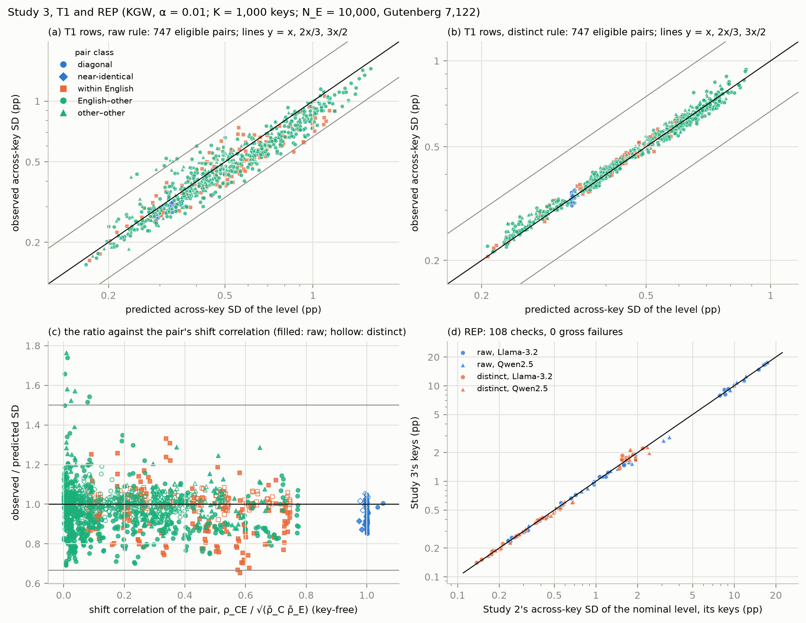
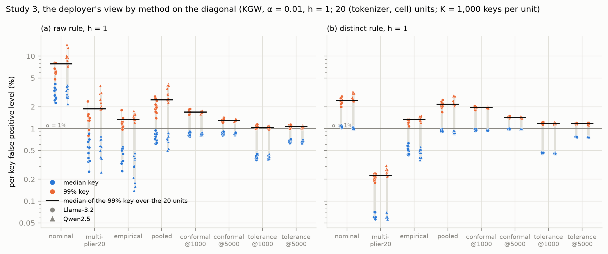
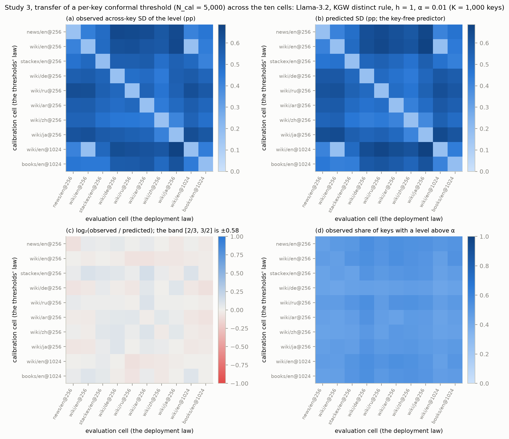
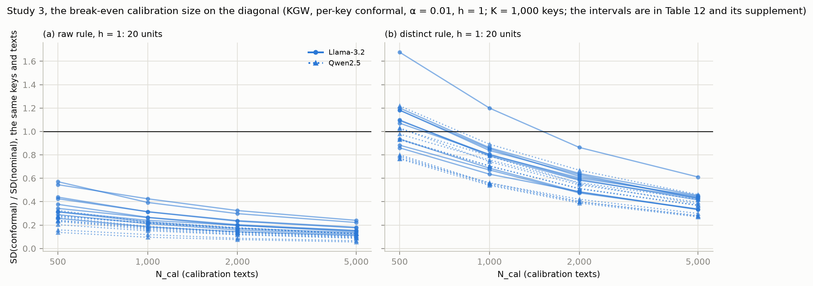
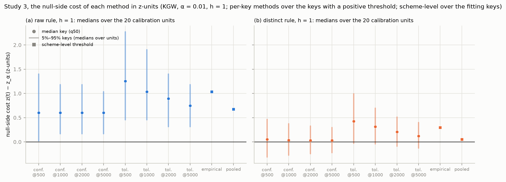
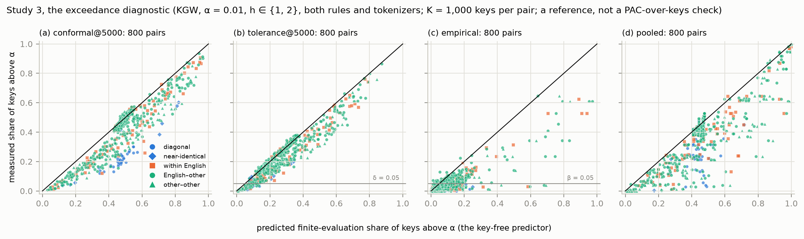

# Study 3 — report v0.1: per-key and scheme-level calibration of key-randomised detection tests on real null text, within and across text laws

Date: 2026-10-15 (Milestone 6). Protocol: [`STUDY3_PROTOCOL_v0.1.md`](STUDY3_PROTOCOL_v0.1.md) (LOCKED 2026-10-15 before outcomes; R07 agreed at round 3). Lock: [`outputs/study3_v0.1/PRE_RUN_LOCK.json`](../outputs/study3_v0.1/PRE_RUN_LOCK.json) (SHA-256 0e2889287d9d814166213e360766e93097de63401842516e3cb308056c666df6). Run manifest: [`outputs/study3_v0.1/RUN_MANIFEST.json`](../outputs/study3_v0.1/RUN_MANIFEST.json). Results: `outputs/study3_v0.1/results.json` (the locked analyzer's output; SHA-256 42bb915363fdb373053e722bf8dc463d83e97f1bbe57cbc810af215555032e89; 108 MB; committed as `results.json.gz` with the same bytes; label STUDY). **No number in this file is typed by hand except one cited Study 2 figure in §5 (its resolved median S1 ratio, about 1.2, from the Study 2 report).** **This file is built by** `research/study3/s3_report.py`, **which re-computes every descriptive row, every pass-1 summary and the rules T1, T2 and REP from the record with its own code, asserts equality with `results.json`, checks every prediction against the key-free inputs disclosed before the lock, and inserts every table, figure and number; no number is typed by hand.** Tables and figures: `outputs/study3_v0.1/report/` (`tables.md`; the supplements `tables_t1_full.md`, `tables_t2_full.md`, `tables_rep_full.md`, `tables_secondary_full.md`, `tables_remedy_full.md`, `tables_pairs_kgw_alpha0.01_full.md`, `tables_zcost_full.md`, `tables_breakeven_full.md`, `tables_calboot_full.md`, `tables_crossed_full.md`, `tables_diag_reference_full.md`, `tables_timing_full.md`, `descriptive_rows_full.csv.gz` (every one of the 87,840 rows); `checks.json`, `prose_values.json`, `fig1`–`fig6`). Sections 5–8 are the conductor's reading of the generated tables (inference, labelled); every number in them is a filled placeholder.

## 1. Run
- **Run:** 2026-10-15T19:47:53Z to 2026-10-15T20:45:53Z UTC, 0.967 h against the validator's projection of 0.921 h (sum of the unit times 0.966 h; restarts 0; units reused on resume 0; peak resident memory 1.82 GB); launched at commit 5e44a2e after the lock's push, with swap "total = 2048.00M  used = 474.94M  free = 1573.06M  (encrypted)", by `caffeinate -i env PYTHONHASHSEED=0 .venv/bin/python -u research/study3/s3_run.py --grid research/study3/grid_v0.1.json`; one process under `caffeinate -i`, Apple M5, 16 GB. The runner verified the lock before the first unit, the analyzer verified it again before any decision, the manifest (written 2026-10-15T20:51:17Z) a third time and this builder a fourth. The held-out partition was not touched (`final: false`). No deviation in execution: the pre-run check (the measured peak against the free memory, swap steady) was met, and no restart was needed (decision log, 2026-10-15).
- **Inventory:** 120 units (10 cells × 2 tokenizers × 3 widths, a calibration and an evaluation unit each) in 240 files (the unit records, the committed per-key and scheme-level thresholds, the evaluation counts); inventory digest c270ab818620…. K = 1,000 evaluation keys (23,000–23,999) and K_fit = 1,000 fitting keys (24,000–24,999); N_E = 10,000 evaluation texts per cell (Gutenberg 7,122), Study 2's frozen samples cut to 256 tokens; N_C = 5,000 calibration texts per cell, disjoint from every evaluation set, with nested prefixes N_cal ∈ {500, 1,000, 2,000, 5,000}. The same keys and the same evaluation texts serve every method, calibration source, rule, family and width of a cell and tokenizer, so every comparison inside an evaluation cell is paired.
- **Independent re-computation (the builder):** from the stored integer counts of every evaluation unit it recomputed all 87,840 descriptive rows (the key-mean, across-key SD, quantiles, extrema, exceedance shares, keys at zero, distinct levels and AutoMark's screen at every family, rule, width, calibration source, method and α); from the committed thresholds files the 5,760 z summaries and 720 scheme-level summaries of pass 1 (the order indices from their definitions; the abstention convention); the 1,600 T1 rows, the 1,600 T2 rows and the 108 REP checks under the protocol's seed convention (the key bootstrap, the paired bootstrap, the gross-failure rule, Study 2's inventory digest against its pinned manifest), and the three verdicts; and asserted that all equal `results.json` (all equal; `checks.json`). The regenerated bootstraps are the same prescribed resamples as the analyzer's (the protocol's §8 names the seed per row), so this is an independent implementation check of the indexing, the arithmetic, the pairing, the quantiles and the classification, not an independent set of draws, a stability analysis across seeds or a validation of the intervals' coverage. It also checked that the prediction compared with every outcome is the one disclosed before the lock: 702,720 prediction fields of the descriptive rows (the predicted SD, mean level and the six exceedance shares) and every T1 and T2 row's predicted SD, mean, theory share, v, set moments and cross-set covariance against `INPUTS.json`, largest difference 0.
- **Process and disclosure:** conductor Claude (Fable 5.1, in Claude Code); independent reviewer Codex (OpenAI) (rule A7 of the research-project-guide); Yichen Zhao decides every lock, run and judgement, reads every word and carries responsibility for the work. The pre-lock validation (protocol §11) used synthetic tokens and validation keys (1,000,000 and above), disjoint from the production keys; no per-key level of a Study 3 key on real text existed before the lock. After the run and before any real number was read, the report builder was written and exercised on a synthetic FIXTURE inventory (`research/study3/s3_fixture.py`: planted numbers in the run's exact file layout with the lock's provenance, analysed by the locked analyzer in study mode, written outside the repository, every unit marked FIXTURE, with one planted failure on every rule path), to test the independent re-computation and every table's and figure's layout; the fixture figures were viewed; no fixture number appears in this report, and the builder refuses a FIXTURE record in study mode. The builder, the fixture generator and the manifest script are not pinned by the lock; the analyzer, the runner, the core, the data and key modules, the grid, the key-free inputs, the tokens manifest, the validation record and the protocol are. Checkpoint R08 status at this build: open (round 1 requested with this report).

| Width | (tokenizer, cell) pairs | Measured minutes (sum of the unit times) | Projected minutes (the validator's model) | Measured / projected | Done (UTC) | Peak RSS so far (GB) |
| --- | --- | --- | --- | --- | --- | --- |
| h = 0 | 20 | 10.3 | 10.3 | 1.00 | 2026-10-15T19:58:14Z | 1.29 |
| h = 1 | 20 | 19.2 | 17.7 | 1.08 | 2026-10-15T20:17:25Z | 1.62 |
| h = 2 | 20 | 28.4 | 27.3 | 1.04 | 2026-10-15T20:45:53Z | 1.82 |
| all | 60 | 58.0 | 55.3 | 1.05 | 2026-10-15T20:45:53Z | 1.82 |

## 2. Pre-registered results (protocol §9)
### Table 1 — Pre-registered rules against the observed results

| Rule | Pre-registered statement (protocol §9) | Observed | Verdict |
| --- | --- | --- | --- |
| T1 (adequacy of the calibrated-threshold predictor) | Over the eligible primary rows (KGW; raw and distinct; h ∈ {1, 2}; both tokenizers; every ordered pair within a tokenizer; per-key conformal; N_cal 1,000 and 5,000; α = 0.01; eligible when the theory share ≥ 0.75 and no flag), the ratio SD_obs/SD_pred with its key-bootstrap 95% interval: consistent inside [2/3, 3/2]; pass iff ≥ 30 resolved and ≥ 80% of the resolved consistent | 1,494 eligible of 1,600; 1,474 resolved; 1,471 consistent (99.8%); 3 inconsistent; 20 unresolved | PASS |
| T2 (the sign of calibration's effect on the dispersion) | Over the same block, the material pairs (R_pred outside [2/3, 3/2]): R_obs = SD(conformal)/SD(nominal) with its paired key-bootstrap 95% interval: agree when the interval excludes 1 on the predicted side; pass iff ≥ 30 resolved and ≥ 90% agree | 879 material of 1,600 (predicted helps 336, hurts 543); 875 resolved; 875 agree (100.0%); 0 disagree; 4 unresolved | PASS |
| REP (integrity: Study 2's nominal dispersion reproduced with independent keys) | For every (tokenizer, evaluation cell except Gutenberg, h, rule) of the KGW family at α = 0.01, \|SD₃ − SD₂\| ≤ 6·√(se₃² + se₂²) + 10⁻¹²; pass iff no gross failure | 108 checks; 0 gross failures; the largest \|difference\|/threshold 0.47 | PASS |

**In words (evidence; every number is filled from the locked outputs):**
- **T1, adequacy of the calibrated-threshold predictor on real text:** PASS. Of 1,600 primary (pair, setting) rows (KGW, γ = 0.25; raw and distinct rules; h ∈ {1, 2}; both tokenizers; every ordered (calibration cell, evaluation cell) pair within a tokenizer, the diagonal included; per-key conformal calibration at N_cal 1,000 and 5,000; α = 0.01), 1,494 were eligible (theory share ≥ 0.75, no prediction flag) and 106 were not (80 diagonal rows at N_cal = 5,000, as the protocol pre-stated, plus 16 near-identical, 8 within-English and 2 English–other rows, all at N_cal = 5,000; Table 2); 1,474 were resolved by their key-bootstrap interval and 1,471 of those were consistent (the interval inside [2/3, 3/2]); 3 inconsistent, 20 unresolved; share consistent 99.8% against the pre-registered 80% with at least 30 resolved. Over the resolved rows the observed-to-predicted ratio ranged from 0.714 to 1.765 (median 0.990); over all eligible rows its median was 0.990, its 10th and 90th percentiles 0.850 and 1.077, with 832 point ratios below 1 and 662 above. By class: diagonal 80 consistent of 80 eligible (0 inconsistent, 0 unresolved); near-identical 16 of 16; within English 275 of 280 (0, 5); English–other 785 of 798 (2, 11); other–other 315 of 320 (1, 4). By N_cal: 1,000, 793 of 800 (0 inconsistent, 7 unresolved); 5,000, 678 of 694 (3, 13). By rule: raw 724 of 747 (3, 20); distinct 747 of 747 (0, 0). By width: h = 1, 738 of 752 (0, 14); h = 2, 733 of 742 (3, 6). By tokenizer: Llama-3.2 729 of 744 (3, 12); Qwen2.5 742 of 750 (0, 8). Every T1 row is in `tables_t1_full.md`.
- **T2, the sign of per-key calibration's effect on the dispersion:** PASS. Of the same 1,600 rows, 879 were material (R_pred outside [2/3, 3/2]; predicted "calibration helps" in 336 and "hurts" in 543; 721 immaterial), 875 were resolved by the paired interval and 875 of those agreed with the predicted side (100.0% against the pre-registered 90%); 0 disagreed, 4 unresolved. Among the material rows predicted to help, R_pred ranged over 0.07–0.67 (median 0.44) and R_obs over 0.06–0.58 (median 0.34; 336 of 336 below 1); among those predicted to hurt, R_pred 1.50–3.28 (median 1.85) and R_obs 0.98–2.96 (median 1.58; 541 of 543 above 1). By class: diagonal 97 material (80 helps, 17 hurts; 97 agree, 0 disagree, 0 unresolved); near-identical 22 (19 / 3; 22 agree); within English 135 (56 / 79; 135 agree, 0 disagree, 0 unresolved); English–other 450 (125 / 325; 447 agree, 0 disagree, 3 unresolved); other–other 175 (56 / 119; 174 agree, 0 disagree, 1 unresolved). By rule: raw 400 material (305 helps, 95 hurts; 396 agree, 0 disagree, 4 unresolved); distinct 479 (31 / 448; 479 agree, 0 disagree, 0 unresolved). The non-agreeing material rows: wikipedia/de@256 → wikipedia/ar@256 (Llama-3.2, raw, h = 2, N_cal = 1,000; predicted hurts, R_pred 1.51, R_obs 0.98 [0.93, 1.03]; nominal SD obs/pred 1.90, conformal SD obs/pred 1.23; unresolved); wikipedia/en@1024 → wikipedia/ar@256 (Llama-3.2, raw, h = 2, N_cal = 1,000; predicted hurts, R_pred 1.57, R_obs 0.99 [0.94, 1.03]; nominal SD obs/pred 1.90, conformal SD obs/pred 1.20; unresolved); wikipedia/en@256 → wikipedia/zh@256 (Qwen2.5, raw, h = 2, N_cal = 5,000; predicted hurts, R_pred 1.54, R_obs 1.01 [0.95, 1.07]; nominal SD obs/pred 1.29, conformal SD obs/pred 0.85; unresolved); wikipedia/de@256 → gutenberg/en@1024 (Qwen2.5, raw, h = 2, N_cal = 5,000; predicted hurts, R_pred 1.50, R_obs 1.05 [0.99, 1.11]; nominal SD obs/pred 1.22, conformal SD obs/pred 0.85; unresolved). Among the 721 immaterial rows (no rule decided on them) R_obs ranged over 0.41–1.46 (median 0.94), with the paired interval below 1 in 359 and above 1 in 250. Every T2 row is in `tables_t2_full.md`.
- **REP, Study 2's nominal dispersion reproduced with independent keys:** PASS. 108 checks (KGW, α = 0.01; every tokenizer, evaluation cell except Gutenberg, width and rule; the nominal across-key SD with Study 3's 1,000 keys against Study 2's observed SD on the same texts with its 1,000 keys): 0 gross failures; the largest |difference|/threshold 0.47 (median 0.10); the SDs ranged over 0.14–17.83 pp with Study 3's keys and 0.14–17.39 pp with Study 2's, the largest absolute difference 0.606 pp (21.6% of Study 2's value). Gross: none. Every check is in `tables_rep_full.md`.

### Table 2 — T1 by pair class, N_cal, rule, width and tokenizer, and by block (counts, never the share alone; K = 1,000 keys; N_E = 10,000, Gutenberg 7,122)

| Block | Candidate | Eligible | Resolved | Consistent | Inconsistent | Unresolved | Median ratio (resolved) | Median ratio (eligible) |
| --- | --- | --- | --- | --- | --- | --- | --- | --- |
| all | 1600 | 1494 | 1474 | 1471 | 3 | 20 | 0.990 | 0.990 |
| class diagonal | 160 | 80 | 80 | 80 | 0 | 0 | 0.970 | 0.970 |
| class near-identical | 32 | 16 | 16 | 16 | 0 | 0 | 0.954 | 0.954 |
| class within English | 288 | 280 | 275 | 275 | 0 | 5 | 0.992 | 0.991 |
| class English–other | 800 | 798 | 787 | 785 | 2 | 11 | 0.980 | 0.979 |
| class other–other | 320 | 320 | 316 | 315 | 1 | 4 | 1.017 | 1.018 |
| N_cal = 1,000 | 800 | 800 | 793 | 793 | 0 | 7 | 0.983 | 0.982 |
| N_cal = 5,000 | 800 | 694 | 681 | 678 | 3 | 13 | 0.998 | 0.998 |
| rule raw | 800 | 747 | 727 | 724 | 3 | 20 | 0.917 | 0.916 |
| rule distinct | 800 | 747 | 747 | 747 | 0 | 0 | 1.013 | 1.013 |
| h = 1 | 800 | 752 | 738 | 738 | 0 | 14 | 0.972 | 0.971 |
| h = 2 | 800 | 742 | 736 | 733 | 3 | 6 | 1.008 | 1.008 |
| Llama-3.2 | 800 | 744 | 732 | 729 | 3 | 12 | 0.986 | 0.986 |
| Qwen2.5 | 800 | 750 | 742 | 742 | 0 | 8 | 0.993 | 0.993 |

| Rule \| h \| tokenizer \| N_cal \| class | Candidate | Eligible | Resolved | Consistent | Inconsistent | Unresolved | Median ratio (resolved) | Median ratio (eligible) |
| --- | --- | --- | --- | --- | --- | --- | --- | --- |
| raw \| h = 1 \| Llama-3.2 \| N_cal = 1,000 \| diagonal | 10 | 10 | 10 | 10 | 0 | 0 | 0.899 | 0.899 |
| raw \| h = 1 \| Llama-3.2 \| N_cal = 1,000 \| near-identical | 2 | 2 | 2 | 2 | 0 | 0 | 0.905 | 0.905 |
| raw \| h = 1 \| Llama-3.2 \| N_cal = 1,000 \| within English | 18 | 18 | 18 | 18 | 0 | 0 | 0.866 | 0.866 |
| raw \| h = 1 \| Llama-3.2 \| N_cal = 1,000 \| English–other | 50 | 50 | 47 | 47 | 0 | 3 | 0.850 | 0.849 |
| raw \| h = 1 \| Llama-3.2 \| N_cal = 1,000 \| other–other | 20 | 20 | 20 | 20 | 0 | 0 | 0.906 | 0.906 |
| raw \| h = 1 \| Llama-3.2 \| N_cal = 5,000 \| diagonal | 10 | 0 | 0 | 0 | 0 | 0 | n/a | n/a |
| raw \| h = 1 \| Llama-3.2 \| N_cal = 5,000 \| near-identical | 2 | 0 | 0 | 0 | 0 | 0 | n/a | n/a |
| raw \| h = 1 \| Llama-3.2 \| N_cal = 5,000 \| within English | 18 | 18 | 18 | 18 | 0 | 0 | 0.887 | 0.887 |
| raw \| h = 1 \| Llama-3.2 \| N_cal = 5,000 \| English–other | 50 | 50 | 48 | 48 | 0 | 2 | 0.836 | 0.834 |
| raw \| h = 1 \| Llama-3.2 \| N_cal = 5,000 \| other–other | 20 | 20 | 19 | 19 | 0 | 1 | 0.909 | 0.914 |
| raw \| h = 1 \| Qwen2.5 \| N_cal = 1,000 \| diagonal | 10 | 10 | 10 | 10 | 0 | 0 | 0.899 | 0.899 |
| raw \| h = 1 \| Qwen2.5 \| N_cal = 1,000 \| near-identical | 2 | 2 | 2 | 2 | 0 | 0 | 0.919 | 0.919 |
| raw \| h = 1 \| Qwen2.5 \| N_cal = 1,000 \| within English | 18 | 18 | 16 | 16 | 0 | 2 | 0.896 | 0.891 |
| raw \| h = 1 \| Qwen2.5 \| N_cal = 1,000 \| English–other | 50 | 50 | 49 | 49 | 0 | 1 | 0.881 | 0.878 |
| raw \| h = 1 \| Qwen2.5 \| N_cal = 1,000 \| other–other | 20 | 20 | 20 | 20 | 0 | 0 | 0.957 | 0.957 |
| raw \| h = 1 \| Qwen2.5 \| N_cal = 5,000 \| diagonal | 10 | 0 | 0 | 0 | 0 | 0 | n/a | n/a |
| raw \| h = 1 \| Qwen2.5 \| N_cal = 5,000 \| near-identical | 2 | 0 | 0 | 0 | 0 | 0 | n/a | n/a |
| raw \| h = 1 \| Qwen2.5 \| N_cal = 5,000 \| within English | 18 | 18 | 15 | 15 | 0 | 3 | 0.860 | 0.855 |
| raw \| h = 1 \| Qwen2.5 \| N_cal = 5,000 \| English–other | 50 | 50 | 48 | 48 | 0 | 2 | 0.875 | 0.874 |
| raw \| h = 1 \| Qwen2.5 \| N_cal = 5,000 \| other–other | 20 | 20 | 20 | 20 | 0 | 0 | 0.962 | 0.962 |
| raw \| h = 2 \| Llama-3.2 \| N_cal = 1,000 \| diagonal | 10 | 10 | 10 | 10 | 0 | 0 | 0.911 | 0.911 |
| raw \| h = 2 \| Llama-3.2 \| N_cal = 1,000 \| near-identical | 2 | 2 | 2 | 2 | 0 | 0 | 0.894 | 0.894 |
| raw \| h = 2 \| Llama-3.2 \| N_cal = 1,000 \| within English | 18 | 18 | 18 | 18 | 0 | 0 | 0.921 | 0.921 |
| raw \| h = 2 \| Llama-3.2 \| N_cal = 1,000 \| English–other | 50 | 50 | 49 | 49 | 0 | 1 | 0.922 | 0.928 |
| raw \| h = 2 \| Llama-3.2 \| N_cal = 1,000 \| other–other | 20 | 20 | 20 | 20 | 0 | 0 | 0.926 | 0.926 |
| raw \| h = 2 \| Llama-3.2 \| N_cal = 5,000 \| diagonal | 10 | 0 | 0 | 0 | 0 | 0 | n/a | n/a |
| raw \| h = 2 \| Llama-3.2 \| N_cal = 5,000 \| near-identical | 2 | 0 | 0 | 0 | 0 | 0 | n/a | n/a |
| raw \| h = 2 \| Llama-3.2 \| N_cal = 5,000 \| within English | 18 | 15 | 15 | 15 | 0 | 0 | 0.953 | 0.953 |
| raw \| h = 2 \| Llama-3.2 \| N_cal = 5,000 \| English–other | 50 | 49 | 47 | 45 | 2 | 2 | 0.968 | 0.968 |
| raw \| h = 2 \| Llama-3.2 \| N_cal = 5,000 \| other–other | 20 | 20 | 17 | 16 | 1 | 3 | 0.977 | 0.986 |
| raw \| h = 2 \| Qwen2.5 \| N_cal = 1,000 \| diagonal | 10 | 10 | 10 | 10 | 0 | 0 | 0.914 | 0.914 |
| raw \| h = 2 \| Qwen2.5 \| N_cal = 1,000 \| near-identical | 2 | 2 | 2 | 2 | 0 | 0 | 0.910 | 0.910 |
| raw \| h = 2 \| Qwen2.5 \| N_cal = 1,000 \| within English | 18 | 18 | 18 | 18 | 0 | 0 | 0.932 | 0.932 |
| raw \| h = 2 \| Qwen2.5 \| N_cal = 1,000 \| English–other | 50 | 50 | 50 | 50 | 0 | 0 | 0.951 | 0.951 |
| raw \| h = 2 \| Qwen2.5 \| N_cal = 1,000 \| other–other | 20 | 20 | 20 | 20 | 0 | 0 | 0.948 | 0.948 |
| raw \| h = 2 \| Qwen2.5 \| N_cal = 5,000 \| diagonal | 10 | 0 | 0 | 0 | 0 | 0 | n/a | n/a |
| raw \| h = 2 \| Qwen2.5 \| N_cal = 5,000 \| near-identical | 2 | 0 | 0 | 0 | 0 | 0 | n/a | n/a |
| raw \| h = 2 \| Qwen2.5 \| N_cal = 5,000 \| within English | 18 | 17 | 17 | 17 | 0 | 0 | 0.987 | 0.987 |
| raw \| h = 2 \| Qwen2.5 \| N_cal = 5,000 \| English–other | 50 | 50 | 50 | 50 | 0 | 0 | 0.987 | 0.987 |
| raw \| h = 2 \| Qwen2.5 \| N_cal = 5,000 \| other–other | 20 | 20 | 20 | 20 | 0 | 0 | 0.956 | 0.956 |
| distinct \| h = 1 \| Llama-3.2 \| N_cal = 1,000 \| diagonal | 10 | 10 | 10 | 10 | 0 | 0 | 1.003 | 1.003 |
| distinct \| h = 1 \| Llama-3.2 \| N_cal = 1,000 \| near-identical | 2 | 2 | 2 | 2 | 0 | 0 | 1.011 | 1.011 |
| distinct \| h = 1 \| Llama-3.2 \| N_cal = 1,000 \| within English | 18 | 18 | 18 | 18 | 0 | 0 | 1.019 | 1.019 |
| distinct \| h = 1 \| Llama-3.2 \| N_cal = 1,000 \| English–other | 50 | 50 | 50 | 50 | 0 | 0 | 0.982 | 0.982 |
| distinct \| h = 1 \| Llama-3.2 \| N_cal = 1,000 \| other–other | 20 | 20 | 20 | 20 | 0 | 0 | 1.033 | 1.033 |
| distinct \| h = 1 \| Llama-3.2 \| N_cal = 5,000 \| diagonal | 10 | 0 | 0 | 0 | 0 | 0 | n/a | n/a |
| distinct \| h = 1 \| Llama-3.2 \| N_cal = 5,000 \| near-identical | 2 | 0 | 0 | 0 | 0 | 0 | n/a | n/a |
| distinct \| h = 1 \| Llama-3.2 \| N_cal = 5,000 \| within English | 18 | 18 | 18 | 18 | 0 | 0 | 1.021 | 1.021 |
| distinct \| h = 1 \| Llama-3.2 \| N_cal = 5,000 \| English–other | 50 | 50 | 50 | 50 | 0 | 0 | 0.984 | 0.984 |
| distinct \| h = 1 \| Llama-3.2 \| N_cal = 5,000 \| other–other | 20 | 20 | 20 | 20 | 0 | 0 | 1.041 | 1.041 |
| distinct \| h = 1 \| Qwen2.5 \| N_cal = 1,000 \| diagonal | 10 | 10 | 10 | 10 | 0 | 0 | 1.006 | 1.006 |
| distinct \| h = 1 \| Qwen2.5 \| N_cal = 1,000 \| near-identical | 2 | 2 | 2 | 2 | 0 | 0 | 1.033 | 1.033 |
| distinct \| h = 1 \| Qwen2.5 \| N_cal = 1,000 \| within English | 18 | 18 | 18 | 18 | 0 | 0 | 1.018 | 1.018 |
| distinct \| h = 1 \| Qwen2.5 \| N_cal = 1,000 \| English–other | 50 | 50 | 50 | 50 | 0 | 0 | 0.989 | 0.989 |
| distinct \| h = 1 \| Qwen2.5 \| N_cal = 1,000 \| other–other | 20 | 20 | 20 | 20 | 0 | 0 | 1.064 | 1.064 |
| distinct \| h = 1 \| Qwen2.5 \| N_cal = 5,000 \| diagonal | 10 | 0 | 0 | 0 | 0 | 0 | n/a | n/a |
| distinct \| h = 1 \| Qwen2.5 \| N_cal = 5,000 \| near-identical | 2 | 0 | 0 | 0 | 0 | 0 | n/a | n/a |
| distinct \| h = 1 \| Qwen2.5 \| N_cal = 5,000 \| within English | 18 | 18 | 18 | 18 | 0 | 0 | 0.999 | 0.999 |
| distinct \| h = 1 \| Qwen2.5 \| N_cal = 5,000 \| English–other | 50 | 50 | 50 | 50 | 0 | 0 | 0.996 | 0.996 |
| distinct \| h = 1 \| Qwen2.5 \| N_cal = 5,000 \| other–other | 20 | 20 | 20 | 20 | 0 | 0 | 1.032 | 1.032 |
| distinct \| h = 2 \| Llama-3.2 \| N_cal = 1,000 \| diagonal | 10 | 10 | 10 | 10 | 0 | 0 | 1.008 | 1.008 |
| distinct \| h = 2 \| Llama-3.2 \| N_cal = 1,000 \| near-identical | 2 | 2 | 2 | 2 | 0 | 0 | 0.993 | 0.993 |
| distinct \| h = 2 \| Llama-3.2 \| N_cal = 1,000 \| within English | 18 | 18 | 18 | 18 | 0 | 0 | 0.990 | 0.990 |
| distinct \| h = 2 \| Llama-3.2 \| N_cal = 1,000 \| English–other | 50 | 50 | 50 | 50 | 0 | 0 | 1.016 | 1.016 |
| distinct \| h = 2 \| Llama-3.2 \| N_cal = 1,000 \| other–other | 20 | 20 | 20 | 20 | 0 | 0 | 1.023 | 1.023 |
| distinct \| h = 2 \| Llama-3.2 \| N_cal = 5,000 \| diagonal | 10 | 0 | 0 | 0 | 0 | 0 | n/a | n/a |
| distinct \| h = 2 \| Llama-3.2 \| N_cal = 5,000 \| near-identical | 2 | 0 | 0 | 0 | 0 | 0 | n/a | n/a |
| distinct \| h = 2 \| Llama-3.2 \| N_cal = 5,000 \| within English | 18 | 15 | 15 | 15 | 0 | 0 | 1.008 | 1.008 |
| distinct \| h = 2 \| Llama-3.2 \| N_cal = 5,000 \| English–other | 50 | 49 | 49 | 49 | 0 | 0 | 1.028 | 1.028 |
| distinct \| h = 2 \| Llama-3.2 \| N_cal = 5,000 \| other–other | 20 | 20 | 20 | 20 | 0 | 0 | 1.055 | 1.055 |
| distinct \| h = 2 \| Qwen2.5 \| N_cal = 1,000 \| diagonal | 10 | 10 | 10 | 10 | 0 | 0 | 1.008 | 1.008 |
| distinct \| h = 2 \| Qwen2.5 \| N_cal = 1,000 \| near-identical | 2 | 2 | 2 | 2 | 0 | 0 | 1.006 | 1.006 |
| distinct \| h = 2 \| Qwen2.5 \| N_cal = 1,000 \| within English | 18 | 18 | 18 | 18 | 0 | 0 | 1.007 | 1.007 |
| distinct \| h = 2 \| Qwen2.5 \| N_cal = 1,000 \| English–other | 50 | 50 | 50 | 50 | 0 | 0 | 1.013 | 1.013 |
| distinct \| h = 2 \| Qwen2.5 \| N_cal = 1,000 \| other–other | 20 | 20 | 20 | 20 | 0 | 0 | 1.024 | 1.024 |
| distinct \| h = 2 \| Qwen2.5 \| N_cal = 5,000 \| diagonal | 10 | 0 | 0 | 0 | 0 | 0 | n/a | n/a |
| distinct \| h = 2 \| Qwen2.5 \| N_cal = 5,000 \| near-identical | 2 | 0 | 0 | 0 | 0 | 0 | n/a | n/a |
| distinct \| h = 2 \| Qwen2.5 \| N_cal = 5,000 \| within English | 18 | 17 | 17 | 17 | 0 | 0 | 1.027 | 1.027 |
| distinct \| h = 2 \| Qwen2.5 \| N_cal = 5,000 \| English–other | 50 | 50 | 50 | 50 | 0 | 0 | 1.018 | 1.018 |
| distinct \| h = 2 \| Qwen2.5 \| N_cal = 5,000 \| other–other | 20 | 20 | 20 | 20 | 0 | 0 | 1.018 | 1.018 |

### Table 3 — T1: the inconsistent and unresolved rows with the protocol's diagnostics (23 rows; every row in `tables_t1_full.md`)

| Pair (calibration → evaluation) | Tokenizer | Rule | h | N_cal | Class | Status | Ratio [95% CI] | SD obs (pp) | SD pred (pp) | Key-mean obs (%) | Key-mean pred (%) | Theory share | v | v_raw | τ_v | ρ̄_C | ρ̄_E | ρ_CE | σ_C² | σ_E² | j | N_E | K |
| --- | --- | --- | --- | --- | --- | --- | --- | --- | --- | --- | --- | --- | --- | --- | --- | --- | --- | --- | --- | --- | --- | --- | --- |
| gutenberg/en@1024 → wikipedia/ar@256 | Llama-3.2 | raw | 2 | 5,000 | English–other | inconsistent | 1.657 [1.511, 1.802] | 0.522 | 0.315 | 1.341% | 1.377% | 0.863 | 0.0055 | 0.0055 | 0.00036 | 0.0011 | 0.0044 | 0.0000 | 1.143 | 1.269 | 50 | 10,000 | 1,000 |
| stackexchange/en@256 → wikipedia/ar@256 | Llama-3.2 | raw | 2 | 5,000 | English–other | inconsistent | 1.740 [1.576, 1.921] | 0.435 | 0.250 | 0.890% | 0.991% | 0.843 | 0.0059 | 0.0059 | 0.00038 | 0.0015 | 0.0044 | 0.0000 | 1.278 | 1.269 | 50 | 10,000 | 1,000 |
| wikipedia/zh@256 → wikipedia/ar@256 | Llama-3.2 | raw | 2 | 5,000 | other–other | inconsistent | 1.765 [1.557, 1.946] | 0.422 | 0.239 | 0.864% | 0.958% | 0.834 | 0.0055 | 0.0055 | 0.00039 | 0.0011 | 0.0044 | 0.0000 | 1.292 | 1.269 | 50 | 10,000 | 1,000 |
| wikipedia/de@256 → gutenberg/en@1024 | Llama-3.2 | raw | 1 | 1,000 | English–other | unresolved | 0.726 [0.663, 0.790] | 0.622 | 0.857 | 1.055% | 1.282% | 0.976 | 0.0658 | 0.0658 | 0.00154 | 0.0173 | 0.0507 | 0.0011 | 1.342 | 1.394 | 10 | 7,122 | 1,000 |
| wikipedia/ja@256 → gutenberg/en@1024 | Llama-3.2 | raw | 1 | 1,000 | English–other | unresolved | 0.696 [0.647, 0.746] | 0.455 | 0.654 | 0.792% | 0.871% | 0.972 | 0.0722 | 0.0722 | 0.00173 | 0.0220 | 0.0507 | 0.0002 | 1.532 | 1.394 | 10 | 7,122 | 1,000 |
| wikipedia/zh@256 → gutenberg/en@1024 | Llama-3.2 | raw | 1 | 1,000 | English–other | unresolved | 0.701 [0.650, 0.743] | 0.336 | 0.479 | 0.596% | 0.652% | 0.960 | 0.0594 | 0.0594 | 0.00185 | 0.0091 | 0.0507 | 0.0001 | 1.658 | 1.394 | 10 | 7,122 | 1,000 |
| wikipedia/de@256 → gutenberg/en@1024 | Llama-3.2 | raw | 1 | 5,000 | English–other | unresolved | 0.711 [0.657, 0.766] | 0.550 | 0.774 | 1.065% | 1.288% | 0.970 | 0.0650 | 0.0650 | 0.00046 | 0.0167 | 0.0507 | 0.0012 | 1.341 | 1.394 | 50 | 7,122 | 1,000 |
| wikipedia/ja@256 → gutenberg/en@1024 | Llama-3.2 | raw | 1 | 5,000 | English–other | unresolved | 0.691 [0.650, 0.740] | 0.402 | 0.582 | 0.771% | 0.862% | 0.965 | 0.0716 | 0.0716 | 0.00050 | 0.0215 | 0.0507 | 0.0003 | 1.537 | 1.394 | 50 | 7,122 | 1,000 |
| wikipedia/zh@256 → wikipedia/ar@256 | Llama-3.2 | raw | 1 | 5,000 | other–other | unresolved | 1.392 [1.250, 1.522] | 0.456 | 0.328 | 0.700% | 0.773% | 0.929 | 0.0272 | 0.0272 | 0.00048 | 0.0087 | 0.0194 | 0.0005 | 1.653 | 1.499 | 50 | 10,000 | 1,000 |
| wikipedia/de@256 → gutenberg/en@1024 | Qwen2.5 | raw | 1 | 1,000 | English–other | unresolved | 0.707 [0.638, 0.765] | 0.665 | 0.941 | 1.109% | 1.295% | 0.980 | 0.0825 | 0.0825 | 0.00158 | 0.0536 | 0.0539 | 0.0125 | 1.384 | 1.429 | 10 | 7,122 | 1,000 |
| wikipedia/en@256 → gutenberg/en@1024 | Qwen2.5 | raw | 1 | 1,000 | within English | unresolved | 0.669 [0.633, 0.710] | 0.624 | 0.932 | 1.012% | 1.101% | 0.983 | 0.1077 | 0.1077 | 0.00169 | 0.1605 | 0.0539 | 0.0534 | 1.488 | 1.429 | 10 | 7,122 | 1,000 |
| wikipedia/en@256 → stackexchange/en@256 | Qwen2.5 | raw | 1 | 1,000 | within English | unresolved | 0.706 [0.661, 0.751] | 0.768 | 1.088 | 1.270% | 1.412% | 0.988 | 0.1079 | 0.1079 | 0.00164 | 0.1605 | 0.0334 | 0.0430 | 1.488 | 1.568 | 10 | 10,000 | 1,000 |
| wikipedia/de@256 → gutenberg/en@1024 | Qwen2.5 | raw | 1 | 5,000 | English–other | unresolved | 0.701 [0.627, 0.760] | 0.609 | 0.869 | 1.121% | 1.303% | 0.976 | 0.0825 | 0.0825 | 0.00048 | 0.0540 | 0.0539 | 0.0127 | 1.383 | 1.429 | 50 | 7,122 | 1,000 |
| wikipedia/en@1024 → gutenberg/en@1024 | Qwen2.5 | raw | 1 | 5,000 | within English | unresolved | 0.677 [0.633, 0.722] | 0.628 | 0.927 | 1.202% | 1.344% | 0.978 | 0.0892 | 0.0892 | 0.00048 | 0.1426 | 0.0539 | 0.0537 | 1.374 | 1.429 | 50 | 7,122 | 1,000 |
| wikipedia/en@256 → gutenberg/en@1024 | Qwen2.5 | raw | 1 | 5,000 | within English | unresolved | 0.653 [0.613, 0.688] | 0.562 | 0.859 | 1.004% | 1.108% | 0.979 | 0.1049 | 0.1049 | 0.00050 | 0.1585 | 0.0539 | 0.0538 | 1.483 | 1.429 | 50 | 7,122 | 1,000 |
| wikipedia/ru@256 → gutenberg/en@1024 | Qwen2.5 | raw | 1 | 5,000 | English–other | unresolved | 0.712 [0.662, 0.766] | 0.683 | 0.959 | 1.155% | 1.336% | 0.980 | 0.0963 | 0.0963 | 0.00048 | 0.0624 | 0.0539 | 0.0100 | 1.383 | 1.429 | 50 | 7,122 | 1,000 |
| wikipedia/en@256 → stackexchange/en@256 | Qwen2.5 | raw | 1 | 5,000 | within English | unresolved | 0.703 [0.665, 0.745] | 0.711 | 1.011 | 1.273% | 1.427% | 0.986 | 0.1060 | 0.1060 | 0.00045 | 0.1585 | 0.0334 | 0.0430 | 1.483 | 1.568 | 50 | 10,000 | 1,000 |
| gutenberg/en@1024 → wikipedia/ar@256 | Llama-3.2 | raw | 2 | 1,000 | English–other | unresolved | 1.498 [1.410, 1.604] | 0.599 | 0.400 | 1.278% | 1.084% | 0.933 | 0.0056 | 0.0056 | 0.00137 | 0.0012 | 0.0044 | 0.0000 | 1.240 | 1.269 | 10 | 10,000 | 1,000 |
| wikipedia/de@256 → wikipedia/ar@256 | Llama-3.2 | raw | 2 | 5,000 | other–other | unresolved | 1.573 [1.417, 1.732] | 0.510 | 0.324 | 1.196% | 1.321% | 0.876 | 0.0068 | 0.0068 | 0.00036 | 0.0026 | 0.0044 | 0.0001 | 1.161 | 1.269 | 50 | 10,000 | 1,000 |
| wikipedia/en@1024 → wikipedia/ar@256 | Llama-3.2 | raw | 2 | 5,000 | English–other | unresolved | 1.517 [1.389, 1.639] | 0.520 | 0.343 | 1.316% | 1.439% | 0.879 | 0.0066 | 0.0066 | 0.00035 | 0.0027 | 0.0044 | 0.0003 | 1.126 | 1.269 | 50 | 10,000 | 1,000 |
| wikipedia/en@256 → wikipedia/ar@256 | Llama-3.2 | raw | 2 | 5,000 | English–other | unresolved | 1.542 [1.432, 1.666] | 0.479 | 0.310 | 1.139% | 1.254% | 0.872 | 0.0067 | 0.0067 | 0.00036 | 0.0029 | 0.0044 | 0.0003 | 1.183 | 1.269 | 50 | 10,000 | 1,000 |
| wikipedia/ja@256 → wikipedia/ar@256 | Llama-3.2 | raw | 2 | 5,000 | other–other | unresolved | 1.581 [1.426, 1.726] | 0.460 | 0.291 | 0.992% | 1.087% | 0.873 | 0.0078 | 0.0078 | 0.00038 | 0.0035 | 0.0044 | 0.0000 | 1.242 | 1.269 | 50 | 10,000 | 1,000 |
| wikipedia/ru@256 → wikipedia/ar@256 | Llama-3.2 | raw | 2 | 5,000 | other–other | unresolved | 1.524 [1.384, 1.671] | 0.505 | 0.332 | 1.179% | 1.289% | 0.884 | 0.0078 | 0.0078 | 0.00036 | 0.0035 | 0.0044 | 0.0001 | 1.172 | 1.269 | 50 | 10,000 | 1,000 |

**Where the non-consistent rows lie (evidence):** 23 rows (10 with a ratio above 1, 13 below; ratios 0.65–1.77; theory shares 0.83–0.99; v 0.005–0.108): by rule, raw 23 and distinct 0; by width, h = 1 14 and h = 2 9; by N_cal, 1,000 7 and 5,000 16; by tokenizer, Llama-3.2 15 and Qwen2.5 8; by class, English–other: 13; other–other: 5; within English: 5; by evaluation cell, gutenberg/en@1024: 11; wikipedia/ar@256: 10; stackexchange/en@256: 2; by calibration cell, wikipedia/de@256: 5; wikipedia/en@256: 5; wikipedia/zh@256: 3; wikipedia/ja@256: 3; wikipedia/ru@256: 2; wikipedia/en@1024: 2; gutenberg/en@1024: 2; stackexchange/en@256: 1. The inconsistent rows: stackexchange/en@256 → wikipedia/ar@256 (Llama-3.2, raw, h = 2, N_cal = 5,000; ratio 1.74 [1.58, 1.92]); wikipedia/zh@256 → wikipedia/ar@256 (Llama-3.2, raw, h = 2, N_cal = 5,000; ratio 1.77 [1.56, 1.95]); gutenberg/en@1024 → wikipedia/ar@256 (Llama-3.2, raw, h = 2, N_cal = 5,000; ratio 1.66 [1.51, 1.80]).

### Table 4 — T2 by class, N_cal, rule, width, tokenizer and predicted side, and the non-agreeing material rows (K = 1,000 keys per row, paired; N_E = 10,000, Gutenberg 7,122)

| Block | Rows | Material | Predicted helps | Predicted hurts | Resolved | Agree | Disagree | Unresolved |
| --- | --- | --- | --- | --- | --- | --- | --- | --- |
| all | 1600 | 879 | 336 | 543 | 875 | 875 | 0 | 4 |
| class diagonal | 160 | 97 | 80 | 17 | 97 | 97 | 0 | 0 |
| class near-identical | 32 | 22 | 19 | 3 | 22 | 22 | 0 | 0 |
| class within English | 288 | 135 | 56 | 79 | 135 | 135 | 0 | 0 |
| class English–other | 800 | 450 | 125 | 325 | 447 | 447 | 0 | 3 |
| class other–other | 320 | 175 | 56 | 119 | 174 | 174 | 0 | 1 |
| N_cal = 1,000 | 800 | 510 | 136 | 374 | 508 | 508 | 0 | 2 |
| N_cal = 5,000 | 800 | 369 | 200 | 169 | 367 | 367 | 0 | 2 |
| rule raw | 800 | 400 | 305 | 95 | 396 | 396 | 0 | 4 |
| rule distinct | 800 | 479 | 31 | 448 | 479 | 479 | 0 | 0 |
| h = 1 | 800 | 466 | 277 | 189 | 466 | 466 | 0 | 0 |
| h = 2 | 800 | 413 | 59 | 354 | 409 | 409 | 0 | 4 |
| Llama-3.2 | 800 | 437 | 123 | 314 | 435 | 435 | 0 | 2 |
| Qwen2.5 | 800 | 442 | 213 | 229 | 440 | 440 | 0 | 2 |
| predicted helps | 589 | 336 | 336 | 0 | 336 | 336 | 0 | 0 |
| predicted hurts | 1011 | 543 | 0 | 543 | 539 | 539 | 0 | 4 |

| Rule \| h \| N_cal \| class | Rows | Material | Predicted helps | Predicted hurts | Resolved | Agree | Disagree | Unresolved |
| --- | --- | --- | --- | --- | --- | --- | --- | --- |
| raw \| h = 1 \| N_cal = 1,000 \| diagonal | 20 | 20 | 20 | 0 | 20 | 20 | 0 | 0 |
| raw \| h = 1 \| N_cal = 1,000 \| near-identical | 4 | 4 | 4 | 0 | 4 | 4 | 0 | 0 |
| raw \| h = 1 \| N_cal = 1,000 \| within English | 36 | 26 | 26 | 0 | 26 | 26 | 0 | 0 |
| raw \| h = 1 \| N_cal = 1,000 \| English–other | 100 | 47 | 44 | 3 | 47 | 47 | 0 | 0 |
| raw \| h = 1 \| N_cal = 1,000 \| other–other | 40 | 23 | 22 | 1 | 23 | 23 | 0 | 0 |
| raw \| h = 1 \| N_cal = 5,000 \| diagonal | 20 | 20 | 20 | 0 | 20 | 20 | 0 | 0 |
| raw \| h = 1 \| N_cal = 5,000 \| near-identical | 4 | 4 | 4 | 0 | 4 | 4 | 0 | 0 |
| raw \| h = 1 \| N_cal = 5,000 \| within English | 36 | 26 | 26 | 0 | 26 | 26 | 0 | 0 |
| raw \| h = 1 \| N_cal = 5,000 \| English–other | 100 | 59 | 55 | 4 | 59 | 59 | 0 | 0 |
| raw \| h = 1 \| N_cal = 5,000 \| other–other | 40 | 28 | 28 | 0 | 28 | 28 | 0 | 0 |
| raw \| h = 2 \| N_cal = 1,000 \| diagonal | 20 | 8 | 4 | 4 | 8 | 8 | 0 | 0 |
| raw \| h = 2 \| N_cal = 1,000 \| near-identical | 4 | 3 | 2 | 1 | 3 | 3 | 0 | 0 |
| raw \| h = 2 \| N_cal = 1,000 \| within English | 36 | 17 | 1 | 16 | 17 | 17 | 0 | 0 |
| raw \| h = 2 \| N_cal = 1,000 \| English–other | 100 | 50 | 8 | 42 | 49 | 49 | 0 | 1 |
| raw \| h = 2 \| N_cal = 1,000 \| other–other | 40 | 10 | 0 | 10 | 9 | 9 | 0 | 1 |
| raw \| h = 2 \| N_cal = 5,000 \| diagonal | 20 | 12 | 12 | 0 | 12 | 12 | 0 | 0 |
| raw \| h = 2 \| N_cal = 5,000 \| near-identical | 4 | 2 | 2 | 0 | 2 | 2 | 0 | 0 |
| raw \| h = 2 \| N_cal = 5,000 \| within English | 36 | 11 | 3 | 8 | 11 | 11 | 0 | 0 |
| raw \| h = 2 \| N_cal = 5,000 \| English–other | 100 | 24 | 18 | 6 | 22 | 22 | 0 | 2 |
| raw \| h = 2 \| N_cal = 5,000 \| other–other | 40 | 6 | 6 | 0 | 6 | 6 | 0 | 0 |
| distinct \| h = 1 \| N_cal = 1,000 \| diagonal | 20 | 3 | 3 | 0 | 3 | 3 | 0 | 0 |
| distinct \| h = 1 \| N_cal = 1,000 \| near-identical | 4 | 2 | 2 | 0 | 2 | 2 | 0 | 0 |
| distinct \| h = 1 \| N_cal = 1,000 \| within English | 36 | 8 | 0 | 8 | 8 | 8 | 0 | 0 |
| distinct \| h = 1 \| N_cal = 1,000 \| English–other | 100 | 75 | 0 | 75 | 75 | 75 | 0 | 0 |
| distinct \| h = 1 \| N_cal = 1,000 \| other–other | 40 | 30 | 0 | 30 | 30 | 30 | 0 | 0 |
| distinct \| h = 1 \| N_cal = 5,000 \| diagonal | 20 | 19 | 19 | 0 | 19 | 19 | 0 | 0 |
| distinct \| h = 1 \| N_cal = 5,000 \| near-identical | 4 | 4 | 4 | 0 | 4 | 4 | 0 | 0 |
| distinct \| h = 1 \| N_cal = 5,000 \| within English | 36 | 0 | 0 | 0 | 0 | 0 | 0 | 0 |
| distinct \| h = 1 \| N_cal = 5,000 \| English–other | 100 | 50 | 0 | 50 | 50 | 50 | 0 | 0 |
| distinct \| h = 1 \| N_cal = 5,000 \| other–other | 40 | 18 | 0 | 18 | 18 | 18 | 0 | 0 |
| distinct \| h = 2 \| N_cal = 1,000 \| diagonal | 20 | 13 | 0 | 13 | 13 | 13 | 0 | 0 |
| distinct \| h = 2 \| N_cal = 1,000 \| near-identical | 4 | 2 | 0 | 2 | 2 | 2 | 0 | 0 |
| distinct \| h = 2 \| N_cal = 1,000 \| within English | 36 | 32 | 0 | 32 | 32 | 32 | 0 | 0 |
| distinct \| h = 2 \| N_cal = 1,000 \| English–other | 100 | 97 | 0 | 97 | 97 | 97 | 0 | 0 |
| distinct \| h = 2 \| N_cal = 1,000 \| other–other | 40 | 40 | 0 | 40 | 40 | 40 | 0 | 0 |
| distinct \| h = 2 \| N_cal = 5,000 \| diagonal | 20 | 2 | 2 | 0 | 2 | 2 | 0 | 0 |
| distinct \| h = 2 \| N_cal = 5,000 \| near-identical | 4 | 1 | 1 | 0 | 1 | 1 | 0 | 0 |
| distinct \| h = 2 \| N_cal = 5,000 \| within English | 36 | 15 | 0 | 15 | 15 | 15 | 0 | 0 |
| distinct \| h = 2 \| N_cal = 5,000 \| English–other | 100 | 48 | 0 | 48 | 48 | 48 | 0 | 0 |
| distinct \| h = 2 \| N_cal = 5,000 \| other–other | 40 | 20 | 0 | 20 | 20 | 20 | 0 | 0 |

| Pair (calibration → evaluation) | Tokenizer | Rule | h | N_cal | Class | Predicted side | R_pred | R_obs [paired 95% CI] | Status | SD conformal obs (pp) | SD nominal obs (pp) | SD conformal pred (pp) | SD nominal pred (pp) | N_E | K |
| --- | --- | --- | --- | --- | --- | --- | --- | --- | --- | --- | --- | --- | --- | --- | --- |
| wikipedia/de@256 → wikipedia/ar@256 | Llama-3.2 | raw | 2 | 1,000 | other–other | hurts | 1.506 | 0.981 [0.934, 1.027] | unresolved | 0.584 | 0.596 | 0.473 | 0.314 | 10,000 | 1,000 |
| wikipedia/en@1024 → wikipedia/ar@256 | Llama-3.2 | raw | 2 | 1,000 | English–other | hurts | 1.572 | 0.994 [0.937, 1.030] | unresolved | 0.592 | 0.596 | 0.494 | 0.314 | 10,000 | 1,000 |
| wikipedia/de@256 → gutenberg/en@1024 | Qwen2.5 | raw | 2 | 5,000 | English–other | hurts | 1.501 | 1.047 [0.990, 1.105] | unresolved | 0.269 | 0.257 | 0.316 | 0.211 | 7,122 | 1,000 |
| wikipedia/en@256 → wikipedia/zh@256 | Qwen2.5 | raw | 2 | 5,000 | English–other | hurts | 1.540 | 1.011 [0.952, 1.071] | unresolved | 0.433 | 0.428 | 0.512 | 0.333 | 10,000 | 1,000 |

### Table 5 — REP by tokenizer, width and rule, and the gross failures (K = 1,000 keys in each study; N_E = 10,000 shared texts; every check in `tables_rep_full.md`)

| Tokenizer \| h \| rule | Checks | Gross failures | Largest \|difference\| / threshold | Median SD, Study 3 keys (pp) | Median SD, Study 2 keys (pp) |
| --- | --- | --- | --- | --- | --- |
| Llama-3.2 \| h = 0 \| raw | 9 | 0 | 0.170 | 9.974 | 9.961 |
| Llama-3.2 \| h = 0 \| distinct | 9 | 0 | 0.291 | 1.714 | 1.649 |
| Llama-3.2 \| h = 1 \| raw | 9 | 0 | 0.241 | 1.120 | 1.063 |
| Llama-3.2 \| h = 1 \| distinct | 9 | 0 | 0.243 | 0.411 | 0.411 |
| Llama-3.2 \| h = 2 \| raw | 9 | 0 | 0.237 | 0.262 | 0.264 |
| Llama-3.2 \| h = 2 \| distinct | 9 | 0 | 0.225 | 0.188 | 0.181 |
| Qwen2.5 \| h = 0 \| raw | 9 | 0 | 0.127 | 11.683 | 11.749 |
| Qwen2.5 \| h = 0 \| distinct | 9 | 0 | 0.296 | 1.940 | 1.780 |
| Qwen2.5 \| h = 1 \| raw | 9 | 0 | 0.465 | 1.737 | 1.823 |
| Qwen2.5 \| h = 1 \| distinct | 9 | 0 | 0.295 | 0.477 | 0.497 |
| Qwen2.5 \| h = 2 \| raw | 9 | 0 | 0.246 | 0.566 | 0.567 |
| Qwen2.5 \| h = 2 \| distinct | 9 | 0 | 0.231 | 0.280 | 0.280 |

_No gross failure._

### Table 6 — The diagonal against the i.i.d. reference law (descriptive; the N_cal = 5,000 rows are never T1-eligible; K = 1,000 keys per unit; N_E = 10,000, Gutenberg 7,122; ranges and medians over the 20 (tokenizer, cell) units; the floor √(ℓ(1−ℓ)/N_E) at the Beta mean; every unit in `tables_diag_reference_full.md`)

| Family | Rule | h | Method | N_cal | j | Units | T1-eligible | Beta mean (%) | Key-mean obs (%), range | Beta SD (pp) | Floor √(ℓ(1−ℓ)/N_E) (pp) | SD pred (pp), range | SD obs (pp), range | Median SD obs / pred | Range | Beta share > α | Predicted finite share > α, range | Share > α obs, range |
| --- | --- | --- | --- | --- | --- | --- | --- | --- | --- | --- | --- | --- | --- | --- | --- | --- | --- | --- |
| kgw | raw | 1 | per-key conformal | 1,000 | 10 | 20 | 20 | 0.999% | 0.809%–0.924% | 0.314 | 0.099–0.118 | 0.299–0.341 | 0.280–0.318 | 0.899 | 0.85–0.97 | 45.7% | 26.8%–51.3% | 22.0%–36.1% |
| kgw | raw | 1 | per-key conformal | 5,000 | 50 | 20 | 0 | 1.000% | 0.826%–0.926% | 0.141 | 0.099–0.118 | 0.166–0.188 | 0.159–0.177 | 0.965 | 0.92–1.01 | 48.1% | 33.9%–54.8% | 13.9%–30.2% |
| kgw | raw | 1 | per-key tolerance | 1,000 | 5 | 20 | 20 | 0.500% | 0.395%–0.482% | 0.223 | 0.070–0.084 | 0.206–0.244 | 0.191–0.225 | 0.868 | 0.84–1.01 | 2.9% | 1.2%–4.4% | 0.9%–2.1% |
| kgw | raw | 1 | per-key tolerance | 5,000 | 39 | 20 | 0 | 0.780% | 0.640%–0.726% | 0.124 | 0.088–0.104 | 0.147–0.166 | 0.140–0.156 | 0.953 | 0.92–1.00 | 4.7% | 4.1%–12.4% | 0.8%–4.2% |
| kgw | raw | 2 | per-key conformal | 1,000 | 10 | 20 | 20 | 0.999% | 0.801%–0.915% | 0.314 | 0.099–0.118 | 0.288–0.342 | 0.282–0.315 | 0.911 | 0.85–1.01 | 45.7% | 22.1%–51.7% | 21.3%–34.4% |
| kgw | raw | 2 | per-key conformal | 5,000 | 50 | 20 | 0 | 1.000% | 0.813%–0.901% | 0.141 | 0.099–0.118 | 0.167–0.189 | 0.158–0.184 | 0.997 | 0.93–1.04 | 48.1% | 34.5%–57.2% | 12.0%–26.3% |
| kgw | raw | 2 | per-key tolerance | 1,000 | 5 | 20 | 20 | 0.500% | 0.378%–0.470% | 0.223 | 0.070–0.084 | 0.196–0.245 | 0.182–0.216 | 0.877 | 0.82–1.01 | 2.9% | 0.8%–4.5% | 0.2%–2.5% |
| kgw | raw | 2 | per-key tolerance | 5,000 | 39 | 20 | 0 | 0.780% | 0.626%–0.708% | 0.124 | 0.088–0.104 | 0.147–0.167 | 0.137–0.164 | 0.970 | 0.90–1.01 | 4.7% | 4.1%–13.6% | 0.5%–3.7% |
| kgw | distinct | 1 | per-key conformal | 1,000 | 10 | 20 | 20 | 0.999% | 0.980%–1.017% | 0.314 | 0.099–0.118 | 0.329–0.336 | 0.323–0.346 | 1.004 | 0.98–1.05 | 45.7% | 45.0%–45.7% | 41.5%–47.6% |
| kgw | distinct | 1 | per-key conformal | 5,000 | 50 | 20 | 0 | 1.000% | 0.982%–1.009% | 0.141 | 0.099–0.118 | 0.172–0.184 | 0.162–0.185 | 0.997 | 0.94–1.06 | 48.1% | 46.9%–47.4% | 41.4%–48.4% |
| kgw | distinct | 1 | per-key tolerance | 1,000 | 5 | 20 | 20 | 0.500% | 0.482%–0.509% | 0.223 | 0.070–0.084 | 0.233–0.238 | 0.221–0.246 | 0.997 | 0.94–1.06 | 2.9% | 3.2%–3.5% | 2.2%–4.4% |
| kgw | distinct | 1 | per-key tolerance | 5,000 | 39 | 20 | 0 | 0.780% | 0.766%–0.786% | 0.124 | 0.088–0.104 | 0.152–0.162 | 0.143–0.167 | 1.000 | 0.94–1.06 | 4.7% | 7.7%–9.0% | 5.1%–10.0% |
| kgw | distinct | 2 | per-key conformal | 1,000 | 10 | 20 | 20 | 0.999% | 0.971%–1.018% | 0.314 | 0.099–0.118 | 0.330–0.336 | 0.312–0.341 | 1.008 | 0.94–1.03 | 45.7% | 45.1%–45.5% | 41.0%–47.2% |
| kgw | distinct | 2 | per-key conformal | 5,000 | 50 | 20 | 0 | 1.000% | 0.983%–1.008% | 0.141 | 0.099–0.118 | 0.172–0.184 | 0.165–0.183 | 0.994 | 0.96–1.04 | 48.1% | 46.9%–47.2% | 42.3%–49.2% |
| kgw | distinct | 2 | per-key tolerance | 1,000 | 5 | 20 | 20 | 0.500% | 0.484%–0.507% | 0.223 | 0.070–0.084 | 0.234–0.238 | 0.220–0.243 | 0.992 | 0.94–1.04 | 2.9% | 3.2%–3.5% | 1.8%–4.4% |
| kgw | distinct | 2 | per-key tolerance | 5,000 | 39 | 20 | 0 | 0.780% | 0.765%–0.786% | 0.124 | 0.088–0.104 | 0.152–0.162 | 0.145–0.160 | 0.986 | 0.95–1.03 | 4.7% | 7.7%–9.0% | 6.0%–8.4% |
| gumbel | raw | 1 | per-key conformal | 1,000 | 10 | 20 | 20 | 0.999% | 0.908%–1.037% | 0.314 | 0.099–0.118 | 0.299–0.341 | 0.305–0.338 | 0.999 | 0.94–1.07 | 45.7% | 26.8%–51.3% | 33.0%–49.5% |
| gumbel | raw | 1 | per-key conformal | 5,000 | 50 | 20 | 0 | 1.000% | 0.947%–1.033% | 0.141 | 0.099–0.118 | 0.166–0.188 | 0.160–0.181 | 0.982 | 0.95–1.02 | 48.1% | 33.9%–54.8% | 35.4%–56.7% |
| gumbel | raw | 1 | per-key tolerance | 1,000 | 5 | 20 | 20 | 0.500% | 0.444%–0.528% | 0.223 | 0.070–0.084 | 0.206–0.244 | 0.214–0.246 | 0.996 | 0.91–1.08 | 2.9% | 1.2%–4.4% | 1.4%–5.2% |
| gumbel | raw | 1 | per-key tolerance | 5,000 | 39 | 20 | 0 | 0.780% | 0.734%–0.812% | 0.124 | 0.088–0.104 | 0.147–0.166 | 0.144–0.160 | 0.991 | 0.95–1.03 | 4.7% | 4.1%–12.4% | 3.7%–12.8% |
| gumbel | raw | 2 | per-key conformal | 1,000 | 10 | 20 | 20 | 0.999% | 0.942%–1.046% | 0.314 | 0.099–0.118 | 0.288–0.342 | 0.308–0.341 | 0.989 | 0.94–1.13 | 45.7% | 22.1%–51.7% | 36.6%–51.3% |
| gumbel | raw | 2 | per-key conformal | 5,000 | 50 | 20 | 0 | 1.000% | 0.961%–1.032% | 0.141 | 0.099–0.118 | 0.167–0.189 | 0.161–0.187 | 1.004 | 0.93–1.04 | 48.1% | 34.5%–57.2% | 38.3%–55.7% |
| gumbel | raw | 2 | per-key tolerance | 1,000 | 5 | 20 | 20 | 0.500% | 0.457%–0.531% | 0.223 | 0.070–0.084 | 0.196–0.245 | 0.219–0.240 | 0.987 | 0.95–1.15 | 2.9% | 0.8%–4.5% | 2.1%–4.1% |
| gumbel | raw | 2 | per-key tolerance | 5,000 | 39 | 20 | 0 | 0.780% | 0.743%–0.814% | 0.124 | 0.088–0.104 | 0.147–0.167 | 0.139–0.163 | 0.998 | 0.91–1.06 | 4.7% | 4.1%–13.6% | 4.2%–11.7% |
| gumbel | distinct | 1 | per-key conformal | 1,000 | 10 | 20 | 20 | 0.999% | 0.983%–1.018% | 0.314 | 0.099–0.118 | 0.329–0.336 | 0.317–0.353 | 0.993 | 0.96–1.05 | 45.7% | 45.0%–45.7% | 43.1%–48.4% |
| gumbel | distinct | 1 | per-key conformal | 5,000 | 50 | 20 | 0 | 1.000% | 0.993%–1.012% | 0.141 | 0.099–0.118 | 0.172–0.184 | 0.165–0.187 | 0.995 | 0.96–1.03 | 48.1% | 46.9%–47.4% | 44.1%–51.1% |
| gumbel | distinct | 1 | per-key tolerance | 1,000 | 5 | 20 | 20 | 0.500% | 0.488%–0.521% | 0.223 | 0.070–0.084 | 0.233–0.238 | 0.222–0.249 | 1.003 | 0.95–1.06 | 2.9% | 3.2%–3.5% | 2.2%–4.8% |
| gumbel | distinct | 1 | per-key tolerance | 5,000 | 39 | 20 | 0 | 0.780% | 0.775%–0.789% | 0.124 | 0.088–0.104 | 0.152–0.162 | 0.147–0.167 | 0.998 | 0.96–1.03 | 4.7% | 7.7%–9.0% | 7.0%–10.0% |
| gumbel | distinct | 2 | per-key conformal | 1,000 | 10 | 20 | 20 | 0.999% | 0.986%–1.022% | 0.314 | 0.099–0.118 | 0.330–0.336 | 0.304–0.348 | 0.997 | 0.92–1.06 | 45.7% | 45.1%–45.5% | 42.9%–49.0% |
| gumbel | distinct | 2 | per-key conformal | 5,000 | 50 | 20 | 0 | 1.000% | 0.993%–1.012% | 0.141 | 0.099–0.118 | 0.172–0.184 | 0.164–0.186 | 0.988 | 0.95–1.04 | 48.1% | 46.9%–47.2% | 44.7%–52.0% |
| gumbel | distinct | 2 | per-key tolerance | 1,000 | 5 | 20 | 20 | 0.500% | 0.481%–0.520% | 0.223 | 0.070–0.084 | 0.234–0.238 | 0.215–0.246 | 0.989 | 0.92–1.05 | 2.9% | 3.2%–3.5% | 2.2%–4.3% |
| gumbel | distinct | 2 | per-key tolerance | 5,000 | 39 | 20 | 0 | 0.780% | 0.770%–0.791% | 0.124 | 0.088–0.104 | 0.152–0.162 | 0.143–0.164 | 0.988 | 0.94–1.07 | 4.7% | 7.7%–9.0% | 5.9%–9.4% |

### Table 7 — Secondary adequacy blocks (T1's statistic and bands with the builder's seed convention; descriptive; K = 1,000 keys per row; N_E = 10,000, Gutenberg 7,122; every row in `tables_secondary_full.md`)

| Block (the builder's; T1's statistic and bands; descriptive) | Candidate | Eligible | Resolved | Consistent | Inconsistent | Unresolved | Share consistent | Median ratio (resolved) | Median ratio (eligible) | Ratio range (resolved) |
| --- | --- | --- | --- | --- | --- | --- | --- | --- | --- | --- |
| Gumbel-max (conformal; raw and distinct; h ∈ {1, 2}; N_cal 1,000 and 5,000; α = 0.01) | 1600 | 1494 | 1431 | 1425 | 6 | 63 | 99.6% | 1.023 | 1.027 | 0.713–1.853 |
| h = 0 (KGW; conformal; N_cal 1,000 and 5,000; α = 0.01) | 800 | 756 | 630 | 612 | 18 | 126 | 97.1% | 0.946 | 0.923 | 0.459–1.185 |
| α = 0.05 (KGW; conformal; h ∈ {1, 2}; N_cal 1,000 and 5,000) | 1600 | 1507 | 1507 | 1507 | 0 | 0 | 100.0% | 0.996 | 0.996 | 0.772–1.276 |
| α = 0.001 (KGW; conformal; h ∈ {1, 2}; N_cal 1,000 and 5,000) | 1600 | 1307 | 1149 | 1117 | 32 | 158 | 97.2% | 0.982 | 0.976 | 0.441–2.425 |
| N_cal = 500 (KGW; conformal; h ∈ {1, 2}; α = 0.01) | 800 | 800 | 786 | 785 | 1 | 14 | 99.9% | 0.976 | 0.977 | 0.727–1.666 |
| N_cal = 2,000 (KGW; conformal; h ∈ {1, 2}; α = 0.01) | 800 | 800 | 789 | 789 | 0 | 11 | 100.0% | 0.982 | 0.982 | 0.712–1.365 |
| per-key tolerance (KGW; h ∈ {1, 2}; N_cal 1,000 and 5,000; α = 0.01) | 1600 | 1487 | 1460 | 1455 | 5 | 27 | 99.7% | 0.987 | 0.987 | 0.709–1.870 |
| cross-tokenizer (KGW; conformal; h ∈ {1, 2}; N_cal 1,000 and 5,000; α = 0.01) | 1600 | 1590 | 1574 | 1573 | 1 | 16 | 99.9% | 0.989 | 0.989 | 0.713–1.676 |
| Gumbel-max, per-key tolerance (h ∈ {1, 2}; N_cal 1,000 and 5,000; α = 0.01) | 1600 | 1487 | 1416 | 1401 | 15 | 71 | 98.9% | 1.023 | 1.027 | 0.708–1.963 |

## 3. The remedies compared on the null side (descriptive; protocol §7)
### Table 8 — The remedy table on the diagonal (KGW, α = 0.01, h ∈ {1, 2}; medians over the 20 (tokenizer, cell) units; K = 1,000 keys per unit; N_E = 10,000, Gutenberg 7,122; the predicted share is the finite-evaluation estimand unless marked population)

| Rule | h | Method | Pairs | Key-mean (%) | SD (pp) | 99% key (%) | Worst sampled key (%) | Share > α | Share > 2α | Share > 5α | Keys at 0 | Screen B > b·K (pairs) | Pred mean (%) | Pred SD (pp) | Median SD obs / pred | Pred share > α (finite) | Pred share > α (population) |
| --- | --- | --- | --- | --- | --- | --- | --- | --- | --- | --- | --- | --- | --- | --- | --- | --- | --- |
| raw | 1 | nominal | 20 | 3.355% | 1.363 | 7.81% | 10.81% | 99.8% | 78.7% | 11.4% | 0 | 20 | 2.878% | 1.200 | 1.191 | 96.9% | 97.2% |
| raw | 1 | multiplier20 | 20 | 0.626% | 0.352 | 1.87% | 2.49% | 10.1% | 0.7% | 0.0% | 0 | 8 | 0.362% | 0.207 | 1.590 | 1.0% | 1.0% |
| raw | 1 | empirical | 20 | 0.425% | 0.261 | 1.34% | 2.06% | 3.1% | 0.1% | 0.0% | 0 | 0 | 0.485% | 0.277 | 0.897 | 5.3% | 4.9% |
| raw | 1 | pooled | 20 | 0.891% | 0.466 | 2.50% | 3.68% | 28.4% | 3.4% | 0.0% | 0 | 19 | 0.999% | 0.522 | 0.909 | 41.4% | 41.6% |
| raw | 1 | conformal@1000 | 20 | 0.860% | 0.291 | 1.69% | 2.15% | 28.7% | 0.1% | 0.0% | 0 | 20 | 0.980% | 0.325 | 0.899 | 42.8% | 43.3% |
| raw | 1 | conformal@5000 | 20 | 0.878% | 0.167 | 1.30% | 1.49% | 20.7% | 0.0% | 0.0% | 0 | 0 | 0.999% | 0.172 | 0.965 | 46.8% | 48.0% |
| raw | 1 | tolerance@1000 | 20 | 0.423% | 0.202 | 1.04% | 1.34% | 1.4% | 0.0% | 0.0% | 0 | 0 | 0.488% | 0.230 | 0.868 | 2.9% | 2.5% |
| raw | 1 | tolerance@5000 | 20 | 0.681% | 0.145 | 1.07% | 1.28% | 2.3% | 0.0% | 0.0% | 0 | 0 | 0.780% | 0.152 | 0.953 | 7.6% | 4.6% |
| raw | 2 | nominal | 20 | 2.032% | 0.365 | 3.14% | 3.61% | 100.0% | 40.6% | 0.0% | 0 | 20 | 1.735% | 0.286 | 1.235 | 99.6% | 99.9% |
| raw | 2 | multiplier20 | 20 | 0.242% | 0.095 | 0.53% | 0.73% | 0.0% | 0.0% | 0.0% | 0 | 0 | 0.141% | 0.051 | 1.698 | 0.0% | 0.0% |
| raw | 2 | empirical | 20 | 0.556% | 0.151 | 1.04% | 1.28% | 1.4% | 0.0% | 0.0% | 0 | 0 | 0.777% | 0.152 | 0.921 | 7.6% | 4.9% |
| raw | 2 | pooled | 20 | 0.817% | 0.185 | 1.42% | 1.67% | 21.1% | 0.0% | 0.0% | 0 | 8 | 1.000% | 0.183 | 1.017 | 45.5% | 46.1% |
| raw | 2 | conformal@1000 | 20 | 0.850% | 0.297 | 1.68% | 2.05% | 26.9% | 0.1% | 0.0% | 0 | 20 | 0.983% | 0.326 | 0.911 | 43.1% | 43.6% |
| raw | 2 | conformal@5000 | 20 | 0.863% | 0.173 | 1.32% | 1.52% | 19.8% | 0.0% | 0.0% | 0 | 0 | 0.999% | 0.172 | 0.997 | 46.8% | 48.0% |
| raw | 2 | tolerance@1000 | 20 | 0.417% | 0.202 | 1.02% | 1.34% | 1.2% | 0.0% | 0.0% | 0 | 0 | 0.490% | 0.230 | 0.877 | 2.9% | 2.6% |
| raw | 2 | tolerance@5000 | 20 | 0.670% | 0.149 | 1.05% | 1.24% | 2.1% | 0.0% | 0.0% | 0 | 0 | 0.780% | 0.152 | 0.970 | 7.7% | 4.6% |
| distinct | 1 | nominal | 20 | 1.132% | 0.441 | 2.44% | 3.62% | 54.8% | 4.5% | 0.0% | 0 | 20 | 1.000% | 0.405 | 1.142 | 43.1% | 43.4% |
| distinct | 1 | multiplier20 | 20 | 0.072% | 0.048 | 0.22% | 0.40% | 0.0% | 0.0% | 0.0% | 12 | 0 | 0.050% | 0.036 | 1.346 | 0.0% | 0.0% |
| distinct | 1 | empirical | 20 | 0.521% | 0.240 | 1.33% | 1.90% | 4.5% | 0.0% | 0.0% | 0 | 0 | 0.559% | 0.249 | 0.989 | 5.5% | 5.0% |
| distinct | 1 | pooled | 20 | 0.994% | 0.397 | 2.18% | 3.23% | 41.4% | 1.9% | 0.0% | 0 | 20 | 1.000% | 0.405 | 1.022 | 43.1% | 43.4% |
| distinct | 1 | conformal@1000 | 20 | 1.002% | 0.332 | 1.95% | 2.41% | 45.4% | 0.8% | 0.0% | 0 | 20 | 1.000% | 0.330 | 1.004 | 45.3% | 45.9% |
| distinct | 1 | conformal@5000 | 20 | 0.996% | 0.172 | 1.43% | 1.62% | 45.6% | 0.0% | 0.0% | 0 | 18 | 1.000% | 0.172 | 0.997 | 47.0% | 48.1% |
| distinct | 1 | tolerance@1000 | 20 | 0.501% | 0.234 | 1.18% | 1.61% | 3.3% | 0.0% | 0.0% | 0 | 0 | 0.500% | 0.234 | 0.997 | 3.3% | 2.9% |
| distinct | 1 | tolerance@5000 | 20 | 0.777% | 0.153 | 1.17% | 1.33% | 7.3% | 0.0% | 0.0% | 0 | 0 | 0.780% | 0.152 | 1.000 | 7.7% | 4.7% |
| distinct | 2 | nominal | 20 | 1.139% | 0.198 | 1.69% | 1.97% | 73.3% | 0.1% | 0.0% | 0 | 20 | 1.000% | 0.168 | 1.151 | 46.7% | 47.6% |
| distinct | 2 | multiplier20 | 20 | 0.072% | 0.032 | 0.16% | 0.21% | 0.0% | 0.0% | 0.0% | 2 | 0 | 0.050% | 0.025 | 1.264 | 0.0% | 0.0% |
| distinct | 2 | empirical | 20 | 0.720% | 0.143 | 1.11% | 1.37% | 3.7% | 0.0% | 0.0% | 0 | 0 | 0.804% | 0.143 | 0.971 | 8.7% | 4.8% |
| distinct | 2 | pooled | 20 | 0.993% | 0.180 | 1.53% | 1.80% | 43.5% | 0.0% | 0.0% | 0 | 15 | 1.000% | 0.168 | 1.042 | 46.7% | 47.6% |
| distinct | 2 | conformal@1000 | 20 | 0.993% | 0.332 | 1.91% | 2.41% | 44.5% | 0.6% | 0.0% | 0 | 20 | 0.999% | 0.330 | 1.008 | 45.2% | 45.8% |
| distinct | 2 | conformal@5000 | 20 | 0.995% | 0.172 | 1.43% | 1.59% | 45.4% | 0.0% | 0.0% | 0 | 19 | 1.000% | 0.172 | 0.994 | 47.0% | 48.1% |
| distinct | 2 | tolerance@1000 | 20 | 0.495% | 0.232 | 1.16% | 1.50% | 3.1% | 0.0% | 0.0% | 0 | 0 | 0.500% | 0.234 | 0.992 | 3.2% | 2.9% |
| distinct | 2 | tolerance@5000 | 20 | 0.774% | 0.151 | 1.15% | 1.31% | 7.2% | 0.0% | 0.0% | 0 | 0 | 0.780% | 0.152 | 0.986 | 7.7% | 4.7% |

### Table 9 — The remedy table by pair class (transfer; KGW, α = 0.01; K = 1,000 keys per pair on the N_E = 10,000 evaluation texts of the evaluation cell, Gutenberg 7,122; medians over the ordered pairs of the class, their number in the Pairs column; every block of every family, α and class in `tables_remedy_full.md`)

| Class | Rule | h | Method | Pairs | Key-mean (%) | SD (pp) | 99% key (%) | Worst sampled key (%) | Share > α | Share > 2α | Share > 5α | Keys at 0 | Screen B > b·K (pairs) | Pred mean (%) | Pred SD (pp) | Median SD obs / pred | Pred share > α (finite) | Pred share > α (population) |
| --- | --- | --- | --- | --- | --- | --- | --- | --- | --- | --- | --- | --- | --- | --- | --- | --- | --- | --- |
| diagonal | raw | 1 | empirical | 20 | 0.425% | 0.261 | 1.34% | 2.06% | 3.1% | 0.1% | 0.0% | 0 | 0 | 0.485% | 0.277 | 0.897 | 5.3% | 4.9% |
| diagonal | raw | 1 | pooled | 20 | 0.891% | 0.466 | 2.50% | 3.68% | 28.4% | 3.4% | 0.0% | 0 | 19 | 0.999% | 0.522 | 0.909 | 41.4% | 41.6% |
| diagonal | raw | 1 | conformal@1000 | 20 | 0.860% | 0.291 | 1.69% | 2.15% | 28.7% | 0.1% | 0.0% | 0 | 20 | 0.980% | 0.325 | 0.899 | 42.8% | 43.3% |
| diagonal | raw | 1 | conformal@5000 | 20 | 0.878% | 0.167 | 1.30% | 1.49% | 20.7% | 0.0% | 0.0% | 0 | 0 | 0.999% | 0.172 | 0.965 | 46.8% | 48.0% |
| diagonal | raw | 1 | tolerance@1000 | 20 | 0.423% | 0.202 | 1.04% | 1.34% | 1.4% | 0.0% | 0.0% | 0 | 0 | 0.488% | 0.230 | 0.868 | 2.9% | 2.5% |
| diagonal | raw | 1 | tolerance@5000 | 20 | 0.681% | 0.145 | 1.07% | 1.28% | 2.3% | 0.0% | 0.0% | 0 | 0 | 0.780% | 0.152 | 0.953 | 7.6% | 4.6% |
| diagonal | raw | 2 | empirical | 20 | 0.556% | 0.151 | 1.04% | 1.28% | 1.4% | 0.0% | 0.0% | 0 | 0 | 0.777% | 0.152 | 0.921 | 7.6% | 4.9% |
| diagonal | raw | 2 | pooled | 20 | 0.817% | 0.185 | 1.42% | 1.67% | 21.1% | 0.0% | 0.0% | 0 | 8 | 1.000% | 0.183 | 1.017 | 45.5% | 46.1% |
| diagonal | raw | 2 | conformal@1000 | 20 | 0.850% | 0.297 | 1.68% | 2.05% | 26.9% | 0.1% | 0.0% | 0 | 20 | 0.983% | 0.326 | 0.911 | 43.1% | 43.6% |
| diagonal | raw | 2 | conformal@5000 | 20 | 0.863% | 0.173 | 1.32% | 1.52% | 19.8% | 0.0% | 0.0% | 0 | 0 | 0.999% | 0.172 | 0.997 | 46.8% | 48.0% |
| diagonal | raw | 2 | tolerance@1000 | 20 | 0.417% | 0.202 | 1.02% | 1.34% | 1.2% | 0.0% | 0.0% | 0 | 0 | 0.490% | 0.230 | 0.877 | 2.9% | 2.6% |
| diagonal | raw | 2 | tolerance@5000 | 20 | 0.670% | 0.149 | 1.05% | 1.24% | 2.1% | 0.0% | 0.0% | 0 | 0 | 0.780% | 0.152 | 0.970 | 7.7% | 4.6% |
| diagonal | distinct | 1 | empirical | 20 | 0.521% | 0.240 | 1.33% | 1.90% | 4.5% | 0.0% | 0.0% | 0 | 0 | 0.559% | 0.249 | 0.989 | 5.5% | 5.0% |
| diagonal | distinct | 1 | pooled | 20 | 0.994% | 0.397 | 2.18% | 3.23% | 41.4% | 1.9% | 0.0% | 0 | 20 | 1.000% | 0.405 | 1.022 | 43.1% | 43.4% |
| diagonal | distinct | 1 | conformal@1000 | 20 | 1.002% | 0.332 | 1.95% | 2.41% | 45.4% | 0.8% | 0.0% | 0 | 20 | 1.000% | 0.330 | 1.004 | 45.3% | 45.9% |
| diagonal | distinct | 1 | conformal@5000 | 20 | 0.996% | 0.172 | 1.43% | 1.62% | 45.6% | 0.0% | 0.0% | 0 | 18 | 1.000% | 0.172 | 0.997 | 47.0% | 48.1% |
| diagonal | distinct | 1 | tolerance@1000 | 20 | 0.501% | 0.234 | 1.18% | 1.61% | 3.3% | 0.0% | 0.0% | 0 | 0 | 0.500% | 0.234 | 0.997 | 3.3% | 2.9% |
| diagonal | distinct | 1 | tolerance@5000 | 20 | 0.777% | 0.153 | 1.17% | 1.33% | 7.3% | 0.0% | 0.0% | 0 | 0 | 0.780% | 0.152 | 1.000 | 7.7% | 4.7% |
| diagonal | distinct | 2 | empirical | 20 | 0.720% | 0.143 | 1.11% | 1.37% | 3.7% | 0.0% | 0.0% | 0 | 0 | 0.804% | 0.143 | 0.971 | 8.7% | 4.8% |
| diagonal | distinct | 2 | pooled | 20 | 0.993% | 0.180 | 1.53% | 1.80% | 43.5% | 0.0% | 0.0% | 0 | 15 | 1.000% | 0.168 | 1.042 | 46.7% | 47.6% |
| diagonal | distinct | 2 | conformal@1000 | 20 | 0.993% | 0.332 | 1.91% | 2.41% | 44.5% | 0.6% | 0.0% | 0 | 20 | 0.999% | 0.330 | 1.008 | 45.2% | 45.8% |
| diagonal | distinct | 2 | conformal@5000 | 20 | 0.995% | 0.172 | 1.43% | 1.59% | 45.4% | 0.0% | 0.0% | 0 | 19 | 1.000% | 0.172 | 0.994 | 47.0% | 48.1% |
| diagonal | distinct | 2 | tolerance@1000 | 20 | 0.495% | 0.232 | 1.16% | 1.50% | 3.1% | 0.0% | 0.0% | 0 | 0 | 0.500% | 0.234 | 0.992 | 3.2% | 2.9% |
| diagonal | distinct | 2 | tolerance@5000 | 20 | 0.774% | 0.151 | 1.15% | 1.31% | 7.2% | 0.0% | 0.0% | 0 | 0 | 0.780% | 0.152 | 0.986 | 7.7% | 4.7% |
| near-identical | raw | 1 | empirical | 4 | 0.339% | 0.253 | 1.34% | 2.43% | 4.0% | 0.2% | 0.0% | 0 | 0 | 0.381% | 0.306 | 0.858 | 5.3% | 5.2% |
| near-identical | raw | 1 | pooled | 4 | 0.831% | 0.566 | 2.87% | 5.31% | 26.6% | 4.0% | 0.1% | 0 | 4 | 0.995% | 0.708 | 0.870 | 35.6% | 35.8% |
| near-identical | raw | 1 | conformal@1000 | 4 | 0.881% | 0.302 | 1.71% | 2.15% | 32.0% | 0.6% | 0.0% | 0 | 2 | 0.991% | 0.333 | 0.905 | 43.7% | 44.1% |
| near-identical | raw | 1 | conformal@5000 | 4 | 0.878% | 0.184 | 1.37% | 1.54% | 31.0% | 0.0% | 0.0% | 0 | 2 | 0.998% | 0.184 | 1.028 | 46.6% | 47.9% |
| near-identical | raw | 1 | tolerance@1000 | 4 | 0.439% | 0.218 | 1.08% | 1.50% | 2.8% | 0.0% | 0.0% | 0 | 0 | 0.496% | 0.234 | 0.933 | 4.5% | 4.2% |
| near-identical | raw | 1 | tolerance@5000 | 4 | 0.687% | 0.162 | 1.10% | 1.39% | 9.4% | 0.0% | 0.0% | 0 | 0 | 0.779% | 0.161 | 1.011 | 16.7% | 15.7% |
| near-identical | raw | 2 | empirical | 4 | 0.418% | 0.149 | 0.96% | 1.63% | 1.6% | 0.0% | 0.0% | 0 | 0 | 0.653% | 0.178 | 0.841 | 5.6% | 5.4% |
| near-identical | raw | 2 | pooled | 4 | 0.792% | 0.267 | 1.72% | 2.65% | 21.4% | 0.4% | 0.0% | 0 | 3 | 0.991% | 0.273 | 0.970 | 39.9% | 40.1% |
| near-identical | raw | 2 | conformal@1000 | 4 | 0.830% | 0.291 | 1.66% | 2.08% | 26.2% | 0.1% | 0.0% | 0 | 2 | 0.982% | 0.326 | 0.909 | 42.8% | 43.3% |
| near-identical | raw | 2 | conformal@5000 | 4 | 0.846% | 0.175 | 1.31% | 1.50% | 22.1% | 0.0% | 0.0% | 0 | 2 | 0.991% | 0.175 | 1.014 | 45.1% | 45.9% |
| near-identical | raw | 2 | tolerance@1000 | 4 | 0.410% | 0.197 | 0.99% | 1.28% | 1.3% | 0.0% | 0.0% | 0 | 0 | 0.490% | 0.230 | 0.855 | 3.5% | 3.1% |
| near-identical | raw | 2 | tolerance@5000 | 4 | 0.657% | 0.152 | 1.06% | 1.27% | 4.2% | 0.0% | 0.0% | 0 | 0 | 0.773% | 0.154 | 0.989 | 11.1% | 9.0% |
| near-identical | distinct | 1 | empirical | 4 | 0.480% | 0.262 | 1.38% | 1.88% | 4.5% | 0.0% | 0.0% | 0 | 0 | 0.486% | 0.276 | 0.951 | 5.2% | 4.9% |
| near-identical | distinct | 1 | pooled | 4 | 0.996% | 0.501 | 2.63% | 3.67% | 40.8% | 4.5% | 0.0% | 0 | 4 | 1.000% | 0.513 | 0.981 | 41.3% | 41.6% |
| near-identical | distinct | 1 | conformal@1000 | 4 | 1.013% | 0.337 | 1.90% | 2.71% | 45.9% | 0.7% | 0.0% | 0 | 4 | 1.000% | 0.333 | 1.019 | 45.1% | 45.7% |
| near-identical | distinct | 1 | conformal@5000 | 4 | 0.999% | 0.175 | 1.45% | 1.66% | 46.8% | 0.0% | 0.0% | 0 | 4 | 1.001% | 0.178 | 0.977 | 47.2% | 48.3% |
| near-identical | distinct | 1 | tolerance@1000 | 4 | 0.509% | 0.241 | 1.22% | 1.75% | 3.8% | 0.0% | 0.0% | 0 | 0 | 0.500% | 0.235 | 1.030 | 3.3% | 3.0% |
| near-identical | distinct | 1 | tolerance@5000 | 4 | 0.778% | 0.155 | 1.17% | 1.33% | 7.6% | 0.0% | 0.0% | 0 | 0 | 0.781% | 0.157 | 0.994 | 8.3% | 5.4% |
| near-identical | distinct | 2 | empirical | 4 | 0.684% | 0.163 | 1.16% | 1.72% | 4.3% | 0.1% | 0.0% | 0 | 0 | 0.749% | 0.163 | 1.000 | 7.5% | 4.7% |
| near-identical | distinct | 2 | pooled | 4 | 0.993% | 0.220 | 1.64% | 2.39% | 42.3% | 0.1% | 0.0% | 0 | 4 | 1.000% | 0.209 | 1.053 | 46.1% | 46.9% |
| near-identical | distinct | 2 | conformal@1000 | 4 | 0.994% | 0.333 | 1.92% | 2.36% | 45.1% | 0.8% | 0.0% | 0 | 4 | 0.999% | 0.331 | 1.006 | 45.2% | 45.8% |
| near-identical | distinct | 2 | conformal@5000 | 4 | 0.997% | 0.174 | 1.46% | 1.61% | 45.1% | 0.0% | 0.0% | 0 | 4 | 1.000% | 0.174 | 0.997 | 47.0% | 48.2% |
| near-identical | distinct | 2 | tolerance@1000 | 4 | 0.494% | 0.232 | 1.18% | 1.64% | 3.2% | 0.0% | 0.0% | 0 | 0 | 0.500% | 0.234 | 0.990 | 3.3% | 2.9% |
| near-identical | distinct | 2 | tolerance@5000 | 4 | 0.779% | 0.154 | 1.17% | 1.40% | 7.5% | 0.0% | 0.0% | 0 | 0 | 0.780% | 0.154 | 1.001 | 7.9% | 4.9% |
| within English | raw | 1 | empirical | 36 | 0.435% | 0.233 | 1.26% | 1.98% | 2.8% | 0.1% | 0.0% | 0 | 7 | 0.479% | 0.284 | 0.866 | 6.0% | 5.7% |
| within English | raw | 1 | pooled | 36 | 0.903% | 0.436 | 2.44% | 3.69% | 31.5% | 2.1% | 0.0% | 0 | 30 | 0.971% | 0.512 | 0.872 | 36.0% | 36.0% |
| within English | raw | 1 | conformal@1000 | 36 | 0.996% | 0.621 | 3.12% | 4.66% | 39.8% | 7.8% | 0.0% | 0 | 34 | 1.062% | 0.680 | 0.877 | 41.8% | 42.0% |
| within English | raw | 1 | conformal@5000 | 36 | 0.995% | 0.547 | 2.85% | 4.04% | 40.4% | 5.9% | 0.0% | 0 | 33 | 1.121% | 0.613 | 0.864 | 48.5% | 48.9% |
| within English | raw | 1 | tolerance@1000 | 36 | 0.505% | 0.369 | 1.85% | 3.12% | 9.6% | 0.7% | 0.0% | 0 | 16 | 0.537% | 0.423 | 0.850 | 13.5% | 13.4% |
| within English | raw | 1 | tolerance@5000 | 36 | 0.779% | 0.445 | 2.29% | 3.18% | 23.7% | 2.1% | 0.0% | 0 | 25 | 0.881% | 0.501 | 0.847 | 31.5% | 31.6% |
| within English | raw | 2 | empirical | 36 | 0.526% | 0.138 | 1.02% | 1.28% | 1.2% | 0.0% | 0.0% | 0 | 4 | 0.729% | 0.143 | 0.961 | 9.3% | 5.3% |
| within English | raw | 2 | pooled | 36 | 0.893% | 0.167 | 1.47% | 1.83% | 23.9% | 0.0% | 0.0% | 0 | 18 | 1.004% | 0.175 | 1.030 | 47.4% | 48.6% |
| within English | raw | 2 | conformal@1000 | 36 | 0.864% | 0.401 | 2.17% | 2.84% | 30.3% | 2.1% | 0.0% | 0 | 29 | 0.964% | 0.435 | 0.921 | 40.2% | 40.4% |
| within English | raw | 2 | conformal@5000 | 36 | 0.895% | 0.296 | 1.82% | 2.45% | 31.9% | 0.5% | 0.0% | 0 | 27 | 1.057% | 0.303 | 0.953 | 50.0% | 50.7% |
| within English | raw | 2 | tolerance@1000 | 36 | 0.451% | 0.266 | 1.36% | 1.98% | 4.7% | 0.1% | 0.0% | 0 | 7 | 0.479% | 0.288 | 0.900 | 6.1% | 5.7% |
| within English | raw | 2 | tolerance@5000 | 36 | 0.704% | 0.247 | 1.47% | 2.07% | 13.2% | 0.1% | 0.0% | 0 | 15 | 0.828% | 0.260 | 0.960 | 20.9% | 20.0% |
| within English | distinct | 1 | empirical | 36 | 0.492% | 0.240 | 1.24% | 1.89% | 3.7% | 0.0% | 0.0% | 0 | 0 | 0.524% | 0.267 | 0.938 | 5.1% | 4.9% |
| within English | distinct | 1 | pooled | 36 | 0.995% | 0.433 | 2.22% | 3.27% | 40.9% | 2.4% | 0.0% | 0 | 36 | 1.000% | 0.449 | 0.972 | 42.3% | 42.6% |
| within English | distinct | 1 | conformal@1000 | 36 | 1.065% | 0.561 | 2.87% | 4.12% | 46.4% | 6.8% | 0.0% | 0 | 36 | 1.059% | 0.559 | 1.018 | 46.5% | 46.9% |
| within English | distinct | 1 | conformal@5000 | 36 | 1.059% | 0.467 | 2.50% | 3.42% | 48.2% | 4.5% | 0.0% | 0 | 36 | 1.059% | 0.469 | 1.005 | 48.7% | 49.2% |
| within English | distinct | 1 | tolerance@1000 | 36 | 0.536% | 0.356 | 1.76% | 2.68% | 9.5% | 0.5% | 0.0% | 0 | 5 | 0.535% | 0.349 | 1.016 | 9.4% | 9.2% |
| within English | distinct | 1 | tolerance@5000 | 36 | 0.832% | 0.384 | 2.06% | 2.85% | 27.1% | 1.3% | 0.0% | 0 | 36 | 0.830% | 0.385 | 1.010 | 26.2% | 26.0% |
| within English | distinct | 2 | empirical | 36 | 0.732% | 0.131 | 1.08% | 1.23% | 3.0% | 0.0% | 0.0% | 0 | 1 | 0.817% | 0.138 | 0.974 | 10.0% | 5.2% |
| within English | distinct | 2 | pooled | 36 | 0.998% | 0.160 | 1.45% | 1.54% | 42.8% | 0.0% | 0.0% | 0 | 18 | 1.000% | 0.158 | 1.040 | 46.8% | 47.9% |
| within English | distinct | 2 | conformal@1000 | 36 | 1.016% | 0.406 | 2.18% | 3.05% | 45.8% | 2.1% | 0.0% | 0 | 36 | 1.009% | 0.408 | 1.005 | 45.4% | 45.9% |
| within English | distinct | 2 | conformal@5000 | 36 | 1.008% | 0.289 | 1.85% | 2.34% | 47.2% | 0.5% | 0.0% | 0 | 36 | 1.010% | 0.285 | 1.010 | 47.4% | 48.3% |
| within English | distinct | 2 | tolerance@1000 | 36 | 0.506% | 0.274 | 1.35% | 2.02% | 5.4% | 0.1% | 0.0% | 0 | 0 | 0.506% | 0.270 | 0.995 | 5.2% | 4.9% |
| within English | distinct | 2 | tolerance@5000 | 36 | 0.788% | 0.245 | 1.50% | 1.95% | 17.6% | 0.0% | 0.0% | 0 | 11 | 0.789% | 0.239 | 1.016 | 17.0% | 16.0% |
| English–other | raw | 1 | empirical | 100 | 0.418% | 0.228 | 1.22% | 2.01% | 3.0% | 0.1% | 0.0% | 0 | 15 | 0.492% | 0.259 | 0.909 | 5.4% | 5.1% |
| English–other | raw | 1 | pooled | 100 | 0.891% | 0.440 | 2.48% | 3.58% | 28.4% | 3.2% | 0.0% | 0 | 81 | 0.997% | 0.464 | 0.937 | 40.8% | 41.0% |
| English–other | raw | 1 | conformal@1000 | 100 | 1.026% | 0.701 | 3.53% | 5.59% | 40.6% | 8.8% | 0.1% | 0 | 94 | 1.163% | 0.833 | 0.861 | 47.3% | 47.5% |
| English–other | raw | 1 | conformal@5000 | 100 | 1.037% | 0.643 | 3.24% | 5.14% | 40.6% | 7.5% | 0.1% | 0 | 92 | 1.176% | 0.775 | 0.853 | 49.3% | 49.6% |
| English–other | raw | 1 | tolerance@1000 | 100 | 0.531% | 0.424 | 2.06% | 3.52% | 10.8% | 1.3% | 0.0% | 0 | 50 | 0.599% | 0.502 | 0.846 | 15.3% | 15.3% |
| English–other | raw | 1 | tolerance@5000 | 100 | 0.817% | 0.514 | 2.68% | 4.02% | 26.9% | 3.8% | 0.0% | 0 | 80 | 0.928% | 0.639 | 0.838 | 34.4% | 34.6% |
| English–other | raw | 2 | empirical | 100 | 0.520% | 0.135 | 1.03% | 1.28% | 1.1% | 0.0% | 0.0% | 0 | 12 | 0.729% | 0.152 | 0.920 | 6.8% | 4.8% |
| English–other | raw | 2 | pooled | 100 | 0.805% | 0.193 | 1.54% | 1.83% | 18.9% | 0.0% | 0.0% | 0 | 50 | 0.988% | 0.194 | 1.007 | 43.2% | 43.6% |
| English–other | raw | 2 | conformal@1000 | 100 | 0.877% | 0.406 | 2.20% | 2.83% | 29.7% | 1.8% | 0.0% | 0 | 79 | 1.000% | 0.412 | 0.941 | 43.8% | 44.2% |
| English–other | raw | 2 | conformal@5000 | 100 | 0.873% | 0.297 | 1.83% | 2.28% | 27.2% | 0.5% | 0.0% | 0 | 68 | 1.002% | 0.302 | 0.982 | 45.4% | 45.9% |
| English–other | raw | 2 | tolerance@1000 | 100 | 0.439% | 0.263 | 1.28% | 1.95% | 3.8% | 0.0% | 0.0% | 0 | 15 | 0.500% | 0.271 | 0.913 | 5.3% | 5.0% |
| English–other | raw | 2 | tolerance@5000 | 100 | 0.688% | 0.252 | 1.49% | 1.90% | 12.4% | 0.0% | 0.0% | 0 | 40 | 0.782% | 0.256 | 0.974 | 17.9% | 17.2% |
| English–other | distinct | 1 | empirical | 100 | 0.523% | 0.238 | 1.30% | 1.95% | 4.4% | 0.0% | 0.0% | 0 | 0 | 0.559% | 0.245 | 0.974 | 5.5% | 5.0% |
| English–other | distinct | 1 | pooled | 100 | 0.994% | 0.398 | 2.18% | 3.24% | 41.1% | 2.0% | 0.0% | 0 | 100 | 1.000% | 0.405 | 1.017 | 43.1% | 43.4% |
| English–other | distinct | 1 | conformal@1000 | 100 | 1.113% | 0.682 | 3.36% | 5.13% | 47.0% | 10.2% | 0.1% | 0 | 100 | 1.103% | 0.692 | 0.985 | 46.9% | 47.2% |
| English–other | distinct | 1 | conformal@5000 | 100 | 1.109% | 0.595 | 3.02% | 4.35% | 48.6% | 8.3% | 0.0% | 0 | 100 | 1.103% | 0.610 | 0.986 | 48.9% | 49.3% |
| English–other | distinct | 1 | tolerance@1000 | 100 | 0.565% | 0.422 | 2.04% | 3.40% | 12.8% | 1.1% | 0.0% | 0 | 78 | 0.562% | 0.428 | 0.996 | 12.9% | 12.8% |
| English–other | distinct | 1 | tolerance@5000 | 100 | 0.873% | 0.493 | 2.45% | 3.62% | 31.2% | 3.2% | 0.0% | 0 | 100 | 0.867% | 0.501 | 0.988 | 30.8% | 30.8% |
| English–other | distinct | 2 | empirical | 100 | 0.722% | 0.145 | 1.12% | 1.34% | 3.6% | 0.0% | 0.0% | 0 | 0 | 0.804% | 0.146 | 0.972 | 8.9% | 4.8% |
| English–other | distinct | 2 | pooled | 100 | 0.997% | 0.180 | 1.52% | 1.79% | 43.0% | 0.0% | 0.0% | 0 | 71 | 1.000% | 0.168 | 1.042 | 46.7% | 47.6% |
| English–other | distinct | 2 | conformal@1000 | 100 | 1.017% | 0.408 | 2.21% | 2.94% | 45.2% | 2.1% | 0.0% | 0 | 100 | 1.013% | 0.397 | 1.015 | 45.5% | 46.0% |
| English–other | distinct | 2 | conformal@5000 | 100 | 1.016% | 0.284 | 1.80% | 2.22% | 47.4% | 0.2% | 0.0% | 0 | 100 | 1.014% | 0.274 | 1.023 | 47.7% | 48.6% |
| English–other | distinct | 2 | tolerance@1000 | 100 | 0.508% | 0.270 | 1.36% | 1.92% | 5.3% | 0.0% | 0.0% | 0 | 0 | 0.508% | 0.266 | 1.009 | 5.0% | 4.7% |
| English–other | distinct | 2 | tolerance@5000 | 100 | 0.793% | 0.238 | 1.46% | 1.82% | 16.9% | 0.0% | 0.0% | 0 | 24 | 0.792% | 0.230 | 1.020 | 16.5% | 15.3% |
| other–other | raw | 1 | empirical | 40 | 0.418% | 0.222 | 1.20% | 1.95% | 3.3% | 0.1% | 0.0% | 0 | 9 | 0.541% | 0.238 | 0.898 | 5.3% | 5.0% |
| other–other | raw | 1 | pooled | 40 | 0.875% | 0.428 | 2.45% | 3.36% | 26.5% | 2.9% | 0.0% | 0 | 28 | 0.990% | 0.413 | 0.986 | 39.7% | 39.9% |
| other–other | raw | 1 | conformal@1000 | 40 | 0.963% | 0.615 | 3.13% | 4.50% | 36.9% | 6.2% | 0.0% | 0 | 37 | 1.094% | 0.634 | 0.932 | 45.4% | 45.7% |
| other–other | raw | 1 | conformal@5000 | 40 | 0.973% | 0.537 | 2.67% | 4.24% | 38.6% | 4.3% | 0.0% | 0 | 35 | 1.109% | 0.554 | 0.936 | 48.1% | 48.5% |
| other–other | raw | 1 | tolerance@1000 | 40 | 0.495% | 0.378 | 1.84% | 2.99% | 9.5% | 0.7% | 0.0% | 0 | 17 | 0.557% | 0.401 | 0.917 | 12.5% | 12.3% |
| other–other | raw | 1 | tolerance@5000 | 40 | 0.761% | 0.441 | 2.19% | 3.48% | 22.4% | 1.6% | 0.0% | 0 | 28 | 0.871% | 0.451 | 0.932 | 31.1% | 31.2% |
| other–other | raw | 2 | empirical | 40 | 0.538% | 0.151 | 0.99% | 1.24% | 0.9% | 0.0% | 0.0% | 0 | 4 | 0.759% | 0.164 | 0.885 | 7.0% | 4.9% |
| other–other | raw | 2 | pooled | 40 | 0.796% | 0.212 | 1.56% | 2.00% | 17.8% | 0.1% | 0.0% | 0 | 20 | 1.003% | 0.208 | 0.978 | 46.3% | 47.0% |
| other–other | raw | 2 | conformal@1000 | 40 | 0.894% | 0.404 | 2.07% | 2.81% | 32.2% | 1.6% | 0.0% | 0 | 36 | 1.014% | 0.407 | 0.938 | 44.2% | 44.6% |
| other–other | raw | 2 | conformal@5000 | 40 | 0.902% | 0.290 | 1.74% | 2.22% | 31.6% | 0.2% | 0.0% | 0 | 27 | 1.025% | 0.288 | 0.979 | 48.5% | 49.2% |
| other–other | raw | 2 | tolerance@1000 | 40 | 0.456% | 0.263 | 1.36% | 1.91% | 4.5% | 0.0% | 0.0% | 0 | 4 | 0.508% | 0.273 | 0.928 | 5.9% | 5.5% |
| other–other | raw | 2 | tolerance@5000 | 40 | 0.706% | 0.242 | 1.42% | 1.85% | 13.1% | 0.0% | 0.0% | 0 | 16 | 0.801% | 0.245 | 0.966 | 19.6% | 18.6% |
| other–other | distinct | 1 | empirical | 40 | 0.570% | 0.232 | 1.29% | 1.92% | 5.0% | 0.0% | 0.0% | 0 | 0 | 0.600% | 0.233 | 1.010 | 5.5% | 5.0% |
| other–other | distinct | 1 | pooled | 40 | 0.999% | 0.364 | 2.14% | 3.17% | 41.8% | 1.6% | 0.0% | 0 | 40 | 1.000% | 0.350 | 1.038 | 43.9% | 44.3% |
| other–other | distinct | 1 | conformal@1000 | 40 | 1.100% | 0.628 | 3.15% | 4.61% | 46.8% | 8.2% | 0.0% | 0 | 40 | 1.086% | 0.599 | 1.039 | 46.8% | 47.2% |
| other–other | distinct | 1 | conformal@5000 | 40 | 1.082% | 0.524 | 2.69% | 4.13% | 48.1% | 5.8% | 0.0% | 0 | 40 | 1.085% | 0.509 | 1.041 | 48.9% | 49.3% |
| other–other | distinct | 1 | tolerance@1000 | 40 | 0.562% | 0.387 | 1.90% | 2.84% | 11.6% | 0.8% | 0.0% | 0 | 23 | 0.551% | 0.374 | 1.035 | 10.8% | 10.7% |
| other–other | distinct | 1 | tolerance@5000 | 40 | 0.850% | 0.431 | 2.25% | 3.32% | 28.9% | 2.1% | 0.0% | 0 | 40 | 0.851% | 0.419 | 1.031 | 29.2% | 29.2% |
| other–other | distinct | 2 | empirical | 40 | 0.701% | 0.150 | 1.13% | 1.40% | 3.3% | 0.0% | 0.0% | 0 | 0 | 0.795% | 0.149 | 0.969 | 8.2% | 5.0% |
| other–other | distinct | 2 | pooled | 40 | 0.993% | 0.193 | 1.54% | 1.88% | 43.5% | 0.0% | 0.0% | 0 | 36 | 1.000% | 0.174 | 1.044 | 46.6% | 47.5% |
| other–other | distinct | 2 | conformal@1000 | 40 | 1.014% | 0.404 | 2.19% | 2.92% | 45.2% | 2.0% | 0.0% | 0 | 40 | 1.016% | 0.393 | 1.024 | 45.6% | 46.1% |
| other–other | distinct | 2 | conformal@5000 | 40 | 1.015% | 0.284 | 1.78% | 2.20% | 47.4% | 0.2% | 0.0% | 0 | 40 | 1.017% | 0.267 | 1.035 | 47.9% | 48.7% |
| other–other | distinct | 2 | tolerance@1000 | 40 | 0.511% | 0.272 | 1.31% | 1.86% | 5.6% | 0.0% | 0.0% | 0 | 0 | 0.510% | 0.264 | 1.021 | 5.0% | 4.7% |
| other–other | distinct | 2 | tolerance@5000 | 40 | 0.792% | 0.237 | 1.45% | 1.80% | 17.2% | 0.0% | 0.0% | 0 | 7 | 0.794% | 0.224 | 1.028 | 16.5% | 15.3% |

### Table 10 — The exceedance diagnostic: the measured share of keys above α beside β (the multipliers), δ (the tolerance method) and the finite-evaluation prediction, with AutoMark's screen (a reference, not a PAC-over-keys check; K = 1,000 keys per pair; N_E = 10,000, Gutenberg 7,122; medians and ranges over the pairs of the class; B counted over the keys on one shared evaluation set)

| Class | Rule | h | Method | Pairs | Share > α obs, range | Median | Reference | Pred finite share > α, median | Range | Screen B > b·K (pairs) | Median B | Median b·K |
| --- | --- | --- | --- | --- | --- | --- | --- | --- | --- | --- | --- | --- |
| (evaluation cell) | raw | 1 | nominal | 20 | 88.7%–100.0% | 99.8% | — | 96.9% | 82.4%–100.0% | 20 | 989 | 58.1 |
| (evaluation cell) | raw | 1 | multiplier20 | 20 | 0.2%–28.3% | 10.1% | β = 0.05 | 1.0% | 0.0%–10.6% | 8 | 40 | 58.1 |
| diagonal | raw | 1 | empirical | 20 | 0.5%–6.1% | 3.1% | β = 0.05 (fitted on C) | 5.3% | 4.0%–6.4% | 0 | 14 | 58.1 |
| diagonal | raw | 1 | pooled | 20 | 20.8%–42.0% | 28.4% | — | 41.4% | 32.5%–46.1% | 19 | 152 | 58.1 |
| diagonal | raw | 1 | conformal@1000 | 20 | 22.0%–36.1% | 28.7% | — | 42.8% | 26.8%–51.3% | 20 | 105 | 58.1 |
| diagonal | raw | 1 | conformal@5000 | 20 | 13.9%–30.2% | 20.7% | — | 46.8% | 33.9%–54.8% | 0 | 22 | 58.1 |
| diagonal | raw | 1 | tolerance@1000 | 20 | 0.9%–2.1% | 1.4% | δ = 0.05 | 2.9% | 1.2%–4.4% | 0 | 2 | 58.1 |
| diagonal | raw | 1 | tolerance@5000 | 20 | 0.8%–4.2% | 2.3% | δ = 0.05 | 7.6% | 4.1%–12.4% | 0 | 1 | 58.1 |
| (evaluation cell) | raw | 2 | nominal | 20 | 89.4%–100.0% | 100.0% | — | 99.6% | 80.5%–100.0% | 20 | 992 | 58.1 |
| (evaluation cell) | raw | 2 | multiplier20 | 20 | 0.0%–3.0% | 0.0% | β = 0.05 | 0.0% | 0.0% | 0 | 0 | 58.1 |
| diagonal | raw | 2 | empirical | 20 | 0.0%–5.0% | 1.4% | β = 0.05 (fitted on C) | 7.6% | 3.6%–23.2% | 0 | 1 | 58.1 |
| diagonal | raw | 2 | pooled | 20 | 2.8%–38.8% | 21.1% | — | 45.5% | 36.3%–59.2% | 8 | 48 | 58.1 |
| diagonal | raw | 2 | conformal@1000 | 20 | 21.3%–34.4% | 26.9% | — | 43.1% | 22.1%–51.7% | 20 | 101 | 58.1 |
| diagonal | raw | 2 | conformal@5000 | 20 | 12.0%–26.3% | 19.8% | — | 46.8% | 34.5%–57.2% | 0 | 23 | 58.1 |
| diagonal | raw | 2 | tolerance@1000 | 20 | 0.2%–2.5% | 1.2% | δ = 0.05 | 2.9% | 0.8%–4.5% | 0 | 2 | 58.1 |
| diagonal | raw | 2 | tolerance@5000 | 20 | 0.5%–3.7% | 2.1% | δ = 0.05 | 7.7% | 4.1%–13.6% | 0 | 0 | 58.1 |
| (evaluation cell) | distinct | 1 | nominal | 20 | 47.7%–64.8% | 54.8% | — | 43.1% | 40.6%–45.6% | 20 | 337 | 58.1 |
| (evaluation cell) | distinct | 1 | multiplier20 | 20 | 0.0% | 0.0% | β = 0.05 | 0.0% | 0.0% | 0 | 0 | 58.1 |
| diagonal | distinct | 1 | empirical | 20 | 2.1%–6.0% | 4.5% | β = 0.05 (fitted on C) | 5.5% | 5.1%–6.5% | 0 | 14 | 58.1 |
| diagonal | distinct | 1 | pooled | 20 | 37.9%–47.5% | 41.4% | — | 43.1% | 40.6%–45.6% | 20 | 230 | 58.1 |
| diagonal | distinct | 1 | conformal@1000 | 20 | 41.5%–47.6% | 45.4% | — | 45.3% | 45.0%–45.7% | 20 | 214 | 58.1 |
| diagonal | distinct | 1 | conformal@5000 | 20 | 41.4%–48.4% | 45.6% | — | 47.0% | 46.9%–47.4% | 18 | 77 | 58.1 |
| diagonal | distinct | 1 | tolerance@1000 | 20 | 2.2%–4.4% | 3.3% | δ = 0.05 | 3.3% | 3.2%–3.5% | 0 | 7 | 58.1 |
| diagonal | distinct | 1 | tolerance@5000 | 20 | 5.1%–10.0% | 7.3% | δ = 0.05 | 7.7% | 7.7%–9.0% | 0 | 3 | 58.1 |
| (evaluation cell) | distinct | 2 | nominal | 20 | 58.4%–83.7% | 73.3% | — | 46.7% | 44.4%–47.6% | 20 | 263 | 58.1 |
| (evaluation cell) | distinct | 2 | multiplier20 | 20 | 0.0%–0.1% | 0.0% | β = 0.05 | 0.0% | 0.0% | 0 | 0 | 58.1 |
| diagonal | distinct | 2 | empirical | 20 | 1.4%–5.3% | 3.7% | β = 0.05 (fitted on C) | 8.7% | 5.5%–16.7% | 0 | 2 | 58.1 |
| diagonal | distinct | 2 | pooled | 20 | 28.6%–48.9% | 43.5% | — | 46.7% | 44.4%–47.6% | 15 | 89 | 58.1 |
| diagonal | distinct | 2 | conformal@1000 | 20 | 41.0%–47.2% | 44.5% | — | 45.2% | 45.1%–45.5% | 20 | 210 | 58.1 |
| diagonal | distinct | 2 | conformal@5000 | 20 | 42.3%–49.2% | 45.4% | — | 47.0% | 46.9%–47.2% | 19 | 77 | 58.1 |
| diagonal | distinct | 2 | tolerance@1000 | 20 | 1.8%–4.4% | 3.1% | δ = 0.05 | 3.2% | 3.2%–3.5% | 0 | 6 | 58.1 |
| diagonal | distinct | 2 | tolerance@5000 | 20 | 6.0%–8.4% | 7.2% | δ = 0.05 | 7.7% | 7.7%–9.0% | 0 | 2 | 58.1 |
| near-identical | raw | 1 | empirical | 4 | 0.9%–7.0% | 4.0% | β = 0.05 (fitted on C) | 5.3% | 2.2%–8.9% | 0 | 17 | 58.1 |
| near-identical | raw | 1 | pooled | 4 | 16.3%–31.7% | 26.6% | — | 35.6% | 25.6%–51.6% | 4 | 157 | 58.1 |
| near-identical | raw | 1 | conformal@1000 | 4 | 10.9%–54.1% | 32.0% | — | 43.7% | 22.0%–64.5% | 2 | 154 | 58.1 |
| near-identical | raw | 1 | conformal@5000 | 4 | 3.9%–60.2% | 31.0% | — | 46.6% | 12.0%–81.9% | 2 | 91 | 58.1 |
| near-identical | raw | 1 | tolerance@1000 | 4 | 0.3%–5.8% | 2.8% | δ = 0.05 | 4.5% | 0.9%–8.2% | 0 | 6 | 58.1 |
| near-identical | raw | 1 | tolerance@5000 | 4 | 0.2%–19.9% | 9.4% | δ = 0.05 | 16.7% | 0.8%–34.1% | 0 | 11 | 58.1 |
| near-identical | raw | 2 | empirical | 4 | 0.0%–3.6% | 1.6% | β = 0.05 (fitted on C) | 5.6% | 1.2%–25.0% | 0 | 2 | 58.1 |
| near-identical | raw | 2 | pooled | 4 | 0.3%–45.0% | 21.4% | — | 39.9% | 17.4%–71.5% | 3 | 68 | 58.1 |
| near-identical | raw | 2 | conformal@1000 | 4 | 13.9%–41.7% | 26.2% | — | 42.8% | 26.6%–56.4% | 2 | 103 | 58.1 |
| near-identical | raw | 2 | conformal@5000 | 4 | 4.4%–46.0% | 22.1% | — | 45.1% | 16.7%–72.0% | 2 | 40 | 58.1 |
| near-identical | raw | 2 | tolerance@1000 | 4 | 0.1%–2.9% | 1.3% | δ = 0.05 | 3.5% | 1.1%–5.6% | 0 | 0 | 58.1 |
| near-identical | raw | 2 | tolerance@5000 | 4 | 0.2%–10.3% | 4.2% | δ = 0.05 | 11.1% | 1.3%–22.2% | 0 | 3 | 58.1 |
| near-identical | distinct | 1 | empirical | 4 | 4.1%–5.6% | 4.5% | β = 0.05 (fitted on C) | 5.2% | 5.0%–5.3% | 0 | 16 | 58.1 |
| near-identical | distinct | 1 | pooled | 4 | 38.2%–42.3% | 40.8% | — | 41.3% | 40.6%–42.0% | 4 | 249 | 58.1 |
| near-identical | distinct | 1 | conformal@1000 | 4 | 42.4%–47.0% | 45.9% | — | 45.1% | 44.9%–45.7% | 4 | 231 | 58.1 |
| near-identical | distinct | 1 | conformal@5000 | 4 | 45.7%–49.9% | 46.8% | — | 47.2% | 46.9%–48.0% | 4 | 82 | 58.1 |
| near-identical | distinct | 1 | tolerance@1000 | 4 | 3.4%–4.2% | 3.8% | δ = 0.05 | 3.3% | 3.2%–3.5% | 0 | 8 | 58.1 |
| near-identical | distinct | 1 | tolerance@5000 | 4 | 7.1%–8.8% | 7.6% | δ = 0.05 | 8.3% | 8.1%–8.9% | 0 | 4 | 58.1 |
| near-identical | distinct | 2 | empirical | 4 | 2.9%–4.6% | 4.3% | β = 0.05 (fitted on C) | 7.5% | 5.2%–9.3% | 0 | 4 | 58.1 |
| near-identical | distinct | 2 | pooled | 4 | 40.3%–48.3% | 42.3% | — | 46.1% | 45.2%–46.8% | 4 | 115 | 58.1 |
| near-identical | distinct | 2 | conformal@1000 | 4 | 42.5%–48.3% | 45.1% | — | 45.2% | 45.0%–45.6% | 4 | 207 | 58.1 |
| near-identical | distinct | 2 | conformal@5000 | 4 | 43.4%–46.9% | 45.1% | — | 47.0% | 46.7%–47.7% | 4 | 82 | 58.1 |
| near-identical | distinct | 2 | tolerance@1000 | 4 | 2.4%–3.5% | 3.2% | δ = 0.05 | 3.3% | 3.2%–3.4% | 0 | 5 | 58.1 |
| near-identical | distinct | 2 | tolerance@5000 | 4 | 6.7%–8.8% | 7.5% | δ = 0.05 | 7.9% | 7.7%–8.3% | 0 | 2 | 58.1 |
| within English | raw | 1 | empirical | 36 | 0.1%–29.4% | 2.8% | β = 0.05 (fitted on C) | 6.0% | 0.1%–33.3% | 7 | 10 | 58.1 |
| within English | raw | 1 | pooled | 36 | 3.6%–86.9% | 31.5% | — | 36.0% | 8.2%–92.9% | 30 | 165 | 58.1 |
| within English | raw | 1 | conformal@1000 | 36 | 7.2%–82.0% | 39.8% | — | 41.8% | 12.3%–85.0% | 34 | 258 | 58.1 |
| within English | raw | 1 | conformal@5000 | 36 | 4.4%–87.4% | 40.4% | — | 48.5% | 8.7%–90.7% | 33 | 241 | 58.1 |
| within English | raw | 1 | tolerance@1000 | 36 | 0.7%–48.7% | 9.6% | δ = 0.05 | 13.5% | 1.2%–47.5% | 16 | 46 | 58.1 |
| within English | raw | 1 | tolerance@5000 | 36 | 1.4%–76.2% | 23.7% | δ = 0.05 | 31.5% | 2.9%–79.2% | 25 | 130 | 58.1 |
| within English | raw | 2 | empirical | 36 | 0.0%–62.4% | 1.2% | β = 0.05 (fitted on C) | 9.3% | 0.0%–93.9% | 4 | 1 | 58.1 |
| within English | raw | 2 | pooled | 36 | 0.0%–98.1% | 23.9% | — | 47.4% | 0.7%–99.7% | 18 | 58 | 58.1 |
| within English | raw | 2 | conformal@1000 | 36 | 6.6%–73.6% | 30.3% | — | 40.2% | 14.0%–82.8% | 29 | 165 | 58.1 |
| within English | raw | 2 | conformal@5000 | 36 | 0.7%–90.6% | 31.9% | — | 50.0% | 4.2%–95.4% | 27 | 133 | 58.1 |
| within English | raw | 2 | tolerance@1000 | 36 | 0.1%–28.7% | 4.7% | δ = 0.05 | 6.1% | 0.5%–30.1% | 7 | 14 | 58.1 |
| within English | raw | 2 | tolerance@5000 | 36 | 0.0%–65.1% | 13.2% | δ = 0.05 | 20.9% | 0.3%–73.2% | 15 | 40 | 58.1 |
| within English | distinct | 1 | empirical | 36 | 1.5%–9.8% | 3.7% | β = 0.05 (fitted on C) | 5.1% | 1.6%–10.5% | 0 | 9 | 58.1 |
| within English | distinct | 1 | pooled | 36 | 37.8%–43.7% | 40.9% | — | 42.3% | 40.6%–43.7% | 36 | 232 | 58.1 |
| within English | distinct | 1 | conformal@1000 | 36 | 41.8%–53.4% | 46.4% | — | 46.5% | 42.3%–51.3% | 36 | 296 | 58.1 |
| within English | distinct | 1 | conformal@5000 | 36 | 42.8%–56.9% | 48.2% | — | 48.7% | 43.6%–54.2% | 36 | 285 | 58.1 |
| within English | distinct | 1 | tolerance@1000 | 36 | 7.0%–13.7% | 9.5% | δ = 0.05 | 9.4% | 8.1%–13.8% | 5 | 44 | 58.1 |
| within English | distinct | 1 | tolerance@5000 | 36 | 24.2%–34.9% | 27.1% | δ = 0.05 | 26.2% | 24.0%–34.7% | 36 | 131 | 58.1 |
| within English | distinct | 2 | empirical | 36 | 0.0%–16.3% | 3.0% | β = 0.05 (fitted on C) | 10.0% | 0.1%–27.0% | 1 | 0 | 58.1 |
| within English | distinct | 2 | pooled | 36 | 33.9%–52.6% | 42.8% | — | 46.8% | 44.4%–47.6% | 18 | 63 | 58.1 |
| within English | distinct | 2 | conformal@1000 | 36 | 40.0%–49.5% | 45.8% | — | 45.4% | 42.9%–49.4% | 36 | 237 | 58.1 |
| within English | distinct | 2 | conformal@5000 | 36 | 41.3%–55.7% | 47.2% | — | 47.4% | 44.3%–52.5% | 36 | 191 | 58.1 |
| within English | distinct | 2 | tolerance@1000 | 36 | 3.1%–8.2% | 5.4% | δ = 0.05 | 5.2% | 3.8%–8.6% | 0 | 17 | 58.1 |
| within English | distinct | 2 | tolerance@5000 | 36 | 11.0%–28.3% | 17.6% | δ = 0.05 | 17.0% | 11.2%–26.4% | 11 | 46 | 58.1 |
| English–other | raw | 1 | empirical | 100 | 0.0%–64.6% | 3.0% | β = 0.05 (fitted on C) | 5.4% | 0.0%–64.3% | 15 | 10 | 58.1 |
| English–other | raw | 1 | pooled | 100 | 0.8%–99.6% | 28.4% | — | 40.8% | 2.9%–99.9% | 81 | 151 | 58.1 |
| English–other | raw | 1 | conformal@1000 | 100 | 2.5%–89.4% | 40.6% | — | 47.3% | 6.4%–90.5% | 94 | 274 | 58.1 |
| English–other | raw | 1 | conformal@5000 | 100 | 2.2%–93.5% | 40.6% | — | 49.3% | 4.8%–94.3% | 92 | 277 | 58.1 |
| English–other | raw | 1 | tolerance@1000 | 100 | 0.4%–59.5% | 10.8% | δ = 0.05 | 15.3% | 0.6%–58.4% | 50 | 58 | 58.1 |
| English–other | raw | 1 | tolerance@5000 | 100 | 0.8%–86.5% | 26.9% | δ = 0.05 | 34.4% | 1.6%–87.3% | 80 | 158 | 58.1 |
| English–other | raw | 2 | empirical | 100 | 0.0%–60.9% | 1.1% | β = 0.05 (fitted on C) | 6.8% | 0.0%–97.2% | 12 | 1 | 58.1 |
| English–other | raw | 2 | pooled | 100 | 0.0%–99.7% | 18.9% | — | 43.2% | 0.4%–99.9% | 50 | 59 | 58.1 |
| English–other | raw | 2 | conformal@1000 | 100 | 3.5%–76.8% | 29.7% | — | 43.8% | 9.8%–84.9% | 79 | 170 | 58.1 |
| English–other | raw | 2 | conformal@5000 | 100 | 0.5%–91.4% | 27.2% | — | 45.4% | 3.0%–96.6% | 68 | 127 | 58.1 |
| English–other | raw | 2 | tolerance@1000 | 100 | 0.0%–24.4% | 3.8% | δ = 0.05 | 5.3% | 0.2%–28.6% | 15 | 12 | 58.1 |
| English–other | raw | 2 | tolerance@5000 | 100 | 0.0%–63.5% | 12.4% | δ = 0.05 | 17.9% | 0.2%–77.5% | 40 | 35 | 58.1 |
| English–other | distinct | 1 | empirical | 100 | 0.4%–12.5% | 4.4% | β = 0.05 (fitted on C) | 5.5% | 0.2%–17.5% | 0 | 12 | 58.1 |
| English–other | distinct | 1 | pooled | 100 | 37.9%–49.3% | 41.1% | — | 43.1% | 40.6%–45.6% | 100 | 224 | 58.1 |
| English–other | distinct | 1 | conformal@1000 | 100 | 39.8%–54.5% | 47.0% | — | 46.9% | 41.7%–52.4% | 100 | 333 | 58.1 |
| English–other | distinct | 1 | conformal@5000 | 100 | 40.4%–57.4% | 48.6% | — | 48.9% | 43.0%–55.1% | 100 | 327 | 58.1 |
| English–other | distinct | 1 | tolerance@1000 | 100 | 9.6%–18.8% | 12.8% | δ = 0.05 | 12.9% | 8.9%–17.2% | 78 | 69 | 58.1 |
| English–other | distinct | 1 | tolerance@5000 | 100 | 24.4%–38.1% | 31.2% | δ = 0.05 | 30.8% | 25.4%–37.6% | 100 | 185 | 58.1 |
| English–other | distinct | 2 | empirical | 100 | 0.0%–14.9% | 3.6% | β = 0.05 (fitted on C) | 8.9% | 0.2%–25.0% | 0 | 3 | 58.1 |
| English–other | distinct | 2 | pooled | 100 | 33.6%–52.8% | 43.0% | — | 46.7% | 44.4%–47.6% | 71 | 98 | 58.1 |
| English–other | distinct | 2 | conformal@1000 | 100 | 40.2%–49.3% | 45.2% | — | 45.5% | 43.4%–49.0% | 100 | 251 | 58.1 |
| English–other | distinct | 2 | conformal@5000 | 100 | 39.8%–53.1% | 47.4% | — | 47.7% | 44.9%–52.0% | 100 | 182 | 58.1 |
| English–other | distinct | 2 | tolerance@1000 | 100 | 2.7%–9.1% | 5.3% | δ = 0.05 | 5.0% | 3.8%–9.5% | 0 | 18 | 58.1 |
| English–other | distinct | 2 | tolerance@5000 | 100 | 11.9%–27.2% | 16.9% | δ = 0.05 | 16.5% | 11.2%–27.3% | 24 | 40 | 58.1 |
| other–other | raw | 1 | empirical | 40 | 0.0%–64.6% | 3.3% | β = 0.05 (fitted on C) | 5.3% | 0.0%–77.3% | 9 | 8 | 58.1 |
| other–other | raw | 1 | pooled | 40 | 0.2%–99.6% | 26.5% | — | 39.7% | 0.9%–99.6% | 28 | 144 | 58.1 |
| other–other | raw | 1 | conformal@1000 | 40 | 3.2%–83.8% | 36.9% | — | 45.4% | 6.5%–89.4% | 37 | 246 | 58.1 |
| other–other | raw | 1 | conformal@5000 | 40 | 1.2%–90.2% | 38.6% | — | 48.1% | 3.7%–94.9% | 35 | 249 | 58.1 |
| other–other | raw | 1 | tolerance@1000 | 40 | 0.1%–41.3% | 9.5% | δ = 0.05 | 12.5% | 0.3%–45.3% | 17 | 51 | 58.1 |
| other–other | raw | 1 | tolerance@5000 | 40 | 0.1%–75.9% | 22.4% | δ = 0.05 | 31.1% | 0.8%–84.5% | 28 | 130 | 58.1 |
| other–other | raw | 2 | empirical | 40 | 0.0%–60.9% | 0.9% | β = 0.05 (fitted on C) | 7.0% | 0.0%–83.7% | 4 | 0 | 58.1 |
| other–other | raw | 2 | pooled | 40 | 0.0%–99.7% | 17.8% | — | 46.3% | 1.1%–99.4% | 20 | 63 | 58.1 |
| other–other | raw | 2 | conformal@1000 | 40 | 6.5%–64.5% | 32.2% | — | 44.2% | 13.1%–79.1% | 36 | 191 | 58.1 |
| other–other | raw | 2 | conformal@5000 | 40 | 1.4%–77.8% | 31.6% | — | 48.5% | 5.4%–92.3% | 27 | 133 | 58.1 |
| other–other | raw | 2 | tolerance@1000 | 40 | 0.2%–15.1% | 4.5% | δ = 0.05 | 5.9% | 0.4%–18.9% | 4 | 15 | 58.1 |
| other–other | raw | 2 | tolerance@5000 | 40 | 0.0%–45.3% | 13.1% | δ = 0.05 | 19.6% | 0.4%–63.6% | 16 | 33 | 58.1 |
| other–other | distinct | 1 | empirical | 40 | 1.3%–9.9% | 5.0% | β = 0.05 (fitted on C) | 5.5% | 1.3%–13.2% | 0 | 14 | 58.1 |
| other–other | distinct | 1 | pooled | 40 | 39.3%–49.3% | 41.8% | — | 43.9% | 41.8%–45.6% | 40 | 215 | 58.1 |
| other–other | distinct | 1 | conformal@1000 | 40 | 41.2%–51.5% | 46.8% | — | 46.8% | 42.7%–50.7% | 40 | 322 | 58.1 |
| other–other | distinct | 1 | conformal@5000 | 40 | 43.0%–54.1% | 48.1% | — | 48.9% | 44.1%–53.4% | 40 | 308 | 58.1 |
| other–other | distinct | 1 | tolerance@1000 | 40 | 8.0%–15.5% | 11.6% | δ = 0.05 | 10.8% | 7.4%–15.3% | 23 | 60 | 58.1 |
| other–other | distinct | 1 | tolerance@5000 | 40 | 23.9%–35.9% | 28.9% | δ = 0.05 | 29.2% | 22.6%–34.2% | 40 | 156 | 58.1 |
| other–other | distinct | 2 | empirical | 40 | 0.5%–8.9% | 3.3% | β = 0.05 (fitted on C) | 8.2% | 1.0%–20.9% | 0 | 2 | 58.1 |
| other–other | distinct | 2 | pooled | 40 | 37.7%–48.2% | 43.5% | — | 46.6% | 45.4%–47.2% | 36 | 97 | 58.1 |
| other–other | distinct | 2 | conformal@1000 | 40 | 42.1%–48.1% | 45.2% | — | 45.6% | 44.0%–47.5% | 40 | 249 | 58.1 |
| other–other | distinct | 2 | conformal@5000 | 40 | 42.7%–53.4% | 47.4% | — | 47.9% | 45.6%–50.5% | 40 | 191 | 58.1 |
| other–other | distinct | 2 | tolerance@1000 | 40 | 3.8%–7.6% | 5.6% | δ = 0.05 | 5.0% | 4.1%–7.2% | 0 | 16 | 58.1 |
| other–other | distinct | 2 | tolerance@5000 | 40 | 13.8%–22.8% | 17.2% | δ = 0.05 | 16.5% | 12.6%–22.9% | 7 | 39 | 58.1 |

### Table 11 — The null-side cost z(t) − z_α (KGW, α = 0.01; medians over the 20 calibration units of the key quantiles; per-key methods over the K = 1,000 evaluation keys with a positive threshold, scheme-level methods over the K_fit = 1,000 fitting keys on N_C = 5,000 calibration texts; every unit, family and α in `tables_zcost_full.md`)

| Family | Rule | h | Method | Units | Abstaining keys (sum) | Cost q05, median over units | Cost q50, median | Cost q95, median | Cost q50, range over units | κ̂ median (range) |
| --- | --- | --- | --- | --- | --- | --- | --- | --- | --- | --- |
| kgw | raw | 1 | empirical | 20 | 0 | — | 1.036 | — | 0.75–1.61 | 25.89 (9.44–246.38) |
| kgw | raw | 1 | pooled | 20 | 0 | — | 0.675 | — | 0.46–0.89 | — |
| kgw | raw | 1 | conformal@500 | 20 | 0 | 0.024 | 0.602 | 1.398 | 0.46–1.04 | — |
| kgw | raw | 1 | conformal@1000 | 20 | 0 | 0.168 | 0.602 | 1.181 | 0.31–0.89 | — |
| kgw | raw | 1 | conformal@2000 | 20 | 0 | 0.168 | 0.602 | 1.181 | 0.31–0.89 | — |
| kgw | raw | 1 | conformal@5000 | 20 | 0 | 0.168 | 0.602 | 1.036 | 0.31–0.89 | — |
| kgw | raw | 1 | tolerance@500 | 20 | 0 | 0.458 | 1.253 | 2.269 | 0.89–1.76 | — |
| kgw | raw | 1 | tolerance@1000 | 20 | 0 | 0.458 | 1.036 | 1.904 | 0.75–1.33 | — |
| kgw | raw | 1 | tolerance@2000 | 20 | 0 | 0.313 | 0.891 | 1.398 | 0.60–1.18 | — |
| kgw | raw | 1 | tolerance@5000 | 20 | 0 | 0.313 | 0.747 | 1.181 | 0.46–1.04 | — |
| kgw | raw | 2 | empirical | 20 | 0 | — | 0.644 | — | 0.35–0.93 | 6.73 (2.72–17.97) |
| kgw | raw | 2 | pooled | 20 | 0 | — | 0.354 | — | 0.21–0.50 | — |
| kgw | raw | 2 | conformal@500 | 20 | 0 | −0.080 | 0.354 | 0.789 | 0.21–0.50 | — |
| kgw | raw | 2 | conformal@1000 | 20 | 0 | 0.065 | 0.354 | 0.644 | 0.21–0.50 | — |
| kgw | raw | 2 | conformal@2000 | 20 | 0 | 0.065 | 0.354 | 0.644 | 0.21–0.50 | — |
| kgw | raw | 2 | conformal@5000 | 20 | 0 | 0.065 | 0.354 | 0.644 | 0.21–0.50 | — |
| kgw | raw | 2 | tolerance@500 | 20 | 0 | 0.354 | 0.862 | 1.659 | 0.64–1.08 | — |
| kgw | raw | 2 | tolerance@1000 | 20 | 0 | 0.354 | 0.644 | 1.151 | 0.50–0.93 | — |
| kgw | raw | 2 | tolerance@2000 | 20 | 0 | 0.209 | 0.499 | 0.789 | 0.35–0.79 | — |
| kgw | raw | 2 | tolerance@5000 | 20 | 0 | 0.209 | 0.427 | 0.717 | 0.35–0.64 | — |
| kgw | distinct | 1 | empirical | 20 | 0 | — | 0.296 | — | 0.21–0.36 | 2.29 (1.79–2.78) |
| kgw | distinct | 1 | pooled | 20 | 0 | — | 0.053 | — | 0.05–0.06 | — |
| kgw | distinct | 1 | conformal@500 | 20 | 0 | −0.314 | 0.054 | 0.463 | 0.01–0.08 | — |
| kgw | distinct | 1 | conformal@1000 | 20 | 0 | −0.272 | 0.036 | 0.375 | 0.01–0.06 | — |
| kgw | distinct | 1 | conformal@2000 | 20 | 0 | −0.243 | 0.032 | 0.327 | −0.01–0.05 | — |
| kgw | distinct | 1 | conformal@5000 | 20 | 0 | −0.222 | 0.030 | 0.296 | −0.01–0.05 | — |
| kgw | distinct | 1 | tolerance@500 | 20 | 0 | −0.028 | 0.427 | 0.992 | 0.39–0.46 | — |
| kgw | distinct | 1 | tolerance@1000 | 20 | 0 | −0.042 | 0.313 | 0.697 | 0.28–0.34 | — |
| kgw | distinct | 1 | tolerance@2000 | 20 | 0 | −0.087 | 0.208 | 0.510 | 0.16–0.22 | — |
| kgw | distinct | 1 | tolerance@5000 | 20 | 0 | −0.130 | 0.122 | 0.399 | 0.10–0.14 | — |
| kgw | distinct | 2 | empirical | 20 | 0 | — | 0.177 | — | 0.14–0.25 | 1.63 (1.49–2.01) |
| kgw | distinct | 2 | pooled | 20 | 0 | — | 0.057 | — | 0.04–0.06 | — |
| kgw | distinct | 2 | conformal@500 | 20 | 0 | −0.212 | 0.077 | 0.405 | 0.06–0.08 | — |
| kgw | distinct | 2 | conformal@1000 | 20 | 0 | −0.158 | 0.059 | 0.305 | 0.04–0.08 | — |
| kgw | distinct | 2 | conformal@2000 | 20 | 0 | −0.111 | 0.056 | 0.250 | 0.04–0.06 | — |
| kgw | distinct | 2 | conformal@5000 | 20 | 0 | −0.077 | 0.053 | 0.197 | 0.03–0.06 | — |
| kgw | distinct | 2 | tolerance@500 | 20 | 0 | 0.060 | 0.460 | 0.967 | 0.43–0.48 | — |
| kgw | distinct | 2 | tolerance@1000 | 20 | 0 | 0.063 | 0.335 | 0.662 | 0.31–0.35 | — |
| kgw | distinct | 2 | tolerance@2000 | 20 | 0 | 0.038 | 0.229 | 0.438 | 0.21–0.23 | — |
| kgw | distinct | 2 | tolerance@5000 | 20 | 0 | 0.014 | 0.145 | 0.295 | 0.12–0.15 | — |

### Table 12 — The break-even N_cal on the diagonal (the builder's computation; paired key bootstrap over the K = 1,000 keys; N_E = 10,000, Gutenberg 7,122; α = 0.01; counts over the 20 units; every unit in `tables_breakeven_full.md`)

| Family | Rule | h | Method | Units | break-even at N_cal = 500 | break-even at N_cal = 1,000 | break-even at N_cal = 2,000 | break-even at N_cal = 5,000 | never (within the grid) | Median R_obs at N_cal = 5,000 | Range | Median R_pred at 5,000 |
| --- | --- | --- | --- | --- | --- | --- | --- | --- | --- | --- | --- | --- |
| kgw | raw | 0 | per-key conformal | 20 | 20 | 0 | 0 | 0 | 0 | 0.014 | 0.01–0.02 | 0.015 |
| kgw | raw | 0 | per-key tolerance | 20 | 20 | 0 | 0 | 0 | 0 | 0.012 | 0.01–0.02 | 0.014 |
| kgw | raw | 1 | per-key conformal | 20 | 20 | 0 | 0 | 0 | 0 | 0.125 | 0.06–0.24 | 0.150 |
| kgw | raw | 1 | per-key tolerance | 20 | 20 | 0 | 0 | 0 | 0 | 0.110 | 0.05–0.21 | 0.133 |
| kgw | raw | 2 | per-key conformal | 20 | 8 | 3 | 6 | 3 | 0 | 0.464 | 0.15–0.86 | 0.601 |
| kgw | raw | 2 | per-key tolerance | 20 | 16 | 4 | 0 | 0 | 0 | 0.400 | 0.13–0.76 | 0.531 |
| kgw | distinct | 0 | per-key conformal | 20 | 20 | 0 | 0 | 0 | 0 | 0.094 | 0.08–0.13 | 0.120 |
| kgw | distinct | 0 | per-key tolerance | 20 | 20 | 0 | 0 | 0 | 0 | 0.083 | 0.07–0.11 | 0.106 |
| kgw | distinct | 1 | per-key conformal | 20 | 6 | 13 | 1 | 0 | 0 | 0.388 | 0.27–0.61 | 0.441 |
| kgw | distinct | 1 | per-key tolerance | 20 | 19 | 1 | 0 | 0 | 0 | 0.342 | 0.24–0.54 | 0.390 |
| kgw | distinct | 2 | per-key conformal | 20 | 0 | 1 | 6 | 6 | 7 | 0.873 | 0.46–1.18 | 1.025 |
| kgw | distinct | 2 | per-key tolerance | 20 | 2 | 5 | 2 | 8 | 3 | 0.780 | 0.39–1.05 | 0.906 |
| gumbel | raw | 0 | per-key conformal | 20 | 20 | 0 | 0 | 0 | 0 | 0.015 | 0.01–0.02 | 0.015 |
| gumbel | raw | 0 | per-key tolerance | 20 | 20 | 0 | 0 | 0 | 0 | 0.013 | 0.01–0.02 | 0.014 |
| gumbel | raw | 1 | per-key conformal | 20 | 20 | 0 | 0 | 0 | 0 | 0.128 | 0.05–0.29 | 0.150 |
| gumbel | raw | 1 | per-key tolerance | 20 | 20 | 0 | 0 | 0 | 0 | 0.113 | 0.04–0.25 | 0.133 |
| gumbel | raw | 2 | per-key conformal | 20 | 8 | 2 | 3 | 6 | 1 | 0.486 | 0.13–0.95 | 0.601 |
| gumbel | raw | 2 | per-key tolerance | 20 | 10 | 5 | 4 | 1 | 0 | 0.431 | 0.12–0.85 | 0.531 |
| gumbel | distinct | 0 | per-key conformal | 20 | 20 | 0 | 0 | 0 | 0 | 0.117 | 0.08–0.16 | 0.120 |
| gumbel | distinct | 0 | per-key tolerance | 20 | 20 | 0 | 0 | 0 | 0 | 0.105 | 0.07–0.14 | 0.106 |
| gumbel | distinct | 1 | per-key conformal | 20 | 6 | 11 | 2 | 1 | 0 | 0.391 | 0.27–0.71 | 0.441 |
| gumbel | distinct | 1 | per-key tolerance | 20 | 19 | 0 | 1 | 0 | 0 | 0.344 | 0.24–0.63 | 0.390 |
| gumbel | distinct | 2 | per-key conformal | 20 | 0 | 0 | 3 | 8 | 9 | 0.917 | 0.54–1.29 | 1.025 |
| gumbel | distinct | 2 | per-key tolerance | 20 | 1 | 5 | 2 | 7 | 5 | 0.808 | 0.47–1.14 | 0.906 |

### Table 13 — The calibration-set component (B = 50 resamples of the N_cal calibration texts; each across-key summary over the K = 1,000 keys on the N_E = 10,000 evaluation texts, Gutenberg 7,122; the SD over resamples of that summary, not the variability of any one key's level; the diagonal; medians over the 20 units; every unit and source in `tables_calboot_full.md`)

| Family | Rule | h | Method | Units | B | Across-key SD, mean over resamples (pp) | SD of the across-key SD over resamples (pp), median | Range | SD of the key-mean (pp) | SD of the share > α | SD of the 99% key (pp) |
| --- | --- | --- | --- | --- | --- | --- | --- | --- | --- | --- | --- |
| kgw | raw | 0 | conformal@1000 | 20 | 50 | 0.414 | 0.016 | 0.013–0.024 | 0.0424 | 3.98% | 0.097 |
| kgw | raw | 0 | conformal@5000 | 20 | 50 | 0.208 | 0.006 | 0.004–0.009 | 0.0200 | 3.26% | 0.039 |
| kgw | raw | 0 | tolerance@1000 | 20 | 50 | 0.297 | 0.013 | 0.010–0.024 | 0.0276 | 1.18% | 0.074 |
| kgw | raw | 0 | tolerance@5000 | 20 | 50 | 0.182 | 0.005 | 0.003–0.008 | 0.0178 | 1.38% | 0.037 |
| kgw | raw | 1 | conformal@1000 | 20 | 50 | 0.407 | 0.012 | 0.010–0.020 | 0.0327 | 3.10% | 0.086 |
| kgw | raw | 1 | conformal@5000 | 20 | 50 | 0.209 | 0.005 | 0.004–0.008 | 0.0172 | 2.58% | 0.036 |
| kgw | raw | 1 | tolerance@1000 | 20 | 50 | 0.286 | 0.011 | 0.008–0.020 | 0.0238 | 0.97% | 0.066 |
| kgw | raw | 1 | tolerance@5000 | 20 | 50 | 0.184 | 0.004 | 0.003–0.007 | 0.0149 | 1.00% | 0.031 |
| kgw | raw | 2 | conformal@1000 | 20 | 50 | 0.407 | 0.012 | 0.009–0.015 | 0.0299 | 2.69% | 0.080 |
| kgw | raw | 2 | conformal@5000 | 20 | 50 | 0.212 | 0.005 | 0.004–0.007 | 0.0132 | 2.04% | 0.034 |
| kgw | raw | 2 | tolerance@1000 | 20 | 50 | 0.288 | 0.010 | 0.008–0.015 | 0.0225 | 0.92% | 0.068 |
| kgw | raw | 2 | tolerance@5000 | 20 | 50 | 0.185 | 0.004 | 0.003–0.007 | 0.0116 | 0.77% | 0.033 |
| kgw | distinct | 0 | conformal@1000 | 20 | 50 | 0.459 | 0.012 | 0.009–0.014 | 0.0117 | 1.32% | 0.080 |
| kgw | distinct | 0 | conformal@5000 | 20 | 50 | 0.224 | 0.004 | 0.004–0.005 | 0.0052 | 1.26% | 0.031 |
| kgw | distinct | 0 | tolerance@1000 | 20 | 50 | 0.331 | 0.010 | 0.006–0.011 | 0.0088 | 0.86% | 0.065 |
| kgw | distinct | 0 | tolerance@5000 | 20 | 50 | 0.198 | 0.004 | 0.003–0.005 | 0.0045 | 0.92% | 0.025 |
| kgw | distinct | 1 | conformal@1000 | 20 | 50 | 0.464 | 0.012 | 0.009–0.013 | 0.0110 | 1.25% | 0.083 |
| kgw | distinct | 1 | conformal@5000 | 20 | 50 | 0.222 | 0.004 | 0.004–0.005 | 0.0048 | 1.23% | 0.030 |
| kgw | distinct | 1 | tolerance@1000 | 20 | 50 | 0.333 | 0.010 | 0.008–0.012 | 0.0087 | 0.85% | 0.070 |
| kgw | distinct | 1 | tolerance@5000 | 20 | 50 | 0.197 | 0.004 | 0.003–0.004 | 0.0041 | 0.92% | 0.028 |
| kgw | distinct | 2 | conformal@1000 | 20 | 50 | 0.462 | 0.011 | 0.010–0.014 | 0.0110 | 1.25% | 0.079 |
| kgw | distinct | 2 | conformal@5000 | 20 | 50 | 0.222 | 0.004 | 0.004–0.005 | 0.0046 | 1.15% | 0.029 |
| kgw | distinct | 2 | tolerance@1000 | 20 | 50 | 0.330 | 0.009 | 0.007–0.011 | 0.0085 | 0.84% | 0.064 |
| kgw | distinct | 2 | tolerance@5000 | 20 | 50 | 0.196 | 0.004 | 0.003–0.005 | 0.0042 | 0.87% | 0.027 |
| gumbel | raw | 0 | conformal@1000 | 20 | 50 | 0.455 | 0.016 | 0.013–0.025 | 0.0407 | 3.80% | 0.092 |
| gumbel | raw | 0 | conformal@5000 | 20 | 50 | 0.220 | 0.005 | 0.004–0.008 | 0.0190 | 3.44% | 0.037 |
| gumbel | raw | 0 | tolerance@1000 | 20 | 50 | 0.328 | 0.013 | 0.011–0.019 | 0.0280 | 1.63% | 0.080 |
| gumbel | raw | 0 | tolerance@5000 | 20 | 50 | 0.194 | 0.005 | 0.004–0.008 | 0.0163 | 1.91% | 0.033 |
| gumbel | raw | 1 | conformal@1000 | 20 | 50 | 0.455 | 0.013 | 0.011–0.018 | 0.0357 | 3.15% | 0.087 |
| gumbel | raw | 1 | conformal@5000 | 20 | 50 | 0.221 | 0.005 | 0.004–0.006 | 0.0172 | 3.28% | 0.034 |
| gumbel | raw | 1 | tolerance@1000 | 20 | 50 | 0.327 | 0.011 | 0.009–0.018 | 0.0247 | 1.37% | 0.072 |
| gumbel | raw | 1 | tolerance@5000 | 20 | 50 | 0.195 | 0.004 | 0.003–0.006 | 0.0149 | 1.82% | 0.033 |
| gumbel | raw | 2 | conformal@1000 | 20 | 50 | 0.455 | 0.013 | 0.009–0.014 | 0.0307 | 2.89% | 0.090 |
| gumbel | raw | 2 | conformal@5000 | 20 | 50 | 0.223 | 0.005 | 0.004–0.006 | 0.0140 | 2.64% | 0.034 |
| gumbel | raw | 2 | tolerance@1000 | 20 | 50 | 0.325 | 0.011 | 0.008–0.016 | 0.0228 | 1.23% | 0.075 |
| gumbel | raw | 2 | tolerance@5000 | 20 | 50 | 0.198 | 0.004 | 0.003–0.006 | 0.0124 | 1.58% | 0.029 |
| gumbel | distinct | 0 | conformal@1000 | 20 | 50 | 0.465 | 0.011 | 0.009–0.014 | 0.0115 | 1.30% | 0.078 |
| gumbel | distinct | 0 | conformal@5000 | 20 | 50 | 0.223 | 0.004 | 0.004–0.005 | 0.0051 | 1.27% | 0.031 |
| gumbel | distinct | 0 | tolerance@1000 | 20 | 50 | 0.334 | 0.010 | 0.007–0.012 | 0.0089 | 0.85% | 0.068 |
| gumbel | distinct | 0 | tolerance@5000 | 20 | 50 | 0.197 | 0.004 | 0.003–0.005 | 0.0047 | 0.93% | 0.028 |
| gumbel | distinct | 1 | conformal@1000 | 20 | 50 | 0.462 | 0.011 | 0.009–0.015 | 0.0113 | 1.29% | 0.083 |
| gumbel | distinct | 1 | conformal@5000 | 20 | 50 | 0.222 | 0.004 | 0.004–0.005 | 0.0048 | 1.20% | 0.030 |
| gumbel | distinct | 1 | tolerance@1000 | 20 | 50 | 0.334 | 0.009 | 0.007–0.012 | 0.0086 | 0.83% | 0.067 |
| gumbel | distinct | 1 | tolerance@5000 | 20 | 50 | 0.197 | 0.004 | 0.003–0.005 | 0.0043 | 0.90% | 0.028 |
| gumbel | distinct | 2 | conformal@1000 | 20 | 50 | 0.461 | 0.011 | 0.009–0.013 | 0.0111 | 1.28% | 0.082 |
| gumbel | distinct | 2 | conformal@5000 | 20 | 50 | 0.222 | 0.004 | 0.004–0.005 | 0.0047 | 1.13% | 0.030 |
| gumbel | distinct | 2 | tolerance@1000 | 20 | 50 | 0.331 | 0.009 | 0.007–0.011 | 0.0079 | 0.82% | 0.065 |
| gumbel | distinct | 2 | tolerance@5000 | 20 | 50 | 0.197 | 0.004 | 0.003–0.004 | 0.0041 | 0.92% | 0.028 |

### Table 14 — The deployer's view with crossed intervals: the 99% key by method on the diagonal (KGW, h = 1, α = 0.01; K = 1,000 keys and the unit's N_E texts both resampled, B = 200; every unit, family, rule, method and statistic in `tables_crossed_full.md`)

| Rule | Tokenizer | Evaluation cell | N_E | 99% key: nominal | 99% key: multiplier20 | 99% key: empirical | 99% key: pooled | 99% key: conformal@1000 | 99% key: conformal@5000 | 99% key: tolerance@1000 | 99% key: tolerance@5000 |
| --- | --- | --- | --- | --- | --- | --- | --- | --- | --- | --- | --- |
| raw | Llama-3.2 | news/en@256 | 10,000 | 5.39%–6.76% | 0.86%–1.13% | 1.15%–1.44% | 1.93%–2.48% | 1.56%–1.86% | 1.27%–1.39% | 0.97%–1.14% | 1.03%–1.15% |
| raw | Llama-3.2 | wikipedia/en@256 | 10,000 | 7.50%–9.53% | 1.40%–1.85% | 1.10%–1.45% | 2.34%–3.14% | 1.52%–1.80% | 1.24%–1.40% | 0.88%–1.08% | 1.01%–1.13% |
| raw | Llama-3.2 | stackexchange/en@256 | 10,000 | 5.94%–6.55% | 1.30%–1.51% | 1.06%–1.22% | 1.61%–1.88% | 1.64%–1.87% | 1.30%–1.46% | 1.00%–1.24% | 1.11%–1.24% |
| raw | Llama-3.2 | wikipedia/de@256 | 10,000 | 4.51%–5.06% | 0.77%–0.90% | 0.98%–1.18% | 1.66%–1.91% | 1.60%–1.82% | 1.24%–1.36% | 0.94%–1.15% | 1.01%–1.16% |
| raw | Llama-3.2 | wikipedia/ru@256 | 10,000 | 6.35%–7.06% | 1.19%–1.47% | 0.94%–1.13% | 1.97%–2.30% | 1.52%–1.73% | 1.28%–1.45% | 0.97%–1.17% | 1.04%–1.21% |
| raw | Llama-3.2 | wikipedia/ar@256 | 10,000 | 6.50%–7.41% | 2.09%–2.89% | 1.50%–2.16% | 2.43%–3.41% | 1.64%–1.89% | 1.30%–1.45% | 0.96%–1.13% | 1.09%–1.22% |
| raw | Llama-3.2 | wikipedia/zh@256 | 10,000 | 5.82%–6.39% | 1.37%–1.57% | 0.90%–1.10% | 1.36%–1.59% | 1.58%–1.82% | 1.28%–1.43% | 0.93%–1.21% | 1.04%–1.19% |
| raw | Llama-3.2 | wikipedia/ja@256 | 10,000 | 6.44%–7.43% | 1.36%–1.66% | 1.08%–1.32% | 1.74%–2.05% | 1.72%–2.02% | 1.32%–1.47% | 1.03%–1.26% | 1.07%–1.20% |
| raw | Llama-3.2 | wikipedia/en@1024 | 10,000 | 7.26%–8.85% | 1.26%–1.68% | 1.25%–1.63% | 2.12%–2.73% | 1.75%–2.08% | 1.35%–1.53% | 1.04%–1.30% | 1.09%–1.23% |
| raw | Llama-3.2 | gutenberg/en@1024 | 7,122 | 5.91%–6.71% | 1.22%–1.48% | 1.00%–1.21% | 1.87%–2.23% | 1.64%–1.92% | 1.36%–1.56% | 1.01%–1.25% | 1.11%–1.32% |
| raw | Qwen2.5 | news/en@256 | 10,000 | 8.16%–10.75% | 1.58%–2.53% | 1.20%–1.93% | 3.31%–4.76% | 1.56%–1.79% | 1.28%–1.43% | 0.93%–1.11% | 1.05%–1.17% |
| raw | Qwen2.5 | wikipedia/en@256 | 10,000 | 12.56%–15.30% | 3.36%–4.44% | 1.08%–1.66% | 3.26%–4.49% | 1.55%–1.78% | 1.24%–1.38% | 0.94%–1.17% | 1.00%–1.13% |
| raw | Qwen2.5 | stackexchange/en@256 | 10,000 | 6.86%–8.02% | 1.81%–2.22% | 1.25%–1.56% | 2.18%–2.71% | 1.63%–1.87% | 1.32%–1.47% | 1.02%–1.23% | 1.09%–1.24% |
| raw | Qwen2.5 | wikipedia/de@256 | 10,000 | 7.69%–9.43% | 1.65%–2.33% | 1.29%–1.86% | 2.60%–3.63% | 1.53%–1.75% | 1.26%–1.39% | 0.95%–1.16% | 1.02%–1.15% |
| raw | Qwen2.5 | wikipedia/ru@256 | 10,000 | 7.98%–9.15% | 1.64%–2.09% | 1.31%–1.66% | 2.72%–3.22% | 1.59%–1.79% | 1.30%–1.47% | 0.94%–1.18% | 1.06%–1.23% |
| raw | Qwen2.5 | wikipedia/ar@256 | 10,000 | 8.68%–10.45% | 2.46%–3.51% | 1.20%–2.27% | 2.90%–4.14% | 1.51%–1.76% | 1.27%–1.40% | 0.92%–1.16% | 1.02%–1.16% |
| raw | Qwen2.5 | wikipedia/zh@256 | 10,000 | 8.01%–9.26% | 2.07%–2.65% | 1.11%–1.50% | 2.05%–2.59% | 1.59%–1.80% | 1.29%–1.45% | 0.91%–1.10% | 1.05%–1.19% |
| raw | Qwen2.5 | wikipedia/ja@256 | 10,000 | 9.23%–10.85% | 2.30%–3.18% | 1.52%–2.08% | 2.31%–3.08% | 1.66%–1.92% | 1.30%–1.45% | 1.01%–1.21% | 1.05%–1.19% |
| raw | Qwen2.5 | wikipedia/en@1024 | 10,000 | 11.25%–14.46% | 2.59%–3.65% | 1.29%–1.83% | 3.26%–4.65% | 1.69%–1.99% | 1.34%–1.48% | 1.00%–1.22% | 1.09%–1.21% |
| raw | Qwen2.5 | gutenberg/en@1024 | 7,122 | 6.82%–7.99% | 1.67%–2.22% | 1.17%–1.70% | 2.41%–2.91% | 1.70%–1.98% | 1.36%–1.56% | 1.01%–1.26% | 1.08%–1.26% |
| distinct | Llama-3.2 | news/en@256 | 10,000 | 2.32%–2.75% | 0.22%–0.30% | 1.12%–1.35% | 2.11%–2.49% | 1.81%–2.12% | 1.40%–1.56% | 1.05%–1.28% | 1.14%–1.28% |
| distinct | Llama-3.2 | wikipedia/en@256 | 10,000 | 2.53%–3.12% | 0.23%–0.31% | 1.22%–1.50% | 2.26%–2.79% | 1.81%–2.12% | 1.42%–1.56% | 1.07%–1.29% | 1.15%–1.27% |
| distinct | Llama-3.2 | stackexchange/en@256 | 10,000 | 2.20%–2.71% | 0.21%–0.27% | 1.12%–1.39% | 1.96%–2.36% | 1.83%–2.09% | 1.48%–1.61% | 1.15%–1.40% | 1.20%–1.33% |
| distinct | Llama-3.2 | wikipedia/de@256 | 10,000 | 2.11%–2.42% | 0.20%–0.25% | 1.16%–1.36% | 1.85%–2.16% | 1.77%–1.97% | 1.43%–1.58% | 1.05%–1.34% | 1.17%–1.31% |
| distinct | Llama-3.2 | wikipedia/ru@256 | 10,000 | 2.19%–2.52% | 0.20%–0.26% | 1.15%–1.37% | 1.93%–2.20% | 1.86%–2.18% | 1.44%–1.58% | 1.13%–1.30% | 1.16%–1.29% |
| distinct | Llama-3.2 | wikipedia/ar@256 | 10,000 | 2.13%–2.76% | 0.21%–0.30% | 1.22%–1.67% | 1.88%–2.42% | 1.88%–2.22% | 1.43%–1.55% | 1.13%–1.36% | 1.19%–1.31% |
| distinct | Llama-3.2 | wikipedia/zh@256 | 10,000 | 1.85%–2.22% | 0.18%–0.24% | 1.14%–1.36% | 1.64%–1.94% | 1.84%–2.11% | 1.44%–1.58% | 1.10%–1.29% | 1.16%–1.30% |
| distinct | Llama-3.2 | wikipedia/ja@256 | 10,000 | 2.25%–2.68% | 0.21%–0.28% | 1.23%–1.46% | 2.00%–2.34% | 1.86%–2.19% | 1.44%–1.58% | 1.14%–1.39% | 1.18%–1.30% |
| distinct | Llama-3.2 | wikipedia/en@1024 | 10,000 | 2.56%–3.03% | 0.23%–0.33% | 1.22%–1.50% | 2.32%–2.70% | 1.85%–2.15% | 1.44%–1.58% | 1.14%–1.37% | 1.16%–1.30% |
| distinct | Llama-3.2 | gutenberg/en@1024 | 7,122 | 2.19%–2.53% | 0.22%–0.29% | 1.04%–1.28% | 1.92%–2.29% | 1.85%–2.25% | 1.47%–1.63% | 1.14%–1.40% | 1.22%–1.36% |
| distinct | Qwen2.5 | news/en@256 | 10,000 | 2.81%–3.51% | 0.24%–0.35% | 1.31%–1.70% | 2.52%–3.08% | 1.82%–2.15% | 1.42%–1.57% | 1.11%–1.30% | 1.15%–1.26% |
| distinct | Qwen2.5 | wikipedia/en@256 | 10,000 | 2.91%–3.71% | 0.25%–0.35% | 1.23%–1.66% | 2.57%–3.23% | 1.90%–2.17% | 1.45%–1.58% | 1.18%–1.42% | 1.17%–1.31% |
| distinct | Qwen2.5 | stackexchange/en@256 | 10,000 | 2.26%–2.64% | 0.21%–0.28% | 1.17%–1.41% | 2.03%–2.32% | 1.83%–2.15% | 1.42%–1.57% | 1.10%–1.31% | 1.17%–1.29% |
| distinct | Qwen2.5 | wikipedia/de@256 | 10,000 | 2.29%–2.70% | 0.22%–0.28% | 1.22%–1.50% | 2.05%–2.41% | 1.87%–2.12% | 1.40%–1.55% | 1.13%–1.38% | 1.16%–1.28% |
| distinct | Qwen2.5 | wikipedia/ru@256 | 10,000 | 2.36%–2.94% | 0.23%–0.31% | 1.20%–1.50% | 2.13%–2.61% | 1.87%–2.16% | 1.44%–1.59% | 1.12%–1.31% | 1.18%–1.31% |
| distinct | Qwen2.5 | wikipedia/ar@256 | 10,000 | 2.45%–3.04% | 0.23%–0.35% | 1.28%–1.62% | 2.23%–2.69% | 1.83%–2.09% | 1.44%–1.60% | 1.11%–1.37% | 1.17%–1.32% |
| distinct | Qwen2.5 | wikipedia/zh@256 | 10,000 | 2.14%–2.60% | 0.20%–0.28% | 1.18%–1.54% | 1.89%–2.32% | 1.84%–2.06% | 1.43%–1.57% | 1.10%–1.30% | 1.18%–1.29% |
| distinct | Qwen2.5 | wikipedia/ja@256 | 10,000 | 2.85%–3.71% | 0.26%–0.39% | 1.28%–1.71% | 2.53%–3.38% | 1.83%–2.09% | 1.44%–1.56% | 1.10%–1.33% | 1.16%–1.28% |
| distinct | Qwen2.5 | wikipedia/en@1024 | 10,000 | 2.86%–3.64% | 0.25%–0.35% | 1.30%–1.74% | 2.53%–3.26% | 1.82%–2.08% | 1.42%–1.55% | 1.10%–1.31% | 1.16%–1.29% |
| distinct | Qwen2.5 | gutenberg/en@1024 | 7,122 | 2.30%–2.64% | 0.22%–0.29% | 1.15%–1.35% | 2.08%–2.42% | 1.88%–2.11% | 1.46%–1.63% | 1.12%–1.31% | 1.22%–1.36% |

### Table 15 — The cross-tokenizer transfer (calibrate under one tokenizer's tokens, evaluate under the other's with the same key; α = 0.01; K = 1,000 keys per pair; N_E = 10,000, Gutenberg 7,122; medians over the 200 ordered pairs of a setting)

| Family | Rule | h | Method | Ordered pairs | T1-eligible | Key-mean (%) | SD obs (pp) | SD pred (pp) | Median SD obs / pred (eligible) | Range | Share > α obs | Pred finite share > α | 99% key (%) |
| --- | --- | --- | --- | --- | --- | --- | --- | --- | --- | --- | --- | --- | --- |
| kgw | raw | 0 | empirical | 200 | 200 | 0.262% | 0.844 | 0.851 | 1.023 | 0.42–1.76 | 4.0% | 5.0% | 3.31% |
| kgw | raw | 0 | pooled | 200 | 200 | 0.971% | 2.521 | 2.464 | 1.019 | 0.62–1.28 | 20.2% | 20.3% | 11.22% |
| kgw | raw | 0 | conformal@1000 | 200 | 200 | 2.977% | 5.707 | 7.258 | 0.834 | 0.48–1.04 | 45.9% | 48.7% | 28.67% |
| kgw | raw | 0 | conformal@5000 | 200 | 200 | 2.987% | 5.662 | 7.330 | 0.830 | 0.44–0.99 | 46.5% | 49.4% | 28.93% |
| kgw | raw | 0 | tolerance@1000 | 200 | 200 | 1.701% | 3.721 | 5.411 | 0.754 | 0.31–1.05 | 30.9% | 36.4% | 18.91% |
| kgw | raw | 0 | tolerance@5000 | 200 | 200 | 2.461% | 4.872 | 6.593 | 0.806 | 0.38–1.00 | 40.4% | 44.6% | 24.85% |
| kgw | raw | 1 | empirical | 200 | 189 | 0.418% | 0.259 | 0.281 | 0.891 | 0.44–2.35 | 3.4% | 5.3% | 1.36% |
| kgw | raw | 1 | pooled | 200 | 200 | 0.891% | 0.449 | 0.479 | 0.919 | 0.69–1.70 | 28.8% | 40.4% | 2.51% |
| kgw | raw | 1 | conformal@1000 | 200 | 200 | 1.045% | 0.805 | 0.913 | 0.879 | 0.68–1.26 | 40.0% | 46.2% | 3.90% |
| kgw | raw | 1 | conformal@5000 | 200 | 200 | 1.050% | 0.736 | 0.845 | 0.876 | 0.67–1.18 | 41.9% | 50.1% | 3.64% |
| kgw | raw | 1 | tolerance@1000 | 200 | 200 | 0.542% | 0.484 | 0.556 | 0.882 | 0.65–1.30 | 12.9% | 16.3% | 2.39% |
| kgw | raw | 1 | tolerance@5000 | 200 | 200 | 0.834% | 0.606 | 0.703 | 0.878 | 0.66–1.23 | 27.5% | 34.8% | 3.02% |
| kgw | raw | 2 | empirical | 200 | 74 | 0.554% | 0.151 | 0.149 | 1.006 | 0.60–1.41 | 1.6% | 8.0% | 1.06% |
| kgw | raw | 2 | pooled | 200 | 84 | 0.805% | 0.189 | 0.185 | 1.075 | 0.83–2.04 | 18.9% | 46.8% | 1.47% |
| kgw | raw | 2 | conformal@1000 | 200 | 200 | 0.911% | 0.455 | 0.462 | 0.954 | 0.71–1.50 | 33.4% | 44.2% | 2.41% |
| kgw | raw | 2 | conformal@5000 | 200 | 195 | 0.923% | 0.360 | 0.354 | 0.998 | 0.73–1.68 | 33.8% | 48.5% | 2.01% |
| kgw | raw | 2 | tolerance@1000 | 200 | 200 | 0.459% | 0.291 | 0.298 | 0.935 | 0.68–1.54 | 5.5% | 6.7% | 1.42% |
| kgw | raw | 2 | tolerance@5000 | 200 | 193 | 0.722% | 0.296 | 0.295 | 0.994 | 0.73–1.72 | 15.0% | 21.8% | 1.66% |
| kgw | distinct | 0 | empirical | 200 | 200 | 0.261% | 0.551 | 0.471 | 1.132 | 0.77–1.62 | 5.1% | 5.0% | 2.39% |
| kgw | distinct | 0 | pooled | 200 | 200 | 1.020% | 1.611 | 1.437 | 1.088 | 0.87–1.39 | 29.5% | 30.1% | 7.30% |
| kgw | distinct | 0 | conformal@1000 | 200 | 200 | 2.134% | 3.446 | 3.580 | 0.968 | 0.77–1.17 | 48.5% | 48.7% | 16.47% |
| kgw | distinct | 0 | conformal@5000 | 200 | 200 | 2.171% | 3.336 | 3.542 | 0.965 | 0.80–1.19 | 49.4% | 49.6% | 16.05% |
| kgw | distinct | 0 | tolerance@1000 | 200 | 200 | 1.227% | 2.292 | 2.418 | 0.968 | 0.69–1.20 | 31.0% | 30.8% | 11.15% |
| kgw | distinct | 0 | tolerance@5000 | 200 | 200 | 1.784% | 2.900 | 3.070 | 0.964 | 0.79–1.21 | 42.6% | 43.2% | 14.18% |
| kgw | distinct | 1 | empirical | 200 | 195 | 0.527% | 0.236 | 0.248 | 0.974 | 0.86–1.21 | 4.0% | 5.5% | 1.27% |
| kgw | distinct | 1 | pooled | 200 | 200 | 0.995% | 0.396 | 0.405 | 1.020 | 0.94–1.15 | 41.3% | 43.1% | 2.18% |
| kgw | distinct | 1 | conformal@1000 | 200 | 200 | 1.114% | 0.695 | 0.702 | 0.987 | 0.91–1.11 | 46.8% | 47.0% | 3.42% |
| kgw | distinct | 1 | conformal@5000 | 200 | 200 | 1.106% | 0.614 | 0.620 | 0.995 | 0.91–1.11 | 48.5% | 48.9% | 3.14% |
| kgw | distinct | 1 | tolerance@1000 | 200 | 200 | 0.568% | 0.433 | 0.432 | 1.001 | 0.92–1.17 | 13.0% | 12.9% | 2.08% |
| kgw | distinct | 1 | tolerance@5000 | 200 | 200 | 0.869% | 0.502 | 0.509 | 0.993 | 0.91–1.11 | 31.2% | 31.4% | 2.53% |
| kgw | distinct | 2 | empirical | 200 | 68 | 0.718% | 0.141 | 0.140 | 0.975 | 0.91–1.09 | 3.8% | 8.9% | 1.10% |
| kgw | distinct | 2 | pooled | 200 | 80 | 0.996% | 0.179 | 0.168 | 1.057 | 0.98–1.15 | 43.8% | 46.7% | 1.50% |
| kgw | distinct | 2 | conformal@1000 | 200 | 200 | 1.019% | 0.429 | 0.421 | 1.014 | 0.95–1.13 | 45.5% | 45.6% | 2.27% |
| kgw | distinct | 2 | conformal@5000 | 200 | 195 | 1.017% | 0.314 | 0.303 | 1.026 | 0.95–1.17 | 47.2% | 47.8% | 1.91% |
| kgw | distinct | 2 | tolerance@1000 | 200 | 200 | 0.509% | 0.282 | 0.278 | 1.008 | 0.90–1.11 | 6.0% | 5.8% | 1.37% |
| kgw | distinct | 2 | tolerance@5000 | 200 | 190 | 0.794% | 0.261 | 0.253 | 1.024 | 0.96–1.15 | 18.9% | 19.1% | 1.54% |
| gumbel | raw | 0 | empirical | 200 | 200 | 0.248% | 0.931 | 0.851 | 1.146 | 0.35–2.07 | 3.8% | 5.0% | 3.06% |
| gumbel | raw | 0 | pooled | 200 | 200 | 0.840% | 2.529 | 2.464 | 1.045 | 0.38–1.48 | 16.0% | 20.3% | 11.38% |
| gumbel | raw | 0 | conformal@1000 | 200 | 200 | 3.143% | 6.314 | 7.258 | 0.876 | 0.48–1.32 | 48.3% | 48.7% | 31.61% |
| gumbel | raw | 0 | conformal@5000 | 200 | 200 | 3.166% | 6.235 | 7.330 | 0.871 | 0.46–1.26 | 48.8% | 49.4% | 31.26% |
| gumbel | raw | 0 | tolerance@1000 | 200 | 200 | 1.832% | 4.258 | 5.411 | 0.808 | 0.35–1.25 | 32.8% | 36.4% | 20.62% |
| gumbel | raw | 0 | tolerance@5000 | 200 | 200 | 2.587% | 5.472 | 6.593 | 0.846 | 0.44–1.27 | 42.8% | 44.6% | 27.05% |
| gumbel | raw | 1 | empirical | 200 | 189 | 0.456% | 0.322 | 0.281 | 1.227 | 0.59–2.71 | 4.6% | 5.3% | 1.77% |
| gumbel | raw | 1 | pooled | 200 | 200 | 0.983% | 0.571 | 0.479 | 1.202 | 0.82–1.92 | 32.1% | 40.4% | 3.15% |
| gumbel | raw | 1 | conformal@1000 | 200 | 200 | 1.210% | 0.934 | 0.913 | 1.053 | 0.68–1.79 | 47.4% | 46.2% | 4.65% |
| gumbel | raw | 1 | conformal@5000 | 200 | 200 | 1.229% | 0.860 | 0.845 | 1.052 | 0.68–1.75 | 49.5% | 50.1% | 4.41% |
| gumbel | raw | 1 | tolerance@1000 | 200 | 200 | 0.618% | 0.585 | 0.556 | 1.041 | 0.64–1.92 | 15.7% | 16.3% | 2.80% |
| gumbel | raw | 1 | tolerance@5000 | 200 | 200 | 0.968% | 0.721 | 0.703 | 1.052 | 0.68–1.84 | 33.5% | 34.8% | 3.69% |
| gumbel | raw | 2 | empirical | 200 | 74 | 0.649% | 0.171 | 0.149 | 1.418 | 0.83–1.79 | 4.2% | 8.0% | 1.25% |
| gumbel | raw | 2 | pooled | 200 | 84 | 1.000% | 0.228 | 0.185 | 1.576 | 1.18–2.03 | 37.1% | 46.8% | 1.84% |
| gumbel | raw | 2 | conformal@1000 | 200 | 200 | 1.053% | 0.517 | 0.462 | 1.079 | 0.84–1.98 | 45.3% | 44.2% | 2.66% |
| gumbel | raw | 2 | conformal@5000 | 200 | 195 | 1.062% | 0.429 | 0.354 | 1.138 | 0.82–1.78 | 48.2% | 48.5% | 2.34% |
| gumbel | raw | 2 | tolerance@1000 | 200 | 200 | 0.529% | 0.341 | 0.298 | 1.092 | 0.81–2.20 | 8.4% | 6.7% | 1.68% |
| gumbel | raw | 2 | tolerance@5000 | 200 | 193 | 0.836% | 0.355 | 0.295 | 1.165 | 0.81–1.91 | 23.5% | 21.8% | 1.91% |
| gumbel | distinct | 0 | empirical | 200 | 200 | 0.258% | 0.483 | 0.471 | 1.059 | 0.65–1.50 | 5.1% | 5.0% | 2.24% |
| gumbel | distinct | 0 | pooled | 200 | 200 | 1.013% | 1.460 | 1.437 | 1.050 | 0.77–1.29 | 29.6% | 30.1% | 6.97% |
| gumbel | distinct | 0 | conformal@1000 | 200 | 200 | 2.087% | 3.386 | 3.580 | 0.970 | 0.81–1.24 | 49.1% | 48.7% | 16.22% |
| gumbel | distinct | 0 | conformal@5000 | 200 | 200 | 2.097% | 3.297 | 3.542 | 0.968 | 0.80–1.20 | 49.8% | 49.6% | 15.77% |
| gumbel | distinct | 0 | tolerance@1000 | 200 | 200 | 1.194% | 2.218 | 2.418 | 0.955 | 0.75–1.28 | 30.3% | 30.8% | 10.57% |
| gumbel | distinct | 0 | tolerance@5000 | 200 | 200 | 1.725% | 2.831 | 3.070 | 0.964 | 0.78–1.22 | 42.7% | 43.2% | 13.58% |
| gumbel | distinct | 1 | empirical | 200 | 195 | 0.515% | 0.255 | 0.248 | 1.017 | 0.90–1.22 | 4.9% | 5.5% | 1.34% |
| gumbel | distinct | 1 | pooled | 200 | 200 | 1.000% | 0.440 | 0.405 | 1.069 | 0.98–1.19 | 40.5% | 43.1% | 2.46% |
| gumbel | distinct | 1 | conformal@1000 | 200 | 200 | 1.119% | 0.716 | 0.702 | 1.018 | 0.90–1.17 | 47.2% | 47.0% | 3.52% |
| gumbel | distinct | 1 | conformal@5000 | 200 | 200 | 1.120% | 0.634 | 0.620 | 1.023 | 0.89–1.19 | 49.1% | 48.9% | 3.18% |
| gumbel | distinct | 1 | tolerance@1000 | 200 | 200 | 0.574% | 0.443 | 0.432 | 1.026 | 0.88–1.17 | 13.3% | 12.9% | 2.14% |
| gumbel | distinct | 1 | tolerance@5000 | 200 | 200 | 0.881% | 0.521 | 0.509 | 1.021 | 0.88–1.20 | 31.6% | 31.4% | 2.60% |
| gumbel | distinct | 2 | empirical | 200 | 68 | 0.724% | 0.140 | 0.140 | 1.010 | 0.92–1.10 | 3.7% | 8.9% | 1.11% |
| gumbel | distinct | 2 | pooled | 200 | 80 | 1.000% | 0.181 | 0.168 | 1.079 | 1.03–1.16 | 45.4% | 46.7% | 1.52% |
| gumbel | distinct | 2 | conformal@1000 | 200 | 200 | 1.021% | 0.433 | 0.421 | 1.013 | 0.94–1.11 | 45.5% | 45.6% | 2.31% |
| gumbel | distinct | 2 | conformal@5000 | 200 | 195 | 1.021% | 0.314 | 0.303 | 1.027 | 0.92–1.14 | 47.8% | 47.8% | 1.90% |
| gumbel | distinct | 2 | tolerance@1000 | 200 | 200 | 0.513% | 0.280 | 0.278 | 0.999 | 0.94–1.13 | 5.8% | 5.8% | 1.39% |
| gumbel | distinct | 2 | tolerance@5000 | 200 | 190 | 0.799% | 0.263 | 0.253 | 1.027 | 0.92–1.14 | 19.1% | 19.1% | 1.55% |

### Table 16 — The near-identical pair (wikipedia/en@256 with wikipedia/en@1024): the positive control of transfer beside the two diagonals, within one tokenizer (KGW, α = 0.01; K = 1,000 keys; N_E = 10,000; no rule)

| Tokenizer | Rule | h | N_cal | Pair | SD obs (pp) | SD pred (pp) | Ratio | T1 status | Diagonal SD obs (pp) | Diagonal SD pred (pp) | Key-mean (%) | Diagonal key-mean (%) | v |
| --- | --- | --- | --- | --- | --- | --- | --- | --- | --- | --- | --- | --- | --- |
| Llama-3.2 | raw | 1 | 1,000 | wikipedia/en@256 → wikipedia/en@1024 | 0.261 | 0.290 | 0.898 | consistent | 0.313 | 0.334 | 0.680% | 0.910% | 0.0008 |
| Llama-3.2 | raw | 1 | 1,000 | wikipedia/en@1024 → wikipedia/en@256 | 0.338 | 0.371 | 0.911 | consistent | 0.280 | 0.316 | 1.063% | 0.809% | 0.0003 |
| Llama-3.2 | raw | 1 | 5,000 | wikipedia/en@256 → wikipedia/en@1024 | 0.165 | 0.160 | 1.035 | ineligible | 0.177 | 0.175 | 0.694% | 0.907% | 0.0007 |
| Llama-3.2 | raw | 1 | 5,000 | wikipedia/en@1024 → wikipedia/en@256 | 0.204 | 0.199 | 1.022 | ineligible | 0.167 | 0.166 | 1.061% | 0.826% | 0.0004 |
| Llama-3.2 | raw | 2 | 1,000 | wikipedia/en@256 → wikipedia/en@1024 | 0.275 | 0.300 | 0.916 | consistent | 0.282 | 0.330 | 0.721% | 0.838% | 0.0002 |
| Llama-3.2 | raw | 2 | 1,000 | wikipedia/en@1024 → wikipedia/en@256 | 0.307 | 0.352 | 0.873 | consistent | 0.285 | 0.319 | 0.939% | 0.815% | 0.0001 |
| Llama-3.2 | raw | 2 | 5,000 | wikipedia/en@256 → wikipedia/en@1024 | 0.165 | 0.160 | 1.030 | ineligible | 0.173 | 0.174 | 0.726% | 0.863% | 0.0002 |
| Llama-3.2 | raw | 2 | 5,000 | wikipedia/en@1024 → wikipedia/en@256 | 0.186 | 0.186 | 0.996 | ineligible | 0.167 | 0.168 | 0.966% | 0.819% | 0.0001 |
| Llama-3.2 | distinct | 1 | 1,000 | wikipedia/en@256 → wikipedia/en@1024 | 0.332 | 0.334 | 0.996 | consistent | 0.343 | 0.329 | 0.979% | 1.009% | 0.0003 |
| Llama-3.2 | distinct | 1 | 1,000 | wikipedia/en@1024 → wikipedia/en@256 | 0.340 | 0.332 | 1.025 | consistent | 0.325 | 0.330 | 1.008% | 0.980% | 0.0002 |
| Llama-3.2 | distinct | 1 | 5,000 | wikipedia/en@256 → wikipedia/en@1024 | 0.174 | 0.179 | 0.974 | ineligible | 0.172 | 0.172 | 0.991% | 0.995% | 0.0003 |
| Llama-3.2 | distinct | 1 | 5,000 | wikipedia/en@1024 → wikipedia/en@256 | 0.178 | 0.177 | 1.006 | ineligible | 0.170 | 0.172 | 0.999% | 0.995% | 0.0002 |
| Llama-3.2 | distinct | 2 | 1,000 | wikipedia/en@256 → wikipedia/en@1024 | 0.336 | 0.331 | 1.016 | consistent | 0.316 | 0.330 | 1.019% | 0.983% | 0.0001 |
| Llama-3.2 | distinct | 2 | 1,000 | wikipedia/en@1024 → wikipedia/en@256 | 0.320 | 0.330 | 0.969 | consistent | 0.332 | 0.330 | 0.982% | 1.011% | 0.0001 |
| Llama-3.2 | distinct | 2 | 5,000 | wikipedia/en@256 → wikipedia/en@1024 | 0.177 | 0.175 | 1.011 | ineligible | 0.167 | 0.172 | 0.998% | 0.997% | 0.0001 |
| Llama-3.2 | distinct | 2 | 5,000 | wikipedia/en@1024 → wikipedia/en@256 | 0.172 | 0.174 | 0.989 | ineligible | 0.166 | 0.172 | 0.993% | 0.992% | 0.0001 |
| Qwen2.5 | raw | 1 | 1,000 | wikipedia/en@256 → wikipedia/en@1024 | 0.265 | 0.295 | 0.899 | consistent | 0.318 | 0.331 | 0.698% | 0.900% | 0.0021 |
| Qwen2.5 | raw | 1 | 1,000 | wikipedia/en@1024 → wikipedia/en@256 | 0.348 | 0.371 | 0.938 | consistent | 0.281 | 0.315 | 1.067% | 0.840% | 0.0003 |
| Qwen2.5 | raw | 1 | 5,000 | wikipedia/en@256 → wikipedia/en@1024 | 0.165 | 0.169 | 0.973 | ineligible | 0.177 | 0.175 | 0.689% | 0.896% | 0.0018 |
| Qwen2.5 | raw | 1 | 5,000 | wikipedia/en@1024 → wikipedia/en@256 | 0.210 | 0.202 | 1.040 | ineligible | 0.162 | 0.167 | 1.070% | 0.836% | 0.0006 |
| Qwen2.5 | raw | 2 | 1,000 | wikipedia/en@256 → wikipedia/en@1024 | 0.273 | 0.298 | 0.917 | consistent | 0.294 | 0.327 | 0.696% | 0.844% | 0.0006 |
| Qwen2.5 | raw | 2 | 1,000 | wikipedia/en@1024 → wikipedia/en@256 | 0.318 | 0.353 | 0.903 | consistent | 0.287 | 0.316 | 0.965% | 0.801% | 0.0002 |
| Qwen2.5 | raw | 2 | 5,000 | wikipedia/en@256 → wikipedia/en@1024 | 0.165 | 0.164 | 1.007 | ineligible | 0.177 | 0.174 | 0.702% | 0.873% | 0.0006 |
| Qwen2.5 | raw | 2 | 5,000 | wikipedia/en@1024 → wikipedia/en@256 | 0.193 | 0.189 | 1.020 | ineligible | 0.166 | 0.167 | 0.996% | 0.813% | 0.0002 |
| Qwen2.5 | distinct | 1 | 1,000 | wikipedia/en@256 → wikipedia/en@1024 | 0.353 | 0.335 | 1.052 | consistent | 0.332 | 0.330 | 1.017% | 1.017% | 0.0004 |
| Qwen2.5 | distinct | 1 | 1,000 | wikipedia/en@1024 → wikipedia/en@256 | 0.335 | 0.331 | 1.013 | consistent | 0.346 | 0.330 | 1.017% | 1.013% | 0.0001 |
| Qwen2.5 | distinct | 1 | 5,000 | wikipedia/en@256 → wikipedia/en@1024 | 0.177 | 0.180 | 0.979 | ineligible | 0.167 | 0.173 | 1.009% | 1.000% | 0.0003 |
| Qwen2.5 | distinct | 1 | 5,000 | wikipedia/en@1024 → wikipedia/en@256 | 0.169 | 0.176 | 0.960 | ineligible | 0.173 | 0.173 | 0.999% | 1.009% | 0.0002 |
| Qwen2.5 | distinct | 2 | 1,000 | wikipedia/en@256 → wikipedia/en@1024 | 0.336 | 0.332 | 1.012 | consistent | 0.332 | 0.330 | 0.986% | 0.999% | 0.0001 |
| Qwen2.5 | distinct | 2 | 1,000 | wikipedia/en@1024 → wikipedia/en@256 | 0.330 | 0.330 | 0.999 | consistent | 0.338 | 0.330 | 1.002% | 0.990% | 0.0001 |
| Qwen2.5 | distinct | 2 | 5,000 | wikipedia/en@256 → wikipedia/en@1024 | 0.174 | 0.176 | 0.990 | ineligible | 0.171 | 0.172 | 0.995% | 1.001% | 0.0001 |
| Qwen2.5 | distinct | 2 | 5,000 | wikipedia/en@1024 → wikipedia/en@256 | 0.174 | 0.174 | 1.004 | ineligible | 0.172 | 0.172 | 1.001% | 0.995% | 0.0001 |

### Table 17 — The protocol's §7 promised outputs, each with its estimand and denominator and where it is reported

| Protocol §7 promised output | Estimand and denominator | Where (this report) | Done |
| --- | --- | --- | --- |
| The remedy table per method × pair class × family × rule × h × α (key-mean, SD, quantiles, max, shares above α/2α/5α, keys at 0, the screen, the predicted mean, SD and shares as two estimands) | Over the K = 1,000 evaluation keys on the N_E evaluation texts of the evaluation cell (N_E = 10,000; Gutenberg 7,122); medians over the pairs of a block | Tables 8–9 (KGW, α = 0.01, h ∈ {1, 2}); every block in `tables_remedy_full.md`; every pair in `tables_pairs_kgw_alpha0.01_full.md` and `descriptive_rows_full.csv.gz` | ✓ |
| The exceedance diagnostic per method: the measured share above α beside β / δ and the finite-evaluation prediction, with the screen | The share over the K keys of realised levels above α on the N_E texts; B over the K keys against b·K | Table 10; Figure 6; every block in `tables_remedy_full.md` | ✓ |
| The null-side cost per calibration unit, family, rule, method, N_cal and α (z(t) and z(t) − z_α quantiles and mean over the keys with a positive threshold; n_positive, n_abstain; κ̂, t_emp, t_pool, z_emp, z_pool) | Over the K evaluation keys with a positive threshold (per-key methods) or the K_fit = 1,000 fitting keys on the N_C = 5,000 calibration texts (scheme-level) | Table 11 (medians over the 20 units); Figure 5; every unit in `tables_zcost_full.md` | ✓ |
| The break-even N_cal per diagonal setting | Paired over the K keys (the same resampled keys in numerator and denominator); the builder's computation, descriptive | Table 12; Figure 4; every unit in `tables_breakeven_full.md` | ✓ |
| The calibration-set component (B = 50): the SD over calibration resamples of the key-mean, SD, share above α and 99% key of the per-key methods (α = 0.01; N_cal 1,000 and 5,000; every same-tokenizer calibration cell) | Over the K keys per resample; the SD over the B resamples | Table 13 (diagonal; medians over the 20 units); every unit and source in `tables_calboot_full.md` | ✓ |
| The crossed key-by-document bootstrap on the diagonal (B = 200): the quantiles, the sampled maximum and the shares above 2α and 5α for every registered method | Texts and keys resampled; the maximum is the sampled maximum's interval, never a population extreme | Table 14 (KGW h = 1, the 99% key by method); every unit, family, rule and method in `tables_crossed_full.md` | ✓ |
| The cross-tokenizer transfer with its prediction | Over the K keys (the same key under the other tokenizer's tokens); α = 0.01 | Table 15; the secondary block in Table 7; every row in `descriptive_rows_full.csv.gz` | ✓ |
| The Gumbel family, h = 0, α = 0.05 and 0.001, N_cal = 500 and 2,000: the same summaries with T1's statistic as a secondary block | As the remedy table; T1's statistic with the builder's seed convention | Table 7 (the builder's blocks, with the tolerance and cross-tokenizer blocks added); every row in `tables_secondary_full.md`; the summaries in `tables_remedy_full.md` | ✓ |
| T1 and T2 rows with every diagnostic | As §6 (K = 1,000; N_E stated per row) | Tables 3–4 (the non-consistent and the non-agreeing rows); every row in `tables_t1_full.md` and `tables_t2_full.md` | ✓ |
| REP | §9: the nominal across-key SD at α = 0.01 with Study 3's keys against Study 2's record with its keys, on the same texts | Table 5; every check in `tables_rep_full.md` | ✓ |
| The near-identical pair as the positive control of transfer (no rule) | Over the K keys; against the two cells' own diagonals | Table 16 | ✓ |
| The diagonal at N_cal = 5,000 reported descriptively against the i.i.d. reference law with the floor stated (never T1-eligible) | Over the K keys; Beta(j, N_cal + 1 − j) and √(ℓ(1 − ℓ)/N_E) | Table 6; every unit in `tables_diag_reference_full.md` | ✓ |

### Table 18 — Integrity checks

| Check | Result |
| --- | --- |
| The lock verified by the builder (schema, canonical identity, the digests of the twenty pinned files, the resolution memo) | yes (SHA-256 0e2889287d9d…) |
| The record's inventory digest against `RUN_MANIFEST.json` | equal |
| `results.json` against the digest in `RUN_MANIFEST.json` | equal |
| Every unit record carries this lock's digest and its slot; every counts and thresholds file at its recorded digest | yes |
| Descriptive rows re-computed from the counts and equal to `results.json` | 87,840 |
| Pass-1 z summaries and scheme summaries re-computed from the committed thresholds files and equal | 5,760 and 720 |
| T1, T2 and REP rows re-derived under the protocol's seed convention and equal (every field, interval and class) | 1,600, 1,600 and 108 |
| Predictions compared with outcomes equal the pre-lock `INPUTS.json` (largest difference) | 702,720 fields; 0 |
| Study 2's cell inventory against its pinned run manifest (REP's reference) | equal |
| FIXTURE markers | none in the record (study mode refuses them) |
| Mismatches between the builder's re-computation and `results.json` | 0 |

## 4. Figures

**Figure 1.** T1 and REP. (a, b) The observed against the predicted across-key SD of the realised level for the 1,494 eligible primary rows (per-key conformal; N_cal 1,000 and 5,000; α = 0.01), by pair class; (c) the point ratio against the pair's key-free shift correlation; (d) REP's 108 nominal-rule checks against Study 2's record. Every value is in Tables 1–5 and the supplements.

**Figure 2.** The deployer's view by method when the calibration law is the deployment law (the diagonal): per unit, the median key and the 99% key of the realised level at α = 0.01, h = 1, under the raw (a) and distinct (b) rules; the per-key methods at N_cal 1,000 and 5,000. Every value is in Table 8 and `tables_pairs_kgw_alpha0.01_full.md`.

**Figure 3.** Transfer of a per-key conformal threshold set on one cell's 5,000 calibration texts and applied to every cell's evaluation texts (Llama-3.2, KGW distinct rule, h = 1, α = 0.01): (a) the observed across-key SD, (b) the predicted SD, (c) their ratio on a log₂ scale, (d) the observed share of keys above α. Rows are the calibration cell, columns the evaluation cell; every value is in `tables_pairs_kgw_alpha0.01_full.md` and the other tokenizer, rule and width in the supplements.

**Figure 4.** The observed ratio of the across-key SD under per-key conformal calibration to the nominal test's, against the calibration size, on the diagonal (KGW, α = 0.01, h = 1), one line per (tokenizer, cell) unit; the paired intervals and the break-even N_cal of every unit are in Table 12 and `tables_breakeven_full.md`.

**Figure 5.** The null-side cost z(t) − z_α of each method (KGW, α = 0.01, h = 1): for the per-key methods the across-unit median of the 5, 50 and 95% key quantiles of the cost over the keys with a positive threshold; for the scheme-level methods the fitted threshold's cost. Every value is in Table 11 and `tables_zcost_full.md`.

**Figure 6.** The measured share of keys whose realised level exceeds α against the finite-evaluation prediction, by pair class, for four methods (KGW, α = 0.01, h ∈ {1, 2}); the lines mark β (the multipliers) and δ (the tolerance method), references for the diagnostic of protocol §7. Every value is in Table 10 and `tables_remedy_full.md`.

## 5. Unanticipated observations (labelled; not pre-registered; the conductor's reading of the generated tables)
- **The calibrated-threshold predictor is centred on real text, where Study 2's fixed-threshold predictor was not; the nominal block still shows that bias.** T1 passes with 1,471 of 1,474 resolved rows consistent, and the eligible ratios have median 0.990 (10th–90th percentiles 0.850–1.077; 832 point ratios below 1 and 662 above; Figure 1), against Study 2's resolved median of about 1.2 for the nominal threshold (Study 2 report §2, S1). The nominal rows of this study reproduce that bias on the same texts with fresh keys: the median observed-to-predicted ratio of the nominal SD over the 20 diagonal units is 1.19 (raw, h = 1), 1.14 (distinct, h = 1), 1.23 (raw, h = 2) and 1.15 (distinct, h = 2; Table 8), while the per-key conformal rows on the same units give 1.00 (N_cal = 1,000) and 1.00 (5,000) under the distinct rule. A suggestive account, not an attribution: on the diagonal a per-key threshold's level is set by the calibration order statistic, whose law under the model is the Beta term with the finite-text floor, and across laws by the shift difference v, which the exact cross-set covariance identity supplies; the fixed threshold's dispersion depends instead on the tail of the per-text score law at one fixed point, the term Study 2 found under-predicted by the Gaussian residual. The near-identical pair, the positive control, has v ∈ 0.000–0.002 and ratios 0.87–1.05 (16 of 16 eligible rows consistent; Table 16).
- **Every non-consistent T1 row is under the raw rule, and the raw rule's per-key level is conservative.** The distinct rule has 747 of 747 eligible rows consistent; the raw rule 724 of 747, with its 23 exceptions (10 above the band's direction, 13 below) concentrated on 3 evaluation cells (gutenberg/en@1024: 11; wikipedia/ar@256: 10; stackexchange/en@256: 2; Table 3): the Gutenberg rows (14 of the 23 are at h = 1) have the observed SD below the prediction (the ratio ranges by evaluation cell: gutenberg/en@1024: 0.65–0.73; wikipedia/ar@256: 1.39–1.77; stackexchange/en@256: 0.70–0.71; Table 3), the Arabic Wikipedia rows under Llama-3.2 at h = 2 have it above (the 3 inconsistent rows: stackexchange/en@256 → wikipedia/ar@256 (Llama-3.2, raw, h = 2, N_cal = 5,000; ratio 1.74 [1.58, 1.92]); wikipedia/zh@256 → wikipedia/ar@256 (Llama-3.2, raw, h = 2, N_cal = 5,000; ratio 1.77 [1.56, 1.95]); gutenberg/en@1024 → wikipedia/ar@256 (Llama-3.2, raw, h = 2, N_cal = 5,000; ratio 1.66 [1.51, 1.80]); theory shares 0.83–0.99, against a minimum of 0.753 among the consistent rows). On the diagonal the raw rule's conformal key-mean is 0.81%–0.92% at N_cal = 1,000 and 0.83%–0.93% at 5,000 against the reference law's 1.00% (median ratio of the SD 0.90 and 0.97), while the distinct rule gives 0.98%–1.02% and 0.98%–1.01% (ratios 1.00 and 1.00; Table 6). The protocol registered the mechanism in words (§3: for discrete scores a tie at the order statistic is not rejected, so both per-key methods are conservative) and the validation measured it on synthetic binomial scores (§11 (b): a mean level of 0.0082 against the continuous bound 0.0100); a plausible account of why it shows under the raw rule only is that the raw rule retains M = L − h positions in every text, so every text's z-test p-value lies on one lattice and exact ties at the order statistic are frequent, whereas the distinct rule's M varies by text. Neither the lattice account nor the exceptions on those 3 cells are isolated by this study.
- **Every resolved material row agrees with the predicted sign, and the 4 unresolved rows are where the nominal baseline's bias meets the material band.** All 875 resolved material rows agree with the predicted side; the 4 unresolved rows (wikipedia/de@256 → wikipedia/ar@256 (Llama-3.2, raw, h = 2, N_cal = 1,000; predicted hurts, R_pred 1.51, R_obs 0.98 [0.93, 1.03]; nominal SD obs/pred 1.90, conformal SD obs/pred 1.23; unresolved); wikipedia/en@1024 → wikipedia/ar@256 (Llama-3.2, raw, h = 2, N_cal = 1,000; predicted hurts, R_pred 1.57, R_obs 0.99 [0.94, 1.03]; nominal SD obs/pred 1.90, conformal SD obs/pred 1.20; unresolved); wikipedia/en@256 → wikipedia/zh@256 (Qwen2.5, raw, h = 2, N_cal = 5,000; predicted hurts, R_pred 1.54, R_obs 1.01 [0.95, 1.07]; nominal SD obs/pred 1.29, conformal SD obs/pred 0.85; unresolved); wikipedia/de@256 → gutenberg/en@1024 (Qwen2.5, raw, h = 2, N_cal = 5,000; predicted hurts, R_pred 1.50, R_obs 1.05 [0.99, 1.11]; nominal SD obs/pred 1.22, conformal SD obs/pred 0.85; unresolved)) are raw-rule h = 2 pairs predicted to hurt with R_pred just above 3/2 and a paired interval that reaches 1; in them both the nominal denominator (observed above its prediction in 4 of the 4) and the conformal numerator (above its prediction in 2, below in 2) contribute to R_obs/R_pred = (conformal obs/pred)/(nominal obs/pred), so the aggregate medians alone do not isolate the cause. Since the observed nominal SD exceeds its prediction (median ratios 1.14 to 1.23 over the diagonal units; Table 8) while the conformal SD is centred on its prediction, R_obs generally sits below R_pred (above it in 13 of 1,600 rows, 2 of them material): among the rows predicted to help, R_obs has median 0.34 against R_pred 0.44; among those predicted to hurt, 1.58 against 1.85. The wide material band absorbed that bias as R06 carried forward; the magnitude is T1's question, not T2's.
- **The remedies on the null side, the deployer's view (Table 8, Table 10, Figure 2).** Under the raw rule at h = 1 the nominal test's key-mean is 2.49%–4.22% across the 20 units (within-text repetition; the Study 2 finding), the 99% key 4.78%–14.46% and the worst sampled key 6.67%–24.16%. AutoMark's multiplier 1/β = 20 brings the key-mean to 0.63% (median unit) but leaves 10.1% of the keys above α in the median unit (0.2%–28.3% across units) against β = 5%: the raw rule violates Proposition 1's prerequisite (per-text p-values sound over the key), so this is the numerical arm the protocol announced, not a failure of their proposition. Under the distinct rule the same multiplier is conservative: key-mean 0.07% with 0.0% of the keys above α. The empirical multiplier fitted on the disjoint fitting keys has a measured share of keys above α of 3.1% in the median unit under the raw rule and 4.5% under the distinct rule (ranges 0.5%–6.1% and 2.1%–6.0%; the measured share exceeds β = 5% in 2 of 20 raw-rule units and 4 of 20 distinct-rule units, a finite-evaluation share, not a population statement), at a key-mean of 0.42% and 0.52%; its fitted κ̂ is 25.89 (9.44–246.38 across the 20 calibration units) under the raw rule and 2.29 (1.79–2.78) under the distinct rule, so the fixed 20 sits near the raw rule's median fitted value, an order of magnitude above the distinct rule's, and the fitted value varies by cell within a rule. The pooled calibration targets the key-average without per-key control: it restores the key-mean (0.99%) with an across-key SD of 0.40 pp against the nominal 0.44 pp under the distinct rule and 0.47 pp against 1.36 pp under the raw rule (where lowering the inflated mean lowers the absolute SD), and 41.4% of the keys above α. Per-key conformal calibration under the distinct rule gives a key-mean of 0.98%–1.01% with the dispersion reduced to 0.33 pp at N_cal = 1,000 and 0.17 pp at 5,000, a 99% key of 1.38%–1.50% against the nominal 1.99%–3.26%, and 45.6% of the keys above α in the median unit (41.4%–48.4% across units) against the finite-evaluation prediction 47.0% (46.9%–47.4%; the i.i.d. reference law's population share, a model quantity, is 48.1%): conformal calibration targets the mean, so about half the keys sit above it. For the tolerance method at δ = 5% the reference law's population share above α is 4.7% (a model quantity; nothing here measures a population share over keys), while the measured share is 7.3% in the median unit (5.1%–10.0% across units) against the finite-evaluation prediction 7.7% (7.7%–9.0%): the binomial noise of 10,000 evaluation texts lifts the measured share above δ, which is the distinction between the two estimands the protocol registered at R07; its 99% key is 1.12%–1.24%. AutoMark's screen flags the conformal units in 20 of 20 (N_cal = 1,000) because a method that targets the key-mean puts about half the keys above α; B is a dependent count on one shared evaluation set. Every crossed interval is in Table 14: under the distinct rule at h = 1 the 99% key's upper bound runs over 2.22%–3.71% for the nominal test and 1.55%–1.63% for conformal@5000, and the worst sampled key's upper bound under the raw nominal test over 7.23%–24.95% (the sampled maximum; gate constraint 12).
- **Transfer multiplies the dispersion by 3.5 (English–other) and the key-free predictor tracks it (Table 9, Figure 3).** Moving a conformal@5000 threshold from one law to another under the distinct rule at h = 1 raises the across-key SD from 0.17 pp on the diagonal to 0.47 pp within English, 0.59 pp between English and another language and 0.52 pp between two non-English languages (medians over the pairs), the 99% key from 1.43% to 3.02%, and the share of keys above 2α from 0.0% to 8.3%; the transferred key-mean stays near α on average over keys but moves with the pair (1.01%–1.25%). The predictor's median ratio by class is 1.01, 0.99 and 1.04 under the distinct rule and 0.86, 0.85 and 0.94 under the raw rule (the raw conservativeness again). The component the transfer adds to the predictor is v = ρ̄_C + ρ̄_E − 2ρ_CE, key-free from the two text sets (the residual scales, the order index and the finite-evaluation term enter the predicted level as well); the pair's shift correlation ρ_CE/√(ρ̄_C ρ̄_E) has median 0.45 within English, 0.09 between English and another language and 0.20 between two non-English languages (ranges 0.08–0.75, 0.00–0.77 and 0.00–0.67; Figure 1c), and 71 of the 1,600 T1 rows had a negative raw estimate of v within its algebraic floor, set to 0 as registered. The cross-tokenizer transfer (calibrate under one tokenizer's tokens, evaluate under the other's with the same key) is predicted as well as the within-tokenizer one: 1,573 of 1,574 resolved rows consistent (median ratio 0.989; Table 7), with a transferred SD of 0.61 pp at distinct h = 1 (Table 15), of the order of a cross-language transfer; the same key colours the same integer tuples under both tokenizers, and the identity carries the covariance across the vocabularies as Study 2's post-hoc overlap computation anticipated.
- **The break-even calibration size depends on where the nominal dispersion comes from (Table 12, Figure 4).** Under the raw rule every unit breaks even at N_cal = 500 at h ≤ 1 (20 of 20 at h = 1; R_obs at 5,000 0.06–0.24, median 0.13): the nominal dispersion there is mostly the key's mean shift, which calibration absorbs. Under the distinct rule at h = 1, 6 units break even at 500, 13 at 1,000 and 1 at 2,000 (R_obs at 5,000: median 0.39, range 0.27–0.61); the tolerance method, which lowers the key-mean, breaks even at 500 in 19. At h = 2 under the distinct rule 7 of 20 units never break even within the grid (R_obs at 5,000: median 0.87, range 0.46–1.18; the predicted 1.03): the nominal SD there (0.20 pp) is close to the finite-text floor, and the calibration's own Beta term at N_cal = 5,000 (0.141 pp) is of the same order, so per-key calibration cannot remove what the finite evaluation sets.
- **The null-side price in z-units (Table 11, Figure 5).** Under the distinct rule at h = 1 the median key's conformal threshold sits 0.03 z-units above z_α (the 5% and 95% keys at −0.22 and 0.30): the per-key correction is a fraction of a z-unit either way for most keys. Under the raw rule it is 0.60 at the median key (0.17 to 1.04), the inflation the nominal test ignores. The tolerance method adds 0.12 (distinct) and 0.75 (raw) at N_cal = 5,000 and more at smaller N_cal (1.04 at 1,000, raw); the empirical multiplier costs 0.30 (distinct) and 1.04 (raw); the pooled threshold 0.05 and 0.67. At α = 0.001 the conformal method at N_cal = 500 and the tolerance method at N_cal ≤ 2,000 have an order index of 0 and abstain for every key (960,000 abstaining (unit, key) entries over the 960 such (unit, family, rule, method, N_cal) settings of the 240 (unit, family, rule) blocks), as protocol §3 stated. Separately, 6 stored thresholds are zero at a positive order index (Llama-3.2 gutenberg/en@1024 h = 0 gumbel raw conformal@1000 α = 0.001 (j = 1): 1; Llama-3.2 gutenberg/en@1024 h = 1 gumbel raw conformal@1000 α = 0.001 (j = 1): 1; Qwen2.5 gutenberg/en@1024 h = 1 gumbel raw conformal@1000 α = 0.001 (j = 1): 1; Llama-3.2 gutenberg/en@1024 h = 2 gumbel raw conformal@1000 α = 0.001 (j = 1): 3): a stored p-value of exactly zero among the first N_cal calibration texts of that key, which the strict rule turns into an abstaining key; its numerical cause is not isolated here (a plausible one is the Gamma tail underflowing for an extreme raw-rule score sum in a book text), and Study 4 must treat such a key as abstaining, never repair the committed threshold. The power side of every cost is Study 4's.
- **The across-key summaries vary little over calibration resamples; a single key's level is another matter (Table 13).** Over 50 resamples of the calibration texts the across-key SD of conformal@5000 varies by 1.9% of itself (distinct, h = 1; 2.9% for conformal@1000 under the raw rule), the key-mean by 0.005 pp and the 99% key by 0.030 pp. These are summaries over the K keys; they say nothing about how one fixed key's threshold and level move with the calibration draw, which under the reference law is the Beta term itself (0.141 pp at N_cal = 5,000, 0.314 pp at 1,000), the larger part of the diagonal's across-key dispersion; the retained resampling block carries no per-key decomposition.
- **The secondary blocks repeat Studies 1–2's weak regimes (Table 7).** The Gumbel family gives 1,425 of 1,431 consistent (6 inconsistent, 63 unresolved; median ratio 1.023); h = 0 612 of 630 (18 inconsistent, 126 unresolved; ratios 0.46–1.19, median 0.946); α = 0.05 1,507 of 1,507; α = 0.001 1,117 of 1,149 (32 inconsistent, 158 unresolved; ratios 0.44–2.43); N_cal = 500 785 of 786 and 2,000 789 of 789; the tolerance method 1,455 of 1,460. The h = 0 and far-tail blocks are where the predictor's structure (the Gaussian residual, the common shift) was weakest in Studies 1 and 2, and they are descriptive here.
- **Timing.** 0.967 h against the projected 0.921 h (the measured over the projected per width in §1's table); peak resident memory 1.82 GB against the validator's probe of 3.17 GB.

## 6. Interpretation (inference, for the claim gate; not a pre-registered result)
- **Q1, calibration within a law.** On real null text, per-key conformal calibration on N_cal texts of the deployment law brings a fixed key's false-positive rate to the nominal α in key-mean under the distinct rule (0.98%–1.01% at N_cal = 5,000) and below it under the raw rule (0.83%–0.93%; the lattice ties), and reduces the across-key dispersion from the nominal 0.44 pp to 0.33 pp at N_cal = 1,000 and 0.17 pp at 5,000 (distinct, h = 1), the level the i.i.d. reference law gives for the calibration order statistic plus the finite-text floor (Table 6: on the distinct rule the measured key-means lie at 0.98%–1.01% against the reference law's 1.00%, the SD ratios at 0.94–1.06, and the measured shares above α at 41.4%–48.4% against finite-evaluation predictions of 46.9%–47.4%; close in aggregate, with no uncertainty statement attached to any single unit's share). For the tolerance method the reference law puts the population share of keys above α at 4.7% at N_cal = 5,000 (a model quantity under δ = 5%, not measured here), while a deployer measuring on 10,000 texts sees 7.3% in the median unit, the finite-evaluation estimand (7.7% predicted). The calibration size at which per-key conformal calibration beats the nominal test's dispersion is 500 under the raw rule and 500–2,000 under the distinct rule at h = 1 (the smallest N_cal with the paired interval below 1, over the 20 units; Table 12), and beyond 5,000 for 7 of 20 units at h = 2, where the finite-text term is comparable with the shift term (its share of the predicted nominal variance in those units 38.2%–68.5%, a majority in 4 of them; the median over all 20 h = 2 distinct-rule units 35.0%). These are measurements on ten cells, two tokenizers and 1,000 keys per unit, conditional on the realised texts; the reference law is a model whose adequacy was measured, not a theorem (constraint 10; protocol §12).
- **Q2, transfer.** A per-key threshold set on one law and applied to another keeps its key-mean near α on average but disperses 3.5 times more across keys than on its own law (English–other; 2.7 within English, 3.0 between two non-English languages) (0.59 pp against 0.17 pp; the 99% key 3.02% against 1.43%), and the key-free predictor built from the exact cross-set covariance identity anticipates that dispersion out of sample: T1 passes with 99.8% of the resolved rows consistent and medians near 1 by class on the distinct rule, T2 with every resolved row's sign, and the cross-tokenizer transfer is predicted as well as the within-tokenizer one. The predictor's inputs are the two text sets' second moments; its structure is an assumption, and the eligible blocks evaluated here are where its adequacy was measured: every rule and class at h ∈ {1, 2} and α ∈ {0.01, 0.05} for the distinct rule; the raw rule with a conservative key-mean (0.83%–0.93%) and exceptions on 3 evaluation cells; weaker at h = 0 and α = 0.001. No transfer guarantee is claimed (constraint 10): the transferred levels are measurements with their own error, and the failure of nominal thresholds across languages, per-language calibration and the pooled-against-per-language comparison are the published record's (Nemecek et al. 2026; protocol §12). What this study adds on that axis is the ordered per-key transfer, its across-key dispersion, and a key-free prediction of it.
- **Q3, the remedies compared on the null side.** AutoMark's multiplier 1/β is their guarantee for a detector sound over the key: under the distinct rule, where its prerequisite holds asymptotically, it is conservative on these texts (key-mean 0.07%; a key above α in 0 of 20 units at h = 1); under the raw rule, which violates the prerequisite, 10.1% of the keys exceed α in the median unit, a property of the raw rule, not of their proposition. The empirical multiplier fitted on disjoint keys has a measured share of keys above α at or below β in most units on its own law (4 of 20 distinct-rule and 2 of 20 raw-rule units above 5% at h = 1; maxima 6.0% and 6.1%) at a null-side cost of 0.30 z (distinct) to 1.04 z (raw), and its fitted κ̂ (median 2.29 under the distinct rule, 25.89 under the raw rule, with ranges 1.79–2.78 and 9.44–246.38 across cells) says that a fixed multiplier is neither rule- nor cell-free. The pooled calibration targets the key-average and leaves the keys uncontrolled individually (SD 0.40 against the nominal 0.44 pp, distinct, h = 1). On the registered absolute-SD scale every method below the nominal mean also has a smaller SD (multiplier20 0.05 pp, empirical 0.24 pp); the per-key methods are the ones that reduce the dispersion while holding the key-mean at α (conformal, 0.17 pp at N_cal = 5,000) or below it (tolerance, 0.15 pp), at a cost near zero for the median key under the distinct rule and 0.60 z under the raw rule, with the 5% and 95% keys at −0.22 and 0.30 z (distinct) and 0.17 and 1.04 z (raw); the power cost is Study 4's and nothing here ranks the remedies on power.
- **Q4, the design remedy.** Paired contrasts on the same keys and texts at h = 1 (medians over the 20 units; Table 8): the distinct rule brings the nominal key-mean from 2.49%–4.22% to 1.11%–1.17% and the nominal across-key SD from 1.36 pp to 0.44 pp; per-key conformal calibration at N_cal = 5,000 brings the SD from 1.36 pp to 0.17 pp under the raw rule and from 0.44 pp to 0.17 pp under the distinct rule; the two together reach 0.17 pp with the key-mean at α. The distinct rule also makes the per-key conformal level unbiased in key-mean, makes the multiplier conservative instead of failing, and makes the predictor consistent in 747 of 747 rows against 724 of 747; the context width h = 2 brings the nominal dispersion near the finite-text floor, where calibration has little left to remove. Which lever matters more depends on the estimand (the key-mean, the absolute SD, or the dispersion at a held key-mean) and on the power side, which this study does not measure.

## 7. Limitations
- Ten corpus cells (four sources, six languages, two lengths cut to L = 256) and two tokenizers from the frozen open partition; one calibration set of 5,000 texts per cell, shared by every key, so the i.i.d. reference law is a model and the per-key statements are conditional on that set; no model-generated text, no watermarked text, no power side; no statement about the held-out partition (`final: false`).
- K = 1,000 evaluation keys per unit, one sample shared across every method, calibration source, rule, family and width of a cell and tokenizer (paired comparisons; a common key-sampling error); the across-key SD carries a relative Monte-Carlo error of 2.2% on the normal benchmark (protocol §8); the crossed intervals are nominal; the rare-key quantiles and the worst sampled key carry their intervals and nothing more (constraint 12).
- The target is conditional on the realised texts, and the finite-evaluation term is part of it: at h = 2 under the distinct rule it is comparable with the shift term, and on the diagonal at N_cal = 5,000 it is 32.8%–41.3% of the predicted variance (theory shares 0.59–0.67; Beta SD 0.141 pp against a floor of 0.099–0.118 pp), enough to fail the pre-stated eligibility floor of 0.75 without being the larger part (Table 6 reports the block descriptively).
- The predictor's structure (one Gaussian shift, one residual variance per set, Gaussian residuals, p read as Φ̄ of the standardised statistic for both families) is an assumption whose adequacy was measured, not derived; the raw rule's conservative level and the exceptions on 3 evaluation cells are described with a suggestive account, not isolated; the h = 0 and α = 0.001 blocks are descriptive and weaker; the nominal baseline's bias (Study 2's S1 median of about 1.2) persists in the nominal rows here (median ratios 1.14 to 1.23; Table 8) and enters T2's error budget.
- "Same law" and "near-identical law" are design labels for cells and pairs, not distributional identities: the calibration sets are uniform permutation scans conditional on the exclusions of protocol §2 (finite pools; the English Wikipedia scans exclude the other English cell's evaluation ids), and the two English Wikipedia cells' evaluation sets share ids.
- The exceedance diagnostic is a reference, not a PAC-over-keys check (protocol §7): the tolerance statement is over calibration draws per key, the measured share carries the finite-evaluation noise, and the screen's B is a dependent count on one shared evaluation set; comparing a measured share with β or δ decides nothing.
- The multiplier arm is numerical under the raw rule (Proposition 1's prerequisite is violated there) and the empirical plug-in is not AutoMark's test; neither is a statement about their guarantee.
- The break-even, the secondary adequacy blocks and the diagonal-against-reference-law table are the builder's computations, labelled descriptive; no rule was decided on them. The results file exceeded the host's file limit and is committed gzipped with its digests in the run manifest (§1); the raw file is regenerable from the record by the locked analyzer.
- Priority and wording: per-key calibration, its pricing and the multiplier are the published record's (AutoMark; Genhatharan 2026; Aremu et al. 2026; Delbianco, Tohmé, Acciarri 2026; Vovk 2012 for training-conditional validity), as are per-language calibration, the failure of nominal thresholds across languages and the pooled-against-per-language comparison (Nemecek et al. 2026) and pooled null recalibration (ChainMark 2026; constraints 13, 14 and 16); this report adds the per-key transfer measurement within and across laws and tokenizers on a grid of frozen open corpora, the out-of-sample adequacy of the key-free predictor, and the paired comparison of the remedies on the same keys and texts; nothing here is a theorem, a transfer guarantee, a power statement or a real-world discrimination claim.

## 8. Open items for checkpoint R08
1. The reading of the raw rule's conservative per-key level (the one-lattice tie account; §5, second bullet) and of the 23 non-consistent rows on 3 evaluation cells is a suggestive account, not an attribution; whether a labelled side computation (the share of calibration p-values tied at the order statistic per unit; the lattice of M) belongs in this report or in the paper is Yichen's decision after the review.
2. How the paper states the multiplier result (conservative under the distinct rule; 10.1% of keys above α under the raw rule in the median unit; the fitted κ̂ of 2.29 and 25.89) without presenting it as a failure of AutoMark's proposition: a wording judgement for Yichen.
3. How the paper states tolerance validity (the reference law's population share 4.7%, a model quantity, against the measured finite-evaluation share 7.3% with its prediction 7.7%): a wording judgement.
4. The transfer statement for the paper (3.5 times the diagonal's dispersion for English–other pairs; the predictor's adequacy; the cross-tokenizer result) under constraint 10 and the Nemecek et al. attribution: a wording judgement after the review.
5. Study 4's design (the power side with the frozen thresholds of the committed record): the settings this report suggests (the distinct rule at h = 1; conformal@5000, tolerance@5000 and the empirical multiplier; the diagonal and the pairs with the largest v; the exact threshold-to-key mapping retained, abstentions and any null-law mismatch reported, as R07 carried forward): a decision for Yichen after R08.
6. Which of Figures 1–6 carry to the paper (2, 3 and 4 are the candidates): a Stage 8 decision.
