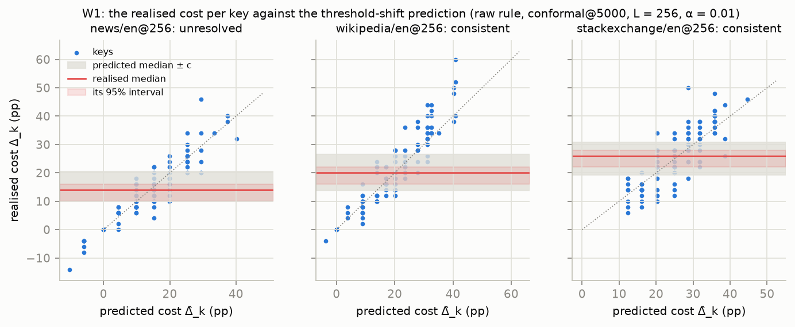
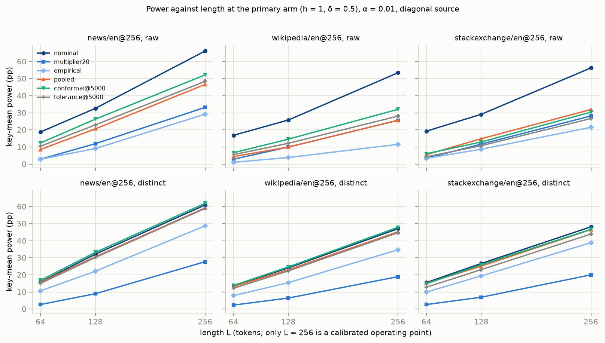

# 1 Introduction

A text watermark detector is deployed with one secret key. Its published false-positive guarantee holds under a null text law on average over the key draw, by method exactly, conservatively or asymptotically [@kirchenbauer2023watermark; @kuditipudi2024distortion; @li2025framework], and the deployer who must state a false-positive rate holds one draw. Our object is the key-conditional false-positive rate $\alpha_P(k)$ of §3.1, the rate the deployed key $k$ realises on the law $P$, and its distribution over the key law: how far one key's rate sits from the nominal $\alpha$, what properties of the statistic and of the text law govern that spread, and what restoring per-key validity costs in power.

**Marginal against conditional validity.** @vovk2012conditional distinguishes validity on average over training sets from validity conditional on the realised one: a method valid on average "might result in 0% training-conditional coverage even though the average coverage is" nominal [@bian2023training, p. 2]; Vovk's Propositions 2a and 2b give the PAC-type and tolerance-region statements and @liang2025algorithmic the stability route. We transfer the frame: the key is the training draw, the key and the realised texts are the "two sources of variability" of @ren2022derandomized (p. 11), and a per-key statement holds either for most keys with a stated failure probability (AutoMark's Equation 3 [@gloaguen2026automark]) or for the given key through calibration. The marginal theory of the published detectors is correct on its own terms; we add a conditional statement and refute none of it.

**The record.** That a fixed key makes the realised rate key-dependent is the published record's (§2): @jovanovic2025image named the question open for LLM watermarks and gave its finite-vocabulary case; @gloaguen2026diffusion report the earliest measurement we located; @genhatharan2026nominal, in a repository-published paper, measured KGW over ten and 128 keys, stated the mean-shift mechanism and its tokenizer dependence, counted the keys above nominal and priced per-key, per-length calibration; AutoMark [@gloaguen2026automark] formalised it as PAC over keys with a verification test and a 1/β multiplier whose cost it measures; @fernandez2026posthoc, TextSeal, textGrain, @delbianco2026compliance and the vLLM documentation state the limitation, screen keys or calibrate per cell [@sander2026textseal; @openai2026textgrain; @vllm2026watermarking]. Independently and concurrently, a course project states the same object, derives the across-key variance of the mean score under the all-token and deduplicated rules, measures the phenomenon over 1,000 keys on five domains under a single tokenizer, calibrates per key within and across domains and prices masking and key screening [@yukhimchuk2026keylottery]: its pre-registration is self-dated 2026-10-03 in a repository created on 2026-10-20, after this project's first protocol was locked on 2026-10-10 and before its release; this project, private until its release, found and cited it at the final gate of 2026-10-21, and the repository's files at the cited commit do not cite this project. Within-text repetition [@fernandez2023bricks; @kirchenbauer2024reliability; @cai2025collision] and many-key multiplicity [@fu2025multiuse] are distinct, known mechanisms. By the retrieved record this paper is at least third in line on the phenomenon, a limited historical characterisation, not an exhaustive priority count.

**Contributions.** The contributions are the across-key dispersion identities for a text law's context-indexed tuple weights under each retention rule, building on the single-context and deduplicated-count variances of Unigram's appendix [@zhao2024unigram] and the finite-vocabulary case of @jovanovic2025image, where the pair for the mean score under the all-token and deduplicated rules is also stated and validated by the concurrent project [@yukhimchuk2026keylottery] and what is this paper's is the ratio through the weights actually scored, the first rule's occupancy weights, the cross-set term and the validation across widths, tokenizers and lengths, with a validated key-free first-order predictor of the false-positive level's dispersion (§3, §5); the systematic per-key measurement against it on frozen open corpora with 1,000 keys per cell, across 10 cells of four sources and six languages, two tokenizers, three retention rules, five widths and the length chains, conditional on the realised texts with crossed intervals (§5); the comparison of remedies on the same keys and texts on the null side, with the many-key transfer term across laws and tokenizers and its key-free prediction, where per-key calibration, its pricing, pooled and per-language calibration and two-key practice are the record's [@genhatharan2026nominal; @gloaguen2026automark; @aremu2026activation; @xie2025classroom; @delbianco2026compliance; @nemecek2026crosslingual; @lichen2026chainmark; @xlr8harder2026synthid] (§6); and the per-key power cost of those remedies on one model's watermarked generations against a threshold-shift prediction (§7). The four studies were pre-registered and locked before any outcome existed, each after an independent second-model review; every result and count in the paper enters through a placeholder resolved from the locked records' registers, and the remaining numerals (settings, mathematical examples, other papers' own numbers) are checked against the pinned grids or listed with a reason at assembly (§8). Nothing here is a theorem, a power or transfer guarantee, a ranking of the remedies, a population extreme, a discrimination claim or a priority claim, and every per-key statement is conditional on the realised texts and, where there is one, the frozen calibration set (§8).

§2 places the work; §3 defines the object, the detectors and their rules, the identities, the predictor and the remedies as estimands; §4 describes the studies, the data and the locks; §5, §6 and §7 report the dispersion, the remedies with their transfer, and the power side; §8 draws what a deployer, a designer and an auditor take from the measurements, the limitations and reproducibility. Appendices A–E hold the derivations, the rules and verdicts, the data, the supplements, and the locks and review rounds.

# 2 Related work

**The phenomenon and its record.** The key dependence of a fixed key's realised false-positive rate is the record's. @jovanovic2025image name the LLM question as open (p. 27), frame it by subdomain and give the finite-vocabulary case (their Equation 9, a hypergeometric green count among alive codes); @gloaguen2026diffusion report the earliest measurement we located (100 keys on 10,000 texts under Unigram and two context sizes, p. 21); @genhatharan2026nominal measure KGW over ten and 128 keys, give the per-key green-rate mechanism with its √T growth, the tokenizer dependence and the share of keys above nominal, and price per-key, per-length calibration; AutoMark [@gloaguen2026automark] states soundness given a key as a PAC-over-keys requirement (Equation 3), tests it on sampled keys (Algorithm 3), proves the 1/β multiplier (Proposition 1) and prices it (Appendix C). @fernandez2026posthoc and TextSeal [@sander2026textseal] state the mechanism in words and screen keys by a uniformity test; textGrain's report states the same limitation of its idealised null across keys and applications [@openai2026textgrain, p. 6] and the vLLM documentation states it of one fixed key [@vllm2026watermarking]; Three Bricks report a residual at h = 0 after their within-text repair [@fernandez2023bricks]; a systematic review lists false-positive control among recurring concerns [@islam2026reliable]. Concurrently and independently of this work, a course project measures the same object over 1,000 keys on five domains of the OPT tokenizer at h = 1, finds the 99% key several times above α on English, code and Russian Wikipedia under Three Bricks scoring while the key-mean holds, and gives h = 0 as the extreme case [@yukhimchuk2026keylottery].

**Marginal theory on its own terms.** The pivotal statistics, detection efficiency and optimal rules of @li2025framework, @li2025robust and @cai2025collision, the optimal watermark of @huang2023optimal, Unigram's Type I theorem over the split [@zhao2024unigram] and the e-process detectors [@su2026anytime; @huang2026anytime; @luo2026anytime; @ding2026reference] control the level over the key or seed draw; @kuditipudi2024distortion's permutation p-value over fresh keys is text-conditional and key-marginal, the mirror image of our object. All hold as stated, and @ma2026predictive names the conditional null as the assumption such guarantees do not cover (p. 1).

**Calibration.** Training-conditional validity and the tolerance-region sample sizes behind per-key calibration are Vovk's [@vovk2012conditional, Propositions 2a and 2b]. Conformal null-text calibration is practised in the classroom [@xie2025classroom], per key for an activation watermark [@aremu2026activation], per cell including the key epoch with the frozen set's variability stated [@delbianco2026compliance], per language and pooled across eleven languages with no key varied [@nemecek2026crosslingual], pooled on one corpus [@lichen2026chainmark], as an empirical quantile of human text [@dathathri2024synthid] and with source-sensitive portability and length conditioning [@lihe2026saccopula; @globalsketch2026]; LUNA compares the model's unwatermarked outputs and human text as two negative classes in aggregate [@park2026luna], and a public SynthID-Text artefact calibrates two keys separately against three negatives and evaluates each frozen threshold across six negative corpora [@xlr8harder2026synthid]; a watermarking library's README measures the across-key SD of a per-key offset on human and on model text and states the fixed-key caveat [@bonet2026llmwatermark], and the concurrent course project standardises each key on reference text of its domain and transfers news-calibrated thresholds to its other domains [@yukhimchuk2026keylottery].

**Distinct mechanisms and the tokenizer axis.** Within-text repetition under one key breaks the z-test's calibration and is repaired by deduplication or modelled as collision [@fernandez2023bricks; @kirchenbauer2024reliability; @cai2025collision]; many keys multiply the false-detection rate [@fu2025multiuse], as many candidate tokenizers do [@wang2026bytemark], and a verifier that reports the key with the largest pivotal statistic inflates its Type I error, with a power price for restoring the level [@zhou2026blade]; humans and unwatermarked models mimic watermarked input in conversation [@khachaturov2025repetition]; "key collision" also names key reuse across generations [@wu2024collision]. §3 keeps each apart from the fixed-key effect. On the tokenizer axis Genhatharan's "the bias belongs to the pair of key and vocabulary" (p. 1) is the one prior measurement, and byte-level designs remove the tokenizer from detection [@li2026tiwm; @wang2026bytemark].

**Antecedents of the identities; vocabulary.** Unigram's appendix computes the across-split variance of a next-token law's green mass by sampling without replacement (Lemma C.21, p. 31) and of a deduplicated count (Remark E.2, p. 34; Lemma F.2, p. 36) [@zhao2024unigram], and @gloaguen2026unified model the split as correlated Bernoulli entries (p. 4); §3.3 builds on both, and the concurrent course project states and validates the same pair of variances for the mean score under the all-token and deduplicated rules, with a fixed-size and an independent colouring, in 203 of its 210 cells [@yukhimchuk2026keylottery]. Regulator and vendor texts supply vocabulary and motivation only: the EU Code of Practice asks signatories to measure "the error rate of the detection" [@ec2026code, Measure 3.2, p. 17], the Article 50 guidelines ask for effective, interoperable, robust and reliable detection [@ec2026guidelines, p. 26], and NIST notes that false positives and false negatives occur with non-zero probability [@nist2024ai1004, p. 12]; none reports a spread across keys.

# 3 Setting, identities and the first-order predictor

## 3.1 The object

A key-randomised detector rejects a text $x$ when a statistic of $x$ and a secret key exceeds a threshold, and its published false-positive guarantee holds under a null text law $P$ *on average over the key draw*, exactly, conservatively or asymptotically by method [@kirchenbauer2023watermark; @kuditipudi2024distortion; @li2025framework]. A deployer holds one key $k$ and sees the text, never the generating distribution; at design time it may also hold null texts of the deployment law. Our object is the key-conditional false-positive rate
$$\alpha_P(k) = \Pr_{X \sim P}\{\text{reject}(X; k)\},$$
for a calibrated detector $\alpha_P(k, D_{\mathrm{cal}})$ with the frozen calibration set in the conditioning, and the distribution of $\alpha_P(K)$ over the key law for fixed $P$: its across-key standard deviation (SD), its quantiles over sampled keys and the share of keys above a multiple of $\alpha$. This is training-conditional validity with the key as the training draw [@vovk2012conditional; @bian2023training; @liang2025algorithmic], the key and the texts being the two sources of variability of @ren2022derandomized. A per-key statement holds either *for most keys* with a stated failure probability (PAC over keys, AutoMark's Equation 3 [@gloaguen2026automark]) or *for the given key* through calibration; we never confuse the two. Every per-key quantity below is conditional on the realised texts, whose finite number contributes a term kept inside the target, and on the frozen calibration set where there is one.

## 3.2 Detectors and retention rules

The red–green test [@kirchenbauer2023watermark] seeds from the key and the $h$ preceding tokens a colouring of the $V$-token vocabulary into a green list of $m = \lfloor \gamma V \rfloor$ tokens; over the $M$ scored positions with green count $G$ it rejects at $z = (G - \gamma M)/\sqrt{M\gamma(1-\gamma)} > z_\alpha$, an asymptotic guarantee under an independence idealisation. Gumbel-max [@aaronson2022lecture; @kuditipudi2024distortion] sums $-\ln(1 - U)$ over the pseudo-uniforms $U$ of key, context and token against the exact $\mathrm{Gamma}(M, 1)$ tail, exact under i.i.d. pseudo-randomness. Both carry a *retention rule* for repeated contexts, the published repair of within-text repetition [@fernandez2023bricks; @kirchenbauer2024reliability], a mechanism distinct from the fixed-key effect: **raw** scores every position, **distinct** each distinct $(h+1)$-tuple once per text [@fernandez2023bricks], **first** the first token after each distinct context [@openai2026textgrain]. The width $h$ runs over $\{0, \dots, 4\}$; at $h = 0$ one global list colours every position [@zhao2024unigram]. A seeded hash gives computational, not statistical, independence: the identities below are ideal random-set statements whose empirical validity the studies check.

## 3.3 The mean shift and its exact across-key law

Under a fixed key $K$ the colour $G_K(u) \in \{0, 1\}$ of a tuple $u = (c, v)$ has mean $g = m/V$, and a text's $z$ is a weighted sum of colours. For fixed coefficients $w$ over tuples (a probability weight such as the fraction weights $w_q$ of §3.4, or the colour coefficients $w_z$ that turn the colours into $z$) define
$$\delta_K(w) = \sum_u w(u)\,\bigl(G_K(u) - g\bigr), \quad A = \sum_u w(u)^2, \quad B = \sum_c w(c)^2,$$
with $w(c)$ the mass of the seed class $c$. Then $\mathbb{E}_K\,\delta_K = 0$ (a detector centred at $\gamma$ carries the offset $g - \gamma$ into its level) and
$$\begin{aligned} \operatorname{Var}_K \delta_K(w) &= \frac{g(1-g)}{V-1}\,(V A - B) && \text{(fixed-size split)},\\ \operatorname{Var}_K \delta_K(w) &= g(1-g)\,A && \text{(independent colours)}, \end{aligned}$$
the first for a uniformly random $m$-subset per seed class, the second for independent colours; no independence within texts is needed. Their ratio is $(V - 1/C_{\mathrm{cond}})/(V - 1)$ with $C_{\mathrm{cond}} = A/B$: the fixed-size reduction $(1/C_{\mathrm{cond}} - 1)/(V - 1)$ is negligible for concentrated scored weights and grows with the size of the support they cover relative to $V$: weights uniform over $s$ tokens of one class give $(s - 1)/(V - 1)$, which reaches one only when they flatten over the whole vocabulary. The single-context case is Unigram's Lemma C.21, proved "by the variance formula for sampling without replacement" [@zhao2024unigram, pp. 31–32], Lemma F.2 (p. 36) being the general finite-population formula; Jovanović et al.'s Equation 9 is the hypergeometric green count among the alive codes of a finite vocabulary [@jovanovic2025image]; @gloaguen2026unified model the split as correlated Bernoulli entries. The pair for the mean score under the raw and distinct rules is also stated, for both colourings, and validated by the concurrent course project [@yukhimchuk2026keylottery]; what this paper adds is the ratio through the weights actually scored, the occupancy weights of each retention rule with the first rule among them, the cross-set term of §3.6 and the identities' validation across widths, tokenizers and lengths, all elementary and each checked in every cell of Studies 1 and 2 (R3, S3).

## 3.4 Occupancy weights and three collision quantities

Three normalisations of one count table appear, named apart (Appendix A.1): the *fraction weights* $w_q(u)$, the document-averaged share of a text's scored positions at tuple $u$, a probability weight under which the per-key green fraction is $\sum_u w_q(u)\,G_K(u)$; the *colour coefficients* $w_z(u) = N^{-1}\sum_i n_{iu}/\sqrt{M_i\gamma(1-\gamma)}$, under which the mean $z$ is $\sum_u w_z(u)\,(G_K(u) - \gamma)$; and the *standardised weights* $b(u) = N^{-1}\sum_i n_{iu}/\sqrt{M_i}$, which multiply a colour or score standardised to unit variance, so that $w_z = b/\sqrt{\gamma(1-\gamma)}$ and, at $g = \gamma$ under independent colours, the across-key covariance of two texts' $z$ is $\sum_u b_i(u)\,b_j(u)$. Under the raw rule $w_q$ is the pooled tuple law of the texts. A repeated-context rule replaces it by *occupancy weights* $a_u(L) = \mathbb{E}\bigl[\mathbf 1\{u \in U_L(X)\}/M_L\bigr]$, $U_L(X)$ the set retained from a text of length $L$ and $M_L = |U_L| > 0$. Three collision quantities stay distinct: $C_{\mathrm{cond}} = A/B$ of the scored weights, which sets the fixed-size ratio; the tuple collision $C_h = \sum_u p_h(u)^2$ of the law; and the between-text collision $\tilde A(h)$, the average over pairs of texts of $\sum_u w_i(u)\,w_j(u)$, which drives the shift the texts share. The occupancy collision is not monotone in $L$ in general, and the retained set reaches the vocabulary only under a coverage condition; under the distinct rule at $h = 0$, a document process every path of which eventually covers the same fixed support of $s$ tokens gives the limit $g(1-g)(V-s)/(s(V-1))$, Unigram's Remark E.2 (in which $m$ counts the unique tokens, our $s$) divided by $s^2$ [@zhao2024unigram, p. 34], so for a deduplicating detector at $h \le 1$ the fixed-size reduction can be material (§5.1).

## 3.5 The first-order predictor of the level

Write $z_i = \delta_k + e_i$ with one Gaussian shift common to a key's texts, $\delta_k \sim \mathcal N(\mu_\delta, \bar\rho)$, and residuals independent across texts with one variance $\sigma^2$. Then $\alpha_k = \bar\Phi\bigl((z_\alpha - \delta_k)/\sigma\bigr)$ and, on $N$ fixed texts,
$$\operatorname{Var}_K(\hat\alpha_k) = \operatorname{Var}(\alpha_k) + \mathbb{E}\bigl[\alpha_k(1-\alpha_k)\bigr]/N,$$
in closed form through Owen's $T$ function [@owen1956tables]; the second term is the finite-text floor. The inputs $\mu_\delta$, $\bar\rho$ (the average over pairs of texts of $\operatorname{Cov}_K(z_i, z_j)$) and $\sigma^2$ are exact second moments from §3.3 at the realised weights (Appendix A); the structure (one shift, one residual variance, conditional independence, normality) is an assumption whose adequacy the studies measure. A cell's *theory share* $\operatorname{Var}(\alpha_k)/\operatorname{Var}_K(\hat\alpha_k)$ separates the shift-driven dispersion from the floor, and a cell enters an adequacy rule only at a share of at least 0.75. For Gumbel-max the same model carries each text's exact Gamma threshold in $z$-units; the delta-method, pairwise and simulated-shift diagnostics are in Appendix A.

## 3.6 Hypotheses and remedies as estimands

**Length and width.** Under the raw rule $\bar\rho$ grows in proportion to $M$ while the occupancy weights stay concentrated, and under the repeated-context rules it drifts toward the plateau the covered support sets (H-length: R4 on $\bar\rho$ under the raw rule on synthetic laws, S4 on the observed SD on real text); the tuple collision $C_h = C(p_h)$ of a projectively consistent raw tuple law is non-increasing in $h$ (a finer partition), while the occupancy weights of different widths need not form such a family and $M$ changes with $h$, so a fall of the empirical between-text collision $\tilde A(h)$ and of the observed SD with $h$ is expected, not implied (H-width: R5 on $\tilde A(h)$, S5 on the observed SD at the longest length, each a registered hypothesis on its own estimand). Each rule is decided on its own estimand (§5.4).

**Per-key calibration.** With $N_{\mathrm{cal}}$ null texts of the deployment law and $j = \lfloor \alpha(N_{\mathrm{cal}}+1) \rfloor$, the conformal threshold of key $k$ is the $j$-th smallest of its calibration $p$-values: a fresh exchangeable text rejects with probability at most $j/(N_{\mathrm{cal}}+1)$ on average over the calibration draw, and for i.i.d. continuous scores the level given the calibration set is exactly $\mathrm{Beta}(j, N_{\mathrm{cal}}+1-j)$ [@vovk2012conditional], the *reference law* whose adequacy Study 3 measures. The tolerance threshold takes the largest $j_\delta$ with $\Pr\{\mathrm{Bin}(N_{\mathrm{cal}}, \alpha) \le j_\delta - 1\} \le \delta$, so a fixed key's level exceeds $\alpha$ with probability at most $\delta$ over calibration draws [@vovk2012conditional, Proposition 2b]. Validity *for the given key* therefore means validity on average over that key's calibration draw (conformal) or with a stated failure probability over draws (tolerance), never for every frozen calibration set. Two exceedance estimands stay apart: the finite-evaluation share of keys above $\alpha$ measured on $N_E$ texts, and the reference law's population share, a model quantity.

**Scheme-level comparators.** AutoMark's Proposition 1 multiplies by $1/\beta$ the $p$-value of a detector sound over the key and obtains soundness given a key at failure probability $\beta$, the Markov bound $\Pr_K\{\alpha_P(K) > t\} \le \alpha/t$ [@gloaguen2026automark]; the prerequisite holds asymptotically under the distinct rule and fails under the raw rule, where a repeated tuple makes a text's $p$-value a function of one colouring. An empirical multiplier fitted on disjoint keys and a pooled null threshold at the key-averaged level are plug-in comparators without a per-key guarantee; the distinct rule and the width are the design remedy.

**Transfer.** A per-key threshold set on the law $P'$ and applied to $P$ sees the shift difference $D^{C} - D^{E}$, whose across-key variance is $v = \bar\rho_C + \bar\rho_E - 2\rho_{CE}$ with $\rho_{CE} = \sum_u b_C(u)\,b_E(u)$ the cross-set shift covariance in the standardised weights $b$ of §3.4, exact under independent colours at $g = \gamma$ or unit-variance scores; the calibrated-threshold predictor combines $v$ with the Beta law of the order statistic (Appendix A). The mean-shift term controls the difference of means only: two laws with identical weights can give a calibrated level of $0$ on one and $1/2$ on the other, so transfer is measured, never guaranteed (§6.4).

**The power side.** The cost of a per-key threshold is the paired difference of realised powers over the same texts, predicted at the key median by the threshold shift through a watermarked $p$-value law fixed before the lock on validation keys (W1); the across-key dispersion of power after against before calibration is a ratio of two-way between-key components of the key-by-prompt rejection tables, a prompt-conditioned functional (W2); the model's own null law is read through §3.5's predictor fed the generated texts' moments (W3).

# 4 The four pre-registered studies: design, data and locks

Table 1 summarises the four studies and every pre-registered rule with its verdict. Each protocol was locked, its hash and those of every pinned code file recorded, before any outcome existed and after an independent second-model review had ended in agreement; the runner refuses to start without the lock, the analyser recomputes under it, and each report's builder re-derives every number from the record and asserts equality with the analyser's output. A failed rule stays failed. Appendix B states every rule with its tolerances; Appendix E lists the locks, the review rounds and the digests.

::: {.table-caption}
**Table 1.** The four pre-registered studies: design, grid, lock and every registered rule with its verdict and counts. A failed rule stays failed; the tolerances and the two text/code discrepancies are in Appendix B; the locks, records and review rounds in Appendix E.
:::

| Study | Units, keys and texts | Grid | Lock (date; checkpoint agreed before it; run) | Pre-registered rules and verdicts |
| --- | --- | --- | --- | --- |
| 1 Theory and simulation | 6 core and 4 illustration synthetic laws (i.i.d. Zipf over V = 1,000–50,000, first-order Markov chains, two control laws); K = 500 keys (200 under the fixed-size colouring on a core subset); N = 4,000 texts of up to 2,048 tokens per law | rules raw, distinct, first; h ∈ {0, …, 4}; γ ∈ {0.5, 0.25}; α ∈ {0.01, 0.05, 0.001}; 1,248 cells (1,194 live) | 2026-10-10, after checkpoint R03 (4 rounds); run 1.49 h | R1 adequacy of the predictor PASS (152 of 152 resolved cells consistent, 28 unresolved; 180 eligible of 360); R2 the simulator's key-mean against the exact binomial PASS (891 checks, 0 flagged, 18 structural zeros); R3 the identities PASS (1,098 checks, 0 gross failures) with the registered fixed-size statement refuted (largest reduction 28.3% at V ≥ 10,000); R4 H-length on ρ̄ under the raw rule PASS (40 of 40 chains); R4b saturation reproduced (4 cells); R5 H-width on Ã(h) PASS (48 of 48 chains) |
| 2 Measurement on real null text | 10 frozen corpus cells × 2 tokenizers; K = 1,000 keys (seeds 22,000–22,999); N = 10,000 texts per cell | KGW γ ∈ {0.25, 0.5} and Gumbel-max; rules raw, distinct, first; h ∈ {0, …, 4}; L chains 64–256 (64–1,024 for the two 1,024-token cells); α ∈ {0.01, 0.05, 0.001}; 3,468 cells | 2026-10-12, after checkpoint R05 (3 rounds); run 4.85 h | S1 adequacy on real text PASS (178 of 184 resolved cells consistent, 6 inconsistent, 33 unresolved; 217 eligible of 544); S2 the hash colouring's key-mean against the ideal colouring PASS (3,060 checks, 0 flagged); S3 the identities PASS (3,468 checks, 0 gross failures); S4 H-length on the observed SD under the raw rule FAIL (24 of 100 chains fail); S5 H-width on the observed SD at the longest length PASS (40 of 40 chains) |
| 3 Remedies and transfer | the same 10 cells × 2 tokenizers; Study 2's evaluation texts (N_E = 10,000, Gutenberg 7,122) and 5,000 calibration texts per cell; K = 1,000 evaluation keys (23,000–23,999) and 1,000 fitting keys (24,000–24,999) | six methods (nominal, multiplier 1/β at β = 0.05, empirical multiplier, pooled, per-key conformal and tolerance at δ = 0.05) at N_cal ∈ {500, 1,000, 2,000, 5,000}; rules raw, distinct; h ∈ {0, 1, 2}; L = 256; every ordered pair of calibration and evaluation cell within a tokenizer and across the two | 2026-10-15, after checkpoint R07 (3 rounds); run 0.97 h | T1 adequacy of the calibrated-threshold predictor PASS (1,471 of 1,474 resolved rows consistent, 3 inconsistent, 20 unresolved; 1,494 eligible of 1,600); T2 the predicted sign of calibration's effect on the dispersion PASS (875 of 875 resolved material rows agree, 4 unresolved; 879 material); REP Study 2's nominal dispersion reproduced with independent keys PASS (108 checks, 0 gross failures) |
| 4 The power side | Qwen2.5-1.5B generations: 3 English prompt cells; K₄ = 100 of Study 3's keys × 50 prompts × 256 tokens per arm; a null arm of 5,000 unwatermarked continuations per cell scored for all 1,000 evaluation keys | three arms (h = 1, δ = 0.5; h = 1, δ = 2.0; h = 2, δ = 0.5); rules raw, distinct; L ∈ {64, 128, 256}; every committed threshold of Study 3 (six methods, ten calibration sources, N_cal, α ∈ {0.01, 0.05, 0.001}); 930 units | 2026-10-16, after checkpoint R09 (5 rounds); run 11.86 h | W1 the threshold-shift prediction of the median per-key cost PASS (2 cells consistent, 0 inconsistent, 1 unresolved of 3); W2 the across-key dispersion of power after against before calibration FAIL (0 agree, 0 disagree, 6 unresolved of 6 rows); W3 the key-free predictor on the model's own null law PASS (216 of 216 resolved rows consistent, 5 unresolved; 221 eligible of 240) |

**Study 1 (synthetic laws).** 6 core and 4 illustration text laws (i.i.d. Zipf laws over $V$ = 1,000 to 50,000 tokens, first-order Markov chains and two control laws), $N$ = 4,000 texts of up to 2,048 tokens per law, $K$ = 500 keys (200 under the fixed-size colouring on a core subset), three rules, five widths, $\gamma \in \{0.5, 0.25\}$: 1248 cells, 1194 live.

**Study 2 (real null text).** The same detectors on 10 frozen corpus cells under 2 tokenizers (Llama-3.2, $V$ = 128,256; Qwen2.5, $V$ = 151,936), $N$ = 10,000 texts per cell, $K$ = 1,000 fresh keys, the KGW family at $\gamma = 0.25$ (primary) and $\gamma = 0.5$ and Gumbel-max, three rules, five widths and each cell's length chain: 3468 cells, with a crossed key-by-document bootstrap.

**Study 3 (remedies and transfer).** Study 2's evaluation texts ($N_E$ = 10,000; Gutenberg 7,122) and 5,000 further calibration texts per cell; $K$ = 1,000 fresh evaluation keys and 1,000 disjoint fitting keys for the scheme-level methods; the six methods of §3.6 ($\beta$ = 0.05, $\delta$ = 0.05, $N_{\mathrm{cal}} \in \{500, 1{,}000, 2{,}000, 5{,}000\}$), both rules, $h \in \{0, 1, 2\}$, $L$ = 256, and every ordered pair of calibration and evaluation cell within and across the tokenizers.

**Study 4 (the power side).** Qwen2.5-1.5B (Qwen/Qwen2.5-1.5B at revision `8faed761d45a263340a0528343f099c05c9a4323`, apache-2.0) generates 256 tokens from the first 64 tokens of 50 fresh prompts per cell under the KGW soft rule at $\gamma = 0.25$ in three arms (Table 1), for $K_4$ = 100 of Study 3's keys, a seeded uniform subset, on 3 English prompt cells; 5000 unwatermarked continuations per cell are scored under every committed threshold for all 1,000 evaluation keys. Thresholds come from Study 3's record; power is the share of a key's texts rejected and the cost its paired difference against the nominal threshold (900 generation units; 0 record-contract failures).

**Data.** The null corpora are open-content sources frozen under a hashed manifest: the Common Pile v0.1 news, Stack Exchange and Project Gutenberg subsets [@kandpal2025commonpile], with a per-document licence string, and the Wikimedia Wikipedia dumps of 2023-11-01 in six languages under the project licence. After licence filtering and exact and near-duplicate clustering (exact Jaccard at 0.65) the partition holds 2,590,960 cluster representatives, of which 20.0% by cluster hash are sealed as a holdout that no study opened (`final: false` in every lock). Ten confirmatory cells define the texts (Table 1): English news, Wikipedia and Stack Exchange at 256 tokens, five other Wikipedia languages at 256, English Wikipedia and Gutenberg at 1,024, each text length-eligible under both tokenizers. Study 4's prompts are fresh units of the three English cells, disjoint from every evaluation and calibration set.

**Keys and pairing.** Each study draws one key sample from its own namespace (validation keys and a reserved range apart, refused by code) and shares it across every cell, so comparisons across cells are paired and the key-sampling error is common to them: "$n$ of $m$ cells" counts are not independent replications. Exceptions are stated where they apply (Study 1's fixed-size draws are paired within a chain only; Study 4's power rows use 100 keys and its null rows all 1,000).

**Disclosures.** Two text/code discrepancies travel with their results: Study 1's R4b compared a residual with $3\,\mathrm{SE} + 10^{-9}$ where the protocol wrote $3\,\mathrm{SE}$, and Study 2's unit-variance block, listed in the protocol, is the report builder's, not the locked analyser's. Zero thresholds at a positive order index and abstaining keys (Studies 3–4) are reported as abstentions, never repaired. Each later study was designed with the earlier studies' outcomes and the key-free statistics of the realised texts known, as the protocols disclose; no per-key level of a study's own keys existed before its lock.

# 5 Results I: the dispersion on synthetic laws and real text

## 5.1 Identities and audits

The exact across-key identities of §3.3 hold in every live cell under both colourings: 1098 checks on the synthetic laws with 0 gross failures (R3) and 3,468 on real text with 0 (S3). The simulator's and the hash colouring's key-mean levels pass the exact Hoeffding audit against the ideal colouring (891 and 3,060 checks, none flagged), a bound on gross deviation that cannot flag under-rejection at α = 0.01 in most cells. The registered statement that the fixed-size reduction is below 1% for V ≥ 10,000 is refuted as registered: under the distinct rule at h ≤ 1 the largest reduction on the synthetic laws is 28.3% at V = 10,000, where deduplication flattens the occupancy weights over the covered support; it holds under the raw and first rules, and on real text at V ≥ 128k the largest reduction is 2.101% under the distinct rule (7 of 68 cells at or above 1%) and 0.346% under the raw (Appendix D3). The support control reproduces its analytic saturation under the locked rule (R4b), whose implemented tolerance, $3\,\mathrm{SE} + 10^{-9}$ against the protocol's $3\,\mathrm{SE}$, is a disclosed discrepancy (§4, Appendix B.6).

## 5.2 The predictor by block (Appendix D, Table D1)

On the synthetic laws the common-factor predictor is adequate in 152 of 152 resolved cells (R1 PASS; resolved ratios 0.792–1.20, median 0.978); the 28 unresolved cells are all at h = 0, where the discrete, skewed score leaves the intervals too wide to decide. On real text S1 passes as registered, 178 of 184 resolved cells consistent (6 inconsistent, 33 unresolved), with a systematic sign: at γ = 0.25 and α = 0.01 the predictor under-predicts the across-key SD by about a fifth (resolved median ratio 1.21, up to 1.78), by more in the far tail (1.72 at α = 0.001, where 41.7% of the resolved cells are consistent), by less at α = 0.05 (1.08) and not at γ = 0.5 (0.984), each block on its own eligible set. The pairwise-covariance and simulated-shift predictors reduce the discrepancy a little and do not remove it; the right-skewed, discrete count at γ = 0.25 is a plausible account the study does not isolate. The Gumbel-max predictor is weaker (59.0% of the resolved cells consistent), as registered for a measured approximation.

## 5.3 What one fixed key faces (Figure 1, Table D14)

On the frozen corpora at h = 1, one key's false-positive rate at a nominal 1% is not 1%. Under the raw rule the key-averaged level is 2.52%–8.65%, inflated by within-text repetition, and the sampled keys lie on both sides of it: across the twenty (cell, tokenizer) units the 99% key is 4.8%–38.3%, the worst sampled key 6.1%–51.6% and 55.5%–100.0% of the keys sit above 2α. Under the distinct rule the key-mean is near nominal (1.09%–1.18%) and the per-key level still runs from a median of 0.92%–1.13% to a 99% key of 1.9%–3.7% and a worst sampled key of 2.2%–6.6%; Gumbel-max under the distinct rule disperses alike (its 99% key 1.7%–3.0%), and 609 of the 1020 KGW cells at γ = 0.25 have at least one sampled key above 2α. The same kind of measurement over 1,000 keys on five domains under a single tokenizer, with the 99% key several times above α on code and on Russian Wikipedia, is the concurrent project's [@yukhimchuk2026keylottery]. At h = 0 the raw rule gives nearly binary per-key levels, the per-key face of the known within-text repetition effect [@fernandez2023bricks; @kirchenbauer2024reliability]: on human text the 99% key is 37.0%–96.3% and on the synthetic laws 44.6%–47.4% of the keys sit above 5α at L = 2,048. On the model's own unwatermarked generations (§7) the h = 0 levels are instead broad and right-skewed (medians 3.10 / 4.42 / 6.65% in news / Wikipedia / Stack Exchange, with 417 / 475 / 598 of the 1,000 evaluation keys between 5% and 95%); whether the two shapes differ by law or by measurement is not tested; the concurrent project reports h = 0 as its extreme case under the deduplicated rule, with most keys flagging nothing on its Russian cell [@yukhimchuk2026keylottery].

## 5.4 Length and width (Figure 2)

On the synthetic laws the registered length hypothesis holds for the raw rule's shift dispersion (R4 PASS, 40 of 40 chains; ρ̄ grows ×32.0–32.8 from L = 64 to 2,048 at h = 1, against ×2.0–5.6 under the distinct rule, the drift toward the plateau the covered support sets). On real text it is refuted as registered on the observed dispersion in 24 of 100 raw-rule chains (S4 FAIL), in three overlapping groups: 18 at h = 4, of which the 16 outside the news register are where the predictor's decomposition puts the finite-text term first; 6 news chains, where the between-text collision itself falls with length; and 2 further h = 1 chains; 76 chains hold. A plausible account of the h = 4 dip, not an identified decomposition, is the lattice of the z-test's exact size at γ = 0.25 (1.54% at M = 60, 1.02% at 124, 1.35% at 252), which a reported "false-positive rate at 1%" inherits. The width hypothesis holds on both: Ã(h) is non-increasing in every synthetic chain (R5, 48 of 48) and so is the observed SD at the longest length in every real chain (S5, 40 of 40); at h ≥ 3 the finite-text term dominates most cells. The one prior data point of the width effect is Gloaguen et al.'s [@gloaguen2026diffusion], and the concurrent project's exploratory sweep over widths 1 to 8, labelled post hoc by its author, is a second [@yukhimchuk2026keylottery].

## 5.5 Domain, language and tokenizer (Figure 3)

A key's level co-moves across the five English cells (median correlation 0.562 at h = 1 under the distinct rule and 0.827 at h = 0 under the raw, Llama-3.2) and much less between English and the other languages (0.027 and 0.125), with higher cross-language correlations under Qwen2.5 (0.233): correlations of sampled levels at one threshold, not transfer results [@nemecek2026crosslingual; @jovanovic2025image]. Across the six Wikipedia languages most keys differ by more than a factor 2 at h ≤ 1 (at h = 1, 75.1%–76.4% of the keys under the raw rule and 66.5%–74.4% under the distinct; at h = 0, 99.8%–100.0% and 99.7%–99.9%), an empirical disparity over the sampled keys and realised texts, never a discrimination claim; the concurrent project's Russian Wikipedia cell is the most dispersed of its five under the OPT tokenizer, and its upper-key false-positive quantile at matched length is about half as large under Qwen2.5's tokens, a quantile ratio and a tokenizer caveat its author reports, not an across-key SD [@yukhimchuk2026keylottery]. For the same texts, Qwen2.5 tokens disperse 1.06–2.56 times the Llama-3.2 value at h = 1 under the raw rule (Table D2a), the tokenizer dependence @genhatharan2026nominal reported, which the byte-level designs remove from detection [@li2026tiwm; @wang2026bytemark]. A labelled post-hoc computation accounts for the co-movement across tokenizers through the integer tuple ids the colouring hash reads: the identity-predicted correlation of the per-key green fraction from the shared ids matches the observed correlation cell by cell (Table D2b). That shared integer ids across scripts raise Qwen2.5's cross-language correlations is a hypothesis, not a measurement.

![**Figure 1.** What one fixed key faces on real null text: per corpus cell, the distribution over the 1,000 sampled keys of the per-key false-positive level at the nominal α = 1% on the realised 10,000 texts, KGW at γ = 0.25 and h = 1 at the cell's longest length, under the raw rule (top) and the distinct rule (bottom), Llama-3.2 tokens left and Qwen2.5 right within each cell; the bands cover 1–99% and 5–95% of the sampled keys, the open markers are the median key, the filled markers the worst sampled key with its crossed key-by-text 95% interval, never a population extreme; the raw rule's key-mean inflation is within-text repetition, a distinct mechanism. Gumbel-max under the distinct rule is Figure D6.](figures/fig1_deployer.png)

![**Figure 2.** The across-key SD of the level against text length under the three retention rules at h = 1, α = 0.01 and γ = 0.25, observed (solid) and predicted (dashed): (a) one synthetic law (i.i.d. Zipf, V = 10,000, s = 1.0; K = 500 keys on N = 4,000 texts); (b)–(d) real text, one chain per (cell, tokenizer) over the 10 corpus cells and 2 tokenizers. R4 is a registered PASS on ρ̄ under the raw rule on the synthetic laws and S4 a registered FAIL on the observed SD in 24 of 100 raw-rule chains, each decided on its own estimand; the crosses mark the S4 failures at h = 1; the predictor's under-prediction at γ = 0.25 is visible in (b) and stated in §5.2.](figures/fig2_length.png)

# 6 Results II: remedies and transfer on the null side

## 6.1 Per-key calibration on the deployment law (Table 2, Figure 4)

With N_cal null texts of the deployment law, per-key conformal calibration brings the key-mean level near nominal under the distinct rule (0.98%–1.01% across the twenty units at N_cal = 5,000) and below it under the raw rule (0.83%–0.93%; a lattice-tie account, suggestive), and reduces the across-key dispersion from the nominal 0.44 pp to 0.33 pp at N_cal = 1,000 and 0.17 pp at N_cal = 5,000 (distinct rule, h = 1; medians over the units), the level the i.i.d. reference law gives for the calibration order statistic plus the finite-text floor. Under the reference law about half the keys sit above α, the order statistic's level being centred near α: the measured share is 45.6% in the median unit against a finite-evaluation prediction of 47.0%, the reference law's population share being 48.1%, a model quantity. The tolerance method at δ = 5% and N_cal = 5,000 puts 4.7% of keys above α in population under the reference law, while on 10,000 evaluation texts the measured share is 7.3% in the median unit against a finite-evaluation prediction of 7.7%. The calibrated-threshold predictor passes as registered (T1: 1,471 of 1,474 resolved rows consistent; eligible ratios median 0.990), centred where Study 2's fixed-threshold predictor was not, every non-consistent row under the raw rule on three evaluation cells. The reference law is a model whose adequacy was measured, not a theorem, and validity for the given key means validity on average over that key's calibration draw (conformal) or with the stated failure probability over draws (tolerance), never for every frozen calibration set; per-key calibration as practice is the record's [@vovk2012conditional; @xie2025classroom; @aremu2026activation; @genhatharan2026nominal; @delbianco2026compliance], and the concurrent project standardises each key's score on same-domain reference text over 1,000 keys, after which its key-averaged false-positive rate and its upper keys remain above the nominal and ideal levels [@yukhimchuk2026keylottery].

## 6.2 AutoMark's multiplier and the plug-in comparators

Proposition 1 multiplies a p-value sound over the key by 1/β. Under the distinct rule, where that prerequisite holds asymptotically, the multiplier is conservative on these texts (key-mean 0.07%, no key above α in any of the 20 units at h = 1); under the raw rule, which violates the prerequisite, 10.1% of the keys exceed α in the median unit, a property of the raw rule and not of their proposition [@gloaguen2026automark]. The smallest empirical multiplier fitted on disjoint keys varies by rule (κ̂ 2.29 under the distinct rule against 25.89 under the raw) and by cell; its measured share of keys above α is at or below β in most units (above β = 5% in 4 of 20 distinct-rule and 2 of 20 raw-rule units). The pooled calibration targets the key-average without per-key control: under the distinct rule it restores the key-mean (0.99%) with an across-key SD of 0.40 pp against the nominal 0.44 pp and 41.4% of the keys above α (Table 2 gives the raw rule, where lowering the inflated mean lowers the absolute SD); pooled null recalibration is practised [@lichen2026chainmark; @nemecek2026crosslingual].

## 6.3 The design remedy, paired on the same keys and texts

At h = 1 the distinct rule brings the nominal key-mean from 2.49%–4.22% to 1.11%–1.17% and the nominal across-key SD from 1.36 to 0.44 pp; per-key conformal calibration at N_cal = 5,000 brings either to 0.17 pp, with the key-mean near α under the distinct rule. Within-text deduplication is the record's repair [@fernandez2023bricks]; which lever matters more depends on the estimand and on the power side (§7). Per-key calibration's dispersion falls below the nominal test's from N_cal = 500 in every unit under the raw rule and 500–2,000 under the distinct rule at h = 1 (at h = 2 7 of 20 units never break even within the grid; Table D10a); the null-side cost in z-units is Table D10b's, and the abstaining thresholds at α = 0.001 and the 6 stored zero thresholds at a positive order index are reported as abstentions, never repaired (Table D10d).

## 6.4 Transfer across laws and tokenizers (Table D15, Figure 5)

Under the distinct rule at h = 1 and α = 0.01, a per-key conformal threshold set on one law's 5,000 null texts and applied to another keeps its key-mean near α on average over keys but disperses about 3.5 times more across keys for pairs of an English cell and another language's (medians over the ordered pairs: 0.59 against 0.17 pp on the diagonal; 2.7 within English and 3.0 between two non-English languages), and the key-free predictor from the cross-set covariance identity anticipates that dispersion out of sample (T1 by class: median ratios 1.005, 0.986 and 1.041) and its sign (T2: 875 of 875 resolved material rows agree), across tokenizers as well (1,573 of 1,574 resolved rows consistent, Table D13b; the byte-level designs that remove the tokenizer from detection are TI-WM and ByteMark [@li2026tiwm; @wang2026bytemark]); a measurement with its own error, not a transfer guarantee. The failure of nominal thresholds across languages and per-language calibration are @nemecek2026crosslingual's, and evaluating a fixed per-key threshold across other negative corpora is prior practice [@xlr8harder2026synthid]; the concurrent project transfers news-calibrated per-key thresholds to its other domains and finds their upper keys several times above α on code and on Russian Wikipedia, a measurement from a single calibration domain without a prediction [@yukhimchuk2026keylottery].

## 6.5 Integrity

Study 2's nominal dispersion is reproduced with 1,000 independent keys on the same texts (REP: 108 checks, 0 gross failures); that the across-key summaries vary little over calibration resamples (Table D10c) says nothing about how one fixed key's threshold moves with the calibration draw, the Beta term of §3.6.

::: {.table-caption}
**Table 2.** The remedies on the null side when the calibration law is the deployment law (the diagonal): KGW, γ = 0.25, h = 1, α = 0.01; medians over the 20 (tokenizer, cell) units of K = 1,000 keys on the N_E = 10,000 evaluation texts (Gutenberg 7,122). The share of keys above α is the finite-evaluation estimand, measured and predicted; the reference law's population share is a model quantity. The multiplier arm is read under Proposition 1's prerequisite only (the distinct rule); the empirical plug-in is not AutoMark's test; the null-side cost is the median key's threshold in z-units above z_α (the scheme-level methods' fitted threshold). The h = 2 rows are in Table D8b; every α and every unit are in the Study 3 report's supplement `tables_remedy_full.md` in the companion repository.
:::

| Rule | Method | Key-mean (%) | SD (pp) | 99% key (%) | Keys > α, measured (%) | predicted, finite-evaluation (%) | predicted, population (%) | Median key's cost (z) |
| --- | --- | --- | --- | --- | --- | --- | --- | --- |
| raw | nominal | 3.355 | 1.363 | 7.81 | 99.8 | 96.9 | 97.2 | 0.00 |
| raw | multiplier 1/β | 0.626 | 0.352 | 1.87 | 10.1 | 1.0 | 1.0 | 0.96 |
| raw | empirical multiplier | 0.425 | 0.261 | 1.34 | 3.1 | 5.3 | 4.9 | 1.04 |
| raw | pooled | 0.891 | 0.466 | 2.50 | 28.4 | 41.4 | 41.6 | 0.67 |
| raw | conformal, N_cal 1,000 | 0.860 | 0.291 | 1.69 | 28.7 | 42.8 | 43.3 | 0.60 |
| raw | conformal, N_cal 5,000 | 0.878 | 0.167 | 1.30 | 20.7 | 46.8 | 48.0 | 0.60 |
| raw | tolerance, N_cal 1,000 | 0.423 | 0.202 | 1.04 | 1.4 | 2.9 | 2.5 | 1.04 |
| raw | tolerance, N_cal 5,000 | 0.681 | 0.145 | 1.07 | 2.3 | 7.6 | 4.6 | 0.75 |
| distinct | nominal | 1.132 | 0.441 | 2.44 | 54.8 | 43.1 | 43.4 | 0.00 |
| distinct | multiplier 1/β | 0.072 | 0.048 | 0.22 | 0.0 | 0.0 | 0.0 | 0.96 |
| distinct | empirical multiplier | 0.521 | 0.240 | 1.33 | 4.5 | 5.5 | 5.0 | 0.30 |
| distinct | pooled | 0.994 | 0.397 | 2.18 | 41.4 | 43.1 | 43.4 | 0.05 |
| distinct | conformal, N_cal 1,000 | 1.002 | 0.332 | 1.95 | 45.4 | 45.3 | 45.9 | 0.04 |
| distinct | conformal, N_cal 5,000 | 0.996 | 0.172 | 1.43 | 45.6 | 47.0 | 48.1 | 0.03 |
| distinct | tolerance, N_cal 1,000 | 0.501 | 0.234 | 1.18 | 3.3 | 3.3 | 2.9 | 0.31 |
| distinct | tolerance, N_cal 5,000 | 0.777 | 0.153 | 1.17 | 7.3 | 7.7 | 4.7 | 0.12 |

![**Figure 4.** The deployer's view by method when the calibration law is the deployment law: per (tokenizer, cell) unit, the median key and the 99% key of the realised level at α = 0.01 under each method (KGW, h = 1; raw rule left, distinct rule right; K = 1,000 keys per unit on N_E = 10,000 evaluation texts, Gutenberg 7,122; N_cal ∈ {1,000, 5,000}), with the median over the 20 units. The multiplier arm under the raw rule is numerical only (its prerequisite fails there), the empirical plug-in is not AutoMark's test, the conservative raw-rule conformal level has a suggestive account only, and every level is conditional on the frozen calibration set.](figures/fig4_remedies.png)

![**Figure 5.** Transfer of a per-key conformal threshold: (a) the observed across-key SD of the level when a threshold set on the calibration cell's 5,000 null texts is applied to the evaluation cell (Llama-3.2 tokens, KGW distinct rule, h = 1, α = 0.01; K = 1,000 keys; the diagonal outlined); (b) log₂ of the observed over the predicted SD, the band [2/3, 3/2] being ±0.58. The predicted SD and the share of keys above α are Figure D7; the raw rule and h = 2 by class are Table D13a, the cross-tokenizer transfer Table D13b, and the Qwen2.5 counterpart of this map is in the Study 3 report's supplement `tables_pairs_kgw_alpha0.01_full.md` in the companion repository; a measurement with its own error, never a transfer guarantee.](figures/fig5_transfer.png)

# 7 Results III: the power side

## 7.1 The cost of per-key calibration (Table 3, Figure 6)

On Qwen2.5-1.5B's KGW generations at δ = 0.5, h = 1, L = 256 and α = 0.01 under the raw rule, per-key conformal calibration at N_cal = 5,000 costs a median 14.0 / 20.0 / 26.0 pp of power (news / Wikipedia / Stack Exchange) from nominal key-means of 66.2 / 53.4 / 56.3 pp, paid unevenly across keys (in news the 5th–95th percentiles run from -4.0 to 34.0 pp): a key whose threshold sits above α gains power. The other methods' costs at the same setting are in Table 3, measured values at one setting and never a ranking. Under the distinct rule, where the per-key shifts are small, the median conformal cost is 0.0 / 0.0 / 0.0 pp. At δ = 2.0 power is near saturation: every method's key-mean power is at least 99.2 pp over the 72 rows, the largest mean cost 0.76 pp and the largest 95th-percentile per-key cost 4.0 pp, small and not zero. At h = 2 the median conformal cost under the raw rule is 10.0 / 14.0 / 16.0 pp at about the same nominal power (Table 3). Priority on pricing per-key calibration and on per-key operating points is Genhatharan's and AutoMark's [@genhatharan2026nominal; @gloaguen2026automark], and the concurrent project prices masking of frequent pairs and key screening, remedies not run here, on OPT-1.3B generations [@yukhimchuk2026keylottery] (§8).

## 7.2 W1 (PASS)

The threshold-shift account, fixed per cell before the lock, predicts the key-median cost within the tolerance on 2 of 3 cells and leaves news unresolved (realised 14.0 with interval [10.0, 16.0] against 15.2 ± 5.2 pp, the interval 0.07 pp below the band's lower edge); per key the realised cost lies within the tolerance of its prediction for 70–78% of the keys and correlates with it at 0.82–0.93. The pass does not establish that individual keys share a score law, and the competing explanations the protocol names are not separated.

## 7.3 W2 (FAIL, a stated design limit)

The ratio of the across-key dispersion of power after to before calibration, the prompt-conditioned functional, has point estimates 0.676–0.961, below 1 in 6 of 6 rows, but no key-bootstrap interval resolves a pre-stated side (Tables D6a and D6b): the between-key component of power (SD 3.1–9.6 pp) is of the order of its noise correction (6.6–6.9 pp) at 100 keys × 50 prompts. No sentence here says that calibration equalises power across keys; the population reading over a cell's prompt law is an extrapolation without a confidence statement; whether more prompts per key or a prompt-channel construction would resolve the ratio is not established and would be a new version.

## 7.4 W3 (PASS) and the model's own null law

Study 3's key-free predictor, fed the generated null set's own moments, anticipates the across-key SD of the model-null level within [2/3, 3/2] on 216 of 216 resolved rows (221 eligible of 240; the 5 unresolved rows are Wikipedia-source transfer rows at h = 1 under the raw rule), a conditional check on one generated sample per cell that says nothing about nominal validity on generated text. There, at h = 1 under the raw rule, the nominal key-means are 2.20 / 3.29 / 3.75 pp with 90 / 96 / 100% of the 1,000 evaluation keys above α, and the diagonal conformal thresholds set on human text leave 19 / 18 / 43% above α (Appendix D7); the comparison of the two negative classes in aggregate is LUNA's [@park2026luna], and two keys calibrated separately on the model's text and on human text with frozen thresholds evaluated across negative corpora is the two-key artefact's practice [@xlr8harder2026synthid].

## 7.5 Operating points, transfer sources and the mechanism

Over the 100 power keys under the nominal threshold, 86 / 95 / 100% have a stored corpus level above α and 90 / 95 / 100% a model-null level above α; conformal calibration at N_cal = 5,000 brings the shares to 21 / 12 / 24% and 23 / 18 / 45%, so in Stack Exchange a calibration on human null text does not carry key by key to the model's own text. Calibration weakens the association between a key's null level and its power (the correlations under every method are in Table D7b). A threshold transferred from another cell buys power with level (the news source applied to Stack Exchange: 44.5 pp of power with 89% of the evaluation keys above α on the model's null text; Appendix D8); no transfer guarantee follows. A key's stored null level correlates with its nominal power at 0.65 / 0.66 / 0.57 and with its green share under the hook at 0.71 / 0.71 / 0.59, consistent with the hypothesis that a key whose hash colours the model's likely tokens green gets both a higher null level and a stronger watermark: a descriptive association, not a variance decomposition. No text was excluded for quality (loop shares in Table D9a).

::: {.table-caption}
**Table 3.** The per-key power cost of each remedy on Qwen2.5-1.5B's KGW generations (γ = 0.25, L = 256, α = 0.01, the diagonal calibration source): the key-mean power (pp) and the median per-key cost against the nominal threshold with its 5th–95th percentiles across keys [pp], over K₄ = 100 keys with n = 50 texts each. Every cost carries its conditions and none ranks the remedies; the multiplier arm is read under Proposition 1's prerequisite only; the per-key shares above α on both null laws are in Figure 6 and Table D7b; priority on pricing per-key calibration and on per-key operating points is Genhatharan 2026's and AutoMark's [@genhatharan2026nominal; @gloaguen2026automark].
:::

| Arm | Rule | Method | news: power | cost, median [5%, 95%] | Wikipedia: power | cost, median [5%, 95%] | Stack Exchange: power | cost, median [5%, 95%] |
| --- | --- | --- | --- | --- | --- | --- | --- | --- |
| h = 1, δ = 0.5 | raw | nominal | 66.2 | 0.0 [0.0, 0.0] | 53.4 | 0.0 [0.0, 0.0] | 56.3 | 0.0 [0.0, 0.0] |
| h = 1, δ = 0.5 | raw | multiplier 1/β | 33.2 | 34.0 [24.0, 42.0] | 25.6 | 28.0 [20.0, 38.1] | 28.1 | 28.0 [18.0, 38.0] |
| h = 1, δ = 0.5 | raw | empirical multiplier | 29.2 | 37.0 [28.0, 48.0] | 11.5 | 42.0 [28.0, 54.1] | 21.5 | 36.0 [22.0, 46.0] |
| h = 1, δ = 0.5 | raw | pooled | 46.6 | 20.0 [12.0, 28.0] | 25.6 | 28.0 [20.0, 38.1] | 31.9 | 24.0 [14.0, 32.1] |
| h = 1, δ = 0.5 | raw | conformal, N_cal 5,000 | 52.2 | 14.0 [-4.0, 34.0] | 32.0 | 20.0 [1.9, 44.0] | 30.4 | 26.0 [10.0, 42.0] |
| h = 1, δ = 0.5 | raw | tolerance, N_cal 5,000 | 48.4 | 18.0 [0.0, 36.2] | 28.1 | 24.0 [7.9, 48.1] | 26.7 | 30.0 [13.9, 46.1] |
| h = 1, δ = 0.5 | distinct | nominal | 60.9 | 0.0 [0.0, 0.0] | 47.0 | 0.0 [0.0, 0.0] | 48.2 | 0.0 [0.0, 0.0] |
| h = 1, δ = 0.5 | distinct | multiplier 1/β | 27.7 | 32.0 [24.0, 46.0] | 19.0 | 28.0 [19.9, 38.0] | 20.0 | 28.0 [18.0, 38.1] |
| h = 1, δ = 0.5 | distinct | empirical multiplier | 48.7 | 12.0 [6.0, 18.1] | 34.8 | 12.0 [6.0, 20.0] | 38.9 | 8.0 [2.0, 16.0] |
| h = 1, δ = 0.5 | distinct | pooled | 59.2 | 2.0 [0.0, 4.0] | 45.2 | 2.0 [0.0, 4.0] | 46.5 | 2.0 [0.0, 6.0] |
| h = 1, δ = 0.5 | distinct | conformal, N_cal 5,000 | 61.9 | 0.0 [-12.0, 10.1] | 47.9 | 0.0 [-12.0, 10.0] | 46.6 | 0.0 [-8.0, 12.0] |
| h = 1, δ = 0.5 | distinct | tolerance, N_cal 5,000 | 58.9 | 1.0 [-8.1, 14.0] | 44.7 | 2.0 [-8.1, 12.1] | 43.9 | 4.0 [-6.0, 16.2] |
| h = 1, δ = 2.0 | raw | nominal | 100.0 | 0.0 [0.0, 0.0] | 99.9 | 0.0 [0.0, 0.0] | 99.8 | 0.0 [0.0, 0.0] |
| h = 1, δ = 2.0 | raw | conformal, N_cal 5,000 | 100.0 | 0.0 [0.0, 0.0] | 99.8 | 0.0 [0.0, 0.1] | 99.7 | 0.0 [0.0, 2.0] |
| h = 2, δ = 0.5 | raw | nominal | 65.4 | 0.0 [0.0, 0.0] | 52.3 | 0.0 [0.0, 0.0] | 53.7 | 0.0 [0.0, 0.0] |
| h = 2, δ = 0.5 | raw | conformal, N_cal 5,000 | 54.5 | 10.0 [1.9, 24.0] | 37.7 | 14.0 [2.0, 32.0] | 37.4 | 16.0 [7.9, 26.0] |

![**Figure 6.** The per-key operating points on both null laws: for each of the 100 power keys, its stored corpus null level from Study 3 (top) and its level on the model's own unwatermarked generations (bottom; N₀ = 5000 texts) against its realised power over 50 texts, per prompt cell and method (Qwen2.5-1.5B, δ = 0.5, h = 1, L = 256, α = 0.01, the diagonal calibration source, raw rule; nominal in blue, per-key conformal at N_cal = 5,000 in orange, the other methods in grey; the dashed line is α = 1%). The aggregate comparison of the two negative classes is LUNA's [@park2026luna] and the two-key practice the artefact's [@xlr8harder2026synthid]; a key's operating point before and after calibration is the per-key view Genhatharan 2026 and AutoMark report first [@genhatharan2026nominal; @gloaguen2026automark]; one model and three English prompt cells.](figures/fig6_operating_points.png)

# 8 Discussion, limitations and reproducibility

**Three readers.** A deployer who holds one key cannot read the nominal level as their own: on the frozen corpora the published repair for within-text repetition brings the key-mean near nominal and leaves one key's level dispersed around it (§5, Table D14); per-key calibration on the deployment law's null texts restores the key-mean approximately and shrinks the across-key dispersion to the reference law's scale, valid for the given key on average over its calibration draw (§6), at a power cost that is large under the raw rule at the weak strength and near zero under the distinct rule on the one model measured (§7); a threshold set on another law, or carried to the model's own text, is a measurement with its own error, never a guarantee. A designer gets the identities: the dispersion is set by the collision structure of the weights actually scored, which the width and the retention rule control. An auditor gets vocabulary for a question now put to signatories, the measured detection error rate that the EU Code's Measure 3.2 asks them to report [@ec2026code]: for a key-randomised detector that rate is one number per key, law, tokenizer and width, not one per scheme; none of this is a compliance statement.

**Limitations.** The power side is one model, three English prompt cells, two strengths and two widths, with 100 keys and 50 prompts per key; a cost at δ = 0.5 is a cost at δ = 0.5. Each study shares one key sample across its cells, so its "n of m" counts are paired, not replications. Every per-key quantity is conditional on the realised texts and the frozen calibration set, with the finite-text term inside the target; no population extreme and no population dispersion of power is claimed. The predictor's structure is measured, not derived; its under-prediction at γ = 0.25 has a plausible account the studies do not isolate. The registered failures stay visible: the fixed-size statement refuted under the distinct rule, H-length refuted on real text in 24 of 100 raw-rule chains, W2 unresolved in 6 of 6 rows. The secondary population diagnostic of Studies 1 and 2 carries two SE constructions, neither a validated population confidence statement (Appendix D, Table D5). Nothing is a theorem.

**New versions, not re-readings.** More prompts per key or a prompt-channel interval construction for W2; a population construction with both sampling channels for the secondary diagnostic; a tie-share computation behind the raw rule's conservative calibrated level; the Gumbel-max scheme's power side, other models, samplings, attacks and schemes; stratified splits and key ensembles, named at the gate and never run. Key screening and masking, which this project never ran, were run concurrently by the course project [@yukhimchuk2026keylottery]: its measured screen keeps the 20% of keys with the smallest maximum, across the five reference domains, of the standardised reference-mean score (an audit by each key's predicted rate is proposed there, not measured), at a measured power cost of −0.4 points (95% interval [−5.1, 4.2]; 10 screened against 10 random keys with 400 prompts each at δ = 1, α = 0.0001 on clean text, OPT-1.3B), too imprecise to resolve the cost, and it selects conservative keys without removing the dispersion; masking of frequent pairs is refuted there as a remover of the dispersion, at a cost of 8.7 points at ε = 0.01 under the same δ and α in a separate experiment; neither number ranks a remedy.

**Reproducibility.** Each protocol was locked by hash before any outcome, after the reviewer's agreement; the runners refuse to start without the lock, the analysers recompute under it, and the builders re-derive every number from the record and build byte-identically. Every result and count here enters through a placeholder resolved from their registers or from the paper's own scripts, which assert 359 table and 137 figure values against the agreed reports with 0 and 0 failures; the numerals that remain in the prose are settings checked against the pinned grids or constants listed with a reason at assembly (Appendix E.2); the availability statement describes the repository and the data.

# AI use and independent review

Claude Fable 5.1 (Anthropic), run in Claude Code, drafted the prose of this paper and wrote the code of the four studies, their analysers, report builders, table and figure scripts and the assembly of this document, under the author's instruction and section-level review; the author took every design, lock, wording and publication decision, read every word, and takes full responsibility for the content. An independent second model, Codex (OpenAI), reviewed every major checkpoint before the project proceeded: 13 checkpoints (R01–R13: the topic lock, the data verdict, each study's protocol before its lock, each study's report, the claim gate, the assembled draft of this paper and the paper as typeset before its publication) over 40 rounds with 212 numbered findings, each verified by the drafting model against the primary evidence before any change and answered in a response memo, every judgement call put to the author, and no checkpoint passed without the reviewer's agreement and no open dispute (Appendix E, Table E1).  Neither model is an author. The literature screens were run by the drafting model and its delegated agents against the arXiv API, OpenAlex, Semantic Scholar, GitHub and the web, and every decisive quotation was then confirmed by substring search in the cited full text; the bibliography was built from primary sources and validated by a citation checker; the watermarked and unwatermarked texts of Study 4 are outputs of the open-weight model under study, generated by the locked runner, not by an assistant.

# Code and data availability

The companion repository (`https://github.com/SHENSHENZYC/watermark-key-validity`, a public snapshot of the private working repository, with the paper's page at `https://shenshenzyc.github.io/watermark-key-validity/`) holds the four protocols, their pre-run locks with the hashes of every pinned file, the run records (per-cell outputs, run manifests and the locked analysers' results), the report builders with their generated reports, the paper's table, figure, fill and assembly scripts, the review prompts, memos and resolutions, and the hashed manifests of every external input. The null corpora are open-content sources frozen under those manifests from the Hugging Face Hub at pinned revisions and verified by SHA-256 against the Hub's own digests: the Common Pile v0.1 subsets `common-pile/news_filtered`, `common-pile/stackexchange_filtered` and `common-pile/project_gutenberg_filtered` [@kandpal2025commonpile], whose per-document licence string is recorded per unit, and the Wikimedia dumps of 2023-11-01 in six languages (`wikimedia/wikipedia`, under the project licence) [@wikimedia2023dump]; the raw texts are not redistributed and are re-derivable from the manifests. The tokenizers are Llama-3.2-1B and Qwen2.5-1.5B at the pinned revisions, and Study 4's generations come from Qwen2.5-1.5B (apache-2.0) at revision `8faed761d45a263340a0528343f099c05c9a4323` under the locked runner. The held-out partition (20.0% of the duplicate clusters by hash) was never opened: every lock carries `final: false`, and the access layer refuses the holdout without a registered final lock and logs any opening. The per-text records of every study are committed in full; the one file above the repository host's size limit, Study 3's locked-analyser output (`results.json`), is committed gzipped with both digests in its run manifest and is regenerable from the committed record by the locked analyser.

# References

::: {#refs}
:::

# Appendix A Notation and derivations

**A.1 Colourings, weights and the exact across-key law.** The detector scores tuples $u = (c, v)$, a context $c$ of $h$ tokens and a token $v$, over a vocabulary of $V$ tokens. The key $K$ colours each seed class (a context, or the class of contexts the seeding hash merges) by a uniformly random $m$-subset of green tokens, $m = \lfloor \gamma V \rfloor$, $g = m/V$, independently across classes: the *fixed-size split* of KGW's seeded permutation. Under the *independent-colour* model each tuple is green independently with probability $g$; it is the implementation surrogate of Studies 1–4 (the colour is the indicator $U(\text{key}, u) < g$ of a seeded hash) and the model Study 1 compares with the fixed-size split on its core subset. With $G_K(u) \in \{0, 1\}$ the colour and $w$ fixed coefficients over tuples (a probability weight, or the colour coefficients below), $\delta_K(w) = \sum_u w(u)(G_K(u) - g)$ has $\mathbb{E}_K \delta_K = 0$. Under the fixed-size split $\operatorname{Var} G_K(u) = g(1-g)$, two distinct tokens of one class have covariance $-g(1-g)/(V-1)$ and tokens of different classes are independent, so with $A = \sum_u w(u)^2$, $A_c = \sum_v w(c, v)^2$ and $B = \sum_c w(c)^2$,
$$\operatorname{Var}_K \delta_K(w) = g(1-g)\left[A - \frac{1}{V-1}\sum_c \bigl(w(c)^2 - A_c\bigr)\right] = \frac{g(1-g)}{V-1}\,(V A - B);$$
under independent colours $\operatorname{Var}_K \delta_K(w) = g(1-g) A$. The ratio is $(V - 1/C_{\mathrm{cond}})/(V-1)$ with $C_{\mathrm{cond}} = A/B$, and the relative reduction $(1/C_{\mathrm{cond}} - 1)/(V-1)$ is $0$ when every class puts its mass on one tuple and $1$ when every class is spread uniformly over the vocabulary. A detector centred at $\gamma$ rather than $g$ carries the offset into its level: in $z$-units the exact across-key mean of the shift is $\mu_\delta = (g - \gamma)\sum_u \hat w_z(u)$, zero when $\gamma V$ is an integer. The single-context case ($B = 1$) is Unigram's Lemma C.21, $\gamma(1-\gamma)/(V-1)\cdot(V\lVert p_t\rVert^2 - 1)$, Lemma F.2 being the general finite-population variance [@zhao2024unigram, pp. 31, 36]; the same pair for the mean $z$ under the raw and distinct rules, with a fixed-size and an independent colouring, is stated and validated by the concurrent course project [@yukhimchuk2026keylottery]; the hypergeometric green count among the alive codes of a finite vocabulary is Jovanović et al.'s Equation 9 [@jovanovic2025image]. The identities are checked at the realised weights in every cell, R3 (1098 checks, 0 gross failures) and S3 (3,468, 0), with the known-mean variance estimator $s_0^2 = K^{-1}\sum_k (\hat q_k - g)^2$ of the per-key mean green fraction against the identity $g(1-g)A$ (independent colours; its SE from the exact fourth moment of a weighted sum of independent Bernoulli variables, $\kappa_4 = g(1-g)(1 - 6g(1-g))$) or $g(1-g)(VA - B)/(V-1)$ (fixed-size split; a key-bootstrap SE), and a gross failure declared at $|s_0^2 - \sigma^2_{\mathrm{exact}}| > 6\,\mathrm{SE} + \tau$ with the scale-aware tolerance $\tau = 10^{-9} g(1-g) A$; for Gumbel-max the same check takes the per-key mean score $\bar s_k$ against $\mathbb{E}\,\bar s = 1$ with the identity $\operatorname{Var}_K \bar s_k = A$ (the scores $-\ln(1-U)$ are Exp(1), unit variance), the SE from the exponential fourth moment ($\kappa_4 = 6$; the squared terms are unbounded) and $\tau = 10^{-9} A$ (Appendix B).

**The weights.** Under the raw rule, with $n_{iu}$ the number of scored positions of text $i$ at tuple $u$ and $M_i = \sum_u n_{iu} > 0$, three normalisations of the count table are used and named apart: the *colour coefficients* $\hat w_z(u) = N_{\mathrm{eff}}^{-1}\sum_i n_{iu}/\sqrt{M_i\gamma(1-\gamma)}$, under which the mean $z$ is $\sum_u \hat w_z(u)(G_k(u) - \gamma)$ and $\operatorname{Var}_K(\bar z) = g(1-g)\sum_u \hat w_z(u)^2$ under independent colours; the *fraction weights* $\hat w_q(u) = N_{\mathrm{eff}}^{-1}\sum_i n_{iu}/M_i$, a probability weight with $\hat q_k = \sum_u \hat w_q(u) G_k(u)$ exactly; and the *standardised weights* $b_i(u) = n_{iu}/\sqrt{M_i}$ per text, $b(u) = N_{\mathrm{eff}}^{-1}\sum_i b_i(u)$ per set, which multiply a colour standardised to unit variance, $(G - g)/\sqrt{g(1-g)}$, or a Gumbel-max score minus its mean, so that $\hat w_z = b/\sqrt{\gamma(1-\gamma)}$ and, at $g = \gamma$ under independent colours (or for unit-variance scores), $\operatorname{Cov}_K(z_i, z_j) = \sum_u b_i(u)\,b_j(u)$ and $\operatorname{Var}_K(z_i) = \sum_u n_{iu}^2/M_i$; A.5's cross-set covariance is written in $b$. A repeated-context rule replaces the counts by the retained set $U_L(X)$ of a text of length $L$ and gives the occupancy weights $a_u(L) = \mathbb{E}[\mathbf 1\{u \in U_L(X)\}/M_L]$ on $\{M_L > 0\}$, a text with $M_L = 0$ contributing no detection. Their collision $\sum_u a_u(L)^2$ is not monotone in $L$: a process that draws one of three equally likely prefixes $(a_i, b_i, z)$ with six distinct private tokens $a_i, b_i$ has, under the distinct rule at $h = 0$, collision $6\cdot(1/6)^2 = 1/6$ at $L = 2$ and $6\cdot(1/9)^2 + (1/3)^2 = 5/27$ at $L = 3$. The retained set reaches the vocabulary only under a coverage condition: under the distinct rule a document process every path of which eventually covers the same fixed support of $s$ tokens has limiting occupancy weights uniform on that support, $A = 1/s$ and $B = 1$ at $h = 0$, hence $\operatorname{Var}_K \delta_K \to g(1-g)(V-s)/(s(V-1))$, zero only at $s = V$ (Unigram's Remark E.2, whose $m$ counts the unique tokens, our $s$, divided by $s^2$ [@zhao2024unigram, p. 34]); under the first rule the limit is set by the limiting occupancy weights themselves (at $h = 0$ that rule keeps one token per text, so an i.i.d. two-token law $(0.9, 0.1)$ with $V = 2$ and $m = 1$ has limiting variance $4/25$ although every text covers the vocabulary). Three collision quantities stay apart: $C_{\mathrm{cond}} = A/B$ of the scored weights, which sets the fixed-size ratio; the tuple collision $C_h = \sum_u p_h(u)^2$ of the law (for an i.i.d. law $C_h = C_0^{h+1}$); and the between-text collision $\tilde A(h) = \frac{N}{N-1}\bigl[A(\hat w_q) - N^{-1}\operatorname{mean}_i A_i^q\bigr]$ with $A_i^q = \sum_u (n_{iu}/M_i)^2$, the average over pairs of texts of $\sum_u w_i(u) w_j(u)$.

**A.2 The first-order predictor.** For a cell with $N_{\mathrm{eff}}$ texts and $K$ keys the model is $z_i = \delta_k + e_i$ with $\delta_k \sim \mathcal N(\mu_\delta, \bar\rho)$ common to a key's texts and residuals independent across texts with one variance $\sigma^2$, so $\alpha_k = \bar\Phi((z_\alpha - \delta_k)/\sigma)$ and $\operatorname{Var}_K(\hat\alpha_k) = \operatorname{Var}(\alpha_k) + \mathbb{E}[\alpha_k(1-\alpha_k)]/N_{\mathrm{eff}}$ for one common threshold; with per-text thresholds $\tau_i$ (Gumbel-max) the finite-text term is $\mathbb{E}_D[\operatorname{mean}_i \pi_i(D)(1-\pi_i(D))]/N_{\mathrm{eff}}$ with $\pi_i(D) = P(Z_i > \tau_i \mid D)$ the rejection probability of text $i$ given the common shift $D = \delta_k$ and the outer expectation over the shift, computed as $(\mathbb{E}[\alpha_k] - \operatorname{mean}_i P(Z_i > \tau_i, Z_i' > \tau_i))/N_{\mathrm{eff}}$ for two texts sharing the shift and the same threshold; it vanishes at $\sigma = 0$, where $\pi_i(D)$ is an indicator, whereas the marginal probabilities $P(Z_i > \tau_i)$ would not give it, and $\mathbb{E}[\alpha_k(1-\alpha_k)]/N_{\mathrm{eff}}$ with the averaged level would not vanish either. Its inputs are exact second moments at the realised weights under the cell's colouring: $\mu_\delta$ as above; $\bar\rho = \frac{N_{\mathrm{eff}}}{N_{\mathrm{eff}}-1}\bigl[\operatorname{Var}_K(\bar z) - N_{\mathrm{eff}}^{-1}\operatorname{mean}_i \operatorname{Var}_K(z_i)\bigr]$, the average over pairs $i \ne j$ of $\operatorname{Cov}_K(z_i, z_j)$, which removes the finite-text part the realised-weight identity carries; $\sigma^2 = \operatorname{mean}_i \operatorname{Var}_K(z_i) - \bar\rho + \frac{N_{\mathrm{eff}}}{N_{\mathrm{eff}}-1}\operatorname{mean}_i(\mu_i - \mu_\delta)^2$ with $\mu_i = (g-\gamma)\sqrt{M_i/(\gamma(1-\gamma))}$. In closed form $\mathbb{E}[\alpha_k] = \bar\Phi(t)$ with $t = (z_\alpha - \mu_\delta)/\sqrt{\bar\rho + \sigma^2}$, and $\mathbb{E}[\alpha_k^2]$ is the bivariate normal orthant probability of two scores sharing the shift, at correlation $\bar\rho/(\bar\rho + \sigma^2)$, through Owen's $T$ function [@owen1956tables]; $\sigma = 0$ gives correlation $1$ and $\alpha_k = \mathbf 1\{\delta_k > z_\alpha\}$. The identities determine means and covariances only: the common shift, the common residual variance, the conditional independence and the normality are assumptions, and averaging covariances before the nonlinear tail is a further approximation. The *theory share* is $\operatorname{Var}(\alpha_k)$ over the total; a cell enters an adequacy rule at a share of at least 0.75 and, in Studies 1 and 2, a mean $M$ of at least 30. Diagnostics: the unit-variance variant ($\sigma = 1$); the delta-method limit $\varphi((z_\alpha - \mu_\delta)/\sigma)\sqrt{\bar\rho}/\sigma$; the observed within-key variance against $\sigma^2$; a flag when $\sigma^2$ is materially negative or non-finite. The *pairwise Gaussian predictor* drops the common-factor and homogeneity assumptions and keeps normality: on two disjoint seeded subsamples of 300 texts it uses the exact across-key covariance matrix of the scores (the bilinear form of the cell's colouring), $\operatorname{Var}_K(\hat\alpha_k) = \operatorname{mean}_i \pi_i(1-\pi_i)/N_{\mathrm{eff}} + (1 - 1/N_{\mathrm{eff}})\operatorname{mean}_{i\ne j}[P(z_i > z_\alpha, z_j > z_\alpha) - \pi_i\pi_j]$ with $\pi_i = \bar\Phi((z_\alpha - \mu_i)/\sqrt{V_i})$, and records the covariance heterogeneity of the subsample; the *simulated-shift predictor* of Study 2 draws the shift from the realised weights with fresh ideal colourings (the heaviest tuples exactly, the remainder Gaussian, the draws rescaled to variance $\bar\rho$) and averages the common-factor model over that discrete sample, a moment-matched shape diagnostic. For Gumbel-max the same model carries each text's exact Gamma threshold $\tau_i$ in $z$-units: $\mathbb{E}[\alpha_k] = \operatorname{mean}_i \bar\Phi(a_i)$ with $a_i = (\tau_i - \mu_\delta)/\sqrt{\bar\rho + \sigma^2}$ and the second moment the mean over pairs of the orthant probability at the distinct thresholds, exact within the Gaussian predictor for every $\sigma^2 \ge 0$ (the score law itself is Exp(1); the Gaussian residual is a measured approximation), with $\operatorname{Var} s = 1$ and $\mu_\delta = 0$.

**A.3 The hypotheses as registered.** H-length: under the raw rule $\bar\rho$ grows with $M$ while the occupancy weights stay concentrated, and under the repeated-context rules it drifts toward the plateau the covered support sets; R4 tests $\bar\rho$ non-decreasing in $L$ within $2(\mathrm{se}_L + \mathrm{se}_{L'})$ for adjacent lengths of every core chain on the synthetic laws (text-bootstrap SEs as tolerances; the other rules reported without a rule), R4b the support control's $\bar\rho$ within three text-bootstrap SEs of its analytic limit, and S4 the observed $\mathrm{SD}_K(\hat\alpha_k)$ non-decreasing in $L$ within $2(\mathrm{se}_L + \mathrm{se}_{L'})$ of the key-bootstrap SEs in every real-text chain under the raw rule at $\gamma = 0.25$ and $\alpha = 0.01$. H-width: the tuple collision $C(p_h) = \sum_u p_h(u)^2$ of a projectively consistent raw tuple law is non-increasing in $h$ (a finer partition), which says nothing by itself about the empirical between-text collision or the observed SD; R5 tests $\tilde A$ non-increasing in $h$ within $2(\mathrm{se}_h + \mathrm{se}_{h+1})$ in every core chain, and S5 the observed SD non-increasing in $h$ at the longest length under the raw and distinct rules. The occupancy weights of different widths are not a projective family and $M = L - h$ changes with $h$, so the width rules are expected, not implied.

**A.4 Calibration and the comparators as thresholds on $p$.** Each method is a threshold $t$ on the published test's per-text $p$-value ($\bar\Phi(z)$ of the $z$-test centred at $\gamma$; the exact Gamma upper tail for Gumbel-max), with strict rejection $p < t$. Nominal: $t = \alpha$. AutoMark's multiplier: $t = \alpha\beta$ with $\beta$ = 0.05, Proposition 1's correction of a detector sound over the key [@gloaguen2026automark]; the prerequisite holds exactly for the distinct-rule Gumbel-max test under ideal randomness, asymptotically for the distinct-rule $z$-test, and fails under the raw rule, where a repeated tuple makes a text's $p$-value a function of one colouring. Empirical multiplier (scheme level, on the calibration set $C$ of $N_C$ texts with $K_{\mathrm{fit}}$ = 1,000 fitting keys disjoint from the evaluation keys): $t^*_k$ is the $(\lfloor\alpha N_C\rfloor + 1)$-th smallest $p$ of fitting key $k$, the largest threshold whose realised level on $C$ is at most $\alpha$; $t_{\mathrm{emp}}$ is the smaller of $\alpha$ and the $(\lfloor\beta K_{\mathrm{fit}}\rfloor + 1)$-th smallest $t^*_k$, so that at most $\lfloor\beta K_{\mathrm{fit}}\rfloor$ fitting keys exceed $\alpha$ on $C$, and $\hat\kappa = \alpha/t_{\mathrm{emp}}$; it runs neither AutoMark's Algorithm 2 nor its Algorithm 3. Pooled: $t_{\mathrm{pool}}$ is the $(\lfloor\alpha N_C K_{\mathrm{fit}}\rfloor + 1)$-th smallest of the fitting keys' $p$-values on $C$, the largest threshold whose key-averaged level on $C$ is at most $\alpha$, not capped at $\alpha$. Per-key conformal: $t_k$ is the $j$-th smallest of key $k$'s $p$-values on the first $N_{\mathrm{cal}}$ calibration texts, $j = \lfloor\alpha(N_{\mathrm{cal}} + 1)\rfloor$ in exact rational arithmetic ($j = 0$ never rejects); exchangeability of the calibration texts and a fresh text gives the marginal bound $j/(N_{\mathrm{cal}} + 1)$ on average over the calibration draw, and i.i.d. continuous scores give the level $\mathrm{Beta}(j, N_{\mathrm{cal}} + 1 - j)$ given the calibration set [@vovk2012conditional], the reference law whose adequacy T1 measures. Per-key tolerance [@vovk2012conditional, Proposition 2b]: the $j_\delta$-th smallest with $j_\delta = \max\{j \ge 1 : P(\mathrm{Bin}(N_{\mathrm{cal}}, \alpha) \le j - 1) \le \delta\}$ and $\delta$ = 0.05, so that a fixed key's population level exceeds $\alpha$ with probability at most $\delta$ over calibration draws; where no such $j$ exists the method abstains. For discrete scores both per-key methods are conservative (a tie at the order statistic is not rejected). The null-side cost of a threshold is $z(t) - z_\alpha$ with $z(t) = \bar\Phi^{-1}(t)$.

**A.5 The calibrated-threshold and transfer predictor.** On a text set $S$ key $k$ gives $z_i = D_k^S + e_i$, the residuals i.i.d. $\mathcal N(0, \sigma_S^2)$ across texts and keys. Inputs, exact at the realised weights: $\bar\rho_S$ as in A.2; $\sigma_S^2 = \operatorname{mean}_i V_i - \bar\rho_S$ with $V_i = \sum_u n_{iu}^2/M_i$; $\rho_{CE} = \sum_u b_C(u)\, b_E(u)$, the mean over cross pairs of $\operatorname{Cov}_K(z_i, z_j)$, with $b$ the set's document-averaged standardised weight $N^{-1}\sum_i n_{iu}/\sqrt{M_i}$ (A.1) over the integer tuple ids, exact under independent colours at $g = \gamma$ or for unit-variance scores, because the hash is a function of the integer ids alone. A per-key threshold with order index $j$ sits at $D_k^C + a$ with $a = \sigma_C\Phi^{-1}(U)$ and $U \sim \mathrm{Beta}(N_{\mathrm{cal}} + 1 - j, j)$, and the realised level on $E$'s law is $\ell = \bar\Phi\bigl((X + \sigma_C\Phi^{-1}(U))/\sigma_E\bigr)$ with $X = D^C - D^E \sim \mathcal N(0, v)$ and $v = \bar\rho_C + \bar\rho_E - 2\rho_{CE}$. The estimate of $v$ obeys an exact identity: since $\bar\rho_S = A_S - \sigma_S^2/n_S$ for each set with $A_S = \lVert b_S\rVert^2$, $v + \tau_v = \lVert b_C - b_E\rVert^2 \ge 0$ with $\tau_v = \sigma_C^2/N_{\mathrm{cal}} + \sigma_E^2/N_E$, so a negative estimate within that floor is noise around a non-negative quantity (set to $0$, recorded, unflagged) and a value below $-\tau_v$ is impossible and flagged, the pair ineligible (the implemented comparison is $v_{\mathrm{raw}} < -\tau_v(1 + 10^{-9}) - 10^{-300}$, a relative slack and an absolute guard with no practical effect, as the Study 3 protocol's integrity section states). Given $U$ the integral over $X$ is closed (the mean $\bar\Phi(a/s)$ with $s = \sqrt{\sigma_E^2 + v}$; the second moment through Owen's $T$ at correlation $v/(\sigma_E^2 + v)$); the $U$ integral is a 20,000-node midpoint rule on the probability scale; the finite-evaluation term $\mathbb{E}[\ell(1-\ell)]/N_E$ is added for the conditional SD, and the theory share is the population variance over the total. Two predicted shares of keys above a level $a$ are different estimands: the population share $P(\ell > a)$, in closed form, and the finite-evaluation share $P(\mathrm{count} > \lfloor a N_E\rfloor) = \mathbb{E}[\mathrm{BinomSF}(\lfloor a N_E\rfloor; N_E, \ell)]$, which a measured share over $N_E$ texts estimates; through $\mathrm{BinomSF}(m; N_E, \ell) = P(W < \ell)$ with $W \sim \mathrm{Beta}(m + 1, N_E - m)$ the latter is $\mathbb{E}_{U, W}\bigl[\Phi\bigl((\sigma_E\bar\Phi^{-1}(W) - \sigma_C\Phi^{-1}(U))/\sqrt v\bigr)\bigr]$, a smooth integrand on two probability scales integrated by a midpoint rule in each (1,000 nodes per scale for the per-key methods, 4,000 nodes of $W$ for a fixed threshold, where the integrand is $\bar\Phi((t_z - \sigma_E\bar\Phi^{-1}(W))/\sqrt{\bar\rho_E})$; at $v = 0$ the share is $\mathbb{E}_U[\mathrm{BinomSF}(m; N_E, \ell(U))]$ on the nodes of $U$, and at $\bar\rho_E = 0$ the binomial tail at the constant level; a first version with a fixed Gauss–Hermite rule missed the tail's narrow transition and was corrected before any outcome at checkpoint R07). Within one law $v$ estimates $0$ and the level is exactly $\mathrm{Beta}(j, N_{\mathrm{cal}} + 1 - j)$ when $\sigma_C = \sigma_E$. Fixed thresholds go through A.2's predictor on $E$; the scheme-level thresholds use their model-implied values $z_{\mathrm{emp}} = \max\{z_\alpha,\ \sigma_C z_\alpha + \sqrt{\bar\rho_C}\, z_\beta\}$ (the empirical threshold is capped at $\alpha$ on the $p$ scale, so its $z$ is bounded below by $z_\alpha$) and $z_{\mathrm{pool}} = z_\alpha\sqrt{\bar\rho_C + \sigma_C^2}$. T1 compares $\mathrm{SD}_{\mathrm{obs}}/\mathrm{SD}_{\mathrm{pred}}$ with the band $[2/3, 3/2]$ by its key-bootstrap interval; T2 compares the sign of $R_{\mathrm{obs}} = \mathrm{SD}(\mathrm{conformal})/\mathrm{SD}(\mathrm{nominal})$, on the same keys and texts, with the pre-stated side of $R_{\mathrm{pred}}$ for the material pairs ($R_{\mathrm{pred}}$ outside $[2/3, 3/2]$).

**A.6 Transfer controls the difference of means only.** Two null laws with identical occupancy weights, vocabulary and $M$ can give a calibrated level of $0$ on the calibration law and $1/2$ on the deployment law: with $V = 4$, $m = 2$, $h = 0$ and $M = 2$, let $P$ draw the text $(1, 2)$ or $(3, 4)$ and $P'$ one of $(1, 3)$, $(1, 4)$, $(2, 3)$, $(2, 4)$, each with equal probability, so that every token has occupancy weight $1/4$ under both; a threshold that rejects a text exactly when its green count exceeds the largest green count among $P'$'s texts (that count plus any amount in $(0, 1)$) rejects nothing on $P'$ for every key, while for the keys whose green set is $\{1, 2\}$ or $\{3, 4\}$, for which $P'$'s largest count is $1$, it rejects the $P$ text with both tokens green, half of $P$'s texts; for the other four green sets the largest count on $P'$ is $2$ and nothing is rejected on either law. The mean-shift term $v$ is therefore one component of a transferred level; the other is the score-tail discrepancy between the laws, which the studies measure and never bound.

**A.7 The power side.** For a prompt cell, an arm, a key $k$ and a rule, $\pi_k(m) = n^{-1}\sum_i \mathbf 1\{p_k(x_{ki}) < t_k^m\}$ over the $n$ = 50 generated texts of the key and $\Delta_k(m) = \pi_k(\mathrm{nominal}) - \pi_k(m)$, paired on the same texts (its sign is not empirical; its size and its distribution across keys are). W1 predicts the key-median cost by the threshold shift alone: $\hat\Delta_k = G(\alpha) - G(t_k)$ with $G$ the share of the cell's pilot $p$-values (the pilot law on validation keys, fixed per cell before the lock) strictly below the argument, and the realised key-median with its key-bootstrap interval is consistent when the interval lies inside $\hat\Delta_{\mathrm{med}} \pm c$ with $c = \max(5\ \mathrm{pp},\ 2 \times$ the cluster-bootstrap SE of the predicted median$)$ recorded before the lock. W2 reads the across-key dispersion of power as the two-way between-key component of the $K_4 \times n$ table of rejection indicators, $\hat v = s_K^2 - \mathrm{MS}_E/n$ (Study 1's locked estimator on the transposed table), $\mathrm{SD}_b = \sqrt{\max(\hat v, 0)}$, and $R_{\mathrm{pow}} = \mathrm{SD}_b(\pi(\mathrm{conformal}))/\mathrm{SD}_b(\pi(\mathrm{nominal}))$ with a paired key-bootstrap interval (200 resamples of the keys, the prompts fixed); the target is the ratio of the prompt-conditioned functionals (the expectation of the raw estimator given the realised prompts), whose population counterpart over prompt samples is an extrapolation; a row is unresolved when the observed denominator is $0$ or fewer than 90% of the resamples give a finite ratio. W3 feeds A.5's predictor the generated null set's own moments and the calibration prefix's and compares the across-key SD of the model-null level $\tilde\ell_k$ over the 1,000 evaluation keys on $N_0$ = 5000 unwatermarked texts per cell with its prediction, by the same band and eligibility.

**A.8 The secondary population diagnostic.** Studies 1 and 2 also report, per cell, the two-way estimate $s_K^2 - \mathrm{MS}_E/N_{\mathrm{eff}}$ of the population across-key variance of the level (so that $\mathbb{E}[s_K^2] = v_K + v_E/N$) against the predictor's $\operatorname{Var}(\alpha_k)$, with a crossed key-by-text bootstrap SE (texts and keys resampled; $B$ = 100). The crossed resample centres at $(K-1)/K \cdot s_K^2$ rather than at the corrected component (the R09 F18 identity, checked on the 3,180 of 3,582 stored rows of Study 1 and the 9,724 of 10,404 of Study 2 that carry a positive bootstrap SE and a non-zero component, where the standardised discrepancy of the stored bootstrap mean from the identity has SD close to 1; Table D5); a key-only resample ($B$ = 2,000) measures instead the uncertainty of the text-conditioned functional (R09 F22), and under a multiplicative key-by-text interaction its SE is far below the population sampling SD. Table D5 gives the counts under both constructions and under normal theory; neither carries a validated population confidence statement.

# Appendix B The pre-registered rules, tolerances and verdicts

Tables B1–B4 reproduce each study's generated rule table: the rule, its pre-registered criterion, the observed counts and the verdict, exactly as the report builder wrote them from the locked analyser's output. The paragraphs state the tolerances the code applies where the tables abbreviate them, the two text/code discrepancies, the abstentions, the key samples and the one-correlated-draw statements.

::: {.table-caption}
**Table B1.** Study 1 (synthetic laws): every pre-registered rule with its criterion, the observed counts and its verdict (R1–R5, R4b and the refuted fixed-size statement). A failed rule stays failed. Extracted verbatim from the Study 1 report's generated Table 1 (block `rules` of `outputs/study1_v0.3/report/tables.md`, written by the report builder from the locked record and agreed at checkpoint R04); the report's own column note follows the table.
:::

| Rule (protocol §9) | Pre-registered criterion | Observed | Verdict |
|---|---|---|---|
| R1 adequacy of the common-factor predictor (primary; α = 0.01, γ = 0.5, raw and distinct rules, independent colouring, core laws) | ≥ 30 resolved cells and ≥ 80% of the resolved cells consistent (ratio interval inside [2/3, 3/2]) | candidates 360; eligible 180 (mean M ≥ 30, theory share ≥ 0.75); resolved 152; consistent 152; inconsistent 0; unresolved 28; share consistent 100.0% | **PASS** |
| R2 simulator validity (independent colouring, distinct rule; every α, every K) | no check with a two-sided KL-Chernoff bound below 1e-06 (per-check false audit ≤ 1e-06; union bound over the checks) | 891 checks (18 structural zeros counted separately); flagged 0; smallest bound 0.274; union bound 8.91e-04; normal \|dev\|/SE median 0.747, 99% 2.53, max 11.2 (diagnostic) | **PASS** |
| R3 exact identities (every live cell, both colourings; the core fixed subset reported, not decided on) | no gross failure: \|s₀² − σ²_exact\| ≤ 6·SE + τ; structural zeros ≤ τ | 1098 checks (9 structural zeros); gross failures 0; \|dev\|/SE median 0.665, 99% 2.77, max 1,158,962; nominal-95% coverage 94.3% of 1089 (diagnostic) | **PASS** |
| R3 statement: fixed-size reduction below 1% for V ≥ 10,000 (core cells, exact ratio at the realised weights) | every core cell with V ≥ 10,000 has (I − Var)/I < 1% | 540 cells; largest reduction 28.305% | **refuted** |
| R4 H-length under the raw rule (core chains, independent colouring) | ρ̄ non-decreasing in L within 2(se_L + se_L′) in every (law, h, γ) chain | 40 chains; non-decreasing 100.0%; failing: none | **PASS** |
| R4b saturation (support control, distinct rule, h = 0, longest L) | ρ̄ within 3 text-bootstrap SEs of the analytic limit, both colourings and both γ | 4 cells at the longest L | **reproduced** |
| R5 H-width under the raw rule (core chains, independent colouring) | Ã non-increasing in h within 2(se_h + se_h+1) in every (law, L, γ) chain | 48 chains; non-increasing 100.0%; failing: none | **PASS** |

::: {.table-caption}
**Table B2.** Study 2 (real null text): the pre-registered rules S1–S5 with their criteria, observed counts and verdicts; S4's failing chains are listed in full (the three overlapping groups of §5 are counted from them). Extracted verbatim from the Study 2 report's generated Table 1 (block `rules` of `outputs/study2_v0.1/report/tables.md`, written by the report builder from the locked record and agreed at checkpoint R06); the report's own column note follows the table.
:::

| Rule (protocol §9) | Pre-registered criterion | Observed | Verdict |
|---|---|---|---|
| S1 adequacy of the common-factor predictor on real text (primary; KGW, independent colouring, γ = 0.25, raw and distinct rules, h ∈ {1, 2, 3, 4}, every corpus cell, both tokenizers, every length, α = 0.01) | ≥ 30 resolved cells and ≥ 80% of the resolved cells consistent (key-bootstrap ratio interval inside [0.667, 1.50]); eligible when mean M ≥ 30, theory share ≥ 0.75, no σ² flag | candidates 544; eligible 217; resolved 184; consistent 178; inconsistent 6; unresolved 33; share consistent 96.7% | **PASS** |
| S2 the key-mean audit (distinct rule; KGW independent both γ and Gumbel; every α) | no check with a two-sided Hoeffding–KL bound below 1e-06 (per-check false audit ≤ 1e-06; union bound over the checks) | 3,060 checks (0 structural zeros counted separately; KGW 2,040, Gumbel 1,020); flagged 0 (KGW 0, Gumbel 0); smallest bound 1.00; union bound 3.06e-03; normal (ā − μ)/SE: SD 0.985, max \|·\| 3.50, share above 3 0.20% (diagnostic) | **PASS** |
| S3 the exact identities (every live cell; the known-mean variance estimator of q̂ or s̄ against the identity at the realised weights) | no gross failure: \|s₀² − σ²_exact\| ≤ 6·SE + τ; structural zeros ≤ τ | 3,468 checks (0 structural zeros; independent 2,040, fixed 408, Gumbel 1,020); gross failures 0; (s₀² − σ²)/SE: SD 0.944, max \|·\| 3.56; nominal-95% coverage 94.8% of 3468 (diagnostic) | **PASS** |
| S4 H-length on the observed dispersion (per chain: corpus cell × tokenizer × h; KGW independent γ = 0.25, raw rule, α = 0.01) | SD_K(α̂) non-decreasing in L within 2(se_L + se_L′) in every chain (the counts are the result) | 100 chains; holding 76; failing: news/en@256 Llama-3.2 h = 1; news/en@256 Llama-3.2 h = 2; news/en@256 Llama-3.2 h = 3; news/en@256 Llama-3.2 h = 4; news/en@256 Qwen2.5 h = 1; news/en@256 Qwen2.5 h = 4; wikipedia/en@256 Llama-3.2 h = 4; wikipedia/en@256 Qwen2.5 h = 4; stackexchange/en@256 Llama-3.2 h = 4; stackexchange/en@256 Qwen2.5 h = 4; wikipedia/de@256 Llama-3.2 h = 1; wikipedia/de@256 Llama-3.2 h = 4; wikipedia/de@256 Qwen2.5 h = 4; wikipedia/ru@256 Llama-3.2 h = 1; wikipedia/ru@256 Llama-3.2 h = 4; wikipedia/ru@256 Qwen2.5 h = 4; wikipedia/zh@256 Llama-3.2 h = 4; wikipedia/zh@256 Qwen2.5 h = 4; wikipedia/ja@256 Llama-3.2 h = 4; wikipedia/ja@256 Qwen2.5 h = 4; wikipedia/en@1024 Llama-3.2 h = 4; wikipedia/en@1024 Qwen2.5 h = 4; gutenberg/en@1024 Llama-3.2 h = 4; gutenberg/en@1024 Qwen2.5 h = 4 | **FAIL** |
| S5 H-width on the observed dispersion (per chain: corpus cell × tokenizer × rule ∈ {raw, distinct} at the longest length; KGW independent γ = 0.25, α = 0.01) | SD_K(α̂) non-increasing in h within 2(se_h + se_h+1) in every chain (the counts are the result) | 40 chains; holding 40; failing: none | **PASS** |

::: {.table-caption}
**Table B3.** Study 3 (remedies and transfer): the pre-registered rules T1, T2 and REP with their statements, observed counts and verdicts. Extracted verbatim from the Study 3 report's generated Table 1 (block `rules` of `outputs/study3_v0.1/report/tables.md`, written by the report builder from the locked record and agreed at checkpoint R08); the report's own column note follows the table.
:::

| Rule | Pre-registered statement (protocol §9) | Observed | Verdict |
| --- | --- | --- | --- |
| T1 (adequacy of the calibrated-threshold predictor) | Over the eligible primary rows (KGW; raw and distinct; h ∈ {1, 2}; both tokenizers; every ordered pair within a tokenizer; per-key conformal; N_cal 1,000 and 5,000; α = 0.01; eligible when the theory share ≥ 0.75 and no flag), the ratio SD_obs/SD_pred with its key-bootstrap 95% interval: consistent inside [2/3, 3/2]; pass iff ≥ 30 resolved and ≥ 80% of the resolved consistent | 1,494 eligible of 1,600; 1,474 resolved; 1,471 consistent (99.8%); 3 inconsistent; 20 unresolved | PASS |
| T2 (the sign of calibration's effect on the dispersion) | Over the same block, the material pairs (R_pred outside [2/3, 3/2]): R_obs = SD(conformal)/SD(nominal) with its paired key-bootstrap 95% interval: agree when the interval excludes 1 on the predicted side; pass iff ≥ 30 resolved and ≥ 90% agree | 879 material of 1,600 (predicted helps 336, hurts 543); 875 resolved; 875 agree (100.0%); 0 disagree; 4 unresolved | PASS |
| REP (integrity: Study 2's nominal dispersion reproduced with independent keys) | For every (tokenizer, evaluation cell except Gutenberg, h, rule) of the KGW family at α = 0.01, \|SD₃ − SD₂\| ≤ 6·√(se₃² + se₂²) + 10⁻¹²; pass iff no gross failure | 108 checks; 0 gross failures; the largest \|difference\|/threshold 0.47 | PASS |

::: {.table-caption}
**Table B4.** Study 4 (the power side): the pre-registered rules W1, W2 and W3 with their pass conditions, observed counts and verdicts; W2's failure is every row unresolved (Tables D6a and D6b). Extracted verbatim from the Study 4 report's generated Table 2 (block `rules` of `outputs/study4_v0.1/report/tables.md`, written by the report builder from the locked record and agreed at checkpoint R10); the report's own column note follows the table.
:::

| rule | pre-registered pass condition (protocol §6, §9) | observed | verdict |
|---|---|---|---|
| W1 (the cost is the threshold shift alone) | at least 2 of 3 cells consistent and none inconsistent (the key-median cost's 95% key-bootstrap interval inside the predicted median ± the cell's tolerance) | 2 consistent, 0 inconsistent, 1 unresolved of 3 | PASS |
| W2 (the dispersion of power changes in the predicted direction) | at least 5 of 6 rows agree and none disagrees (raw: the ratio's interval below 1; distinct: inside [2/3, 3/2]; the prompt-conditioned target) | 0 agree, 0 disagree, 6 unresolved of 6 | FAIL |
| W3 (Study 3's predictor out of sample on the model's null law) | at least 30 resolved rows and at least 80% of the resolved consistent (the ratio's interval inside [2/3, 3/2]) | 240 candidate, 221 eligible, 216 resolved, 216 consistent, 0 inconsistent, 5 unresolved | PASS |

**B.1 The adequacy rules (R1, S1, T1, W3).** The statistic is the ratio of the observed across-key SD to the predicted one with its key-bootstrap 95% interval (200 resamples of the keys); a cell is consistent when the interval lies inside [2/3, 3/2], inconsistent when it is disjoint from the band and unresolved otherwise; the rule passes with at least 30 resolved cells and at least 80% of the resolved consistent (W3: 30 and 80%). Eligibility: a theory share of at least 0.75, with a mean $M$ of at least 30 in Studies 1 and 2 and, in Studies 3 and 4, no flag on the prediction and (W3) a positive predicted SD. The candidate, eligible, resolved, consistent, inconsistent and unresolved counts are always reported together (Tables B1–B4); every non-consistent cell or row is listed with its diagnostics in Tables D4a–D4d.

**B.2 The audits (R2, S2) and the identities (R3, S3).** R2 and S2 compare the key-mean level $\bar a$ with its exact value $\mu_a$ given the texts (the mean over texts of the binomial tail under the distinct rule; exactly $\alpha$ for Gumbel-max) by the two-sided Hoeffding–KL bound $\min\{1, 2\exp(-K\,\mathrm{KL}(\bar a \,\|\, \mu_a))\}$, flagged below $10^{-6}$; the per-check false-audit probability is at most $10^{-6}$ for any $K$ and, the keys being independent draws of the ideal key law given the texts, under any dependence between texts and between checks or cells (not under dependence between the key draws themselves), and the experiment-level one is at most the number of checks times $10^{-6}$ by the union bound (891 and 3,060 checks, none flagged); the bound cannot flag under-rejection at $\alpha = 0.01$ in most cells and flags a dead detector only where $2(1 - \mu_a)^K < 10^{-6}$, with the flaggable thresholds tabulated in each study's validation record. R3 and S3 are the identity checks of Appendix A.1 with the gross-failure threshold $6\,\mathrm{SE} + \tau$, $\tau = 10^{-9} g(1-g) A$ for the green fraction and $10^{-9} A$ for the Gumbel-max mean score; structural zeros (the fixed-size variance vanishing when $V A - B \le 10^{-9} V A$) require $s_0^2 \le \tau$; the nominal-95% coverage of the key-bootstrap intervals is a diagnostic. The 6-SE threshold is heuristic: $s_0^2$ is a mean of $K$ i.i.d. terms (bounded for the green fraction; with finite fourth moments, not bounded, for the Exp(1) scores), central at the studies' $K$ by the validation's disjoint subsamples, and no experiment-level probability is claimed for it.

**B.3 Length and width (R4, R4b, R5, S4, S5).** The tolerances are Appendix A.3's. On real text S4 fails in 24 of 100 chains, listed in Table B2: 18 at $h = 4$ (16 of them outside the news register, where the predictor's decomposition puts the finite-text term first), 6 news chains at $h = 1$–$4$, where the between-text collision itself falls with length, and 2 further $h = 1$ chains; the three groups overlap, a news chain at $h = 4$ belonging to both the $h = 4$ group and the news group. The lattice of the $z$-test's exact size at $\gamma = 0.25$ under the raw rule, which a reported "false-positive rate at 1%" inherits, is 1.47%, 0.96% and 1.28% at $h = 1$ for $L \in \{64, 128, 256\}$ ($M = L - 1$), and 1.54%, 1.02% and 1.35% at $h = 4$ ($M$ = 60, 124, 252); a plausible account of the $h = 4$ dip, not an identified decomposition.

**B.4 Study 3's rules (T1, T2, REP).** T2 takes the material pairs ($R_{\mathrm{pred}}$ outside [2/3, 3/2]) and counts a pair as agreeing when the paired key-bootstrap interval of $R_{\mathrm{obs}}$ excludes 1 on the predicted side, disagreeing when it excludes 1 on the other side and unresolved otherwise; it passes with at least 30 resolved and at least 90% agreeing. REP compares Study 3's nominal across-key SD with Study 2's on the same texts under independent keys for every (tokenizer, evaluation cell except Gutenberg, width, rule) of the KGW family at $\alpha = 0.01$, a gross failure at $|\mathrm{SD}_3 - \mathrm{SD}_2| > 6\sqrt{\mathrm{se}_3^2 + \mathrm{se}_2^2} + 10^{-12}$ (108 checks, 0 gross failures). The diagonal at $N_{\mathrm{cal}}$ = 5,000 is never T1-eligible (the Beta term's SD is of the order of the finite-evaluation floor, so the theory share lies below the floor) and is reported descriptively against the reference law.

**B.5 Study 4's rules (W1, W2, W3), the record contract and the budget stop.** W1's tolerance is $c = \max(t,\, 2\,\mathrm{SE})$ with $t$ = 5 pp and SE the cluster-bootstrap SE of the predicted key-median, recorded before the lock; it passes with at least 2 of 3 cells consistent and at most 0 inconsistent. W2 passes with at least 5 of 6 rows agreeing and at most 0 disagreeing, the raw rule's pre-stated side "below 1" and the distinct rule's "inside [2/3, 3/2]". W3 is B.1's rule on the model-null block. Every generation unit's stored green flags must equal the locked detector's recomputation at every scored position; a unit that fails is a contract failure and enters no rule (0 of 900 units failed; a run with more than 5% failures would have been void). A committed threshold at or below 0 never rejects (an abstention, never repaired): 6 stored thresholds of Study 3 are zero at a positive order index (a stored $p$-value of exactly 0, its numerical cause not isolated), beside the structural abstentions of the tolerance and conformal methods at $\alpha = 0.001$ and small $N_{\mathrm{cal}}$; Table D10d lists the 481 null-block settings with abstaining keys. A text with rep-4 above 0.5 is a loop, reported and never excluded. The runner's budget stop (2 times the validator's projection per invocation) was not reached.

**B.6 Disclosed text/code discrepancies.** (i) Study 1's R4b: the locked analyser compared the residual with $3\,\mathrm{SE} + 10^{-9}$ where the protocol's text wrote $3\,\mathrm{SE}$; the residuals were floating-point remainders of an exactly saturated quantity and the SEs smaller still, so the literal text fails in every cell and the implemented rule passes; the verdict stays the locked rule's ("reproduced") and the discrepancy travels with it. (ii) Study 2's unit-$\sigma$ secondary block is listed in the protocol and computed by the report builder, not by the locked analyser; it is descriptive. Every later protocol states every tolerance its code applies.

**B.7 Key samples and the one-correlated-draw statements.** Study 1 draws its production keys from seed 20,000: 500 keys on the core laws under the independent colouring and 200 under the fixed-size colouring on the core subset (a larger sample on the small-vocabulary illustration laws, which enter no rule), the same seeds and the same hashed token ids across laws, so comparisons across cells are paired and the key-sampling error is common to them; under the fixed colouring the hypergeometric draws are paired across lengths and rules within a chain only. Study 2 draws 1,000 keys from seed 22,000, shared across every cell, width, length, rule, family and tokenizer. Study 3 draws 1,000 evaluation keys from seed 23,000, independent of Study 2's, and 1,000 disjoint fitting keys from seed 24,000; every method, source, rule, family and width of a cell and tokenizer shares them. Study 4's power rows use a seeded uniform subset of 100 of Study 3's evaluation keys (seed 20,261,016) and its null rows all 1,000. Validation keys start at seed 1,000,000, and the reserved confirmatory range 30,000–30,999 is refused by code and was never used. In every study, "n of m cells" counts over such cells are not independent replications.

# Appendix C Data

**C.1 Sources, terms and licences.** The null corpora are four open-content sources read from the Hugging Face Hub after their terms of use and licences were checked and quoted (`research/corpora/TERMS_OF_USE_CHECK.md`): the Common Pile v0.1 subsets `common-pile/news_filtered`, `common-pile/stackexchange_filtered` and `common-pile/project_gutenberg_filtered` [@kandpal2025commonpile], whose records carry a per-document licence string, and the Wikimedia dumps of 2023-11-01 (`wikimedia/wikipedia`, the configurations `20231101.<lang>` for 6 languages) under the project licence [@wikimedia2023dump]. A unit is admitted only with a licence identity on a closed allow-list (cc-by-4.0, cc-by-sa-2.5, cc-by-sa-3.0, cc-by-sa-4.0, public-domain; a Stack Exchange thread needs a non-empty component list with every entry admitted); 19,060 units were excluded by it. The freeze pinned 17 files (6.79 GiB) at their Hub revisions, the local SHA-256 of every data file equal to the Hub's own LFS digest (`outputs/corpora_manifest_v0.1.json`); the raw texts stay local and are not redistributed.

**C.2 Units, parsing and eligibility.** A unit is one news article (17 outlets), one Stack Exchange thread (question, answers and comments; 35 sites), one Project Gutenberg book, whose study window starts at token 1,000, or one Wikipedia article; 2,617,347 units were parsed with no unparseable line, every file reconciled exactly to its card count or Parquet footer (Table C1). Token counts under both tokenizers are taken on a prefix capped at 12,000 characters (24,000 for books) with a censoring flag; a unit is eligible at length $L$ when its Llama-3.2 count is at least $L$ (books: 1,000 + $L$), and the Qwen2.5-eligible subset is reported beside it.

**C.3 Deduplication.** Texts are normalised (NFC, lower case, whitespace collapsed, punctuation stripped); exact duplicates are found by the SHA-256 of the normalised text (230 unions) and near duplicates by MinHash (128 permutations) of the 5-gram shingles of the normalised-text prefix with 32 × 4 LSH bands, every distinct band-sharing pair (3,095,016 pairs over 75,295 units, with no estimate-based prefilter) confirmed by the exact Jaccard similarity of the full-text shingle fingerprints at or above 0.65 (85,442 pairs; 7,097 unions); CJK-dominant texts are shingled by characters; clusters are the connected components, computed across every source and language at once (0 cross-source clusters); the analysis unit is one representative per cluster (2,610,020 clusters; 2,590,960 allowed representatives), and the 7,327 non-representative duplicates are never scored. A planted-copy validation under the production predicate and the comparison with the pre-set rule are recorded in the audit (`research/corpora/CORPORA_AUDIT_v0.3.md`).

**C.4 The holdout and the seal.** A cluster is held out when the first sixteen hexadecimal digits of the SHA-256 of its identifier, read as an integer, are 0 modulo 5, unless it contains a unit whose text was seen before the partition (73 exposure records; their clusters forced open): 518,060 representatives are held out against 2,072,900 open, 20.00% of the clusters. The sealed accessor binds to the finalised map by its digest and the units-metadata digest, resolves every requested id against the map, opens the held-out partition only for a lock registered in an allow-list that carries `final: true`, the study name, the manifest, partition and units digests and the cells, and logs every opening; the allow-list is empty, every study's lock carries `final: false`, and no opening is logged. The ten confirmatory cells with their eligible counts are in Table C2; the proceed rule asked for at least 2,500 eligible units per cell in each partition and held in every cell.

::: {.table-caption}
**Table C1.** The frozen null corpora (Stage 4, procedure v3; `outputs/corpora_audit_v0.3.json`): per frozen file, the physical lines, the unparseable lines, the units excluded by the licence allow-list, the non-representative duplicates (never scored), the allowed cluster representatives and their open and held-out partitions. Every file reconciled exactly to its card count or footer; the held-out share of clusters is 20.00%.
:::

| File | Source | Lang. | Lines | Unparseable | Licence-excluded | Duplicates (non-rep.) | Representatives | Open | Held out |
| --- | --- | --- | --- | --- | --- | --- | --- | --- | --- |
| `news-dolma-0000.json.gz` | Common Pile v0.1 news | en | 126,673 | 0 | 0 | 243 | 126,430 | 101,153 | 25,277 |
| `stackexchange-dolma-0000.json.gz` | Common Pile v0.1 Stack Exchange | en | 863,130 | 0 | 19,060 | 149 | 843,921 | 675,341 | 168,580 |
| `stackexchange-dolma-0022.json.gz` | Common Pile v0.1 Stack Exchange | en | 723,470 | 0 | 0 | 30 | 723,440 | 578,717 | 144,723 |
| `project_gutenberg-dolma-0000.json.gz` | Common Pile v0.1 Project Gutenberg | en | 4,025 | 0 | 0 | 7 | 4,018 | 3,235 | 783 |
| `project_gutenberg-dolma-0003.json.gz` | Common Pile v0.1 Project Gutenberg | en | 4,004 | 0 | 0 | 21 | 3,983 | 3,218 | 765 |
| `project_gutenberg-dolma-0007.json.gz` | Common Pile v0.1 Project Gutenberg | en | 3,305 | 0 | 0 | 10 | 3,295 | 2,671 | 624 |
| `project_gutenberg-dolma-0011.json.gz` | Common Pile v0.1 Project Gutenberg | en | 3,966 | 0 | 0 | 13 | 3,953 | 3,163 | 790 |
| `20231101.ar/train-00000-of-00007.parquet` | Wikimedia Wikipedia 2023-11-01 | ar | 174,172 | 0 | 0 | 4,793 | 169,379 | 135,529 | 33,850 |
| `20231101.de/train-00000-of-00020.parquet` | Wikimedia Wikipedia 2023-11-01 | de | 142,266 | 0 | 0 | 53 | 142,213 | 113,649 | 28,564 |
| `20231101.en/train-00000-of-00041.parquet` | Wikimedia Wikipedia 2023-11-01 | en | 156,289 | 0 | 0 | 381 | 155,908 | 124,725 | 31,183 |
| `20231101.ja/train-00000-of-00015.parquet` | Wikimedia Wikipedia 2023-11-01 | ja | 92,632 | 0 | 0 | 139 | 92,493 | 73,910 | 18,583 |
| `20231101.ru/train-00000-of-00021.parquet` | Wikimedia Wikipedia 2023-11-01 | ru | 92,623 | 0 | 0 | 84 | 92,539 | 74,033 | 18,506 |
| `20231101.zh/train-00000-of-00006.parquet` | Wikimedia Wikipedia 2023-11-01 | zh | 230,792 | 0 | 0 | 1,404 | 229,388 | 183,556 | 45,832 |
| **total** |  |  | 2,617,347 | 0 | 19,060 | 7,327 | 2,590,960 | 2,072,900 | 518,060 |

::: {.table-caption}
**Table C2.** The ten confirmatory cells (source/language@L): the open units eligible at the cell's length under the Llama-3.2 tokenizer, the subset also eligible under Qwen2.5, and the held-out counts (never opened; `final: false` in every lock). The proceed rule's floor was 2,500 eligible units per cell in each partition.
:::

| Cell | Open eligible | Open, Qwen-eligible too | Held out eligible | Held out, Qwen-eligible too |
| --- | --- | --- | --- | --- |
| news/en@256 | 37,696 | 37,695 | 9,362 | 9,362 |
| wikipedia/en@256 | 95,048 | 95,045 | 23,738 | 23,737 |
| stackexchange/en@256 | 982,015 | 982,004 | 245,245 | 245,238 |
| wikipedia/en@1024 | 36,046 | 36,045 | 8,941 | 8,941 |
| gutenberg/en@1024 | 12,122 | 12,122 | 2,917 | 2,917 |
| wikipedia/de@256 | 100,065 | 100,042 | 25,259 | 25,253 |
| wikipedia/ru@256 | 62,249 | 62,249 | 15,500 | 15,500 |
| wikipedia/ar@256 | 85,264 | 84,999 | 21,459 | 21,409 |
| wikipedia/zh@256 | 121,418 | 116,578 | 30,284 | 29,073 |
| wikipedia/ja@256 | 68,208 | 68,120 | 17,165 | 17,143 |

**C.5 The texts the studies read.** Study 2 draws $N$ = 10,000 open units per cell by a seeded permutation (seed 20,261,012) through the seal, tokenises them under Llama-3.2-1B (`meta-llama/Llama-3.2-1B`, revision `4e20de362430cd3b72f300e6b0f18e50e7166e08`, $V$ = 128,256) and Qwen2.5-1.5B (`Qwen/Qwen2.5-1.5B`, revision `8faed761d45a263340a0528343f099c05c9a4323`, $V$ = 151,936), the same texts under both, and stores the token arrays under a hashed manifest. Study 3 reuses them as the evaluation sets (Gutenberg's as a 7,122-text prefix) and draws 5,000 further calibration texts per cell as uniform permutation scans conditional on the stated exclusions (the English Wikipedia scans exclude the other English Wikipedia cell's evaluation ids), with nested prefixes at $N_{\mathrm{cal}} \in \{500, 1{,}000, 2{,}000, 5{,}000\}$. Study 4 takes fresh units of the three English cells, disjoint from every evaluation and calibration set, as prompts: the first 64 tokens of each, 5,000 per cell, with the human continuation of 192 tokens kept as the quality reference; the model generates 256 new tokens at temperature 1 and top-$p$ 1 under each arm's hook for the 50 watermarked prompts per key, and the 5,000 unwatermarked continuations per cell form the model-null set.

**C.6 Quality of the generations.** No text was excluded. The loop share (rep-4 above 0.5) at the primary arm is 0.02 / 0.08 / 0.46% (news / Wikipedia / Stack Exchange), 0.22 / 0.32 / 1.56% at $\delta = 2.0$ and 0.02 / 0.10 / 0.58% unwatermarked; the model's perplexity of its own tokens is 20.9 / 11.2 / 10.8 at the primary arm against 21.1 / 9.7 / 10.6 unwatermarked and 11.6 / 9.5 / 8.9 for the human continuations (Table D9a); the per-prompt pairing is Table D9b.

# Appendix D Supplementary tables and figures

Each item is generated from the locked outputs: Tables D1, D14 and D15 by the paper's table script from the results files (D14 and D15 are the deployer's view in numbers and the transfer-by-class table that the main text condenses in §5.3 and §6.4); Tables D2a, D3, D4, D6–D13 extracted verbatim from the agreed reports' generated tables, each caption naming the report, its table number and the checkpoint at which it was agreed; Tables D2b and D5 computed from the two labelled side computations with their values asserted against the registers; Figures D1–D5 are the agreed reports' own figures, copied unchanged with their provenance recorded, and Figures D6 and D7 are generated by the main figures' scripts. Items D12 and D13 carry the supplements that Tables D14 and D15 (the former main-text tables) and Figure 5 promise; every ordered transfer pair and every (α, unit) remedy row are in the Study 3 report's supplements in the companion repository.

**D1. The first-order predictor by block** (§5.2).

::: {.table-caption}
**Table D1.** The first-order predictor by block: the registered primary rule of each study (R1, S1) and the descriptive secondary blocks, with the candidate, eligible (theory share ≥ 0.75, mean M ≥ 30), resolved, consistent, inconsistent and unresolved counts and the median observed-to-predicted SD ratio over the resolved and over the eligible cells of each block. A cell is consistent when the ratio's key-bootstrap 95% interval lies inside [2/3, 3/2]; the blocks are not independent replications (one key sample per study) and a median is a description of the block, never a correction factor. Study 2's unit-variance block is the report builder's, not the locked analyser's.
:::

| Study | Block | Candidate | Eligible | Resolved | Consistent | Inconsistent | Unresolved | Median ratio (resolved) | Median ratio (eligible) |
| --- | --- | --- | --- | --- | --- | --- | --- | --- | --- |
| 1 | primary: γ = 0.5, raw and distinct, α = 0.01 (R1) | 360 | 180 | 152 | 152 | 0 | 28 | 0.978 | 0.962 |
| 1 | α = 0.05 | 360 | 204 | 204 | 204 | 0 | 0 | 0.983 | 0.983 |
| 1 | α = 0.001 | 360 | 135 | 74 | 71 | 3 | 61 | 0.999 | 0.901 |
| 1 | the first rule | 180 | 26 | 26 | 26 | 0 | 0 | 0.992 | 0.992 |
| 1 | γ = 0.25 (two laws) | 120 | 57 | 47 | 47 | 0 | 10 | 1.089 | 1.122 |
| 1 | the unit-variance predictor | 360 | 180 | 138 | 136 | 2 | 42 | 0.954 | 0.924 |
| 1 | the illustration laws | 126 | 99 | 77 | 74 | 3 | 22 | 1.014 | 1.022 |
| 1 | the fixed-size colouring (core subset) | 190 | 147 | 109 | 106 | 3 | 38 | 1.011 | 1.007 |
| 2 | primary: γ = 0.25, raw and distinct, h ≥ 1, α = 0.01 (S1) | 544 | 217 | 184 | 178 | 6 | 33 | 1.212 | 1.234 |
| 2 | h = 0 | 136 | 136 | 116 | 116 | 0 | 20 | 1.093 | 1.120 |
| 2 | the first rule | 340 | 97 | 89 | 89 | 0 | 8 | 1.230 | 1.252 |
| 2 | γ = 0.5 | 680 | 353 | 348 | 348 | 0 | 5 | 0.984 | 0.984 |
| 2 | α = 0.05 | 544 | 315 | 315 | 315 | 0 | 0 | 1.078 | 1.078 |
| 2 | α = 0.001 | 544 | 94 | 60 | 25 | 35 | 34 | 1.722 | 1.574 |
| 2 | the fixed-size colouring at h = 0 | 408 | 272 | 241 | 241 | 0 | 31 | 1.003 | 1.021 |
| 2 | Gumbel-max, raw and distinct | 680 | 335 | 195 | 115 | 80 | 140 | 1.330 | 1.458 |
| 2 | Gumbel-max, the first rule | 340 | 78 | 49 | 23 | 26 | 29 | 1.647 | 1.532 |
| 2 | the unit-variance predictor (the report builder's block) | 544 | 213 | 195 | 112 | 83 | 18 | 1.32 | — |

**D2. The tokenizer axis (D2a) with the labelled post-hoc overlap account (D2b)** (§5.5).

::: {.table-caption}
**Table D2a.** The tokenizer axis: for the same texts, the across-key SD under Qwen2.5 tokens against the Llama-3.2 value and the across-tokenizer correlation of the per-key levels, by family, width and rule; the labelled post-hoc overlap account that explains the co-movement is Table D2b. Extracted verbatim from the Study 2 report's generated Table 21 (block `tokenizer_axis` of `outputs/study2_v0.1/report/tables.md`, written by the report builder from the locked record and agreed at checkpoint R06); the report's own column note follows the table.
:::

| Family | h | Rule | Cells | SD ratio Qwen / Llama, range | Median | Across-tokenizer Pearson, range | Median | Key-mean level, Llama (%) | Key-mean level, Qwen (%) |
|---|---|---|---|---|---|---|---|---|---|
| kgw | 0 | raw | 10 | 0.984–1.49 | 1.06 | 0.048–0.931 | 0.670 | 6.59%–12.06% | 7.36%–12.15% |
| kgw | 0 | distinct | 10 | 0.941–1.56 | 1.06 | 0.034–0.569 | 0.382 | 1.09%–1.23% | 1.12%–1.25% |
| kgw | 0 | first | 10 | — | — | — | — | 0.00%–0.00% | 0.00%–0.00% |
| kgw | 1 | raw | 10 | 1.06–2.56 | 1.78 | −0.013–0.759 | 0.176 | 2.52%–4.23% | 2.79%–4.31% |
| kgw | 1 | distinct | 10 | 1.02–1.42 | 1.26 | 0.012–0.618 | 0.203 | 1.12%–1.17% | 1.14%–1.18% |
| kgw | 1 | first | 10 | 1.02–1.38 | 1.16 | −0.025–0.403 | 0.114 | 1.14%–1.19% | 1.16%–1.19% |
| kgw | 2 | raw | 10 | 1.24–4.24 | 1.78 | −0.054–0.172 | 0.014 | 1.64%–2.38% | 1.69%–2.44% |
| kgw | 2 | distinct | 10 | 1.09–1.71 | 1.36 | −0.037–0.209 | 0.026 | 1.13%–1.16% | 1.13%–1.15% |
| kgw | 2 | first | 10 | 1.04–1.53 | 1.23 | −0.057–0.125 | 0.021 | 1.13%–1.16% | 1.13%–1.16% |
| kgw | 3 | raw | 10 | 1.07–2.64 | 1.34 | −0.015–0.041 | 0.026 | 1.25%–1.73% | 1.28%–1.79% |
| kgw | 3 | distinct | 10 | 1.05–1.65 | 1.22 | −0.052–0.048 | 0.011 | 1.12%–1.15% | 1.12%–1.15% |
| kgw | 3 | first | 10 | 1.04–1.49 | 1.19 | −0.056–0.052 | 6.06e-03 | 1.13%–1.16% | 1.13%–1.15% |
| kgw | 4 | raw | 10 | 1.04–1.40 | 1.12 | −0.062–0.047 | −0.022 | 1.46%–1.91% | 1.50%–1.95% |
| kgw | 4 | distinct | 10 | 1.00–1.28 | 1.10 | −0.050–0.050 | −6.03e-03 | 1.17%–1.30% | 1.17%–1.29% |
| kgw | 4 | first | 10 | 1.00–1.25 | 1.10 | −0.040–0.059 | −0.012 | 1.14%–1.25% | 1.13%–1.25% |
| gumbel | 0 | raw | 10 | 0.951–1.31 | 1.02 | 0.012–0.935 | 0.713 | 6.70%–11.97% | 7.16%–12.34% |
| gumbel | 0 | distinct | 10 | 0.919–1.21 | 1.06 | 0.016–0.573 | 0.384 | 1.01%–1.12% | 0.98%–1.16% |
| gumbel | 0 | first | 10 | 0.782–1.43 | 1.11 | −0.045–0.935 | 0.059 | 0.90%–1.04% | 0.98%–1.06% |
| gumbel | 1 | raw | 10 | 1.08–2.30 | 1.72 | −0.048–0.773 | 0.220 | 2.14%–3.65% | 2.35%–3.67% |
| gumbel | 1 | distinct | 10 | 1.03–1.43 | 1.13 | −0.036–0.542 | 0.221 | 1.00%–1.01% | 0.98%–1.01% |
| gumbel | 1 | first | 10 | 1.03–1.39 | 1.10 | −0.016–0.314 | 0.134 | 1.00%–1.02% | 0.99%–1.01% |
| gumbel | 2 | raw | 10 | 1.31–5.50 | 1.80 | −0.021–0.147 | 2.62e-03 | 1.41%–2.17% | 1.49%–2.19% |
| gumbel | 2 | distinct | 10 | 1.06–1.68 | 1.34 | −0.018–0.150 | 0.025 | 0.99%–1.01% | 0.98%–1.01% |
| gumbel | 2 | first | 10 | 1.03–1.50 | 1.23 | −0.027–0.096 | 0.013 | 0.99%–1.00% | 0.98%–1.01% |
| gumbel | 3 | raw | 10 | 1.07–3.41 | 1.34 | −0.042–0.078 | 0.021 | 1.20%–1.67% | 1.24%–1.72% |
| gumbel | 3 | distinct | 10 | 1.01–1.76 | 1.22 | −0.065–0.052 | 0.032 | 0.99%–1.00% | 1.00%–1.02% |
| gumbel | 3 | first | 10 | 1.02–1.54 | 1.16 | −0.081–0.066 | 0.027 | 0.99%–1.00% | 0.99%–1.01% |
| gumbel | 4 | raw | 10 | 1.00–1.44 | 1.15 | −0.030–0.035 | 0.015 | 1.10%–1.48% | 1.13%–1.51% |
| gumbel | 4 | distinct | 10 | 1.000–1.33 | 1.10 | −0.026–0.042 | 0.011 | 0.99%–1.01% | 0.99%–1.01% |
| gumbel | 4 | first | 10 | 0.995–1.27 | 1.08 | −0.028–0.030 | −8.11e-04 | 0.99%–1.01% | 0.99%–1.01% |

The same texts under both tokenizers at L = 256, α = 0.01: the ratio of the across-key SDs of the level and the across-key correlation of the per-key levels (the identity predicts a non-zero correlation only through coinciding integer ids; protocol §7). Every (cell, L) is in `tables_tokenizer_full.md`.

::: {.table-caption}
**Table D2b.** The labelled post-hoc overlap account of the across-tokenizer co-movement (the side computation `research/study2/tokenizer_overlap.py` of 2026-10-13, not pre-registered; its first version compared string-identical ids and was corrected at checkpoint R06, the superseded output kept beside it): per corpus cell at its longest length (L = 256, or 1,024 for the two 1,024-token cells), at h = 0 and h = 1 under the raw rule, over the N = 10,000 realised texts and the stored q̂ values of the K = 1,000 production keys: the number of integer tuple ids shared by the two tokenizers' document-averaged weight vectors, the share of each tokenizer's occurrence weight that sits on the shared tuples (Llama-3.2 / Qwen2.5), the identity-predicted correlation of the per-key mean green fraction q̂ from the shared hash inputs, and the observed correlation of the stored q̂ values of the two production cells; the last column is the semantic diagnostic (the share of each tokenizer's token occurrences on the 410 ids of 128,256 whose token string is the same in both vocabularies), not the hash-overlap estimand. The colouring hash is a function of the integer ids alone, so the identity, not shared strings, accounts for the co-movement; the shared-id account of the cross-language correlations under Qwen2.5 remains a hypothesis.
:::

| Cell | h = 0: shared ids | weight on shared (L / Q) | predicted corr. | observed corr. | h = 1: shared pairs | weight on shared (L / Q) | predicted corr. | observed corr. | same-string occurrence share (L / Q) |
| --- | --- | --- | --- | --- | --- | --- | --- | --- | --- |
| news/en@256 | 24,192 | 77.9% / 80.5% | 0.874 | 0.863 | 25,175 | 12.3% / 14.6% | 0.399 | 0.387 | 29.8% / 33.9% |
| wikipedia/en@256 | 24,720 | 80.2% / 82.6% | 0.899 | 0.890 | 33,462 | 16.5% / 18.9% | 0.447 | 0.408 | 35.1% / 40.6% |
| stackexchange/en@256 | 35,002 | 92.5% / 93.3% | 0.855 | 0.844 | 35,319 | 15.3% / 17.3% | 0.441 | 0.455 | 31.6% / 34.7% |
| wikipedia/en@1024 | 35,778 | 86.0% / 87.3% | 0.908 | 0.899 | 104,656 | 20.0% / 22.2% | 0.482 | 0.440 | 34.4% / 39.4% |
| gutenberg/en@1024 | 29,481 | 84.7% / 84.8% | 0.944 | 0.938 | 94,348 | 22.5% / 22.9% | 0.766 | 0.783 | 35.4% / 36.8% |
| wikipedia/de@256 | 8,387 | 55.9% / 63.3% | 0.579 | 0.567 | 11,585 | 6.0% / 7.3% | 0.084 | 0.068 | 22.9% / 26.7% |
| wikipedia/ru@256 | 2,392 | 19.2% / 23.6% | 0.415 | 0.410 | 2,081 | 1.1% / 2.5% | 0.028 | -0.002 | 10.3% / 13.8% |
| wikipedia/ar@256 | 2,319 | 14.2% / 19.2% | 0.171 | 0.160 | 1,863 | 1.0% / 2.7% | 0.038 | 0.006 | 7.1% / 11.4% |
| wikipedia/zh@256 | 7,174 | 51.6% / 31.4% | 0.066 | 0.087 | 3,596 | 0.8% / 1.2% | 0.006 | 0.008 | 9.1% / 11.7% |
| wikipedia/ja@256 | 3,216 | 25.9% / 29.1% | 0.065 | 0.096 | 2,458 | 0.7% / 1.2% | 0.005 | -0.013 | 6.9% / 14.0% |

**D3. The fixed-size reduction** on the synthetic laws (D3a) and on real text (D3b) (§5.1).

::: {.table-caption}
**Table D3a.** The fixed-size reduction (1/C_cond − 1)/(V − 1) on the synthetic laws by rule and width: the registered statement 'below 1% for V ≥ 10,000' is refuted under the distinct rule at h ≤ 1. Extracted verbatim from the Study 1 report's generated Table 6 (block `reduction` of `outputs/study1_v0.3/report/tables.md`, written by the report builder from the locked record and agreed at checkpoint R04); the report's own column note follows the table.
:::

| Rule | h | Cells (V ≥ 10,000) | Largest reduction (I − Var)/I | Where | Cells at or above 1% |
|---|---|---|---|---|---|
| raw | 0 | 36 | 0.92% | Markov 10,000, L = 1024 | 0 |
| raw | 1 | 36 | 0.58% | Zipf 10,000, L = 128 | 0 |
| raw | 2 | 36 | 0.56% | Zipf 10,000, L = 2048 | 0 |
| raw | 3 | 36 | 0.24% | Zipf 10,000, L = 2048 | 0 |
| raw | 4 | 36 | 0.14% | Zipf 10,000 s1.2, L = 2048 | 0 |
| distinct | 0 | 36 | 28.31% | Zipf 10,000, L = 2048 | 35 |
| distinct | 1 | 36 | 3.07% | Zipf 10,000, L = 2048 | 10 |
| distinct | 2 | 36 | 0.85% | Zipf 10,000, L = 2048 | 0 |
| distinct | 3 | 36 | 0.26% | Zipf 10,000 s1.2, L = 2048 | 0 |
| distinct | 4 | 36 | 0.15% | Zipf 10,000 s1.2, L = 2048 | 0 |
| first | 0 | 36 | 0.87% | Markov 10,000, L = 64 | 0 |
| first | 1 | 36 | 0.55% | Zipf 10,000, L = 2048 | 0 |
| first | 2 | 36 | 0.47% | Zipf 10,000, L = 2048 | 0 |
| first | 3 | 36 | 0.17% | Zipf 10,000, L = 2048 | 0 |
| first | 4 | 36 | 0.11% | Zipf 10,000 s1.2, L = 2048 | 0 |

The relative reduction of the fixed-size across-key variance against the independent-colour value, (1/C_cond − 1)/(V − 1), at the realised q-weights of every core cell with V ≥ 10,000 (both γ).

::: {.table-caption}
**Table D3b.** The fixed-size reduction on real text at V ≥ 128k by rule. Extracted verbatim from the Study 2 report's generated Table 12 (block `reduction` of `outputs/study2_v0.1/report/tables.md`, written by the report builder from the locked record and agreed at checkpoint R06); the report's own column note follows the table.
:::

| Rule | Cells (both tokenizers, every L) | Reduction (1/C_cond − 1)/(V − 1), range | Largest, where | Cells at or above 1% | 1/C_cond, range | Covered share of V, range | Observed Var_fixed/Var_indep, range | Exact (V − 1/C_cond)/(V − 1), range |
|---|---|---|---|---|---|---|---|---|
| raw | 68 | 0.079%–0.346% | wikipedia/zh@256 Llama-3.2 L = 256 | 0 | 120–445 | 5.0%–48.7% | 0.9812–1.0165 | 0.9965–0.9992 |
| distinct | 68 | 0.164%–2.101% | gutenberg/en@1024 Llama-3.2 L = 1,024 | 7 | 250–2,695 | 5.0%–48.7% | 0.9750–1.0253 | 0.9790–0.9984 |
| first | 68 | 0.011%–0.139% | wikipedia/zh@256 Llama-3.2 L = 64 | 0 | 18–191 | 0.2%–2.9% | 0.9879–1.0281 | 0.9986–0.9999 |

At h = 0, γ = 0.25, at the realised q-weights of the production texts (a key-free quantity, in INPUTS.json before the lock; the observed ratio is the across-key sample variance of q̂ under the fixed colouring over that under the independent colouring, `q_hat.var_across_keys`, K = 1,000 each; S3's known-mean estimator is a separate check). V = 128,256 (Llama) and 151,936 (Qwen).

**D4. The inconsistent and unresolved cells and rows** of each adequacy rule with their diagnostics (R1, S1, T1, W3; Appendix B.1).

::: {.table-caption}
**Table D4a.** Study 1, R1: the inconsistent and unresolved cells with the protocol's diagnostics (every one at h = 0). Extracted verbatim from the Study 1 report's generated Table 4 (block `r1_failures` of `outputs/study1_v0.3/report/tables.md`, written by the report builder from the locked record and agreed at checkpoint R04); the report's own column note follows the table.
:::

| Law | Rule | h | L | Colouring | γ | α | Status | Ratio [95% CI] | SD obs (pp) | SD pred (pp) | σ_δ = √ρ̄ | Mean M | Theory share | σ² predictor / identities / observed | Key-mean level obs / pred (%) | Pairwise ratio, subsample 1 / 2 | Pairwise subsampling difference (pp) | Pair-cov CV | Pair-corr q50 / q90 / q99 / max |
|---|---|---|---|---|---|---|---|---|---|---|---|---|---|---|---|---|---|---|---|
| Markov 1,000 | distinct | 0 | 128 | independent | 0.5 | 0.01 | unresolved | 0.818 [0.656, 0.962] | 1.96 | 2.39 | 0.583 | 83 | 0.996 | 0.660 / 0.660 / 0.661 | 0.879 / 1.00 | 0.813 / 0.803 | 0.031 | 0.119 | 0.339 / 0.393 / 0.435 / 0.527 |
| Markov 1,000 | distinct | 0 | 256 | independent | 0.5 | 0.01 | unresolved | 0.827 [0.618, 1.02] | 2.35 | 2.83 | 0.640 | 137 | 0.997 | 0.590 / 0.590 / 0.590 | 0.874 / 1.00 | 0.823 / 0.826 | 0.013 | 0.079 | 0.410 / 0.452 / 0.487 / 0.543 |
| Markov 1,000 | distinct | 0 | 512 | independent | 0.5 | 0.01 | unresolved | 0.846 [0.647, 1.10] | 2.85 | 3.37 | 0.698 | 218 | 0.998 | 0.513 / 0.513 / 0.512 | 0.860 / 1.00 | 0.845 / 0.844 | 3.32e-03 | 0.052 | 0.487 / 0.520 / 0.546 / 0.597 |
| Markov 1,000 | distinct | 0 | 1024 | independent | 0.5 | 0.01 | unresolved | 0.817 [0.599, 1.05] | 3.28 | 4.02 | 0.758 | 330 | 0.999 | 0.425 / 0.425 / 0.426 | 0.843 / 1.00 | 0.815 / 0.820 | 0.022 | 0.033 | 0.575 / 0.600 / 0.620 / 0.658 |
| Markov 1,000 | distinct | 0 | 2048 | independent | 0.5 | 0.01 | unresolved | 0.775 [0.505, 1.05] | 3.70 | 4.77 | 0.816 | 471 | 0.999 | 0.334 / 0.334 / 0.334 | 0.821 / 1.00 | 0.775 / 0.774 | 3.71e-03 | 0.022 | 0.666 / 0.685 / 0.700 / 0.722 |
| Markov 10,000 | distinct | 0 | 128 | independent | 0.5 | 0.01 | unresolved | 0.802 [0.647, 0.960] | 1.35 | 1.68 | 0.471 | 95 | 0.991 | 0.778 / 0.778 / 0.778 | 0.864 / 1.00 | 0.791 / 0.804 | 0.028 | 0.155 | 0.222 / 0.269 / 0.309 / 0.381 |
| Markov 10,000 | distinct | 0 | 512 | independent | 0.5 | 0.01 | unresolved | 0.835 [0.664, 0.996] | 1.80 | 2.15 | 0.549 | 296 | 0.995 | 0.698 / 0.698 / 0.698 | 0.892 / 1.00 | 0.833 / 0.830 | 9.19e-03 | 0.067 | 0.302 / 0.328 / 0.350 / 0.404 |
| Markov 10,000 | distinct | 0 | 1024 | independent | 0.5 | 0.01 | unresolved | 0.856 [0.656, 1.05] | 2.10 | 2.46 | 0.592 | 502 | 0.996 | 0.649 / 0.649 / 0.649 | 0.908 / 1.00 | 0.856 / 0.855 | 2.30e-03 | 0.045 | 0.351 / 0.371 / 0.388 / 0.420 |
| Markov 10,000 | distinct | 0 | 2048 | independent | 0.5 | 0.01 | unresolved | 0.876 [0.660, 1.08] | 2.46 | 2.81 | 0.637 | 828 | 0.997 | 0.594 / 0.594 / 0.592 | 0.926 / 1.00 | 0.875 / 0.876 | 3.89e-03 | 0.031 | 0.406 / 0.423 / 0.436 / 0.454 |
| Markov 10,000 | raw | 0 | 64 | independent | 0.5 | 0.01 | unresolved | 0.744 [0.622, 0.865] | 5.15 | 6.92 | 0.832 | 64 | 0.998 | 0.993 / 0.993 / 0.991 | 2.96 / 3.66 | 0.714 / 0.722 | 0.075 | 0.383 | 0.408 / 0.544 / 0.643 / 0.793 |
| Markov 10,000 | raw | 0 | 128 | independent | 0.5 | 0.01 | unresolved | 0.798 [0.666, 0.911] | 10.5 | 13.1 | 1.18 | 128 | 0.999 | 0.994 / 0.994 / 0.992 | 5.44 / 6.60 | 0.780 / 0.812 | 0.533 | 0.262 | 0.596 / 0.691 / 0.747 / 0.815 |
| Zipf 1,000 | distinct | 0 | 64 | independent | 0.5 | 0.01 | unresolved | 0.767 [0.581, 0.916] | 1.45 | 1.89 | 0.508 | 44 | 0.993 | 0.742 / 0.742 / 0.744 | 0.841 / 1.00 | 0.756 / 0.754 | 5.56e-03 | 0.194 | 0.256 / 0.323 / 0.378 / 0.462 |
| Zipf 1,000 | distinct | 0 | 128 | independent | 0.5 | 0.01 | unresolved | 0.781 [0.588, 0.953] | 1.68 | 2.14 | 0.548 | 77 | 0.995 | 0.700 / 0.700 / 0.700 | 0.820 / 1.00 | 0.778 / 0.777 | 4.27e-03 | 0.130 | 0.299 / 0.349 / 0.392 / 0.471 |
| Zipf 1,000 | distinct | 0 | 256 | independent | 0.5 | 0.01 | unresolved | 0.855 [0.601, 1.07] | 2.11 | 2.47 | 0.594 | 130 | 0.996 | 0.648 / 0.648 / 0.647 | 0.839 / 1.00 | 0.850 / 0.855 | 0.015 | 0.087 | 0.353 / 0.393 / 0.426 / 0.489 |
| Zipf 1,000 | distinct | 0 | 512 | independent | 0.5 | 0.01 | unresolved | 0.875 [0.571, 1.13] | 2.54 | 2.90 | 0.648 | 214 | 0.997 | 0.581 / 0.581 / 0.581 | 0.834 / 1.00 | 0.876 / 0.870 | 0.023 | 0.058 | 0.418 / 0.449 / 0.474 / 0.521 |
| Zipf 1,000 | distinct | 0 | 1024 | independent | 0.5 | 0.01 | unresolved | 0.876 [0.522, 1.22] | 3.07 | 3.51 | 0.712 | 339 | 0.998 | 0.493 / 0.493 / 0.493 | 0.836 / 1.00 | 0.874 / 0.874 | 1.24e-03 | 0.038 | 0.508 / 0.533 / 0.553 / 0.590 |
| Zipf 1,000 | distinct | 0 | 2048 | independent | 0.5 | 0.01 | unresolved | 0.873 [0.466, 1.19] | 3.82 | 4.38 | 0.787 | 506 | 0.999 | 0.380 / 0.380 / 0.381 | 0.815 / 1.00 | 0.870 / 0.873 | 0.011 | 0.024 | 0.621 / 0.639 / 0.654 / 0.680 |
| Zipf 10,000 | distinct | 0 | 64 | independent | 0.5 | 0.01 | unresolved | 0.788 [0.662, 0.932] | 1.10 | 1.39 | 0.414 | 50 | 0.987 | 0.829 / 0.829 / 0.828 | 0.876 / 1.00 | 0.775 / 0.757 | 0.034 | 0.235 | 0.170 / 0.225 / 0.272 / 0.396 |
| Zipf 10,000 | distinct | 0 | 512 | independent | 0.5 | 0.01 | unresolved | 0.917 [0.647, 1.11] | 1.65 | 1.80 | 0.492 | 296 | 0.993 | 0.758 / 0.758 / 0.759 | 0.923 / 1.00 | 0.914 / 0.915 | 2.09e-03 | 0.077 | 0.243 / 0.267 / 0.286 / 0.317 |
| Zipf 10,000 | distinct | 0 | 1024 | independent | 0.5 | 0.01 | unresolved | 0.942 [0.649, 1.22] | 1.87 | 1.99 | 0.524 | 521 | 0.994 | 0.725 / 0.725 / 0.726 | 0.935 / 1.00 | 0.941 / 0.943 | 5.13e-03 | 0.052 | 0.275 / 0.293 / 0.309 / 0.328 |
| Zipf 10,000 | distinct | 0 | 2048 | independent | 0.5 | 0.01 | unresolved | 0.975 [0.630, 1.35] | 2.19 | 2.25 | 0.563 | 899 | 0.995 | 0.683 / 0.683 / 0.684 | 0.940 / 1.00 | 0.974 / 0.975 | 1.08e-03 | 0.036 | 0.317 / 0.332 / 0.344 / 0.366 |
| Zipf 10,000 | raw | 0 | 64 | independent | 0.5 | 0.01 | unresolved | 0.739 [0.649, 0.838] | 7.92 | 10.7 | 1.05 | 64 | 0.999 | 0.983 / 0.983 / 0.983 | 4.55 / 5.35 | 0.752 / 0.719 | 0.488 | 0.335 | 0.523 / 0.643 / 0.726 / 0.814 |
| Zipf 10,000 s1.2 | distinct | 0 | 64 | independent | 0.5 | 0.01 | unresolved | 0.778 [0.623, 0.948] | 1.54 | 1.98 | 0.522 | 37 | 0.994 | 0.727 / 0.727 / 0.728 | 0.874 / 1.00 | 0.767 / 0.763 | 0.011 | 0.196 | 0.270 / 0.342 / 0.406 / 0.502 |
| Zipf 10,000 s1.2 | distinct | 0 | 128 | independent | 0.5 | 0.01 | unresolved | 0.746 [0.590, 0.916] | 1.53 | 2.05 | 0.534 | 64 | 0.994 | 0.715 / 0.715 / 0.715 | 0.806 / 1.00 | 0.739 / 0.738 | 9.36e-04 | 0.137 | 0.284 / 0.336 / 0.380 / 0.450 |
| Zipf 10,000 s1.2 | distinct | 0 | 256 | independent | 0.5 | 0.01 | unresolved | 0.847 [0.625, 1.03] | 1.81 | 2.14 | 0.547 | 110 | 0.995 | 0.701 / 0.701 / 0.701 | 0.869 / 1.00 | 0.842 / 0.846 | 9.63e-03 | 0.109 | 0.300 / 0.342 / 0.377 / 0.441 |
| Zipf 10,000 s1.2 | distinct | 0 | 512 | independent | 0.5 | 0.01 | unresolved | 0.906 [0.628, 1.19] | 2.02 | 2.23 | 0.561 | 188 | 0.995 | 0.685 / 0.685 / 0.685 | 0.894 / 1.00 | 0.905 / 0.900 | 0.013 | 0.074 | 0.314 / 0.344 / 0.369 / 0.405 |
| Zipf 10,000 s1.2 | distinct | 0 | 2048 | independent | 0.5 | 0.01 | unresolved | 0.979 [0.607, 1.31] | 2.44 | 2.49 | 0.597 | 527 | 0.996 | 0.643 / 0.643 / 0.644 | 0.927 / 1.00 | 0.980 / 0.979 | 2.51e-03 | 0.041 | 0.356 / 0.375 / 0.390 / 0.415 |
| Zipf 50,000 | raw | 0 | 64 | independent | 0.5 | 0.01 | unresolved | 0.700 [0.601, 0.792] | 5.66 | 8.09 | 0.903 | 64 | 0.999 | 0.984 / 0.984 / 0.984 | 3.43 / 4.14 | 0.719 / 0.704 | 0.164 | 0.373 | 0.441 / 0.576 / 0.666 / 0.777 |

::: {.table-caption}
**Table D4b.** Study 2, S1: the inconsistent and unresolved cells with the protocol's diagnostics. Extracted verbatim from the Study 2 report's generated Table 4 (block `s1_failures` of `outputs/study2_v0.1/report/tables.md`, written by the report builder from the locked record and agreed at checkpoint R06); the report's own column note follows the table.
:::

| Block | Corpus cell | Tokenizer | Family | Rule | h | L | Colouring | γ | α | Status | Ratio [95% CI] | SD obs (pp) | SD pred (pp) | σ_δ = √ρ̄ | Mean M | Theory share | σ² predictor / identities / observed | Key-mean level obs / pred / exact-binomial (%) | Pairwise ratio, subsample 1 / 2 | Pairwise subsampling difference (pp) | Pair-cov CV | Pair-corr q50 / q90 / q99 / max | Simulated-shift ratio | Unit-σ ratio | Keys at 0 / at 1 / distinct levels / keys > 5α |
|---|---|---|---|---|---|---|---|---|---|---|---|---|---|---|---|---|---|---|---|---|---|---|---|---|---|
| primary | news/en@256 | Llama-3.2 | kgw | raw | 4 | 64 | independent | 0.25 | 0.01 | inconsistent | 1.63 [1.53, 1.73] | 0.352 | 0.216 | 0.069 | 60 | 0.780 | 1.01 / 1.01 / 1.01 | 1.60 / 1.03 / 1.54 | 1.46 / 1.44 | 3.27e-03 | 4.59 | 0 / 0 / 0.133 / 0.400 | 1.63 | 1.65 | 0 / 0 / 159 / 0 |
| primary | news/en@256 | Qwen2.5 | kgw | raw | 4 | 64 | independent | 0.25 | 0.01 | inconsistent | 1.65 [1.53, 1.80] | 0.478 | 0.290 | 0.097 | 60 | 0.877 | 1.01 / 1.01 / 1.01 | 1.60 / 1.05 / 1.54 | 1.42 / 1.49 | 0.017 | 2.72 | 0 / 0.033 / 0.150 / 0.450 | 1.63 | 1.67 | 0 / 0 / 203 / 0 |
| primary | wikipedia/ar@256 | Llama-3.2 | kgw | raw | 2 | 256 | independent | 0.25 | 0.01 | inconsistent | 1.78 [1.61, 1.93] | 0.558 | 0.314 | 0.067 | 254 | 0.805 | 1.27 / 1.27 / 1.27 | 2.26 / 1.96 / 1.15 | 1.26 / 1.43 | 0.054 | 11.7 | 0 / 5.29e-03 / 0.026 / 0.854 | 1.76 | 2.71 | 0 / 0 / 213 / 3 |
| primary | wikipedia/ar@256 | Qwen2.5 | kgw | raw | 1 | 64 | independent | 0.25 | 0.01 | inconsistent | 1.67 [1.54, 1.78] | 0.870 | 0.522 | 0.144 | 63 | 0.947 | 1.12 / 1.12 / 1.12 | 2.14 / 1.45 / 1.47 | 1.65 / 1.52 | 0.044 | 2.20 | 0 / 0.055 / 0.154 / 0.819 | 1.59 | 2.05 | 0 / 0 / 281 / 15 |
| primary | wikipedia/de@256 | Qwen2.5 | kgw | raw | 1 | 64 | independent | 0.25 | 0.01 | inconsistent | 1.76 [1.57, 1.94] | 0.945 | 0.538 | 0.150 | 63 | 0.951 | 1.11 / 1.11 / 1.11 | 2.11 / 1.43 / 1.47 | 1.57 / 1.45 | 0.051 | 2.12 | 0 / 0.059 / 0.208 / 0.667 | 1.65 | 2.13 | 0 / 0 / 300 / 19 |
| primary | wikipedia/en@256 | Qwen2.5 | kgw | raw | 1 | 64 | independent | 0.25 | 0.01 | inconsistent | 1.66 [1.53, 1.79] | 1.48 | 0.889 | 0.233 | 63 | 0.981 | 1.10 / 1.10 / 1.10 | 2.25 / 1.52 / 1.47 | 1.41 / 1.39 | 0.013 | 1.28 | 0.029 / 0.123 / 0.262 / 0.568 | 1.55 | 1.97 | 0 / 0 / 365 / 57 |
| primary | gutenberg/en@1024 | Llama-3.2 | kgw | raw | 1 | 64 | independent | 0.25 | 0.01 | unresolved | 1.46 [1.37, 1.56] | 0.588 | 0.403 | 0.112 | 63 | 0.914 | 1.11 / 1.11 / 1.11 | 2.02 / 1.41 / 1.47 | 1.49 / 1.48 | 3.17e-03 | 1.91 | 0 / 0.031 / 0.083 / 0.356 | 1.42 | 1.79 | 0 / 0 / 238 / 2 |
| primary | gutenberg/en@1024 | Qwen2.5 | kgw | raw | 1 | 64 | independent | 0.25 | 0.01 | unresolved | 1.50 [1.42, 1.57] | 0.632 | 0.422 | 0.115 | 63 | 0.920 | 1.12 / 1.12 / 1.12 | 2.06 / 1.45 / 1.47 | 1.42 / 1.53 | 0.032 | 1.87 | 0 / 0.041 / 0.093 / 0.347 | 1.45 | 1.87 | 0 / 0 / 257 / 2 |
| primary | news/en@256 | Llama-3.2 | kgw | distinct | 4 | 64 | independent | 0.25 | 0.01 | unresolved | 1.58 [1.49, 1.68] | 0.335 | 0.211 | 0.070 | 60 | 0.779 | 0.995 / 0.995 / 0.996 | 1.50 / 1.00 / 1.49 | 1.46 / 1.42 | 7.12e-03 | 4.81 | 0 / 0 / 0.133 / 0.533 | 1.56 | 1.57 | 0 / 0 / 158 / 0 |
| primary | news/en@256 | Llama-3.2 | kgw | raw | 1 | 64 | independent | 0.25 | 0.01 | unresolved | 1.43 [1.34, 1.52] | 0.843 | 0.591 | 0.177 | 63 | 0.964 | 1.05 / 1.05 / 1.05 | 1.81 / 1.27 / 1.47 | 1.29 / 1.26 | 0.012 | 1.46 | 0.015 / 0.072 / 0.214 / 0.899 | 1.37 | 1.57 | 0 / 0 / 304 / 4 |
| primary | news/en@256 | Llama-3.2 | kgw | raw | 2 | 128 | independent | 0.25 | 0.01 | unresolved | 1.43 [1.35, 1.51] | 0.452 | 0.316 | 0.094 | 126 | 0.876 | 1.07 / 1.07 / 1.07 | 1.74 / 1.25 / 1.38 | 1.34 / 1.38 | 0.011 | 2.29 | 0 / 0.022 / 0.087 / 0.605 | 1.41 | 1.63 | 0 / 0 / 197 / 0 |
| primary | news/en@256 | Qwen2.5 | kgw | distinct | 4 | 64 | independent | 0.25 | 0.01 | unresolved | 1.60 [1.47, 1.72] | 0.443 | 0.277 | 0.096 | 60 | 0.871 | 0.991 / 0.991 / 0.992 | 1.48 / 1.00 / 1.49 | 1.46 / 1.48 | 3.54e-03 | 3.21 | 0 / 0.018 / 0.151 / 0.500 | 1.59 | 1.57 | 0 / 0 / 191 / 0 |
| primary | news/en@256 | Qwen2.5 | kgw | raw | 1 | 64 | independent | 0.25 | 0.01 | unresolved | 1.62 [1.47, 1.78] | 1.65 | 1.02 | 0.279 | 63 | 0.987 | 1.04 / 1.04 / 1.03 | 1.98 / 1.38 / 1.47 | 1.43 / 1.46 | 0.021 | 1.08 | 0.051 / 0.154 / 0.318 / 0.696 | 1.46 | 1.72 | 0 / 0 / 378 / 62 |
| primary | news/en@256 | Qwen2.5 | kgw | raw | 2 | 128 | independent | 0.25 | 0.01 | unresolved | 1.46 [1.36, 1.56] | 0.816 | 0.560 | 0.165 | 126 | 0.959 | 1.07 / 1.07 / 1.06 | 1.77 / 1.31 / 1.38 | 1.35 / 1.46 | 0.046 | 1.24 | 0.016 / 0.055 / 0.135 / 0.566 | 1.35 | 1.65 | 0 / 0 / 281 / 8 |
| primary | wikipedia/ar@256 | Llama-3.2 | kgw | distinct | 1 | 64 | independent | 0.25 | 0.01 | unresolved | 1.41 [1.32, 1.50] | 0.316 | 0.225 | 0.075 | 60 | 0.804 | 0.994 / 0.994 / 0.995 | 1.29 / 1.00 / 1.28 | 1.40 / 1.29 | 0.019 | 2.90 | 0 / 0.017 / 0.053 / 0.633 | 1.41 | 1.39 | 0 / 0 / 151 / 0 |
| primary | wikipedia/ar@256 | Llama-3.2 | kgw | raw | 1 | 64 | independent | 0.25 | 0.01 | unresolved | 1.48 [1.40, 1.56] | 0.426 | 0.287 | 0.078 | 63 | 0.835 | 1.11 / 1.11 / 1.11 | 2.02 / 1.39 / 1.47 | 1.41 / 1.25 | 0.038 | 3.43 | 0 / 0.015 / 0.063 / 0.772 | 1.47 | 1.82 | 0 / 0 / 186 / 0 |
| primary | wikipedia/ar@256 | Qwen2.5 | kgw | distinct | 1 | 64 | independent | 0.25 | 0.01 | unresolved | 1.43 [1.33, 1.54] | 0.484 | 0.338 | 0.119 | 59 | 0.913 | 0.986 / 0.986 / 0.987 | 1.29 / 1.00 / 1.28 | 1.22 / 1.16 | 0.020 | 1.92 | 0 / 0.050 / 0.117 / 0.770 | 1.40 | 1.39 | 0 / 0 / 198 / 0 |
| primary | wikipedia/ar@256 | Qwen2.5 | kgw | raw | 2 | 128 | independent | 0.25 | 0.01 | unresolved | 1.55 [1.44, 1.67] | 0.540 | 0.348 | 0.094 | 126 | 0.882 | 1.12 / 1.12 / 1.12 | 1.97 / 1.44 / 1.38 | 1.37 / 1.26 | 0.035 | 2.96 | 0 / 0.023 / 0.080 / 0.678 | 1.52 | 1.95 | 0 / 0 / 211 / 1 |
| primary | wikipedia/ar@256 | Qwen2.5 | kgw | raw | 2 | 256 | independent | 0.25 | 0.01 | unresolved | 1.54 [1.42, 1.65] | 0.869 | 0.566 | 0.123 | 254 | 0.936 | 1.29 / 1.29 / 1.29 | 2.44 / 2.08 / 1.15 | 1.21 / 1.19 | 0.015 | 3.19 | 0 / 0.034 / 0.122 / 0.801 | 1.50 | 2.41 | 0 / 0 / 299 / 16 |
| primary | wikipedia/ar@256 | Qwen2.5 | kgw | raw | 3 | 256 | independent | 0.25 | 0.01 | unresolved | 1.50 [1.39, 1.60] | 0.413 | 0.276 | 0.068 | 253 | 0.800 | 1.16 / 1.16 / 1.16 | 1.65 / 1.54 / 1.04 | 1.28 / 1.14 | 0.039 | 6.83 | 0 / 7.12e-03 / 0.043 / 0.744 | 1.48 | 1.96 | 0 / 0 / 181 / 0 |
| primary | wikipedia/de@256 | Qwen2.5 | kgw | distinct | 1 | 64 | independent | 0.25 | 0.01 | unresolved | 1.43 [1.30, 1.57] | 0.492 | 0.345 | 0.121 | 60 | 0.917 | 0.985 / 0.985 / 0.985 | 1.29 / 1.00 / 1.27 | 1.38 / 1.33 | 0.013 | 1.91 | 0 / 0.035 / 0.134 / 0.353 | 1.38 | 1.38 | 0 / 0 / 200 / 1 |
| primary | wikipedia/de@256 | Qwen2.5 | kgw | raw | 1 | 256 | independent | 0.25 | 0.01 | unresolved | 1.52 [1.40, 1.68] | 1.82 | 1.20 | 0.230 | 255 | 0.983 | 1.37 / 1.37 / 1.37 | 3.25 / 2.56 / 1.28 | 1.54 / 1.42 | 0.098 | 1.48 | 0.017 / 0.080 / 0.201 / 0.679 | 1.42 | 2.48 | 0 / 0 / 429 / 130 |
| primary | wikipedia/de@256 | Qwen2.5 | kgw | raw | 2 | 128 | independent | 0.25 | 0.01 | unresolved | 1.46 [1.37, 1.53] | 0.434 | 0.297 | 0.083 | 126 | 0.850 | 1.10 / 1.10 / 1.10 | 1.86 / 1.35 / 1.38 | 1.43 / 1.32 | 0.026 | 2.85 | 0 / 0.019 / 0.081 / 0.359 | 1.43 | 1.75 | 0 / 0 / 190 / 0 |
| primary | wikipedia/en@1024 | Llama-3.2 | kgw | raw | 1 | 64 | independent | 0.25 | 0.01 | unresolved | 1.49 [1.39, 1.60] | 0.778 | 0.521 | 0.151 | 63 | 0.951 | 1.08 / 1.08 / 1.09 | 1.98 / 1.35 / 1.47 | 1.38 / 1.51 | 0.047 | 1.23 | 0.015 / 0.056 / 0.116 / 0.813 | 1.44 | 1.74 | 0 / 0 / 287 / 6 |
| primary | wikipedia/en@1024 | Qwen2.5 | kgw | distinct | 1 | 64 | independent | 0.25 | 0.01 | unresolved | 1.37 [1.24, 1.53] | 0.681 | 0.498 | 0.176 | 59 | 0.960 | 0.969 / 0.969 / 0.970 | 1.30 / 1.00 / 1.27 | 1.34 / 1.29 | 0.021 | 0.934 | 0.018 / 0.068 / 0.116 / 0.473 | 1.31 | 1.28 | 0 / 0 / 249 / 1 |
| primary | wikipedia/en@1024 | Qwen2.5 | kgw | raw | 1 | 64 | independent | 0.25 | 0.01 | unresolved | 1.64 [1.50, 1.79] | 1.40 | 0.848 | 0.227 | 63 | 0.980 | 1.09 / 1.09 / 1.09 | 2.19 / 1.48 / 1.47 | 1.48 / 1.56 | 0.049 | 1.26 | 0.029 / 0.112 / 0.235 / 0.781 | 1.54 | 1.92 | 0 / 0 / 372 / 50 |
| primary | wikipedia/en@1024 | Qwen2.5 | kgw | raw | 1 | 256 | independent | 0.25 | 0.01 | unresolved | 1.39 [1.26, 1.51] | 3.08 | 2.21 | 0.373 | 255 | 0.994 | 1.38 / 1.38 / 1.38 | 3.72 / 2.97 / 1.28 | 1.47 / 1.35 | 0.181 | 0.795 | 0.069 / 0.159 / 0.270 / 0.482 | 1.30 | 2.06 | 0 / 0 / 542 / 226 |
| primary | wikipedia/en@1024 | Qwen2.5 | kgw | raw | 2 | 128 | independent | 0.25 | 0.01 | unresolved | 1.53 [1.42, 1.62] | 0.692 | 0.451 | 0.130 | 126 | 0.934 | 1.09 / 1.09 / 1.09 | 1.88 / 1.36 / 1.38 | 1.36 / 1.26 | 0.038 | 2.00 | 0 / 0.044 / 0.123 / 0.490 | 1.46 | 1.82 | 0 / 0 / 265 / 1 |
| primary | wikipedia/en@1024 | Qwen2.5 | kgw | raw | 2 | 256 | independent | 0.25 | 0.01 | unresolved | 1.41 [1.28, 1.51] | 0.946 | 0.672 | 0.167 | 254 | 0.963 | 1.18 / 1.18 / 1.18 | 2.04 / 1.71 / 1.15 | 1.17 / 1.08 | 0.064 | 1.70 | 9.48e-03 / 0.068 / 0.164 / 0.576 | 1.31 | 1.89 | 0 / 0 / 305 / 12 |
| primary | wikipedia/en@256 | Llama-3.2 | kgw | raw | 1 | 64 | independent | 0.25 | 0.01 | unresolved | 1.48 [1.39, 1.60] | 0.793 | 0.537 | 0.153 | 63 | 0.953 | 1.09 / 1.09 / 1.09 | 2.01 / 1.38 / 1.47 | 1.39 / 1.40 | 4.62e-03 | 1.19 | 0.015 / 0.056 / 0.113 / 0.384 | 1.43 | 1.75 | 0 / 0 / 298 / 7 |
| primary | wikipedia/en@256 | Qwen2.5 | kgw | distinct | 1 | 64 | independent | 0.25 | 0.01 | unresolved | 1.38 [1.26, 1.51] | 0.705 | 0.510 | 0.180 | 59 | 0.962 | 0.968 / 0.968 / 0.969 | 1.31 / 1.00 / 1.27 | 1.34 / 1.36 | 7.52e-03 | 0.916 | 0.032 / 0.069 / 0.126 / 0.459 | 1.32 | 1.30 | 0 / 0 / 248 / 1 |
| primary | wikipedia/en@256 | Qwen2.5 | kgw | raw | 2 | 128 | independent | 0.25 | 0.01 | unresolved | 1.53 [1.43, 1.62] | 0.747 | 0.487 | 0.137 | 126 | 0.942 | 1.10 / 1.10 / 1.11 | 1.95 / 1.41 / 1.38 | 1.35 / 1.42 | 0.029 | 1.82 | 5.99e-03 / 0.050 / 0.138 / 0.340 | 1.44 | 1.85 | 0 / 0 / 272 / 4 |
| primary | wikipedia/en@256 | Qwen2.5 | kgw | raw | 2 | 256 | independent | 0.25 | 0.01 | unresolved | 1.44 [1.34, 1.54] | 1.12 | 0.777 | 0.181 | 254 | 0.969 | 1.22 / 1.22 / 1.22 | 2.25 / 1.88 / 1.15 | 1.19 / 1.35 | 0.109 | 1.55 | 0.012 / 0.077 / 0.186 / 0.488 | 1.33 | 2.03 | 0 / 0 / 335 / 30 |
| primary | wikipedia/ja@256 | Llama-3.2 | kgw | raw | 1 | 64 | independent | 0.25 | 0.01 | unresolved | 1.43 [1.35, 1.51] | 0.636 | 0.444 | 0.112 | 63 | 0.918 | 1.17 / 1.17 / 1.17 | 2.36 / 1.64 / 1.47 | 1.39 / 1.43 | 0.015 | 2.33 | 0 / 0.029 / 0.109 / 0.702 | 1.41 | 1.94 | 0 / 0 / 260 / 3 |
| primary | wikipedia/ja@256 | Qwen2.5 | kgw | distinct | 1 | 64 | independent | 0.25 | 0.01 | unresolved | 1.43 [1.30, 1.55] | 0.739 | 0.518 | 0.182 | 58 | 0.963 | 0.967 / 0.967 / 0.967 | 1.31 / 1.00 / 1.28 | 1.40 / 1.40 | 6.06e-04 | 1.12 | 0.033 / 0.055 / 0.175 / 0.633 | 1.33 | 1.34 | 0 / 0 / 256 / 3 |
| primary | wikipedia/ja@256 | Qwen2.5 | kgw | raw | 1 | 64 | independent | 0.25 | 0.01 | unresolved | 1.44 [1.33, 1.54] | 1.10 | 0.759 | 0.188 | 63 | 0.971 | 1.17 / 1.17 / 1.17 | 2.49 / 1.71 / 1.47 | 1.35 / 1.37 | 0.012 | 1.32 | 0.026 / 0.059 / 0.207 / 0.714 | 1.34 | 1.91 | 0 / 0 / 348 / 34 |
| primary | wikipedia/ru@256 | Llama-3.2 | kgw | raw | 1 | 64 | independent | 0.25 | 0.01 | unresolved | 1.47 [1.39, 1.54] | 0.901 | 0.614 | 0.177 | 63 | 0.965 | 1.07 / 1.07 / 1.07 | 1.98 / 1.35 / 1.47 | 1.44 / 1.39 | 0.026 | 1.04 | 0.026 / 0.059 / 0.120 / 0.654 | 1.32 | 1.68 | 0 / 0 / 295 / 4 |
| primary | wikipedia/ru@256 | Qwen2.5 | kgw | raw | 1 | 64 | independent | 0.25 | 0.01 | unresolved | 1.43 [1.33, 1.53] | 1.00 | 0.701 | 0.195 | 63 | 0.972 | 1.09 / 1.09 / 1.09 | 2.01 / 1.42 / 1.47 | 1.41 / 1.34 | 0.037 | 1.10 | 0.028 / 0.074 / 0.167 / 0.652 | 1.30 | 1.67 | 0 / 0 / 324 / 17 |
| primary | wikipedia/zh@256 | Qwen2.5 | kgw | raw | 1 | 64 | independent | 0.25 | 0.01 | unresolved | 1.46 [1.38, 1.53] | 0.560 | 0.384 | 0.095 | 63 | 0.890 | 1.18 / 1.18 / 1.18 | 2.39 / 1.65 / 1.47 | 1.41 / 1.42 | 2.49e-03 | 2.52 | 0 / 0.027 / 0.083 / 0.535 | 1.45 | 2.00 | 0 / 0 / 238 / 0 |

::: {.table-caption}
**Table D4c.** Study 3, T1: the inconsistent and unresolved rows with the protocol's diagnostics (every one under the raw rule). Extracted verbatim from the Study 3 report's generated Table 3 (block `t1_failures` of `outputs/study3_v0.1/report/tables.md`, written by the report builder from the locked record and agreed at checkpoint R08); the report's own column note follows the table.
:::

| Pair (calibration → evaluation) | Tokenizer | Rule | h | N_cal | Class | Status | Ratio [95% CI] | SD obs (pp) | SD pred (pp) | Key-mean obs (%) | Key-mean pred (%) | Theory share | v | v_raw | τ_v | ρ̄_C | ρ̄_E | ρ_CE | σ_C² | σ_E² | j | N_E | K |
| --- | --- | --- | --- | --- | --- | --- | --- | --- | --- | --- | --- | --- | --- | --- | --- | --- | --- | --- | --- | --- | --- | --- | --- |
| gutenberg/en@1024 → wikipedia/ar@256 | Llama-3.2 | raw | 2 | 5,000 | English–other | inconsistent | 1.657 [1.511, 1.802] | 0.522 | 0.315 | 1.341% | 1.377% | 0.863 | 0.0055 | 0.0055 | 0.00036 | 0.0011 | 0.0044 | 0.0000 | 1.143 | 1.269 | 50 | 10,000 | 1,000 |
| stackexchange/en@256 → wikipedia/ar@256 | Llama-3.2 | raw | 2 | 5,000 | English–other | inconsistent | 1.740 [1.576, 1.921] | 0.435 | 0.250 | 0.890% | 0.991% | 0.843 | 0.0059 | 0.0059 | 0.00038 | 0.0015 | 0.0044 | 0.0000 | 1.278 | 1.269 | 50 | 10,000 | 1,000 |
| wikipedia/zh@256 → wikipedia/ar@256 | Llama-3.2 | raw | 2 | 5,000 | other–other | inconsistent | 1.765 [1.557, 1.946] | 0.422 | 0.239 | 0.864% | 0.958% | 0.834 | 0.0055 | 0.0055 | 0.00039 | 0.0011 | 0.0044 | 0.0000 | 1.292 | 1.269 | 50 | 10,000 | 1,000 |
| wikipedia/de@256 → gutenberg/en@1024 | Llama-3.2 | raw | 1 | 1,000 | English–other | unresolved | 0.726 [0.663, 0.790] | 0.622 | 0.857 | 1.055% | 1.282% | 0.976 | 0.0658 | 0.0658 | 0.00154 | 0.0173 | 0.0507 | 0.0011 | 1.342 | 1.394 | 10 | 7,122 | 1,000 |
| wikipedia/ja@256 → gutenberg/en@1024 | Llama-3.2 | raw | 1 | 1,000 | English–other | unresolved | 0.696 [0.647, 0.746] | 0.455 | 0.654 | 0.792% | 0.871% | 0.972 | 0.0722 | 0.0722 | 0.00173 | 0.0220 | 0.0507 | 0.0002 | 1.532 | 1.394 | 10 | 7,122 | 1,000 |
| wikipedia/zh@256 → gutenberg/en@1024 | Llama-3.2 | raw | 1 | 1,000 | English–other | unresolved | 0.701 [0.650, 0.743] | 0.336 | 0.479 | 0.596% | 0.652% | 0.960 | 0.0594 | 0.0594 | 0.00185 | 0.0091 | 0.0507 | 0.0001 | 1.658 | 1.394 | 10 | 7,122 | 1,000 |
| wikipedia/de@256 → gutenberg/en@1024 | Llama-3.2 | raw | 1 | 5,000 | English–other | unresolved | 0.711 [0.657, 0.766] | 0.550 | 0.774 | 1.065% | 1.288% | 0.970 | 0.0650 | 0.0650 | 0.00046 | 0.0167 | 0.0507 | 0.0012 | 1.341 | 1.394 | 50 | 7,122 | 1,000 |
| wikipedia/ja@256 → gutenberg/en@1024 | Llama-3.2 | raw | 1 | 5,000 | English–other | unresolved | 0.691 [0.650, 0.740] | 0.402 | 0.582 | 0.771% | 0.862% | 0.965 | 0.0716 | 0.0716 | 0.00050 | 0.0215 | 0.0507 | 0.0003 | 1.537 | 1.394 | 50 | 7,122 | 1,000 |
| wikipedia/zh@256 → wikipedia/ar@256 | Llama-3.2 | raw | 1 | 5,000 | other–other | unresolved | 1.392 [1.250, 1.522] | 0.456 | 0.328 | 0.700% | 0.773% | 0.929 | 0.0272 | 0.0272 | 0.00048 | 0.0087 | 0.0194 | 0.0005 | 1.653 | 1.499 | 50 | 10,000 | 1,000 |
| wikipedia/de@256 → gutenberg/en@1024 | Qwen2.5 | raw | 1 | 1,000 | English–other | unresolved | 0.707 [0.638, 0.765] | 0.665 | 0.941 | 1.109% | 1.295% | 0.980 | 0.0825 | 0.0825 | 0.00158 | 0.0536 | 0.0539 | 0.0125 | 1.384 | 1.429 | 10 | 7,122 | 1,000 |
| wikipedia/en@256 → gutenberg/en@1024 | Qwen2.5 | raw | 1 | 1,000 | within English | unresolved | 0.669 [0.633, 0.710] | 0.624 | 0.932 | 1.012% | 1.101% | 0.983 | 0.1077 | 0.1077 | 0.00169 | 0.1605 | 0.0539 | 0.0534 | 1.488 | 1.429 | 10 | 7,122 | 1,000 |
| wikipedia/en@256 → stackexchange/en@256 | Qwen2.5 | raw | 1 | 1,000 | within English | unresolved | 0.706 [0.661, 0.751] | 0.768 | 1.088 | 1.270% | 1.412% | 0.988 | 0.1079 | 0.1079 | 0.00164 | 0.1605 | 0.0334 | 0.0430 | 1.488 | 1.568 | 10 | 10,000 | 1,000 |
| wikipedia/de@256 → gutenberg/en@1024 | Qwen2.5 | raw | 1 | 5,000 | English–other | unresolved | 0.701 [0.627, 0.760] | 0.609 | 0.869 | 1.121% | 1.303% | 0.976 | 0.0825 | 0.0825 | 0.00048 | 0.0540 | 0.0539 | 0.0127 | 1.383 | 1.429 | 50 | 7,122 | 1,000 |
| wikipedia/en@1024 → gutenberg/en@1024 | Qwen2.5 | raw | 1 | 5,000 | within English | unresolved | 0.677 [0.633, 0.722] | 0.628 | 0.927 | 1.202% | 1.344% | 0.978 | 0.0892 | 0.0892 | 0.00048 | 0.1426 | 0.0539 | 0.0537 | 1.374 | 1.429 | 50 | 7,122 | 1,000 |
| wikipedia/en@256 → gutenberg/en@1024 | Qwen2.5 | raw | 1 | 5,000 | within English | unresolved | 0.653 [0.613, 0.688] | 0.562 | 0.859 | 1.004% | 1.108% | 0.979 | 0.1049 | 0.1049 | 0.00050 | 0.1585 | 0.0539 | 0.0538 | 1.483 | 1.429 | 50 | 7,122 | 1,000 |
| wikipedia/ru@256 → gutenberg/en@1024 | Qwen2.5 | raw | 1 | 5,000 | English–other | unresolved | 0.712 [0.662, 0.766] | 0.683 | 0.959 | 1.155% | 1.336% | 0.980 | 0.0963 | 0.0963 | 0.00048 | 0.0624 | 0.0539 | 0.0100 | 1.383 | 1.429 | 50 | 7,122 | 1,000 |
| wikipedia/en@256 → stackexchange/en@256 | Qwen2.5 | raw | 1 | 5,000 | within English | unresolved | 0.703 [0.665, 0.745] | 0.711 | 1.011 | 1.273% | 1.427% | 0.986 | 0.1060 | 0.1060 | 0.00045 | 0.1585 | 0.0334 | 0.0430 | 1.483 | 1.568 | 50 | 10,000 | 1,000 |
| gutenberg/en@1024 → wikipedia/ar@256 | Llama-3.2 | raw | 2 | 1,000 | English–other | unresolved | 1.498 [1.410, 1.604] | 0.599 | 0.400 | 1.278% | 1.084% | 0.933 | 0.0056 | 0.0056 | 0.00137 | 0.0012 | 0.0044 | 0.0000 | 1.240 | 1.269 | 10 | 10,000 | 1,000 |
| wikipedia/de@256 → wikipedia/ar@256 | Llama-3.2 | raw | 2 | 5,000 | other–other | unresolved | 1.573 [1.417, 1.732] | 0.510 | 0.324 | 1.196% | 1.321% | 0.876 | 0.0068 | 0.0068 | 0.00036 | 0.0026 | 0.0044 | 0.0001 | 1.161 | 1.269 | 50 | 10,000 | 1,000 |
| wikipedia/en@1024 → wikipedia/ar@256 | Llama-3.2 | raw | 2 | 5,000 | English–other | unresolved | 1.517 [1.389, 1.639] | 0.520 | 0.343 | 1.316% | 1.439% | 0.879 | 0.0066 | 0.0066 | 0.00035 | 0.0027 | 0.0044 | 0.0003 | 1.126 | 1.269 | 50 | 10,000 | 1,000 |
| wikipedia/en@256 → wikipedia/ar@256 | Llama-3.2 | raw | 2 | 5,000 | English–other | unresolved | 1.542 [1.432, 1.666] | 0.479 | 0.310 | 1.139% | 1.254% | 0.872 | 0.0067 | 0.0067 | 0.00036 | 0.0029 | 0.0044 | 0.0003 | 1.183 | 1.269 | 50 | 10,000 | 1,000 |
| wikipedia/ja@256 → wikipedia/ar@256 | Llama-3.2 | raw | 2 | 5,000 | other–other | unresolved | 1.581 [1.426, 1.726] | 0.460 | 0.291 | 0.992% | 1.087% | 0.873 | 0.0078 | 0.0078 | 0.00038 | 0.0035 | 0.0044 | 0.0000 | 1.242 | 1.269 | 50 | 10,000 | 1,000 |
| wikipedia/ru@256 → wikipedia/ar@256 | Llama-3.2 | raw | 2 | 5,000 | other–other | unresolved | 1.524 [1.384, 1.671] | 0.505 | 0.332 | 1.179% | 1.289% | 0.884 | 0.0078 | 0.0078 | 0.00036 | 0.0035 | 0.0044 | 0.0001 | 1.172 | 1.269 | 50 | 10,000 | 1,000 |

::: {.table-caption}
**Table D4d.** Study 4, W3: the unresolved rows with every diagnostic the protocol names (every one a Wikipedia-source transfer row at h = 1 under the raw rule). Extracted verbatim from the Study 4 report's generated Table 7 (block `w3_failures` of `outputs/study4_v0.1/report/tables.md`, written by the report builder from the locked record and agreed at checkpoint R10); the report's own column note follows the table.
:::

| prompt cell | h | rule | source | N_cal | observed SD (pp) | predicted SD (pp) | ratio | 95% interval | class | theory share | v | v_raw | ρ̄_E | σ_E² | ρ̄_C | σ_C² | ρ_CE | shared tuples | j | mean level (pp) | predicted mean (pp) | predicted finite-evaluation share above α (%) | predicted population share above α (%) |
|---|---|---|---|---|---|---|---|---|---|---|---|---|---|---|---|---|---|---|---|---|---|---|---|
| news/en@256 | 1 | raw | wikipedia/en@256 | 1000 | 0.342 | 0.494 | 0.693 | [0.645, 0.743] | unresolved | 0.954 | 7.04e-02 | 7.04e-02 | 0.0493 | 1.183e+00 | 0.1605 | 1.488e+00 | 0.0697 | 41772 | 10 | 0.463 | 0.567 | 14.0 | 13.9 |
| news/en@256 | 1 | raw | wikipedia/en@256 | 5000 | 0.295 | 0.437 | 0.674 | [0.644, 0.707] | unresolved | 0.941 | 6.80e-02 | 6.80e-02 | 0.0493 | 1.183e+00 | 0.1585 | 1.483e+00 | 0.0699 | 106453 | 50 | 0.458 | 0.566 | 12.8 | 12.6 |
| stackexchange/en@256 | 1 | raw | wikipedia/en@256 | 1000 | 0.746 | 1.104 | 0.676 | [0.627, 0.711] | unresolved | 0.976 | 1.05e-01 | 1.05e-01 | 0.0277 | 1.595e+00 | 0.1605 | 1.488e+00 | 0.0418 | 21045 | 10 | 1.331 | 1.466 | 58.2 | 59.0 |
| stackexchange/en@256 | 1 | raw | wikipedia/en@256 | 5000 | 0.689 | 1.025 | 0.672 | [0.639, 0.707] | unresolved | 0.972 | 1.03e-01 | 1.03e-01 | 0.0277 | 1.595e+00 | 0.1585 | 1.483e+00 | 0.0417 | 51291 | 50 | 1.338 | 1.482 | 61.3 | 62.1 |
| stackexchange/en@256 | 1 | raw | wikipedia/en@1024 | 5000 | 0.773 | 1.119 | 0.691 | [0.658, 0.726] | unresolved | 0.972 | 9.06e-02 | 9.06e-02 | 0.0277 | 1.595e+00 | 0.1426 | 1.374e+00 | 0.0399 | 52437 | 50 | 1.600 | 1.783 | 74.0 | 75.0 |

**D5. The secondary population diagnostic with both SE counts** (§8; Appendix A.8).

::: {.table-caption}
**Table D5.** The secondary population diagnostic of Studies 1 and 2: the two-way estimate s_K² − MS_E/N of the across-key variance of the level against the predictor's population variance, counted as 'within 2 SEs' under three SE constructions: the reports' crossed key-by-text bootstrap (its resamples centre at (K − 1)/K · s_K², the R09 F18 identity, so these counts are historical descriptive diagnostics), a key-only bootstrap from the stored per-key levels (the uncertainty of the text-conditioned functional, R09 F22 and D18, with the a_k-only approximation; a conditional sensitivity calculation), and normal theory. Neither construction carries a validated population confidence statement; the labelled side computation `research/study1/TWOWAY_SE_CHECK_2026-10-18.md` is the source and the agreed reports are unchanged.
:::

| Study (cells) | Cells | Within 2 crossed SEs (reported) | Within 2 key-only SEs (recount) | Within 2 normal-theory SEs | Stored rows whose crossed mean was checked against the identity |
| --- | --- | --- | --- | --- | --- |
| 1 (synthetic laws; the R1 cells) | 360 | 309 | 292 | 256 | 3,180 of 3,582 |
| 2 (real text; the eligible primary cells) | 217 | 22 | 20 | 14 | 9,724 of 10,404 |

**D6. W2's rows and components** (§7.3).

::: {.table-caption}
**Table D6a.** W2 by prompt cell and rule (a stated design limit): the two-way between-key components of power before and after per-key calibration, the observed SDs, the binomial proxy, the ratio R_pow with its paired key-bootstrap interval for the prompt-conditioned target, the predicted side and the class (every row unresolved). Extracted verbatim from the Study 4 report's generated Table 4 (block `w2_rows` of `outputs/study4_v0.1/report/tables.md`, written by the report builder from the locked record and agreed at checkpoint R10); the report's own column note follows the table.
:::

| prompt cell | rule | K | SD_b nominal (two-way, pp) | SD_b conformal@5000 (pp) | observed SD nominal (pp) | observed SD conformal (pp) | proxy SD nominal (pp) | proxy SD conformal (pp) | R_pow | 95% key-bootstrap interval | finite resamples | predicted side | class | key-mean power nominal (pp) | key-mean power conformal (pp) |
|---|---|---|---|---|---|---|---|---|---|---|---|---|---|---|---|
| news/en@256 | raw | 100 | 6.39 | 6.14 | 9.19 | 9.29 | 6.36 | 6.10 | 0.961 | [0.708, 1.271] | 200 | below_1 | unresolved | 66.2 | 52.2 |
| news/en@256 | distinct | 100 | 4.68 | 4.07 | 8.29 | 7.94 | 4.63 | 4.03 | 0.870 | [0.342, 1.737] | 199 | inside_band | unresolved | 60.9 | 61.9 |
| stackexchange/en@256 | raw | 100 | 4.97 | 4.36 | 8.49 | 7.77 | 4.83 | 4.29 | 0.876 | [0.334, 1.860] | 199 | below_1 | unresolved | 56.3 | 30.4 |
| stackexchange/en@256 | distinct | 100 | 3.14 | 2.12 | 7.61 | 7.24 | 2.85 | 1.64 | 0.676 | [0.000, 1.565] | 181 | inside_band | unresolved | 48.2 | 46.6 |
| wikipedia/en@256 | raw | 100 | 9.55 | 6.95 | 11.70 | 9.46 | 9.43 | 6.85 | 0.728 | [0.519, 1.002] | 200 | below_1 | unresolved | 53.4 | 32.0 |
| wikipedia/en@256 | distinct | 100 | 6.55 | 4.60 | 9.44 | 8.23 | 6.33 | 4.25 | 0.703 | [0.329, 0.945] | 200 | inside_band | unresolved | 47.0 | 47.9 |

::: {.table-caption}
**Table D6b.** W2's components per row: the raw two-way values before the floor, the residual mean square and the prompt component (the between-key component of power is of the order of its noise correction at 100 keys × 50 prompts). Extracted verbatim from the Study 4 report's generated Table 5 (block `w2_components` of `outputs/study4_v0.1/report/tables.md`, written by the report builder from the locked record and agreed at checkpoint R10); the report's own column note follows the table.
:::

| prompt cell | rule | raw two-way component nominal | raw two-way component conformal | observed variance nominal | observed variance conformal | MS_E nominal | MS_E conformal | prompt component nominal | prompt component conformal | mean binomial variance nominal | mean binomial variance conformal | proxy raw corrected variance nominal (observed − mean binomial) | proxy raw corrected variance conformal |
|---|---|---|---|---|---|---|---|---|---|---|---|---|---|
| news/en@256 | raw | 4.08e-03 | 3.76e-03 | 8.45e-03 | 8.63e-03 | 0.218 | 0.244 | 1.52e-03 | 2.38e-03 | 4.40e-03 | 4.92e-03 | 4.05e-03 | 3.72e-03 |
| news/en@256 | distinct | 2.19e-03 | 1.66e-03 | 6.86e-03 | 6.31e-03 | 0.234 | 0.233 | 2.37e-03 | 1.73e-03 | 4.72e-03 | 4.68e-03 | 2.15e-03 | 1.63e-03 |
| stackexchange/en@256 | raw | 2.47e-03 | 1.90e-03 | 7.21e-03 | 6.04e-03 | 0.237 | 0.207 | 6.99e-03 | 2.87e-03 | 4.88e-03 | 4.20e-03 | 2.33e-03 | 1.84e-03 |
| stackexchange/en@256 | distinct | 9.86e-04 | 4.50e-04 | 5.79e-03 | 5.24e-03 | 0.240 | 0.240 | 8.63e-03 | 9.00e-03 | 4.98e-03 | 4.97e-03 | 8.13e-04 | 2.70e-04 |
| wikipedia/en@256 | raw | 9.13e-03 | 4.84e-03 | 1.37e-02 | 8.95e-03 | 0.229 | 0.206 | 1.14e-02 | 7.33e-03 | 4.80e-03 | 4.26e-03 | 8.90e-03 | 4.69e-03 |
| wikipedia/en@256 | distinct | 4.28e-03 | 2.12e-03 | 8.92e-03 | 6.77e-03 | 0.232 | 0.232 | 1.36e-02 | 1.54e-02 | 4.90e-03 | 4.96e-03 | 4.01e-03 | 1.81e-03 |

**D7. The model's own null law (D7) and the per-key operating points before and after calibration (D7b)** (§5.3, §7.4, §7.5).

::: {.table-caption}
**Table D7.** The model's own null law: the nominal and the diagonal conformal@5000 levels of the 1,000 evaluation keys on the 5,000 unwatermarked generations per cell, with the predictor's values; the aggregate comparison of the two negative classes is LUNA's and the two-key practice the artefact's (§7.4). Extracted verbatim from the Study 4 report's generated Table 14 (block `model_null` of `outputs/study4_v0.1/report/tables.md`, written by the report builder from the locked record and agreed at checkpoint R10); the report's own column note follows the table.
:::

| prompt cell | h | family | rule | nominal: key-mean level (pp) | SD (pp) | share above α | 99% key quantile (pp) | predicted SD (pp) | conformal@5000 (diagonal): key-mean (pp) | SD (pp) | share above α | predicted SD (pp) | theory share | W3 class |
|---|---|---|---|---|---|---|---|---|---|---|---|---|---|---|
| news/en@256 | 0 | kgw | raw | 10.026 | 15.763 | 66.3 | 75.76 | 15.118 | 0.939 | 0.549 | 33.7 | 0.717 | 0.96 | — |
| news/en@256 | 0 | kgw | distinct | 1.119 | 1.471 | 35.0 | 8.26 | 1.287 | 1.179 | 0.476 | 59.4 | 0.502 | 0.91 | — |
| news/en@256 | 0 | gumbel | raw | 9.245 | 16.025 | 67.2 | 77.95 | — | 1.006 | 0.534 | 40.9 | — | — | — |
| news/en@256 | 0 | gumbel | distinct | 1.008 | 1.439 | 29.4 | 6.83 | — | 1.172 | 0.467 | 58.5 | — | — | — |
| news/en@256 | 1 | kgw | raw | 2.199 | 1.188 | 89.5 | 5.84 | 0.946 | 0.741 | 0.318 | 19.0 | 0.357 | 0.87 | consistent |
| news/en@256 | 1 | kgw | distinct | 1.119 | 0.480 | 52.6 | 2.52 | 0.432 | 1.077 | 0.350 | 53.1 | 0.347 | 0.82 | consistent |
| news/en@256 | 1 | gumbel | raw | 1.835 | 1.122 | 80.2 | 5.54 | — | 0.840 | 0.317 | 28.6 | — | — | — |
| news/en@256 | 1 | gumbel | distinct | 0.988 | 0.441 | 40.0 | 2.22 | — | 1.066 | 0.341 | 53.6 | — | — | — |
| news/en@256 | 2 | kgw | raw | 1.479 | 0.373 | 94.1 | 2.66 | 0.291 | 0.760 | 0.270 | 18.4 | 0.303 | 0.80 | consistent |
| news/en@256 | 2 | kgw | distinct | 1.148 | 0.224 | 71.8 | 1.74 | 0.197 | 1.055 | 0.295 | 53.0 | 0.304 | 0.77 | consistent |
| news/en@256 | 2 | gumbel | raw | 1.298 | 0.391 | 83.1 | 2.64 | — | 0.881 | 0.283 | 31.1 | — | — | — |
| news/en@256 | 2 | gumbel | distinct | 0.992 | 0.201 | 41.7 | 1.52 | — | 1.052 | 0.295 | 53.4 | — | — | — |
| wikipedia/en@256 | 0 | kgw | raw | 11.420 | 16.193 | 75.0 | 73.83 | 15.597 | 0.885 | 0.689 | 25.8 | 0.696 | 0.96 | — |
| wikipedia/en@256 | 0 | kgw | distinct | 1.173 | 1.770 | 34.1 | 10.72 | 1.387 | 1.093 | 0.573 | 45.6 | 0.541 | 0.92 | — |
| wikipedia/en@256 | 0 | gumbel | raw | 10.365 | 15.935 | 74.1 | 76.26 | — | 0.949 | 0.694 | 30.0 | — | — | — |
| wikipedia/en@256 | 0 | gumbel | distinct | 1.017 | 1.586 | 29.1 | 7.82 | — | 1.111 | 0.580 | 48.0 | — | — | — |
| wikipedia/en@256 | 1 | kgw | raw | 3.292 | 2.056 | 95.7 | 10.44 | 1.705 | 0.767 | 0.359 | 18.0 | 0.392 | 0.88 | consistent |
| wikipedia/en@256 | 1 | kgw | distinct | 1.133 | 0.595 | 48.7 | 3.18 | 0.518 | 1.065 | 0.402 | 48.0 | 0.363 | 0.84 | consistent |
| wikipedia/en@256 | 1 | gumbel | raw | 2.834 | 2.209 | 92.9 | 11.70 | — | 0.870 | 0.383 | 28.0 | — | — | — |
| wikipedia/en@256 | 1 | gumbel | distinct | 1.011 | 0.570 | 39.6 | 2.92 | — | 1.058 | 0.415 | 47.3 | — | — | — |
| wikipedia/en@256 | 2 | kgw | raw | 2.065 | 0.801 | 98.1 | 4.64 | 0.600 | 0.802 | 0.296 | 21.2 | 0.323 | 0.81 | consistent |
| wikipedia/en@256 | 2 | kgw | distinct | 1.141 | 0.337 | 61.9 | 2.20 | 0.283 | 1.009 | 0.301 | 43.7 | 0.293 | 0.76 | consistent |
| wikipedia/en@256 | 2 | gumbel | raw | 1.851 | 0.853 | 95.1 | 5.58 | — | 0.941 | 0.345 | 34.1 | — | — | — |
| wikipedia/en@256 | 2 | gumbel | distinct | 1.005 | 0.309 | 42.4 | 2.06 | — | 1.033 | 0.308 | 47.0 | — | — | — |
| stackexchange/en@256 | 0 | kgw | raw | 10.398 | 11.055 | 96.1 | 55.20 | 10.672 | 1.101 | 0.334 | 56.8 | 0.377 | 0.84 | — |
| stackexchange/en@256 | 0 | kgw | distinct | 1.168 | 1.639 | 35.5 | 7.44 | 1.324 | 1.167 | 0.405 | 60.9 | 0.386 | 0.85 | — |
| stackexchange/en@256 | 0 | gumbel | raw | 9.657 | 10.775 | 95.5 | 48.62 | — | 1.132 | 0.344 | 59.9 | — | — | — |
| stackexchange/en@256 | 0 | gumbel | distinct | 1.014 | 1.496 | 29.6 | 6.90 | — | 1.129 | 0.378 | 56.8 | — | — | — |
| stackexchange/en@256 | 1 | kgw | raw | 3.753 | 1.174 | 100.0 | 6.98 | 1.031 | 0.988 | 0.225 | 43.3 | 0.264 | 0.70 | ineligible |
| stackexchange/en@256 | 1 | kgw | distinct | 1.133 | 0.413 | 57.6 | 2.30 | 0.361 | 1.023 | 0.260 | 49.3 | 0.263 | 0.71 | ineligible |
| stackexchange/en@256 | 1 | gumbel | raw | 3.239 | 1.078 | 100.0 | 6.90 | — | 1.078 | 0.249 | 57.6 | — | — | — |
| stackexchange/en@256 | 1 | gumbel | distinct | 1.008 | 0.386 | 42.9 | 2.10 | — | 1.028 | 0.268 | 51.3 | — | — | — |
| stackexchange/en@256 | 2 | kgw | raw | 2.438 | 0.364 | 100.0 | 3.36 | 0.302 | 0.957 | 0.209 | 38.5 | 0.222 | 0.57 | ineligible |
| stackexchange/en@256 | 2 | kgw | distinct | 1.143 | 0.190 | 75.5 | 1.62 | 0.173 | 1.003 | 0.207 | 47.2 | 0.214 | 0.57 | ineligible |
| stackexchange/en@256 | 2 | gumbel | raw | 2.190 | 0.347 | 100.0 | 3.10 | — | 1.069 | 0.221 | 58.3 | — | — | — |
| stackexchange/en@256 | 2 | gumbel | distinct | 1.008 | 0.182 | 49.0 | 1.48 | — | 1.008 | 0.223 | 47.2 | — | — | — |

::: {.table-caption}
**Table D7b.** The per-key operating points before and after calibration: Study 3's stored corpus null level (over its N_E = 10,000 texts) and the model-null level (over N₀ = 5000 unwatermarked generations) of each of the 100 power keys against its realised power over 50 generated texts, per method and prompt cell, on Qwen2.5-1.5B at the primary arm (δ = 0.5, h = 1), the raw rule, L = 256, α = 0.01, the per-key and scheme-level thresholds set on the same-cell human null texts (the diagonal source; N_cal = 5,000 for the per-key methods), with the correlation of a key's null level and its power under each method. The per-key operating point before and after calibration is the view Genhatharan 2026 and AutoMark report before this study [@genhatharan2026nominal; @gloaguen2026automark]; the aggregate comparison of the two negative classes is LUNA's [@park2026luna] and the two-key practice the artefact's [@xlr8harder2026synthid]; one model and three English prompt cells, no transfer claim. Extracted verbatim from the Study 4 report's generated Table 9 (block `operating_points` of `outputs/study4_v0.1/report/tables.md`, written by the report builder from the locked record and agreed at checkpoint R10); the report's own column note follows the table.
:::

| prompt cell | method | K | key-mean stored null level ℓ_k (Study 3, pp) | share of keys with ℓ_k > α | their mean power (pp) | the others' mean power (pp) | corr(ℓ_k, π_k) | key-mean model-null level ℓ̃_k (pp) | share with ℓ̃_k > α | corr(ℓ̃_k, π_k) |
|---|---|---|---|---|---|---|---|---|---|---|
| news/en@256 | nominal | 100 | 2.37 | 86.0 | 67.6 | 57.7 | 0.65 | 2.04 | 90.0 | 0.68 |
| news/en@256 | multiplier20 | 100 | 0.29 | 3.0 | 47.3 | 32.7 | 0.59 | 0.22 | 0.0 | 0.67 |
| news/en@256 | empirical | 100 | 0.21 | 0.0 | — | 29.2 | 0.60 | 0.17 | 0.0 | 0.63 |
| news/en@256 | pooled | 100 | 0.74 | 22.0 | 55.3 | 44.2 | 0.59 | 0.60 | 10.0 | 0.64 |
| news/en@256 | conformal@5000 | 100 | 0.87 | 21.0 | 54.9 | 51.5 | 0.28 | 0.82 | 23.0 | 0.61 |
| news/en@256 | tolerance@5000 | 100 | 0.69 | 3.0 | 55.3 | 48.2 | 0.27 | 0.63 | 9.0 | 0.55 |
| wikipedia/en@256 | nominal | 100 | 3.47 | 95.0 | 54.5 | 34.0 | 0.66 | 3.17 | 95.0 | 0.74 |
| wikipedia/en@256 | multiplier20 | 100 | 0.66 | 17.0 | 36.0 | 23.5 | 0.59 | 0.54 | 10.0 | 0.66 |
| wikipedia/en@256 | empirical | 100 | 0.20 | 3.0 | 22.7 | 11.2 | 0.56 | 0.15 | 0.0 | 0.63 |
| wikipedia/en@256 | pooled | 100 | 0.66 | 17.0 | 36.0 | 23.5 | 0.59 | 0.54 | 10.0 | 0.66 |
| wikipedia/en@256 | conformal@5000 | 100 | 0.82 | 12.0 | 41.2 | 30.8 | 0.31 | 0.79 | 18.0 | 0.53 |
| wikipedia/en@256 | tolerance@5000 | 100 | 0.64 | 2.0 | 43.0 | 27.8 | 0.42 | 0.62 | 11.0 | 0.54 |
| stackexchange/en@256 | nominal | 100 | 3.78 | 100.0 | 56.3 | — | 0.57 | 3.77 | 100.0 | 0.59 |
| stackexchange/en@256 | multiplier20 | 100 | 0.81 | 28.0 | 31.7 | 26.8 | 0.40 | 0.87 | 28.0 | 0.47 |
| stackexchange/en@256 | empirical | 100 | 0.53 | 3.0 | 20.0 | 21.6 | 0.43 | 0.59 | 7.0 | 0.43 |
| stackexchange/en@256 | pooled | 100 | 1.01 | 42.0 | 35.9 | 29.0 | 0.41 | 1.07 | 50.0 | 0.47 |
| stackexchange/en@256 | conformal@5000 | 100 | 0.90 | 24.0 | 32.1 | 29.9 | 0.22 | 0.97 | 45.0 | 0.39 |
| stackexchange/en@256 | tolerance@5000 | 100 | 0.69 | 1.0 | 26.0 | 26.7 | 0.25 | 0.77 | 10.0 | 0.40 |

**D8. The transfer sources on the power side, and the remedy table at both widths** (§6.1–§6.3, §7.5).

::: {.table-caption}
**Table D8a.** The transfer sources on the power side: the conformal@5000 power over the 100 power keys and the model-null level over the 1,000 evaluation keys under every calibration source beside the diagonal; no transfer guarantee. Extracted verbatim from the Study 4 report's generated Table 13 (block `transfer` of `outputs/study4_v0.1/report/tables.md`, written by the report builder from the locked record and agreed at checkpoint R10); the report's own column note follows the table.
:::

| prompt cell | rule | calibration source | class | key-mean power conformal@5000 (pp) | mean cost (pp) | two-way SD_b (pp) | abstaining keys | model-null level: key-mean (pp) | SD (pp) | share of keys above α |
|---|---|---|---|---|---|---|---|---|---|---|
| news/en@256 | raw | news/en@256 | diagonal | 52.2 | 14.0 | 6.14 | 0 | 0.741 | 0.318 | 19.0 |
| news/en@256 | raw | wikipedia/en@256 | transfer | 41.8 | 24.4 | 11.42 | 0 | 0.458 | 0.295 | 4.2 |
| news/en@256 | raw | stackexchange/en@256 | transfer | 35.6 | 30.5 | 7.19 | 0 | 0.317 | 0.199 | 1.0 |
| news/en@256 | raw | wikipedia/de@256 | transfer | 44.0 | 22.1 | 10.27 | 0 | 0.575 | 0.425 | 12.9 |
| news/en@256 | raw | wikipedia/ru@256 | transfer | 44.1 | 22.1 | 10.85 | 0 | 0.605 | 0.493 | 14.2 |
| news/en@256 | raw | wikipedia/ar@256 | transfer | 39.3 | 26.9 | 9.16 | 0 | 0.403 | 0.326 | 5.3 |
| news/en@256 | raw | wikipedia/zh@256 | transfer | 34.4 | 31.8 | 8.78 | 0 | 0.281 | 0.225 | 1.7 |
| news/en@256 | raw | wikipedia/ja@256 | transfer | 38.0 | 28.2 | 9.97 | 0 | 0.369 | 0.336 | 5.4 |
| news/en@256 | raw | wikipedia/en@1024 | transfer | 46.5 | 19.7 | 9.78 | 0 | 0.592 | 0.339 | 12.0 |
| news/en@256 | raw | gutenberg/en@1024 | transfer | 43.4 | 22.7 | 9.10 | 0 | 0.486 | 0.326 | 6.8 |
| news/en@256 | distinct | news/en@256 | diagonal | 61.9 | -1.0 | 4.07 | 0 | 1.077 | 0.350 | 53.1 |
| news/en@256 | distinct | wikipedia/en@256 | transfer | 61.1 | -0.2 | 5.82 | 0 | 1.095 | 0.373 | 53.7 |
| news/en@256 | distinct | stackexchange/en@256 | transfer | 60.1 | 0.9 | 3.06 | 0 | 1.033 | 0.406 | 48.7 |
| news/en@256 | distinct | wikipedia/de@256 | transfer | 59.9 | 1.1 | 7.18 | 0 | 1.070 | 0.563 | 46.4 |
| news/en@256 | distinct | wikipedia/ru@256 | transfer | 60.3 | 0.6 | 7.23 | 0 | 1.120 | 0.632 | 49.2 |
| news/en@256 | distinct | wikipedia/ar@256 | transfer | 59.9 | 1.1 | 6.68 | 0 | 1.072 | 0.565 | 45.3 |
| news/en@256 | distinct | wikipedia/zh@256 | transfer | 59.1 | 1.8 | 6.75 | 0 | 1.030 | 0.512 | 43.1 |
| news/en@256 | distinct | wikipedia/ja@256 | transfer | 60.8 | 0.1 | 8.67 | 0 | 1.165 | 0.713 | 48.7 |
| news/en@256 | distinct | wikipedia/en@1024 | transfer | 61.2 | -0.3 | 5.24 | 0 | 1.085 | 0.360 | 53.0 |
| news/en@256 | distinct | gutenberg/en@1024 | transfer | 60.6 | 0.4 | 4.72 | 0 | 1.028 | 0.375 | 46.0 |
| wikipedia/en@256 | raw | news/en@256 | transfer | 41.0 | 12.5 | 7.09 | 0 | 1.329 | 0.718 | 61.3 |
| wikipedia/en@256 | raw | wikipedia/en@256 | diagonal | 32.0 | 21.4 | 6.95 | 0 | 0.767 | 0.359 | 18.0 |
| wikipedia/en@256 | raw | stackexchange/en@256 | transfer | 27.6 | 25.8 | 7.21 | 0 | 0.651 | 0.416 | 14.1 |
| wikipedia/en@256 | raw | wikipedia/de@256 | transfer | 34.6 | 18.8 | 9.51 | 0 | 1.001 | 0.598 | 38.4 |
| wikipedia/en@256 | raw | wikipedia/ru@256 | transfer | 34.7 | 18.8 | 9.68 | 0 | 1.063 | 0.742 | 41.7 |
| wikipedia/en@256 | raw | wikipedia/ar@256 | transfer | 30.8 | 22.7 | 7.91 | 0 | 0.754 | 0.512 | 22.5 |
| wikipedia/en@256 | raw | wikipedia/zh@256 | transfer | 26.8 | 26.6 | 8.51 | 0 | 0.597 | 0.455 | 14.2 |
| wikipedia/en@256 | raw | wikipedia/ja@256 | transfer | 29.3 | 24.1 | 8.88 | 0 | 0.733 | 0.626 | 21.8 |
| wikipedia/en@256 | raw | wikipedia/en@1024 | transfer | 36.5 | 16.9 | 6.43 | 0 | 0.974 | 0.397 | 36.4 |
| wikipedia/en@256 | raw | gutenberg/en@1024 | transfer | 34.2 | 19.3 | 8.14 | 0 | 0.910 | 0.603 | 31.3 |
| wikipedia/en@256 | distinct | news/en@256 | transfer | 48.6 | -1.6 | 6.36 | 0 | 1.089 | 0.514 | 47.5 |
| wikipedia/en@256 | distinct | wikipedia/en@256 | diagonal | 47.9 | -0.9 | 4.60 | 0 | 1.065 | 0.402 | 48.0 |
| wikipedia/en@256 | distinct | stackexchange/en@256 | transfer | 46.4 | 0.6 | 6.63 | 0 | 1.033 | 0.518 | 44.4 |
| wikipedia/en@256 | distinct | wikipedia/de@256 | transfer | 46.2 | 0.9 | 8.25 | 0 | 1.060 | 0.622 | 42.9 |
| wikipedia/en@256 | distinct | wikipedia/ru@256 | transfer | 46.2 | 0.8 | 7.69 | 0 | 1.120 | 0.716 | 45.0 |
| wikipedia/en@256 | distinct | wikipedia/ar@256 | transfer | 46.0 | 1.1 | 7.08 | 0 | 1.062 | 0.617 | 42.8 |
| wikipedia/en@256 | distinct | wikipedia/zh@256 | transfer | 45.7 | 1.4 | 8.19 | 0 | 1.033 | 0.599 | 40.9 |
| wikipedia/en@256 | distinct | wikipedia/ja@256 | transfer | 47.4 | -0.3 | 9.17 | 0 | 1.166 | 0.803 | 47.0 |
| wikipedia/en@256 | distinct | wikipedia/en@1024 | transfer | 47.6 | -0.6 | 3.83 | 0 | 1.051 | 0.399 | 46.0 |
| wikipedia/en@256 | distinct | gutenberg/en@1024 | transfer | 47.0 | 0.1 | 6.70 | 0 | 1.026 | 0.496 | 42.5 |
| stackexchange/en@256 | raw | news/en@256 | transfer | 44.5 | 11.8 | 6.81 | 0 | 1.887 | 0.787 | 89.2 |
| stackexchange/en@256 | raw | wikipedia/en@256 | transfer | 36.2 | 20.0 | 8.64 | 0 | 1.338 | 0.689 | 62.6 |
| stackexchange/en@256 | raw | stackexchange/en@256 | diagonal | 30.4 | 25.9 | 4.36 | 0 | 0.988 | 0.225 | 43.3 |
| stackexchange/en@256 | raw | wikipedia/de@256 | transfer | 37.7 | 18.5 | 7.03 | 0 | 1.458 | 0.590 | 76.6 |
| stackexchange/en@256 | raw | wikipedia/ru@256 | transfer | 38.1 | 18.2 | 9.02 | 0 | 1.497 | 0.709 | 73.7 |
| stackexchange/en@256 | raw | wikipedia/ar@256 | transfer | 33.9 | 22.4 | 6.40 | 0 | 1.155 | 0.506 | 57.4 |
| stackexchange/en@256 | raw | wikipedia/zh@256 | transfer | 29.4 | 26.9 | 6.71 | 0 | 0.921 | 0.379 | 36.4 |
| stackexchange/en@256 | raw | wikipedia/ja@256 | transfer | 31.8 | 24.5 | 7.53 | 0 | 1.058 | 0.523 | 46.0 |
| stackexchange/en@256 | raw | wikipedia/en@1024 | transfer | 39.7 | 16.6 | 7.27 | 0 | 1.600 | 0.773 | 76.3 |
| stackexchange/en@256 | raw | gutenberg/en@1024 | transfer | 37.4 | 18.9 | 7.83 | 0 | 1.348 | 0.591 | 68.6 |
| stackexchange/en@256 | distinct | news/en@256 | transfer | 49.0 | -0.8 | 4.53 | 0 | 1.150 | 0.505 | 55.9 |
| stackexchange/en@256 | distinct | wikipedia/en@256 | transfer | 48.7 | -0.6 | 3.49 | 0 | 1.166 | 0.517 | 56.5 |
| stackexchange/en@256 | distinct | stackexchange/en@256 | diagonal | 46.6 | 1.5 | 2.12 | 0 | 1.023 | 0.260 | 49.3 |
| stackexchange/en@256 | distinct | wikipedia/de@256 | transfer | 47.1 | 1.1 | 6.25 | 0 | 1.076 | 0.505 | 49.0 |
| stackexchange/en@256 | distinct | wikipedia/ru@256 | transfer | 47.1 | 1.0 | 6.80 | 0 | 1.134 | 0.594 | 51.1 |
| stackexchange/en@256 | distinct | wikipedia/ar@256 | transfer | 47.1 | 1.0 | 4.80 | 0 | 1.083 | 0.504 | 50.4 |
| stackexchange/en@256 | distinct | wikipedia/zh@256 | transfer | 46.0 | 2.1 | 4.04 | 0 | 1.045 | 0.456 | 47.6 |
| stackexchange/en@256 | distinct | wikipedia/ja@256 | transfer | 47.7 | 0.4 | 6.06 | 0 | 1.171 | 0.668 | 51.8 |
| stackexchange/en@256 | distinct | wikipedia/en@1024 | transfer | 48.4 | -0.3 | 3.28 | 0 | 1.153 | 0.512 | 56.4 |
| stackexchange/en@256 | distinct | gutenberg/en@1024 | transfer | 47.9 | 0.2 | 2.79 | 0 | 1.069 | 0.428 | 51.4 |

::: {.table-caption}
**Table D8b.** The remedy table on the diagonal at h = 1 and h = 2 (the remedy table of §6 condenses the h = 1 rows): per method and rule, the key-mean level, the across-key SD, the key quantiles and the shares above α, 2α and 5α, medians over the 20 (tokenizer, cell) units. Extracted verbatim from the Study 3 report's generated Table 8 (block `remedy_diag` of `outputs/study3_v0.1/report/tables.md`, written by the report builder from the locked record and agreed at checkpoint R08); the report's own column note follows the table.
:::

| Rule | h | Method | Pairs | Key-mean (%) | SD (pp) | 99% key (%) | Worst sampled key (%) | Share > α | Share > 2α | Share > 5α | Keys at 0 | Screen B > b·K (pairs) | Pred mean (%) | Pred SD (pp) | Median SD obs / pred | Pred share > α (finite) | Pred share > α (population) |
| --- | --- | --- | --- | --- | --- | --- | --- | --- | --- | --- | --- | --- | --- | --- | --- | --- | --- |
| raw | 1 | nominal | 20 | 3.355% | 1.363 | 7.81% | 10.81% | 99.8% | 78.7% | 11.4% | 0 | 20 | 2.878% | 1.200 | 1.191 | 96.9% | 97.2% |
| raw | 1 | multiplier20 | 20 | 0.626% | 0.352 | 1.87% | 2.49% | 10.1% | 0.7% | 0.0% | 0 | 8 | 0.362% | 0.207 | 1.590 | 1.0% | 1.0% |
| raw | 1 | empirical | 20 | 0.425% | 0.261 | 1.34% | 2.06% | 3.1% | 0.1% | 0.0% | 0 | 0 | 0.485% | 0.277 | 0.897 | 5.3% | 4.9% |
| raw | 1 | pooled | 20 | 0.891% | 0.466 | 2.50% | 3.68% | 28.4% | 3.4% | 0.0% | 0 | 19 | 0.999% | 0.522 | 0.909 | 41.4% | 41.6% |
| raw | 1 | conformal@1000 | 20 | 0.860% | 0.291 | 1.69% | 2.15% | 28.7% | 0.1% | 0.0% | 0 | 20 | 0.980% | 0.325 | 0.899 | 42.8% | 43.3% |
| raw | 1 | conformal@5000 | 20 | 0.878% | 0.167 | 1.30% | 1.49% | 20.7% | 0.0% | 0.0% | 0 | 0 | 0.999% | 0.172 | 0.965 | 46.8% | 48.0% |
| raw | 1 | tolerance@1000 | 20 | 0.423% | 0.202 | 1.04% | 1.34% | 1.4% | 0.0% | 0.0% | 0 | 0 | 0.488% | 0.230 | 0.868 | 2.9% | 2.5% |
| raw | 1 | tolerance@5000 | 20 | 0.681% | 0.145 | 1.07% | 1.28% | 2.3% | 0.0% | 0.0% | 0 | 0 | 0.780% | 0.152 | 0.953 | 7.6% | 4.6% |
| raw | 2 | nominal | 20 | 2.032% | 0.365 | 3.14% | 3.61% | 100.0% | 40.6% | 0.0% | 0 | 20 | 1.735% | 0.286 | 1.235 | 99.6% | 99.9% |
| raw | 2 | multiplier20 | 20 | 0.242% | 0.095 | 0.53% | 0.73% | 0.0% | 0.0% | 0.0% | 0 | 0 | 0.141% | 0.051 | 1.698 | 0.0% | 0.0% |
| raw | 2 | empirical | 20 | 0.556% | 0.151 | 1.04% | 1.28% | 1.4% | 0.0% | 0.0% | 0 | 0 | 0.777% | 0.152 | 0.921 | 7.6% | 4.9% |
| raw | 2 | pooled | 20 | 0.817% | 0.185 | 1.42% | 1.67% | 21.1% | 0.0% | 0.0% | 0 | 8 | 1.000% | 0.183 | 1.017 | 45.5% | 46.1% |
| raw | 2 | conformal@1000 | 20 | 0.850% | 0.297 | 1.68% | 2.05% | 26.9% | 0.1% | 0.0% | 0 | 20 | 0.983% | 0.326 | 0.911 | 43.1% | 43.6% |
| raw | 2 | conformal@5000 | 20 | 0.863% | 0.173 | 1.32% | 1.52% | 19.8% | 0.0% | 0.0% | 0 | 0 | 0.999% | 0.172 | 0.997 | 46.8% | 48.0% |
| raw | 2 | tolerance@1000 | 20 | 0.417% | 0.202 | 1.02% | 1.34% | 1.2% | 0.0% | 0.0% | 0 | 0 | 0.490% | 0.230 | 0.877 | 2.9% | 2.6% |
| raw | 2 | tolerance@5000 | 20 | 0.670% | 0.149 | 1.05% | 1.24% | 2.1% | 0.0% | 0.0% | 0 | 0 | 0.780% | 0.152 | 0.970 | 7.7% | 4.6% |
| distinct | 1 | nominal | 20 | 1.132% | 0.441 | 2.44% | 3.62% | 54.8% | 4.5% | 0.0% | 0 | 20 | 1.000% | 0.405 | 1.142 | 43.1% | 43.4% |
| distinct | 1 | multiplier20 | 20 | 0.072% | 0.048 | 0.22% | 0.40% | 0.0% | 0.0% | 0.0% | 12 | 0 | 0.050% | 0.036 | 1.346 | 0.0% | 0.0% |
| distinct | 1 | empirical | 20 | 0.521% | 0.240 | 1.33% | 1.90% | 4.5% | 0.0% | 0.0% | 0 | 0 | 0.559% | 0.249 | 0.989 | 5.5% | 5.0% |
| distinct | 1 | pooled | 20 | 0.994% | 0.397 | 2.18% | 3.23% | 41.4% | 1.9% | 0.0% | 0 | 20 | 1.000% | 0.405 | 1.022 | 43.1% | 43.4% |
| distinct | 1 | conformal@1000 | 20 | 1.002% | 0.332 | 1.95% | 2.41% | 45.4% | 0.8% | 0.0% | 0 | 20 | 1.000% | 0.330 | 1.004 | 45.3% | 45.9% |
| distinct | 1 | conformal@5000 | 20 | 0.996% | 0.172 | 1.43% | 1.62% | 45.6% | 0.0% | 0.0% | 0 | 18 | 1.000% | 0.172 | 0.997 | 47.0% | 48.1% |
| distinct | 1 | tolerance@1000 | 20 | 0.501% | 0.234 | 1.18% | 1.61% | 3.3% | 0.0% | 0.0% | 0 | 0 | 0.500% | 0.234 | 0.997 | 3.3% | 2.9% |
| distinct | 1 | tolerance@5000 | 20 | 0.777% | 0.153 | 1.17% | 1.33% | 7.3% | 0.0% | 0.0% | 0 | 0 | 0.780% | 0.152 | 1.000 | 7.7% | 4.7% |
| distinct | 2 | nominal | 20 | 1.139% | 0.198 | 1.69% | 1.97% | 73.3% | 0.1% | 0.0% | 0 | 20 | 1.000% | 0.168 | 1.151 | 46.7% | 47.6% |
| distinct | 2 | multiplier20 | 20 | 0.072% | 0.032 | 0.16% | 0.21% | 0.0% | 0.0% | 0.0% | 2 | 0 | 0.050% | 0.025 | 1.264 | 0.0% | 0.0% |
| distinct | 2 | empirical | 20 | 0.720% | 0.143 | 1.11% | 1.37% | 3.7% | 0.0% | 0.0% | 0 | 0 | 0.804% | 0.143 | 0.971 | 8.7% | 4.8% |
| distinct | 2 | pooled | 20 | 0.993% | 0.180 | 1.53% | 1.80% | 43.5% | 0.0% | 0.0% | 0 | 15 | 1.000% | 0.168 | 1.042 | 46.7% | 47.6% |
| distinct | 2 | conformal@1000 | 20 | 0.993% | 0.332 | 1.91% | 2.41% | 44.5% | 0.6% | 0.0% | 0 | 20 | 0.999% | 0.330 | 1.008 | 45.2% | 45.8% |
| distinct | 2 | conformal@5000 | 20 | 0.995% | 0.172 | 1.43% | 1.59% | 45.4% | 0.0% | 0.0% | 0 | 19 | 1.000% | 0.172 | 0.994 | 47.0% | 48.1% |
| distinct | 2 | tolerance@1000 | 20 | 0.495% | 0.232 | 1.16% | 1.50% | 3.1% | 0.0% | 0.0% | 0 | 0 | 0.500% | 0.234 | 0.992 | 3.2% | 2.9% |
| distinct | 2 | tolerance@5000 | 20 | 0.774% | 0.151 | 1.15% | 1.31% | 7.2% | 0.0% | 0.0% | 0 | 0 | 0.780% | 0.152 | 0.986 | 7.7% | 4.7% |

**D9. Quality and the per-prompt pairing** (§7.5; Appendix C.6).

::: {.table-caption}
**Table D9a.** Quality diagnostics per cell and arm with the human reference: the model's perplexity of its own tokens, rep-4, the loop share (rep-4 above 0.5); no text excluded. Extracted verbatim from the Study 4 report's generated Table 15 (block `quality` of `outputs/study4_v0.1/report/tables.md`, written by the report builder from the locked record and agreed at checkpoint R10); the report's own column note follows the table.
:::

| prompt cell | arm | units (generation arms: key-batches of 50 texts; unwatermarked: chunks of 500 texts; human: single continuations) | perplexity of the model's own tokens (admissible law; generation and unwatermarked rows: the mean over units of exp(−mean log-probability) over the 256 generated tokens; the human reference: exp(−pooled mean log-probability) over its 1,000 × 192 continuation tokens) | mean log-probability, first 192 tokens (the matched window) | rep-4 | loop share (rep-4 > 0.5, %) | green share (pp) | EOS mass |
|---|---|---|---|---|---|---|---|---|
| news/en@256 | h = 1, δ = 0.5 | 100 | 20.93 | -2.978 | 0.016 | 0.02 | 32.5 | 0.0004 |
| news/en@256 | h = 1, δ = 2.0 | 100 | 29.35 | -3.303 | 0.023 | 0.22 | 60.0 | 0.0005 |
| news/en@256 | h = 2, δ = 0.5 | 100 | 21.24 | -2.993 | 0.015 | 0.04 | 32.6 | 0.0005 |
| news/en@256 | unwatermarked | 10 | 21.12 | -2.990 | 0.016 | 0.02 | — | 0.0005 |
| wikipedia/en@256 | h = 1, δ = 0.5 | 100 | 11.22 | -2.362 | 0.040 | 0.08 | 31.5 | 0.0048 |
| wikipedia/en@256 | h = 1, δ = 2.0 | 100 | 16.60 | -2.733 | 0.047 | 0.32 | 55.9 | 0.0043 |
| wikipedia/en@256 | h = 2, δ = 0.5 | 100 | 11.40 | -2.375 | 0.040 | 0.04 | 31.5 | 0.0046 |
| wikipedia/en@256 | unwatermarked | 10 | 9.69 | -2.229 | 0.043 | 0.10 | — | 0.0057 |
| stackexchange/en@256 | h = 1, δ = 0.5 | 100 | 10.85 | -2.388 | 0.057 | 0.46 | 31.8 | 0.0014 |
| stackexchange/en@256 | h = 1, δ = 2.0 | 100 | 15.74 | -2.744 | 0.071 | 1.56 | 57.9 | 0.0013 |
| stackexchange/en@256 | h = 2, δ = 0.5 | 100 | 10.62 | -2.371 | 0.057 | 0.42 | 31.7 | 0.0014 |
| stackexchange/en@256 | unwatermarked | 10 | 10.61 | -2.378 | 0.059 | 0.58 | — | 0.0013 |
| news/en@256 | human continuation (reference, 192 tokens) | 1000 | 11.63 | -2.453 | 0.023 | — | — | — |
| wikipedia/en@256 | human continuation (reference, 192 tokens) | 1000 | 9.50 | -2.252 | 0.030 | — | — | — |
| stackexchange/en@256 | human continuation (reference, 192 tokens) | 1000 | 8.93 | -2.190 | 0.058 | — | — | — |

::: {.table-caption}
**Table D9b.** The per-prompt pairing: the watermark's effect per prompt averaged over the 100 power keys, by arm and rule. Extracted verbatim from the Study 4 report's generated Table 16 (block `pairing` of `outputs/study4_v0.1/report/tables.md`, written by the report builder from the locked record and agreed at checkpoint R10); the report's own column note follows the table.
:::

| prompt cell | arm | rule | prompts | mean effect (z) | 5% | median | 95% | SD across prompts (z) |
|---|---|---|---|---|---|---|---|---|
| news/en@256 | h = 1, δ = 0.5 | raw | 50 | 2.80 | 2.55 | 2.79 | 3.07 | 0.21 |
| news/en@256 | h = 1, δ = 0.5 | distinct | 50 | 2.66 | 2.41 | 2.63 | 2.93 | 0.19 |
| news/en@256 | h = 1, δ = 2.0 | raw | 50 | 12.95 | 12.18 | 12.91 | 13.76 | 0.51 |
| news/en@256 | h = 1, δ = 2.0 | distinct | 50 | 12.20 | 11.42 | 12.19 | 13.01 | 0.53 |
| news/en@256 | h = 2, δ = 0.5 | raw | 50 | 2.77 | 2.53 | 2.74 | 3.12 | 0.19 |
| news/en@256 | h = 2, δ = 0.5 | distinct | 50 | 2.73 | 2.51 | 2.72 | 3.07 | 0.19 |
| wikipedia/en@256 | h = 1, δ = 0.5 | raw | 50 | 2.41 | 1.60 | 2.52 | 2.96 | 0.43 |
| wikipedia/en@256 | h = 1, δ = 0.5 | distinct | 50 | 2.24 | 1.50 | 2.37 | 2.73 | 0.40 |
| wikipedia/en@256 | h = 1, δ = 2.0 | raw | 50 | 11.43 | 9.00 | 11.95 | 13.18 | 1.56 |
| wikipedia/en@256 | h = 1, δ = 2.0 | distinct | 50 | 10.48 | 8.13 | 10.93 | 12.28 | 1.51 |
| wikipedia/en@256 | h = 2, δ = 0.5 | raw | 50 | 2.34 | 1.60 | 2.45 | 2.83 | 0.41 |
| wikipedia/en@256 | h = 2, δ = 0.5 | distinct | 50 | 2.28 | 1.54 | 2.40 | 2.77 | 0.41 |
| stackexchange/en@256 | h = 1, δ = 0.5 | raw | 50 | 2.52 | 1.81 | 2.57 | 3.08 | 0.37 |
| stackexchange/en@256 | h = 1, δ = 0.5 | distinct | 50 | 2.29 | 1.70 | 2.31 | 2.79 | 0.33 |
| stackexchange/en@256 | h = 1, δ = 2.0 | raw | 50 | 12.16 | 9.81 | 12.33 | 13.78 | 1.21 |
| stackexchange/en@256 | h = 1, δ = 2.0 | distinct | 50 | 10.81 | 8.73 | 11.09 | 12.44 | 1.21 |
| stackexchange/en@256 | h = 2, δ = 0.5 | raw | 50 | 2.45 | 1.99 | 2.42 | 3.00 | 0.34 |
| stackexchange/en@256 | h = 2, δ = 0.5 | distinct | 50 | 2.33 | 1.88 | 2.33 | 2.87 | 0.33 |

**D10. Break-even, the null-side cost, the calibration-set component and the abstentions** (§6.3, §6.5).

::: {.table-caption}
**Table D10a.** The break-even calibration size on the diagonal: the smallest N_cal at which per-key conformal calibration's across-key dispersion falls below the nominal test's (paired key bootstrap). Extracted verbatim from the Study 3 report's generated Table 12 (block `breakeven` of `outputs/study3_v0.1/report/tables.md`, written by the report builder from the locked record and agreed at checkpoint R08); the report's own column note follows the table.
:::

| Family | Rule | h | Method | Units | break-even at N_cal = 500 | break-even at N_cal = 1,000 | break-even at N_cal = 2,000 | break-even at N_cal = 5,000 | never (within the grid) | Median R_obs at N_cal = 5,000 | Range | Median R_pred at 5,000 |
| --- | --- | --- | --- | --- | --- | --- | --- | --- | --- | --- | --- | --- |
| kgw | raw | 0 | per-key conformal | 20 | 20 | 0 | 0 | 0 | 0 | 0.014 | 0.01–0.02 | 0.015 |
| kgw | raw | 0 | per-key tolerance | 20 | 20 | 0 | 0 | 0 | 0 | 0.012 | 0.01–0.02 | 0.014 |
| kgw | raw | 1 | per-key conformal | 20 | 20 | 0 | 0 | 0 | 0 | 0.125 | 0.06–0.24 | 0.150 |
| kgw | raw | 1 | per-key tolerance | 20 | 20 | 0 | 0 | 0 | 0 | 0.110 | 0.05–0.21 | 0.133 |
| kgw | raw | 2 | per-key conformal | 20 | 8 | 3 | 6 | 3 | 0 | 0.464 | 0.15–0.86 | 0.601 |
| kgw | raw | 2 | per-key tolerance | 20 | 16 | 4 | 0 | 0 | 0 | 0.400 | 0.13–0.76 | 0.531 |
| kgw | distinct | 0 | per-key conformal | 20 | 20 | 0 | 0 | 0 | 0 | 0.094 | 0.08–0.13 | 0.120 |
| kgw | distinct | 0 | per-key tolerance | 20 | 20 | 0 | 0 | 0 | 0 | 0.083 | 0.07–0.11 | 0.106 |
| kgw | distinct | 1 | per-key conformal | 20 | 6 | 13 | 1 | 0 | 0 | 0.388 | 0.27–0.61 | 0.441 |
| kgw | distinct | 1 | per-key tolerance | 20 | 19 | 1 | 0 | 0 | 0 | 0.342 | 0.24–0.54 | 0.390 |
| kgw | distinct | 2 | per-key conformal | 20 | 0 | 1 | 6 | 6 | 7 | 0.873 | 0.46–1.18 | 1.025 |
| kgw | distinct | 2 | per-key tolerance | 20 | 2 | 5 | 2 | 8 | 3 | 0.780 | 0.39–1.05 | 0.906 |
| gumbel | raw | 0 | per-key conformal | 20 | 20 | 0 | 0 | 0 | 0 | 0.015 | 0.01–0.02 | 0.015 |
| gumbel | raw | 0 | per-key tolerance | 20 | 20 | 0 | 0 | 0 | 0 | 0.013 | 0.01–0.02 | 0.014 |
| gumbel | raw | 1 | per-key conformal | 20 | 20 | 0 | 0 | 0 | 0 | 0.128 | 0.05–0.29 | 0.150 |
| gumbel | raw | 1 | per-key tolerance | 20 | 20 | 0 | 0 | 0 | 0 | 0.113 | 0.04–0.25 | 0.133 |
| gumbel | raw | 2 | per-key conformal | 20 | 8 | 2 | 3 | 6 | 1 | 0.486 | 0.13–0.95 | 0.601 |
| gumbel | raw | 2 | per-key tolerance | 20 | 10 | 5 | 4 | 1 | 0 | 0.431 | 0.12–0.85 | 0.531 |
| gumbel | distinct | 0 | per-key conformal | 20 | 20 | 0 | 0 | 0 | 0 | 0.117 | 0.08–0.16 | 0.120 |
| gumbel | distinct | 0 | per-key tolerance | 20 | 20 | 0 | 0 | 0 | 0 | 0.105 | 0.07–0.14 | 0.106 |
| gumbel | distinct | 1 | per-key conformal | 20 | 6 | 11 | 2 | 1 | 0 | 0.391 | 0.27–0.71 | 0.441 |
| gumbel | distinct | 1 | per-key tolerance | 20 | 19 | 0 | 1 | 0 | 0 | 0.344 | 0.24–0.63 | 0.390 |
| gumbel | distinct | 2 | per-key conformal | 20 | 0 | 0 | 3 | 8 | 9 | 0.917 | 0.54–1.29 | 1.025 |
| gumbel | distinct | 2 | per-key tolerance | 20 | 1 | 5 | 2 | 7 | 5 | 0.808 | 0.47–1.14 | 0.906 |

::: {.table-caption}
**Table D10b.** The null-side cost z(t) − z_α of each method: the key quantiles of the threshold in z-units, the abstaining keys counted. Extracted verbatim from the Study 3 report's generated Table 11 (block `zcost` of `outputs/study3_v0.1/report/tables.md`, written by the report builder from the locked record and agreed at checkpoint R08); the report's own column note follows the table.
:::

| Family | Rule | h | Method | Units | Abstaining keys (sum) | Cost q05, median over units | Cost q50, median | Cost q95, median | Cost q50, range over units | κ̂ median (range) |
| --- | --- | --- | --- | --- | --- | --- | --- | --- | --- | --- |
| kgw | raw | 1 | empirical | 20 | 0 | — | 1.036 | — | 0.75–1.61 | 25.89 (9.44–246.38) |
| kgw | raw | 1 | pooled | 20 | 0 | — | 0.675 | — | 0.46–0.89 | — |
| kgw | raw | 1 | conformal@500 | 20 | 0 | 0.024 | 0.602 | 1.398 | 0.46–1.04 | — |
| kgw | raw | 1 | conformal@1000 | 20 | 0 | 0.168 | 0.602 | 1.181 | 0.31–0.89 | — |
| kgw | raw | 1 | conformal@2000 | 20 | 0 | 0.168 | 0.602 | 1.181 | 0.31–0.89 | — |
| kgw | raw | 1 | conformal@5000 | 20 | 0 | 0.168 | 0.602 | 1.036 | 0.31–0.89 | — |
| kgw | raw | 1 | tolerance@500 | 20 | 0 | 0.458 | 1.253 | 2.269 | 0.89–1.76 | — |
| kgw | raw | 1 | tolerance@1000 | 20 | 0 | 0.458 | 1.036 | 1.904 | 0.75–1.33 | — |
| kgw | raw | 1 | tolerance@2000 | 20 | 0 | 0.313 | 0.891 | 1.398 | 0.60–1.18 | — |
| kgw | raw | 1 | tolerance@5000 | 20 | 0 | 0.313 | 0.747 | 1.181 | 0.46–1.04 | — |
| kgw | raw | 2 | empirical | 20 | 0 | — | 0.644 | — | 0.35–0.93 | 6.73 (2.72–17.97) |
| kgw | raw | 2 | pooled | 20 | 0 | — | 0.354 | — | 0.21–0.50 | — |
| kgw | raw | 2 | conformal@500 | 20 | 0 | −0.080 | 0.354 | 0.789 | 0.21–0.50 | — |
| kgw | raw | 2 | conformal@1000 | 20 | 0 | 0.065 | 0.354 | 0.644 | 0.21–0.50 | — |
| kgw | raw | 2 | conformal@2000 | 20 | 0 | 0.065 | 0.354 | 0.644 | 0.21–0.50 | — |
| kgw | raw | 2 | conformal@5000 | 20 | 0 | 0.065 | 0.354 | 0.644 | 0.21–0.50 | — |
| kgw | raw | 2 | tolerance@500 | 20 | 0 | 0.354 | 0.862 | 1.659 | 0.64–1.08 | — |
| kgw | raw | 2 | tolerance@1000 | 20 | 0 | 0.354 | 0.644 | 1.151 | 0.50–0.93 | — |
| kgw | raw | 2 | tolerance@2000 | 20 | 0 | 0.209 | 0.499 | 0.789 | 0.35–0.79 | — |
| kgw | raw | 2 | tolerance@5000 | 20 | 0 | 0.209 | 0.427 | 0.717 | 0.35–0.64 | — |
| kgw | distinct | 1 | empirical | 20 | 0 | — | 0.296 | — | 0.21–0.36 | 2.29 (1.79–2.78) |
| kgw | distinct | 1 | pooled | 20 | 0 | — | 0.053 | — | 0.05–0.06 | — |
| kgw | distinct | 1 | conformal@500 | 20 | 0 | −0.314 | 0.054 | 0.463 | 0.01–0.08 | — |
| kgw | distinct | 1 | conformal@1000 | 20 | 0 | −0.272 | 0.036 | 0.375 | 0.01–0.06 | — |
| kgw | distinct | 1 | conformal@2000 | 20 | 0 | −0.243 | 0.032 | 0.327 | −0.01–0.05 | — |
| kgw | distinct | 1 | conformal@5000 | 20 | 0 | −0.222 | 0.030 | 0.296 | −0.01–0.05 | — |
| kgw | distinct | 1 | tolerance@500 | 20 | 0 | −0.028 | 0.427 | 0.992 | 0.39–0.46 | — |
| kgw | distinct | 1 | tolerance@1000 | 20 | 0 | −0.042 | 0.313 | 0.697 | 0.28–0.34 | — |
| kgw | distinct | 1 | tolerance@2000 | 20 | 0 | −0.087 | 0.208 | 0.510 | 0.16–0.22 | — |
| kgw | distinct | 1 | tolerance@5000 | 20 | 0 | −0.130 | 0.122 | 0.399 | 0.10–0.14 | — |
| kgw | distinct | 2 | empirical | 20 | 0 | — | 0.177 | — | 0.14–0.25 | 1.63 (1.49–2.01) |
| kgw | distinct | 2 | pooled | 20 | 0 | — | 0.057 | — | 0.04–0.06 | — |
| kgw | distinct | 2 | conformal@500 | 20 | 0 | −0.212 | 0.077 | 0.405 | 0.06–0.08 | — |
| kgw | distinct | 2 | conformal@1000 | 20 | 0 | −0.158 | 0.059 | 0.305 | 0.04–0.08 | — |
| kgw | distinct | 2 | conformal@2000 | 20 | 0 | −0.111 | 0.056 | 0.250 | 0.04–0.06 | — |
| kgw | distinct | 2 | conformal@5000 | 20 | 0 | −0.077 | 0.053 | 0.197 | 0.03–0.06 | — |
| kgw | distinct | 2 | tolerance@500 | 20 | 0 | 0.060 | 0.460 | 0.967 | 0.43–0.48 | — |
| kgw | distinct | 2 | tolerance@1000 | 20 | 0 | 0.063 | 0.335 | 0.662 | 0.31–0.35 | — |
| kgw | distinct | 2 | tolerance@2000 | 20 | 0 | 0.038 | 0.229 | 0.438 | 0.21–0.23 | — |
| kgw | distinct | 2 | tolerance@5000 | 20 | 0 | 0.014 | 0.145 | 0.295 | 0.12–0.15 | — |

::: {.table-caption}
**Table D10c.** The calibration-set component: the variation of the across-key summaries over resamples of the calibration texts, beside the Beta term of one fixed key's threshold. Extracted verbatim from the Study 3 report's generated Table 13 (block `calboot` of `outputs/study3_v0.1/report/tables.md`, written by the report builder from the locked record and agreed at checkpoint R08); the report's own column note follows the table.
:::

| Family | Rule | h | Method | Units | B | Across-key SD, mean over resamples (pp) | SD of the across-key SD over resamples (pp), median | Range | SD of the key-mean (pp) | SD of the share > α | SD of the 99% key (pp) |
| --- | --- | --- | --- | --- | --- | --- | --- | --- | --- | --- | --- |
| kgw | raw | 0 | conformal@1000 | 20 | 50 | 0.414 | 0.016 | 0.013–0.024 | 0.0424 | 3.98% | 0.097 |
| kgw | raw | 0 | conformal@5000 | 20 | 50 | 0.208 | 0.006 | 0.004–0.009 | 0.0200 | 3.26% | 0.039 |
| kgw | raw | 0 | tolerance@1000 | 20 | 50 | 0.297 | 0.013 | 0.010–0.024 | 0.0276 | 1.18% | 0.074 |
| kgw | raw | 0 | tolerance@5000 | 20 | 50 | 0.182 | 0.005 | 0.003–0.008 | 0.0178 | 1.38% | 0.037 |
| kgw | raw | 1 | conformal@1000 | 20 | 50 | 0.407 | 0.012 | 0.010–0.020 | 0.0327 | 3.10% | 0.086 |
| kgw | raw | 1 | conformal@5000 | 20 | 50 | 0.209 | 0.005 | 0.004–0.008 | 0.0172 | 2.58% | 0.036 |
| kgw | raw | 1 | tolerance@1000 | 20 | 50 | 0.286 | 0.011 | 0.008–0.020 | 0.0238 | 0.97% | 0.066 |
| kgw | raw | 1 | tolerance@5000 | 20 | 50 | 0.184 | 0.004 | 0.003–0.007 | 0.0149 | 1.00% | 0.031 |
| kgw | raw | 2 | conformal@1000 | 20 | 50 | 0.407 | 0.012 | 0.009–0.015 | 0.0299 | 2.69% | 0.080 |
| kgw | raw | 2 | conformal@5000 | 20 | 50 | 0.212 | 0.005 | 0.004–0.007 | 0.0132 | 2.04% | 0.034 |
| kgw | raw | 2 | tolerance@1000 | 20 | 50 | 0.288 | 0.010 | 0.008–0.015 | 0.0225 | 0.92% | 0.068 |
| kgw | raw | 2 | tolerance@5000 | 20 | 50 | 0.185 | 0.004 | 0.003–0.007 | 0.0116 | 0.77% | 0.033 |
| kgw | distinct | 0 | conformal@1000 | 20 | 50 | 0.459 | 0.012 | 0.009–0.014 | 0.0117 | 1.32% | 0.080 |
| kgw | distinct | 0 | conformal@5000 | 20 | 50 | 0.224 | 0.004 | 0.004–0.005 | 0.0052 | 1.26% | 0.031 |
| kgw | distinct | 0 | tolerance@1000 | 20 | 50 | 0.331 | 0.010 | 0.006–0.011 | 0.0088 | 0.86% | 0.065 |
| kgw | distinct | 0 | tolerance@5000 | 20 | 50 | 0.198 | 0.004 | 0.003–0.005 | 0.0045 | 0.92% | 0.025 |
| kgw | distinct | 1 | conformal@1000 | 20 | 50 | 0.464 | 0.012 | 0.009–0.013 | 0.0110 | 1.25% | 0.083 |
| kgw | distinct | 1 | conformal@5000 | 20 | 50 | 0.222 | 0.004 | 0.004–0.005 | 0.0048 | 1.23% | 0.030 |
| kgw | distinct | 1 | tolerance@1000 | 20 | 50 | 0.333 | 0.010 | 0.008–0.012 | 0.0087 | 0.85% | 0.070 |
| kgw | distinct | 1 | tolerance@5000 | 20 | 50 | 0.197 | 0.004 | 0.003–0.004 | 0.0041 | 0.92% | 0.028 |
| kgw | distinct | 2 | conformal@1000 | 20 | 50 | 0.462 | 0.011 | 0.010–0.014 | 0.0110 | 1.25% | 0.079 |
| kgw | distinct | 2 | conformal@5000 | 20 | 50 | 0.222 | 0.004 | 0.004–0.005 | 0.0046 | 1.15% | 0.029 |
| kgw | distinct | 2 | tolerance@1000 | 20 | 50 | 0.330 | 0.009 | 0.007–0.011 | 0.0085 | 0.84% | 0.064 |
| kgw | distinct | 2 | tolerance@5000 | 20 | 50 | 0.196 | 0.004 | 0.003–0.005 | 0.0042 | 0.87% | 0.027 |
| gumbel | raw | 0 | conformal@1000 | 20 | 50 | 0.455 | 0.016 | 0.013–0.025 | 0.0407 | 3.80% | 0.092 |
| gumbel | raw | 0 | conformal@5000 | 20 | 50 | 0.220 | 0.005 | 0.004–0.008 | 0.0190 | 3.44% | 0.037 |
| gumbel | raw | 0 | tolerance@1000 | 20 | 50 | 0.328 | 0.013 | 0.011–0.019 | 0.0280 | 1.63% | 0.080 |
| gumbel | raw | 0 | tolerance@5000 | 20 | 50 | 0.194 | 0.005 | 0.004–0.008 | 0.0163 | 1.91% | 0.033 |
| gumbel | raw | 1 | conformal@1000 | 20 | 50 | 0.455 | 0.013 | 0.011–0.018 | 0.0357 | 3.15% | 0.087 |
| gumbel | raw | 1 | conformal@5000 | 20 | 50 | 0.221 | 0.005 | 0.004–0.006 | 0.0172 | 3.28% | 0.034 |
| gumbel | raw | 1 | tolerance@1000 | 20 | 50 | 0.327 | 0.011 | 0.009–0.018 | 0.0247 | 1.37% | 0.072 |
| gumbel | raw | 1 | tolerance@5000 | 20 | 50 | 0.195 | 0.004 | 0.003–0.006 | 0.0149 | 1.82% | 0.033 |
| gumbel | raw | 2 | conformal@1000 | 20 | 50 | 0.455 | 0.013 | 0.009–0.014 | 0.0307 | 2.89% | 0.090 |
| gumbel | raw | 2 | conformal@5000 | 20 | 50 | 0.223 | 0.005 | 0.004–0.006 | 0.0140 | 2.64% | 0.034 |
| gumbel | raw | 2 | tolerance@1000 | 20 | 50 | 0.325 | 0.011 | 0.008–0.016 | 0.0228 | 1.23% | 0.075 |
| gumbel | raw | 2 | tolerance@5000 | 20 | 50 | 0.198 | 0.004 | 0.003–0.006 | 0.0124 | 1.58% | 0.029 |
| gumbel | distinct | 0 | conformal@1000 | 20 | 50 | 0.465 | 0.011 | 0.009–0.014 | 0.0115 | 1.30% | 0.078 |
| gumbel | distinct | 0 | conformal@5000 | 20 | 50 | 0.223 | 0.004 | 0.004–0.005 | 0.0051 | 1.27% | 0.031 |
| gumbel | distinct | 0 | tolerance@1000 | 20 | 50 | 0.334 | 0.010 | 0.007–0.012 | 0.0089 | 0.85% | 0.068 |
| gumbel | distinct | 0 | tolerance@5000 | 20 | 50 | 0.197 | 0.004 | 0.003–0.005 | 0.0047 | 0.93% | 0.028 |
| gumbel | distinct | 1 | conformal@1000 | 20 | 50 | 0.462 | 0.011 | 0.009–0.015 | 0.0113 | 1.29% | 0.083 |
| gumbel | distinct | 1 | conformal@5000 | 20 | 50 | 0.222 | 0.004 | 0.004–0.005 | 0.0048 | 1.20% | 0.030 |
| gumbel | distinct | 1 | tolerance@1000 | 20 | 50 | 0.334 | 0.009 | 0.007–0.012 | 0.0086 | 0.83% | 0.067 |
| gumbel | distinct | 1 | tolerance@5000 | 20 | 50 | 0.197 | 0.004 | 0.003–0.005 | 0.0043 | 0.90% | 0.028 |
| gumbel | distinct | 2 | conformal@1000 | 20 | 50 | 0.461 | 0.011 | 0.009–0.013 | 0.0111 | 1.28% | 0.082 |
| gumbel | distinct | 2 | conformal@5000 | 20 | 50 | 0.222 | 0.004 | 0.004–0.005 | 0.0047 | 1.13% | 0.030 |
| gumbel | distinct | 2 | tolerance@1000 | 20 | 50 | 0.331 | 0.009 | 0.007–0.011 | 0.0079 | 0.82% | 0.065 |
| gumbel | distinct | 2 | tolerance@5000 | 20 | 50 | 0.197 | 0.004 | 0.003–0.004 | 0.0041 | 0.92% | 0.028 |

::: {.table-caption}
**Table D10d.** The null-block threshold settings with abstaining keys: the committed thresholds at or below zero never reject and are never repaired. Extracted verbatim from the Study 4 report's generated Table 18 (block `null_abstentions` of `outputs/study4_v0.1/report/tables.md`, written by the report builder from the locked record and agreed at checkpoint R10); the report's own column note follows the table.
:::

| family | rule | method | α | kind | order index j | settings | span (sources × widths) | keys abstaining per setting | model-null rows entered (3 cells × 3 lengths per setting) | key identity (positive-index settings) |
|---|---|---|---|---|---|---|---|---|---|---|
| gumbel | distinct | conformal@500 | 0.001 | structural | 0 | 30 | 10 sources × 3 widths | 1000 of 1000 | 270 | — |
| gumbel | distinct | tolerance@1000 | 0.001 | structural | 0 | 30 | 10 sources × 3 widths | 1000 of 1000 | 270 | — |
| gumbel | distinct | tolerance@2000 | 0.001 | structural | 0 | 30 | 10 sources × 3 widths | 1000 of 1000 | 270 | — |
| gumbel | distinct | tolerance@500 | 0.001 | structural | 0 | 30 | 10 sources × 3 widths | 1000 of 1000 | 270 | — |
| gumbel | raw | conformal@1000 | 0.001 | positive_index | 1 | 1 | 1 source × 1 width | 1 of 1000 | 9 | gutenberg/en@1024, h = 1: key 23626 |
| gumbel | raw | conformal@500 | 0.001 | structural | 0 | 30 | 10 sources × 3 widths | 1000 of 1000 | 270 | — |
| gumbel | raw | tolerance@1000 | 0.001 | structural | 0 | 30 | 10 sources × 3 widths | 1000 of 1000 | 270 | — |
| gumbel | raw | tolerance@2000 | 0.001 | structural | 0 | 30 | 10 sources × 3 widths | 1000 of 1000 | 270 | — |
| gumbel | raw | tolerance@500 | 0.001 | structural | 0 | 30 | 10 sources × 3 widths | 1000 of 1000 | 270 | — |
| kgw | distinct | conformal@500 | 0.001 | structural | 0 | 30 | 10 sources × 3 widths | 1000 of 1000 | 270 | — |
| kgw | distinct | tolerance@1000 | 0.001 | structural | 0 | 30 | 10 sources × 3 widths | 1000 of 1000 | 270 | — |
| kgw | distinct | tolerance@2000 | 0.001 | structural | 0 | 30 | 10 sources × 3 widths | 1000 of 1000 | 270 | — |
| kgw | distinct | tolerance@500 | 0.001 | structural | 0 | 30 | 10 sources × 3 widths | 1000 of 1000 | 270 | — |
| kgw | raw | conformal@500 | 0.001 | structural | 0 | 30 | 10 sources × 3 widths | 1000 of 1000 | 270 | — |
| kgw | raw | tolerance@1000 | 0.001 | structural | 0 | 30 | 10 sources × 3 widths | 1000 of 1000 | 270 | — |
| kgw | raw | tolerance@2000 | 0.001 | structural | 0 | 30 | 10 sources × 3 widths | 1000 of 1000 | 270 | — |
| kgw | raw | tolerance@500 | 0.001 | structural | 0 | 30 | 10 sources × 3 widths | 1000 of 1000 | 270 | — |

**D11. The H-language disparity** (§5.5).

::: {.table-caption}
**Table D11.** The H-language disparity: the per-key ratio of the largest to the smallest of a key's six Wikipedia-language levels at L = 256, by tokenizer, family, width and rule; empirical ratios over the sampled keys and realised texts, never a discrimination claim. Extracted verbatim from the Study 2 report's generated Table 20 (block `language` of `outputs/study2_v0.1/report/tables.md`, written by the report builder from the locked record and agreed at checkpoint R06); the report's own column note follows the table.
:::

| Tokenizer | Family | h | Rule | K | Keys with all six levels 0 | Keys with a 0 and a positive level | Keys with all six positive | Share with max/min > 2 | Share with max/min > 5 | Median max/min | Largest max/min | SD of the pairwise difference (pp), range over the 15 pairs |
|---|---|---|---|---|---|---|---|---|---|---|---|---|
| Llama-3.2 | kgw | 0 | raw | 1000 | 0 | 0 | 1000 | 99.8% | 90.9% | 16.6 | 998 | 9.00–19.1 |
| Llama-3.2 | kgw | 0 | distinct | 1000 | 0 | 45 | 955 | 99.9% | 93.9% | 23.3 | 881 | 1.89–2.83 |
| Llama-3.2 | kgw | 1 | raw | 1000 | 0 | 0 | 1000 | 75.1% | 0.9% | 2.38 | 6.40 | 0.978–2.01 |
| Llama-3.2 | kgw | 1 | distinct | 1000 | 0 | 0 | 1000 | 66.5% | 1.4% | 2.30 | 6.96 | 0.453–0.668 |
| Llama-3.2 | kgw | 2 | raw | 1000 | 0 | 0 | 1000 | 11.2% | 0.0% | 1.61 | 3.42 | 0.340–0.638 |
| Llama-3.2 | kgw | 2 | distinct | 1000 | 0 | 0 | 1000 | 3.7% | 0.0% | 1.48 | 2.71 | 0.223–0.292 |
| Qwen2.5 | kgw | 0 | raw | 1000 | 0 | 0 | 1000 | 100.0% | 91.5% | 16.2 | 1,609 | 10.0–18.9 |
| Qwen2.5 | kgw | 0 | distinct | 1000 | 0 | 93 | 907 | 99.7% | 94.4% | 26.4 | 1,236 | 1.67–3.11 |
| Qwen2.5 | kgw | 1 | raw | 1000 | 0 | 0 | 1000 | 76.4% | 3.6% | 2.53 | 9.39 | 1.45–3.09 |
| Qwen2.5 | kgw | 1 | distinct | 1000 | 0 | 0 | 1000 | 74.4% | 4.0% | 2.44 | 9.19 | 0.511–0.783 |
| Qwen2.5 | kgw | 2 | raw | 1000 | 0 | 0 | 1000 | 28.4% | 0.0% | 1.79 | 3.99 | 0.512–1.09 |
| Qwen2.5 | kgw | 2 | distinct | 1000 | 0 | 0 | 1000 | 12.4% | 0.0% | 1.62 | 3.43 | 0.276–0.387 |
| Llama-3.2 | gumbel | 0 | raw | 1000 | 0 | 0 | 1000 | 99.6% | 87.4% | 14.7 | 422 | 9.79–19.5 |
| Llama-3.2 | gumbel | 0 | distinct | 1000 | 0 | 63 | 937 | 99.7% | 93.5% | 22.6 | 1,365 | 1.61–2.84 |
| Llama-3.2 | gumbel | 1 | raw | 1000 | 0 | 0 | 1000 | 78.5% | 2.0% | 2.48 | 9.51 | 0.893–2.00 |
| Llama-3.2 | gumbel | 1 | distinct | 1000 | 0 | 0 | 1000 | 70.3% | 2.1% | 2.35 | 12.5 | 0.410–0.633 |
| Llama-3.2 | gumbel | 2 | raw | 1000 | 0 | 0 | 1000 | 13.9% | 0.0% | 1.63 | 3.82 | 0.321–0.635 |
| Llama-3.2 | gumbel | 2 | distinct | 1000 | 0 | 0 | 1000 | 4.8% | 0.0% | 1.50 | 2.58 | 0.207–0.277 |
| Qwen2.5 | gumbel | 0 | raw | 1000 | 0 | 0 | 1000 | 99.7% | 88.4% | 15.3 | 551 | 9.72–20.0 |
| Qwen2.5 | gumbel | 0 | distinct | 1000 | 0 | 110 | 890 | 99.9% | 94.2% | 25.7 | 2,220 | 1.72–2.97 |
| Qwen2.5 | gumbel | 1 | raw | 1000 | 0 | 0 | 1000 | 79.3% | 5.4% | 2.57 | 13.5 | 1.36–2.91 |
| Qwen2.5 | gumbel | 1 | distinct | 1000 | 0 | 0 | 1000 | 77.3% | 4.8% | 2.55 | 15.7 | 0.463–0.712 |
| Qwen2.5 | gumbel | 2 | raw | 1000 | 0 | 0 | 1000 | 30.7% | 0.2% | 1.77 | 5.78 | 0.510–1.27 |
| Qwen2.5 | gumbel | 2 | distinct | 1000 | 0 | 0 | 1000 | 16.4% | 0.0% | 1.63 | 4.14 | 0.245–0.356 |

The per-key disparity across the six Wikipedia language cells at L = 256 (en, de, ru, ar, zh, ja), α = 0.01: the ratio of the largest to the smallest of a key's six levels is defined only for the keys with all six positive, and the shares, median and maximum are over those keys (their number is the denominator); empirical finite-text ratios over the sampled keys, not calibrated population language effects (protocol §7).

**D12. The deployer's view in full** (§5.3; Table D14): KGW (D12a) and Gumbel-max (D12b) under both tokenizers and both rules, every quantile with its crossed interval.

::: {.table-caption}
**Table D12a.** The deployer's view in full (KGW, γ = 0.25, h = 1, α = 1%, the longest length of each cell) under both tokenizers and both rules: the key-mean; the key quantiles, the sampled worst key and the shares above 2α and 5α, each of these with its crossed key-by-document 95% interval; and the across-key SD with its key-bootstrap interval; the Llama-3.2 rows at h = 1 condense to Table D14. Extracted verbatim from the Study 2 report's generated Table 16 (block `deployer_kgw` of `outputs/study2_v0.1/report/tables.md`, written by the report builder from the locked record and agreed at checkpoint R06); the report's own column note follows the table.
:::

| Corpus cell | Tokenizer | Rule | L | Mean M | K / N_eff | Key-mean (%) | 1% key (%) [crossed 95% CI] | 5% key (%) [CI] | Median key (%) [CI] | 95% key (%) [CI] | 99% key (%) [CI] | Worst sampled key (%) [CI] | Keys > 2α [CI, in %] | Keys > 5α [CI, in %] | SD of the level (pp) [key-bootstrap 95% CI] |
|---|---|---|---|---|---|---|---|---|---|---|---|---|---|---|---|
| news/en@256 | Llama-3.2 | raw | 256 | 255 | 1,000 / 10,000 | 2.52 | 0.79 [0.720, 0.890] | 1.08 [1.01, 1.14] | 2.27 [2.18, 2.35] | 4.66 [4.47, 4.97] | 6.20 [5.63, 7.10] | 8.49 [7.76, 8.98] | 61.4% [57.7, 65.0] | 3.3% [2.40, 4.90] | 1.17 [1.10, 1.27] |
| news/en@256 | Llama-3.2 | distinct | 256 | 229 | 1,000 / 10,000 | 1.12 | 0.36 [0.300, 0.390] | 0.50 [0.450, 0.520] | 1.03 [0.990, 1.07] | 2.09 [2.00, 2.23] | 2.80 [2.50, 3.01] | 3.61 [3.11, 3.92] | 6.1% [5.00, 8.00] | 0.0% [0, 0] | 0.499 [0.466, 0.527] |
| news/en@256 | Qwen2.5 | raw | 256 | 255 | 1,000 / 10,000 | 2.79 | 0.63 [0.480, 0.650] | 0.83 [0.750, 0.879] | 2.23 [2.11, 2.35] | 6.46 [6.06, 7.23] | 9.37 [8.44, 11.9] | 15.0 [12.1, 15.6] | 55.5% [53.0, 59.1] | 10.9% [9.00, 12.9] | 1.93 [1.78, 2.08] |
| news/en@256 | Qwen2.5 | distinct | 256 | 226 | 1,000 / 10,000 | 1.14 | 0.32 [0.239, 0.340] | 0.44 [0.390, 0.460] | 1.00 [0.960, 1.04] | 2.32 [2.18, 2.42] | 3.03 [2.72, 3.47] | 4.62 [3.66, 5.00] | 8.5% [7.20, 10.7] | 0.0% [0, 2.50e-03] | 0.592 [0.549, 0.643] |
| wikipedia/en@256 | Llama-3.2 | raw | 256 | 255 | 1,000 / 10,000 | 3.31 | 1.12 [1.03, 1.22] | 1.48 [1.37, 1.55] | 2.95 [2.84, 3.09] | 6.16 [5.88, 6.63] | 9.13 [8.44, 10.2] | 12.7 [10.5, 13.3] | 82.0% [79.1, 84.4] | 12.1% [10.5, 14.4] | 1.60 [1.48, 1.71] |
| wikipedia/en@256 | Llama-3.2 | distinct | 256 | 223 | 1,000 / 10,000 | 1.16 | 0.36 [0.300, 0.380] | 0.50 [0.449, 0.520] | 1.07 [1.02, 1.10] | 2.17 [2.05, 2.35] | 3.16 [2.73, 3.53] | 3.94 [3.54, 4.25] | 6.8% [5.50, 8.90] | 0.0% [0, 0] | 0.541 [0.503, 0.576] |
| wikipedia/en@256 | Qwen2.5 | raw | 256 | 255 | 1,000 / 10,000 | 4.10 | 0.74 [0.640, 0.800] | 0.99 [0.910, 1.07] | 3.14 [2.96, 3.33] | 10.9 [9.49, 12.5] | 18.0 [16.1, 19.3] | 24.5 [19.9, 25.4] | 71.7% [69.6, 75.3] | 26.2% [23.6, 29.0] | 3.38 [3.08, 3.65] |
| wikipedia/en@256 | Qwen2.5 | distinct | 256 | 217 | 1,000 / 10,000 | 1.18 | 0.29 [0.220, 0.310] | 0.40 [0.359, 0.420] | 1.05 [1.00, 1.09] | 2.50 [2.32, 2.71] | 3.42 [3.14, 4.05] | 6.58 [4.03, 7.12] | 10.3% [8.50, 12.7] | 0.2% [0, 0.400] | 0.681 [0.635, 0.737] |
| stackexchange/en@256 | Llama-3.2 | raw | 256 | 255 | 1,000 / 10,000 | 3.65 | 1.98 [1.83, 2.12] | 2.39 [2.25, 2.42] | 3.48 [3.40, 3.58] | 5.36 [5.22, 5.63] | 6.60 [6.13, 7.42] | 8.27 [7.44, 8.86] | 98.9% [98.1, 99.4] | 9.1% [7.40, 11.2] | 0.970 [0.915, 1.03] |
| stackexchange/en@256 | Llama-3.2 | distinct | 256 | 217 | 1,000 / 10,000 | 1.17 | 0.49 [0.400, 0.500] | 0.62 [0.559, 0.620] | 1.10 [1.07, 1.13] | 1.96 [1.89, 2.11] | 2.50 [2.31, 2.90] | 3.54 [3.01, 3.89] | 4.5% [3.40, 6.30] | 0.0% [0, 0] | 0.432 [0.401, 0.462] |
| stackexchange/en@256 | Qwen2.5 | raw | 256 | 255 | 1,000 / 10,000 | 3.80 | 1.79 [1.61, 1.85] | 2.12 [1.99, 2.21] | 3.58 [3.47, 3.69] | 6.23 [5.93, 6.58] | 7.88 [7.31, 8.45] | 9.10 [8.49, 9.62] | 96.9% [94.8, 97.8] | 15.9% [13.3, 18.4] | 1.27 [1.21, 1.35] |
| stackexchange/en@256 | Qwen2.5 | distinct | 256 | 215 | 1,000 / 10,000 | 1.15 | 0.44 [0.370, 0.460] | 0.57 [0.510, 0.580] | 1.07 [1.04, 1.11] | 2.00 [1.93, 2.15] | 2.52 [2.41, 2.76] | 3.32 [2.83, 3.64] | 4.8% [3.90, 7.00] | 0.0% [0, 0] | 0.452 [0.422, 0.479] |
| wikipedia/de@256 | Llama-3.2 | raw | 256 | 255 | 1,000 / 10,000 | 2.79 | 1.56 [1.39, 1.59] | 1.76 [1.66, 1.82] | 2.70 [2.62, 2.76] | 4.05 [3.98, 4.30] | 4.84 [4.64, 5.16] | 6.11 [5.18, 6.56] | 87.8% [84.4, 89.8] | 0.4% [0.200, 1.31] | 0.712 [0.680, 0.749] |
| wikipedia/de@256 | Llama-3.2 | distinct | 256 | 229 | 1,000 / 10,000 | 1.14 | 0.49 [0.410, 0.510] | 0.62 [0.570, 0.640] | 1.08 [1.05, 1.12] | 1.81 [1.75, 1.93] | 2.24 [2.09, 2.45] | 2.69 [2.43, 3.07] | 2.3% [1.60, 4.20] | 0.0% [0, 0] | 0.371 [0.352, 0.388] |
| wikipedia/de@256 | Qwen2.5 | raw | 256 | 255 | 1,000 / 10,000 | 3.25 | 1.22 [1.06, 1.27] | 1.47 [1.40, 1.55] | 2.71 [2.61, 2.82] | 6.99 [6.46, 7.63] | 10.1 [8.91, 11.7] | 14.5 [12.6, 15.2] | 78.1% [75.2, 80.9] | 13.0% [11.1, 15.0] | 1.82 [1.68, 2.01] |
| wikipedia/de@256 | Qwen2.5 | distinct | 256 | 226 | 1,000 / 10,000 | 1.16 | 0.42 [0.350, 0.470] | 0.58 [0.530, 0.600] | 1.07 [1.03, 1.10] | 2.08 [1.96, 2.22] | 2.74 [2.52, 3.10] | 3.64 [3.21, 4.00] | 5.7% [4.60, 8.00] | 0.0% [0, 0] | 0.474 [0.440, 0.511] |
| wikipedia/ru@256 | Llama-3.2 | raw | 256 | 255 | 1,000 / 10,000 | 2.92 | 1.32 [1.17, 1.39] | 1.56 [1.48, 1.61] | 2.52 [2.45, 2.61] | 5.49 [5.28, 5.77] | 6.35 [6.03, 6.74] | 7.34 [6.92, 7.87] | 77.0% [73.5, 80.4] | 8.7% [6.70, 11.2] | 1.22 [1.15, 1.27] |
| wikipedia/ru@256 | Llama-3.2 | distinct | 256 | 227 | 1,000 / 10,000 | 1.14 | 0.49 [0.400, 0.500] | 0.61 [0.560, 0.630] | 1.07 [1.04, 1.11] | 1.86 [1.80, 1.97] | 2.37 [2.17, 2.55] | 2.81 [2.65, 3.12] | 2.9% [2.10, 4.60] | 0.0% [0, 0] | 0.396 [0.373, 0.417] |
| wikipedia/ru@256 | Qwen2.5 | raw | 256 | 255 | 1,000 / 10,000 | 3.26 | 1.05 [0.889, 1.14] | 1.39 [1.29, 1.45] | 2.79 [2.68, 2.90] | 6.87 [6.29, 7.15] | 8.96 [8.19, 10.7] | 13.3 [12.0, 13.9] | 76.7% [73.5, 79.8] | 14.0% [11.7, 16.0] | 1.73 [1.60, 1.88] |
| wikipedia/ru@256 | Qwen2.5 | distinct | 256 | 222 | 1,000 / 10,000 | 1.15 | 0.38 [0.310, 0.400] | 0.50 [0.460, 0.540] | 1.05 [1.02, 1.09] | 2.15 [2.04, 2.29] | 2.74 [2.54, 2.95] | 4.02 [2.98, 4.34] | 6.8% [5.30, 8.61] | 0.0% [0, 0] | 0.497 [0.465, 0.525] |
| wikipedia/ar@256 | Llama-3.2 | raw | 256 | 255 | 1,000 / 10,000 | 3.48 | 1.88 [1.69, 1.92] | 2.15 [2.03, 2.19] | 3.31 [3.21, 3.38] | 5.53 [5.24, 5.77] | 6.80 [6.31, 7.38] | 8.86 [7.54, 9.40] | 97.8% [95.2, 98.1] | 8.7% [6.70, 10.7] | 1.06 [0.996, 1.11] |
| wikipedia/ar@256 | Llama-3.2 | distinct | 256 | 220 | 1,000 / 10,000 | 1.14 | 0.54 [0.450, 0.540] | 0.62 [0.590, 0.650] | 1.08 [1.05, 1.12] | 1.83 [1.75, 1.94] | 2.43 [2.16, 2.74] | 3.21 [2.79, 3.50] | 2.9% [2.00, 4.30] | 0.0% [0, 0] | 0.378 [0.351, 0.400] |
| wikipedia/ar@256 | Qwen2.5 | raw | 256 | 255 | 1,000 / 10,000 | 3.83 | 1.40 [1.17, 1.51] | 1.74 [1.64, 1.82] | 3.28 [3.19, 3.44] | 7.67 [7.25, 8.39] | 10.4 [9.30, 11.4] | 15.6 [12.7, 16.2] | 89.6% [87.4, 91.4] | 20.3% [17.4, 23.3] | 1.93 [1.78, 2.07] |
| wikipedia/ar@256 | Qwen2.5 | distinct | 256 | 217 | 1,000 / 10,000 | 1.16 | 0.38 [0.329, 0.430] | 0.56 [0.500, 0.580] | 1.05 [1.03, 1.09] | 2.09 [1.98, 2.26] | 2.87 [2.53, 3.14] | 4.42 [3.29, 4.75] | 6.2% [4.80, 8.01] | 0.0% [0, 0] | 0.494 [0.451, 0.529] |
| wikipedia/zh@256 | Llama-3.2 | raw | 256 | 255 | 1,000 / 10,000 | 4.23 | 2.94 [2.71, 2.97] | 3.23 [3.10, 3.28] | 4.18 [4.09, 4.25] | 5.40 [5.31, 5.58] | 5.98 [5.75, 6.30] | 6.63 [6.27, 7.14] | 100.0% [100, 100] | 13.3% [11.0, 16.5] | 0.661 [0.633, 0.688] |
| wikipedia/zh@256 | Llama-3.2 | distinct | 256 | 215 | 1,000 / 10,000 | 1.16 | 0.64 [0.540, 0.650] | 0.77 [0.690, 0.760] | 1.13 [1.11, 1.16] | 1.66 [1.63, 1.75] | 1.91 [1.86, 2.06] | 2.19 [2.05, 2.44] | 0.5% [0.198, 1.50] | 0.0% [0, 0] | 0.276 [0.263, 0.287] |
| wikipedia/zh@256 | Qwen2.5 | raw | 256 | 255 | 1,000 / 10,000 | 4.31 | 2.29 [2.08, 2.31] | 2.59 [2.45, 2.63] | 4.00 [3.91, 4.14] | 7.27 [6.90, 7.57] | 8.51 [8.24, 8.92] | 12.2 [8.94, 12.7] | 99.8% [99.2, 100] | 24.7% [21.9, 27.8] | 1.43 [1.36, 1.52] |
| wikipedia/zh@256 | Qwen2.5 | distinct | 256 | 215 | 1,000 / 10,000 | 1.15 | 0.53 [0.430, 0.540] | 0.66 [0.590, 0.660] | 1.10 [1.07, 1.14] | 1.82 [1.79, 1.92] | 2.16 [2.08, 2.43] | 3.09 [2.51, 3.37] | 2.2% [1.70, 3.70] | 0.0% [0, 0] | 0.370 [0.352, 0.392] |
| wikipedia/ja@256 | Llama-3.2 | raw | 256 | 255 | 1,000 / 10,000 | 3.80 | 2.10 [1.92, 2.18] | 2.42 [2.33, 2.50] | 3.67 [3.60, 3.76] | 5.56 [5.35, 5.80] | 6.79 [6.31, 7.29] | 8.42 [7.57, 8.87] | 99.3% [98.5, 99.7] | 10.6% [9.10, 13.6] | 0.974 [0.920, 1.03] |
| wikipedia/ja@256 | Llama-3.2 | distinct | 256 | 217 | 1,000 / 10,000 | 1.16 | 0.49 [0.380, 0.490] | 0.59 [0.540, 0.629] | 1.10 [1.06, 1.12] | 1.90 [1.83, 1.98] | 2.45 [2.20, 2.71] | 3.64 [2.87, 4.01] | 3.2% [2.60, 4.60] | 0.0% [0, 0] | 0.411 [0.381, 0.439] |
| wikipedia/ja@256 | Qwen2.5 | raw | 256 | 255 | 1,000 / 10,000 | 4.21 | 1.70 [1.50, 1.76] | 2.09 [1.97, 2.19] | 3.85 [3.73, 3.98] | 7.59 [7.19, 8.00] | 8.93 [8.72, 10.7] | 13.0 [10.9, 13.6] | 96.0% [94.5, 97.4] | 25.9% [23.0, 29.2] | 1.70 [1.61, 1.81] |
| wikipedia/ja@256 | Qwen2.5 | distinct | 256 | 212 | 1,000 / 10,000 | 1.17 | 0.33 [0.270, 0.370] | 0.48 [0.420, 0.490] | 1.05 [1.00, 1.10] | 2.27 [2.17, 2.42] | 3.03 [2.80, 3.56] | 4.42 [3.87, 4.74] | 9.1% [7.40, 10.8] | 0.0% [0, 0] | 0.583 [0.535, 0.624] |
| wikipedia/en@1024 | Llama-3.2 | raw | 1,024 | 1,023 | 1,000 / 10,000 | 6.66 | 1.70 [1.49, 1.88] | 2.26 [2.12, 2.48] | 5.56 [5.31, 5.86] | 14.3 [13.5, 15.9] | 23.0 [20.0, 27.7] | 29.0 [28.2, 29.9] | 97.5% [96.0, 98.4] | 56.6% [54.0, 60.1] | 4.19 [3.86, 4.57] |
| wikipedia/en@1024 | Llama-3.2 | distinct | 1,024 | 806 | 1,000 / 10,000 | 1.09 | 0.29 [0.200, 0.310] | 0.42 [0.370, 0.430] | 0.96 [0.920, 1.00] | 2.21 [2.05, 2.42] | 3.10 [2.81, 3.57] | 4.53 [3.66, 4.97] | 7.3% [5.60, 9.00] | 0.0% [0, 0] | 0.587 [0.545, 0.635] |
| wikipedia/en@1024 | Qwen2.5 | raw | 1,024 | 1,023 | 1,000 / 10,000 | 8.65 | 1.00 [0.860, 1.11] | 1.47 [1.35, 1.62] | 6.28 [5.91, 6.73] | 24.8 [21.5, 27.6] | 38.3 [34.0, 41.9] | 51.6 [42.2, 52.4] | 88.3% [86.4, 90.5] | 60.0% [56.6, 63.2] | 7.73 [7.04, 8.28] |
| wikipedia/en@1024 | Qwen2.5 | distinct | 1,024 | 779 | 1,000 / 10,000 | 1.11 | 0.23 [0.170, 0.250] | 0.34 [0.290, 0.350] | 0.96 [0.920, 1.01] | 2.43 [2.29, 2.71] | 3.65 [3.35, 3.92] | 4.61 [3.96, 4.93] | 9.7% [7.90, 11.6] | 0.0% [0, 0] | 0.686 [0.633, 0.734] |
| gutenberg/en@1024 | Llama-3.2 | raw | 1,024 | 1,023 | 1,000 / 10,000 | 5.65 | 1.22 [1.06, 1.37] | 1.74 [1.59, 1.88] | 4.33 [4.15, 4.61] | 13.4 [12.6, 14.5] | 20.7 [17.7, 25.2] | 39.0 [26.3, 39.7] | 91.4% [88.8, 93.3] | 42.0% [38.9, 45.5] | 4.18 [3.72, 4.63] |
| gutenberg/en@1024 | Llama-3.2 | distinct | 1,024 | 871 | 1,000 / 10,000 | 1.10 | 0.25 [0.190, 0.300] | 0.39 [0.350, 0.410] | 0.95 [0.910, 0.990] | 2.32 [2.18, 2.50] | 3.27 [2.93, 3.66] | 6.09 [3.65, 6.48] | 8.5% [7.00, 10.8] | 0.1% [0, 0.303] | 0.633 [0.579, 0.686] |
| gutenberg/en@1024 | Qwen2.5 | raw | 1,024 | 1,023 | 1,000 / 10,000 | 5.84 | 1.01 [0.840, 1.22] | 1.66 [1.52, 1.83] | 4.58 [4.37, 4.88] | 13.9 [12.6, 15.2] | 21.2 [18.4, 23.5] | 36.8 [24.8, 37.8] | 91.2% [89.0, 92.9] | 45.4% [42.2, 48.4] | 4.17 [3.79, 4.63] |
| gutenberg/en@1024 | Qwen2.5 | distinct | 1,024 | 861 | 1,000 / 10,000 | 1.10 | 0.23 [0.180, 0.270] | 0.38 [0.320, 0.390] | 0.92 [0.880, 0.980] | 2.40 [2.26, 2.64] | 3.37 [2.98, 4.04] | 6.20 [4.25, 6.57] | 9.1% [7.90, 11.3] | 0.1% [0, 0.300] | 0.676 [0.619, 0.735] |

Per-key false-positive levels at α = 0.01 over the K = 1,000 production keys on the N_eff = N = 10,000 realised texts of each corpus cell (the nominal level is 1%); h = 1, the cell's longest length. The 1%, 5%, 50%, 95% and 99% key quantiles, the worst sampled key and the shares carry their crossed key-by-document bootstrap intervals (200 resamples of texts and keys; the worst key's interval is the sampled maximum's under resampling, never a population extreme; gate constraint 12); the SD carries its key-bootstrap interval conditional on the texts. KGW, γ = 0.25, independent colouring.

::: {.table-caption}
**Table D12b.** The same for Gumbel-max under both rules. Extracted verbatim from the Study 2 report's generated Table 17 (block `deployer_gumbel` of `outputs/study2_v0.1/report/tables.md`, written by the report builder from the locked record and agreed at checkpoint R06); the report's own column note follows the table.
:::

| Corpus cell | Tokenizer | Rule | L | Mean M | K / N_eff | Key-mean (%) | 1% key (%) [crossed 95% CI] | 5% key (%) [CI] | Median key (%) [CI] | 95% key (%) [CI] | 99% key (%) [CI] | Worst sampled key (%) [CI] | Keys > 2α [CI, in %] | Keys > 5α [CI, in %] | SD of the level (pp) [key-bootstrap 95% CI] |
|---|---|---|---|---|---|---|---|---|---|---|---|---|---|---|---|
| news/en@256 | Llama-3.2 | raw | 256 | 255 | 1,000 / 10,000 | 2.14 | 0.67 [0.570, 0.750] | 0.92 [0.859, 0.980] | 1.88 [1.81, 1.96] | 4.02 [3.81, 4.46] | 6.27 [5.50, 7.42] | 12.6 [8.34, 13.1] | 46.0% [41.5, 48.2] | 2.8% [1.60, 3.70] | 1.13 [1.03, 1.25] |
| news/en@256 | Llama-3.2 | distinct | 256 | 229 | 1,000 / 10,000 | 1.00 | 0.30 [0.240, 0.340] | 0.44 [0.389, 0.450] | 0.92 [0.890, 0.950] | 1.84 [1.77, 1.99] | 2.54 [2.32, 3.09] | 5.46 [3.54, 5.78] | 3.8% [2.90, 4.90] | 0.1% [0, 0.300] | 0.491 [0.447, 0.541] |
| news/en@256 | Qwen2.5 | raw | 256 | 255 | 1,000 / 10,000 | 2.35 | 0.45 [0.360, 0.540] | 0.72 [0.649, 0.760] | 1.80 [1.73, 1.90] | 5.91 [5.43, 6.24] | 9.25 [7.73, 10.6] | 17.1 [12.0, 17.7] | 43.2% [40.1, 46.2] | 8.5% [6.70, 9.90] | 1.80 [1.56, 1.98] |
| news/en@256 | Qwen2.5 | distinct | 256 | 226 | 1,000 / 10,000 | 0.99 | 0.27 [0.200, 0.290] | 0.39 [0.340, 0.410] | 0.85 [0.820, 0.900] | 1.99 [1.91, 2.20] | 2.69 [2.55, 3.04] | 6.24 [3.17, 6.71] | 4.9% [3.90, 6.70] | 0.1% [0, 0.400] | 0.553 [0.500, 0.618] |
| wikipedia/en@256 | Llama-3.2 | raw | 256 | 255 | 1,000 / 10,000 | 2.79 | 0.97 [0.790, 0.990] | 1.20 [1.10, 1.25] | 2.40 [2.30, 2.49] | 5.77 [5.33, 6.24] | 8.31 [7.45, 9.92] | 16.3 [12.8, 16.9] | 63.7% [60.3, 67.3] | 8.5% [6.60, 9.70] | 1.62 [1.42, 1.83] |
| wikipedia/en@256 | Llama-3.2 | distinct | 256 | 223 | 1,000 / 10,000 | 1.00 | 0.33 [0.230, 0.330] | 0.42 [0.370, 0.420] | 0.89 [0.860, 0.940] | 2.00 [1.86, 2.11] | 2.52 [2.38, 3.07] | 4.93 [3.17, 5.28] | 5.0% [3.60, 6.10] | 0.0% [0, 0.300] | 0.512 [0.472, 0.559] |
| wikipedia/en@256 | Qwen2.5 | raw | 256 | 255 | 1,000 / 10,000 | 3.33 | 0.61 [0.500, 0.690] | 0.88 [0.810, 0.969] | 2.33 [2.22, 2.53] | 9.28 [8.30, 10.1] | 14.1 [11.7, 17.0] | 34.9 [18.2, 36.0] | 58.8% [56.0, 62.7] | 17.1% [15.1, 19.6] | 3.00 [2.65, 3.43] |
| wikipedia/en@256 | Qwen2.5 | distinct | 256 | 217 | 1,000 / 10,000 | 0.98 | 0.24 [0.180, 0.260] | 0.35 [0.310, 0.360] | 0.85 [0.820, 0.890] | 2.04 [1.90, 2.25] | 2.99 [2.75, 3.20] | 4.90 [3.27, 5.32] | 5.4% [4.09, 7.30] | 0.0% [0, 0.300] | 0.566 [0.521, 0.614] |
| stackexchange/en@256 | Llama-3.2 | raw | 256 | 255 | 1,000 / 10,000 | 3.08 | 1.64 [1.47, 1.70] | 1.92 [1.81, 1.96] | 2.94 [2.86, 3.01] | 4.73 [4.62, 4.99] | 5.53 [5.33, 6.02] | 7.23 [6.13, 7.70] | 92.4% [89.6, 94.0] | 3.8% [2.40, 4.81] | 0.881 [0.834, 0.931] |
| stackexchange/en@256 | Llama-3.2 | distinct | 256 | 217 | 1,000 / 10,000 | 1.01 | 0.41 [0.340, 0.410] | 0.49 [0.450, 0.500] | 0.93 [0.905, 0.960] | 1.78 [1.69, 1.90] | 2.22 [2.08, 2.55] | 3.30 [2.69, 3.60] | 2.8% [1.50, 3.90] | 0.0% [0, 0] | 0.408 [0.383, 0.433] |
| stackexchange/en@256 | Qwen2.5 | raw | 256 | 255 | 1,000 / 10,000 | 3.23 | 1.51 [1.32, 1.56] | 1.84 [1.71, 1.90] | 2.99 [2.88, 3.08] | 5.40 [5.20, 5.82] | 7.12 [6.66, 7.80] | 9.99 [7.91, 10.6] | 91.1% [86.9, 92.7] | 7.8% [6.40, 10.1] | 1.18 [1.10, 1.26] |
| stackexchange/en@256 | Qwen2.5 | distinct | 256 | 215 | 1,000 / 10,000 | 1.00 | 0.38 [0.300, 0.380] | 0.49 [0.440, 0.500] | 0.91 [0.880, 0.940] | 1.86 [1.72, 1.99] | 2.34 [2.23, 2.81] | 3.62 [2.83, 3.92] | 3.7% [2.30, 4.90] | 0.0% [0, 0] | 0.425 [0.389, 0.461] |
| wikipedia/de@256 | Llama-3.2 | raw | 256 | 255 | 1,000 / 10,000 | 2.34 | 1.26 [1.12, 1.27] | 1.46 [1.35, 1.46] | 2.24 [2.19, 2.31] | 3.53 [3.47, 3.71] | 4.19 [3.93, 4.67] | 5.69 [4.92, 6.13] | 66.8% [61.8, 68.3] | 0.4% [0, 0.700] | 0.670 [0.636, 0.702] |
| wikipedia/de@256 | Llama-3.2 | distinct | 256 | 229 | 1,000 / 10,000 | 1.00 | 0.41 [0.340, 0.430] | 0.54 [0.480, 0.530] | 0.94 [0.910, 0.970] | 1.65 [1.60, 1.75] | 2.05 [1.91, 2.33] | 2.79 [2.41, 3.07] | 1.3% [0.700, 2.40] | 0.0% [0, 0] | 0.360 [0.338, 0.383] |
| wikipedia/de@256 | Qwen2.5 | raw | 256 | 255 | 1,000 / 10,000 | 2.64 | 1.01 [0.850, 1.05] | 1.25 [1.16, 1.29] | 2.23 [2.17, 2.34] | 5.30 [4.79, 5.83] | 8.84 [7.49, 11.0] | 17.4 [12.3, 17.9] | 61.9% [57.8, 64.2] | 5.8% [4.40, 7.51] | 1.54 [1.32, 1.77] |
| wikipedia/de@256 | Qwen2.5 | distinct | 256 | 226 | 1,000 / 10,000 | 0.99 | 0.37 [0.290, 0.370] | 0.48 [0.420, 0.480] | 0.90 [0.880, 0.950] | 1.77 [1.66, 1.86] | 2.30 [2.15, 2.58] | 2.69 [2.56, 3.05] | 2.5% [1.50, 3.90] | 0.0% [0, 0] | 0.405 [0.380, 0.429] |
| wikipedia/ru@256 | Llama-3.2 | raw | 256 | 255 | 1,000 / 10,000 | 2.46 | 1.08 [0.960, 1.13] | 1.33 [1.24, 1.35] | 2.16 [2.09, 2.23] | 4.48 [4.23, 5.03] | 7.79 [6.31, 9.76] | 12.9 [11.0, 13.6] | 58.8% [55.1, 63.1] | 3.6% [2.60, 5.10] | 1.27 [1.07, 1.42] |
| wikipedia/ru@256 | Llama-3.2 | distinct | 256 | 227 | 1,000 / 10,000 | 1.00 | 0.43 [0.360, 0.440] | 0.55 [0.490, 0.540] | 0.94 [0.910, 0.970] | 1.72 [1.62, 1.83] | 2.25 [2.08, 2.42] | 2.88 [2.44, 3.18] | 2.2% [1.50, 3.40] | 0.0% [0, 0] | 0.372 [0.349, 0.391] |
| wikipedia/ru@256 | Qwen2.5 | raw | 256 | 255 | 1,000 / 10,000 | 2.75 | 1.00 [0.870, 1.04] | 1.22 [1.14, 1.26] | 2.36 [2.27, 2.47] | 5.50 [5.09, 6.05] | 9.10 [7.59, 10.3] | 13.2 [10.8, 13.9] | 64.6% [60.7, 67.6] | 6.8% [5.40, 8.60] | 1.53 [1.40, 1.70] |
| wikipedia/ru@256 | Qwen2.5 | distinct | 256 | 222 | 1,000 / 10,000 | 1.00 | 0.35 [0.280, 0.370] | 0.46 [0.410, 0.470] | 0.92 [0.890, 0.960] | 1.81 [1.73, 1.95] | 2.40 [2.21, 2.81] | 3.29 [2.88, 3.68] | 2.9% [2.00, 4.50] | 0.0% [0, 0] | 0.442 [0.412, 0.465] |
| wikipedia/ar@256 | Llama-3.2 | raw | 256 | 255 | 1,000 / 10,000 | 3.00 | 1.52 [1.36, 1.58] | 1.77 [1.68, 1.83] | 2.80 [2.72, 2.87] | 4.88 [4.69, 5.17] | 6.00 [5.63, 6.37] | 7.75 [6.76, 8.26] | 88.4% [85.6, 90.1] | 4.4% [3.00, 6.00] | 0.973 [0.913, 1.03] |
| wikipedia/ar@256 | Llama-3.2 | distinct | 256 | 220 | 1,000 / 10,000 | 1.01 | 0.46 [0.370, 0.470] | 0.57 [0.510, 0.570] | 0.95 [0.920, 0.970] | 1.63 [1.58, 1.76] | 2.04 [1.91, 2.39] | 3.43 [2.47, 3.77] | 1.2% [0.600, 2.30] | 0.0% [0, 0] | 0.351 [0.324, 0.379] |
| wikipedia/ar@256 | Qwen2.5 | raw | 256 | 255 | 1,000 / 10,000 | 3.23 | 1.14 [1.02, 1.25] | 1.47 [1.38, 1.55] | 2.78 [2.65, 2.88] | 6.24 [5.95, 6.73] | 8.99 [8.02, 10.8] | 12.0 [11.2, 12.6] | 78.8% [75.6, 81.5] | 12.7% [10.6, 15.0] | 1.63 [1.50, 1.77] |
| wikipedia/ar@256 | Qwen2.5 | distinct | 256 | 217 | 1,000 / 10,000 | 0.99 | 0.37 [0.300, 0.380] | 0.48 [0.420, 0.490] | 0.90 [0.875, 0.935] | 1.78 [1.69, 1.92] | 2.32 [2.16, 2.75] | 3.50 [2.76, 3.82] | 2.7% [2.00, 4.21] | 0.0% [0, 0] | 0.422 [0.391, 0.454] |
| wikipedia/zh@256 | Llama-3.2 | raw | 256 | 255 | 1,000 / 10,000 | 3.65 | 2.52 [2.28, 2.54] | 2.77 [2.65, 2.79] | 3.60 [3.54, 3.67] | 4.70 [4.61, 4.87] | 5.27 [5.04, 5.58] | 6.99 [5.56, 7.49] | 99.9% [99.5, 100] | 1.8% [1.30, 3.50] | 0.599 [0.569, 0.631] |
| wikipedia/zh@256 | Llama-3.2 | distinct | 256 | 215 | 1,000 / 10,000 | 1.01 | 0.55 [0.440, 0.540] | 0.65 [0.590, 0.640] | 0.99 [0.960, 1.01] | 1.43 [1.43, 1.54] | 1.67 [1.62, 1.86] | 2.78 [1.93, 3.01] | 0.2% [0, 0.700] | 0.0% [0, 0] | 0.257 [0.241, 0.275] |
| wikipedia/zh@256 | Qwen2.5 | raw | 256 | 255 | 1,000 / 10,000 | 3.67 | 1.95 [1.80, 1.98] | 2.18 [2.08, 2.23] | 3.36 [3.27, 3.45] | 6.19 [5.74, 6.54] | 8.65 [7.69, 9.95] | 12.0 [10.6, 12.7] | 98.2% [96.4, 98.8] | 12.6% [10.6, 15.3] | 1.34 [1.22, 1.45] |
| wikipedia/zh@256 | Qwen2.5 | distinct | 256 | 215 | 1,000 / 10,000 | 1.01 | 0.44 [0.370, 0.460] | 0.56 [0.500, 0.570] | 0.95 [0.920, 0.970] | 1.64 [1.59, 1.76] | 2.14 [1.93, 2.42] | 3.35 [2.53, 3.63] | 1.6% [0.800, 2.50] | 0.0% [0, 0] | 0.354 [0.325, 0.377] |
| wikipedia/ja@256 | Llama-3.2 | raw | 256 | 255 | 1,000 / 10,000 | 3.23 | 1.75 [1.62, 1.82] | 2.05 [1.95, 2.09] | 3.06 [3.01, 3.14] | 4.94 [4.71, 5.16] | 5.84 [5.55, 6.57] | 8.50 [6.67, 8.99] | 95.9% [93.9, 96.8] | 4.7% [3.10, 5.90] | 0.895 [0.838, 0.947] |
| wikipedia/ja@256 | Llama-3.2 | distinct | 256 | 217 | 1,000 / 10,000 | 1.00 | 0.42 [0.350, 0.430] | 0.51 [0.460, 0.520] | 0.94 [0.900, 0.960] | 1.77 [1.69, 1.87] | 2.23 [2.09, 2.40] | 2.43 [2.39, 2.79] | 2.3% [1.50, 3.60] | 0.0% [0, 0] | 0.388 [0.367, 0.407] |
| wikipedia/ja@256 | Qwen2.5 | raw | 256 | 255 | 1,000 / 10,000 | 3.59 | 1.49 [1.30, 1.55] | 1.80 [1.69, 1.86] | 3.24 [3.09, 3.32] | 7.00 [6.32, 7.53] | 9.85 [8.90, 10.7] | 12.7 [10.8, 13.3] | 89.3% [86.3, 91.7] | 15.2% [12.5, 17.3] | 1.67 [1.54, 1.79] |
| wikipedia/ja@256 | Qwen2.5 | distinct | 256 | 212 | 1,000 / 10,000 | 1.01 | 0.31 [0.240, 0.330] | 0.42 [0.370, 0.420] | 0.90 [0.850, 0.925] | 2.14 [1.99, 2.32] | 2.92 [2.68, 3.28] | 4.59 [3.33, 4.89] | 6.5% [4.90, 8.20] | 0.0% [0, 0] | 0.554 [0.508, 0.593] |
| wikipedia/en@1024 | Llama-3.2 | raw | 1,024 | 1,023 | 1,000 / 10,000 | 6.01 | 1.56 [1.41, 1.73] | 2.09 [1.95, 2.21] | 4.95 [4.68, 5.16] | 14.2 [13.3, 15.0] | 23.1 [18.3, 26.0] | 39.7 [26.5, 40.5] | 96.2% [94.2, 97.1] | 48.9% [46.1, 52.2] | 4.24 [3.82, 4.68] |
| wikipedia/en@1024 | Llama-3.2 | distinct | 1,024 | 806 | 1,000 / 10,000 | 0.99 | 0.24 [0.180, 0.250] | 0.34 [0.300, 0.360] | 0.88 [0.835, 0.915] | 2.03 [1.95, 2.17] | 2.76 [2.48, 3.27] | 6.07 [3.56, 6.48] | 5.8% [4.20, 7.30] | 0.1% [0, 0.300] | 0.568 [0.522, 0.626] |
| wikipedia/en@1024 | Qwen2.5 | raw | 1,024 | 1,023 | 1,000 / 10,000 | 7.55 | 1.06 [0.860, 1.15] | 1.54 [1.37, 1.67] | 5.12 [4.74, 5.46] | 21.9 [20.6, 23.9] | 32.1 [29.6, 36.2] | 57.7 [44.5, 58.7] | 89.0% [87.0, 90.9] | 50.7% [47.8, 53.7] | 7.09 [6.26, 7.87] |
| wikipedia/en@1024 | Qwen2.5 | distinct | 1,024 | 779 | 1,000 / 10,000 | 0.99 | 0.20 [0.160, 0.230] | 0.31 [0.270, 0.320] | 0.86 [0.820, 0.900] | 2.11 [1.99, 2.29] | 3.02 [2.64, 3.39] | 4.80 [3.71, 5.13] | 5.7% [4.90, 7.81] | 0.0% [0, 0.200] | 0.591 [0.548, 0.637] |
| gutenberg/en@1024 | Llama-3.2 | raw | 1,024 | 1,023 | 1,000 / 10,000 | 4.79 | 1.01 [0.879, 1.15] | 1.45 [1.30, 1.54] | 3.64 [3.43, 3.87] | 12.1 [11.1, 13.0] | 19.6 [16.1, 21.8] | 34.1 [23.4, 34.9] | 83.9% [81.1, 86.4] | 32.1% [29.2, 35.0] | 3.76 [3.37, 4.17] |
| gutenberg/en@1024 | Llama-3.2 | distinct | 1,024 | 871 | 1,000 / 10,000 | 1.00 | 0.24 [0.180, 0.250] | 0.33 [0.290, 0.350] | 0.87 [0.835, 0.915] | 2.02 [1.90, 2.16] | 2.71 [2.42, 3.14] | 5.58 [3.42, 5.92] | 5.1% [3.70, 6.80] | 0.1% [0, 0.300] | 0.551 [0.509, 0.594] |
| gutenberg/en@1024 | Qwen2.5 | raw | 1,024 | 1,023 | 1,000 / 10,000 | 4.94 | 0.99 [0.829, 1.11] | 1.38 [1.27, 1.49] | 3.87 [3.67, 4.01] | 12.3 [11.1, 13.7] | 20.7 [17.2, 25.3] | 39.0 [26.3, 39.8] | 83.8% [80.8, 86.4] | 33.7% [31.7, 36.9] | 3.91 [3.51, 4.40] |
| gutenberg/en@1024 | Qwen2.5 | distinct | 1,024 | 861 | 1,000 / 10,000 | 0.98 | 0.22 [0.170, 0.250] | 0.34 [0.310, 0.369] | 0.84 [0.810, 0.880] | 1.98 [1.87, 2.13] | 2.88 [2.47, 3.43] | 6.32 [3.68, 6.71] | 4.6% [3.50, 6.30] | 0.1% [0, 0.300] | 0.571 [0.509, 0.622] |

Per-key false-positive levels at α = 0.01 over the K = 1,000 production keys on the N_eff = N = 10,000 realised texts of each corpus cell (the nominal level is 1%); h = 1, the cell's longest length. The 1%, 5%, 50%, 95% and 99% key quantiles, the worst sampled key and the shares carry their crossed key-by-document bootstrap intervals (200 resamples of texts and keys; the worst key's interval is the sampled maximum's under resampling, never a population extreme; gate constraint 12); the SD carries its key-bootstrap interval conditional on the texts. Gumbel-max (the per-text Gamma threshold).

**D13. Transfer in full** (§6.4; Table D15, Figure 5): the remedy table by pair class under both rules and both widths (D13a), the cross-tokenizer transfer (D13b) and T1 by block (D13c).

::: {.table-caption}
**Table D13a.** The remedy table by pair class under both rules and both widths: per class, rule, width and method, the key-mean, the across-key SD, the 99% key, the sampled worst key, the shares above α, 2α and 5α, the predicted mean, SD and shares and the median observed-to-predicted SD ratio, medians over the ordered pairs of the class; Table D15 condenses the distinct-rule h = 1 rows. Extracted verbatim from the Study 3 report's generated Table 9 (block `remedy_class` of `outputs/study3_v0.1/report/tables.md`, written by the report builder from the locked record and agreed at checkpoint R08); the report's own column note follows the table.
:::

| Class | Rule | h | Method | Pairs | Key-mean (%) | SD (pp) | 99% key (%) | Worst sampled key (%) | Share > α | Share > 2α | Share > 5α | Keys at 0 | Screen B > b·K (pairs) | Pred mean (%) | Pred SD (pp) | Median SD obs / pred | Pred share > α (finite) | Pred share > α (population) |
| --- | --- | --- | --- | --- | --- | --- | --- | --- | --- | --- | --- | --- | --- | --- | --- | --- | --- | --- |
| diagonal | raw | 1 | empirical | 20 | 0.425% | 0.261 | 1.34% | 2.06% | 3.1% | 0.1% | 0.0% | 0 | 0 | 0.485% | 0.277 | 0.897 | 5.3% | 4.9% |
| diagonal | raw | 1 | pooled | 20 | 0.891% | 0.466 | 2.50% | 3.68% | 28.4% | 3.4% | 0.0% | 0 | 19 | 0.999% | 0.522 | 0.909 | 41.4% | 41.6% |
| diagonal | raw | 1 | conformal@1000 | 20 | 0.860% | 0.291 | 1.69% | 2.15% | 28.7% | 0.1% | 0.0% | 0 | 20 | 0.980% | 0.325 | 0.899 | 42.8% | 43.3% |
| diagonal | raw | 1 | conformal@5000 | 20 | 0.878% | 0.167 | 1.30% | 1.49% | 20.7% | 0.0% | 0.0% | 0 | 0 | 0.999% | 0.172 | 0.965 | 46.8% | 48.0% |
| diagonal | raw | 1 | tolerance@1000 | 20 | 0.423% | 0.202 | 1.04% | 1.34% | 1.4% | 0.0% | 0.0% | 0 | 0 | 0.488% | 0.230 | 0.868 | 2.9% | 2.5% |
| diagonal | raw | 1 | tolerance@5000 | 20 | 0.681% | 0.145 | 1.07% | 1.28% | 2.3% | 0.0% | 0.0% | 0 | 0 | 0.780% | 0.152 | 0.953 | 7.6% | 4.6% |
| diagonal | raw | 2 | empirical | 20 | 0.556% | 0.151 | 1.04% | 1.28% | 1.4% | 0.0% | 0.0% | 0 | 0 | 0.777% | 0.152 | 0.921 | 7.6% | 4.9% |
| diagonal | raw | 2 | pooled | 20 | 0.817% | 0.185 | 1.42% | 1.67% | 21.1% | 0.0% | 0.0% | 0 | 8 | 1.000% | 0.183 | 1.017 | 45.5% | 46.1% |
| diagonal | raw | 2 | conformal@1000 | 20 | 0.850% | 0.297 | 1.68% | 2.05% | 26.9% | 0.1% | 0.0% | 0 | 20 | 0.983% | 0.326 | 0.911 | 43.1% | 43.6% |
| diagonal | raw | 2 | conformal@5000 | 20 | 0.863% | 0.173 | 1.32% | 1.52% | 19.8% | 0.0% | 0.0% | 0 | 0 | 0.999% | 0.172 | 0.997 | 46.8% | 48.0% |
| diagonal | raw | 2 | tolerance@1000 | 20 | 0.417% | 0.202 | 1.02% | 1.34% | 1.2% | 0.0% | 0.0% | 0 | 0 | 0.490% | 0.230 | 0.877 | 2.9% | 2.6% |
| diagonal | raw | 2 | tolerance@5000 | 20 | 0.670% | 0.149 | 1.05% | 1.24% | 2.1% | 0.0% | 0.0% | 0 | 0 | 0.780% | 0.152 | 0.970 | 7.7% | 4.6% |
| diagonal | distinct | 1 | empirical | 20 | 0.521% | 0.240 | 1.33% | 1.90% | 4.5% | 0.0% | 0.0% | 0 | 0 | 0.559% | 0.249 | 0.989 | 5.5% | 5.0% |
| diagonal | distinct | 1 | pooled | 20 | 0.994% | 0.397 | 2.18% | 3.23% | 41.4% | 1.9% | 0.0% | 0 | 20 | 1.000% | 0.405 | 1.022 | 43.1% | 43.4% |
| diagonal | distinct | 1 | conformal@1000 | 20 | 1.002% | 0.332 | 1.95% | 2.41% | 45.4% | 0.8% | 0.0% | 0 | 20 | 1.000% | 0.330 | 1.004 | 45.3% | 45.9% |
| diagonal | distinct | 1 | conformal@5000 | 20 | 0.996% | 0.172 | 1.43% | 1.62% | 45.6% | 0.0% | 0.0% | 0 | 18 | 1.000% | 0.172 | 0.997 | 47.0% | 48.1% |
| diagonal | distinct | 1 | tolerance@1000 | 20 | 0.501% | 0.234 | 1.18% | 1.61% | 3.3% | 0.0% | 0.0% | 0 | 0 | 0.500% | 0.234 | 0.997 | 3.3% | 2.9% |
| diagonal | distinct | 1 | tolerance@5000 | 20 | 0.777% | 0.153 | 1.17% | 1.33% | 7.3% | 0.0% | 0.0% | 0 | 0 | 0.780% | 0.152 | 1.000 | 7.7% | 4.7% |
| diagonal | distinct | 2 | empirical | 20 | 0.720% | 0.143 | 1.11% | 1.37% | 3.7% | 0.0% | 0.0% | 0 | 0 | 0.804% | 0.143 | 0.971 | 8.7% | 4.8% |
| diagonal | distinct | 2 | pooled | 20 | 0.993% | 0.180 | 1.53% | 1.80% | 43.5% | 0.0% | 0.0% | 0 | 15 | 1.000% | 0.168 | 1.042 | 46.7% | 47.6% |
| diagonal | distinct | 2 | conformal@1000 | 20 | 0.993% | 0.332 | 1.91% | 2.41% | 44.5% | 0.6% | 0.0% | 0 | 20 | 0.999% | 0.330 | 1.008 | 45.2% | 45.8% |
| diagonal | distinct | 2 | conformal@5000 | 20 | 0.995% | 0.172 | 1.43% | 1.59% | 45.4% | 0.0% | 0.0% | 0 | 19 | 1.000% | 0.172 | 0.994 | 47.0% | 48.1% |
| diagonal | distinct | 2 | tolerance@1000 | 20 | 0.495% | 0.232 | 1.16% | 1.50% | 3.1% | 0.0% | 0.0% | 0 | 0 | 0.500% | 0.234 | 0.992 | 3.2% | 2.9% |
| diagonal | distinct | 2 | tolerance@5000 | 20 | 0.774% | 0.151 | 1.15% | 1.31% | 7.2% | 0.0% | 0.0% | 0 | 0 | 0.780% | 0.152 | 0.986 | 7.7% | 4.7% |
| near-identical | raw | 1 | empirical | 4 | 0.339% | 0.253 | 1.34% | 2.43% | 4.0% | 0.2% | 0.0% | 0 | 0 | 0.381% | 0.306 | 0.858 | 5.3% | 5.2% |
| near-identical | raw | 1 | pooled | 4 | 0.831% | 0.566 | 2.87% | 5.31% | 26.6% | 4.0% | 0.1% | 0 | 4 | 0.995% | 0.708 | 0.870 | 35.6% | 35.8% |
| near-identical | raw | 1 | conformal@1000 | 4 | 0.881% | 0.302 | 1.71% | 2.15% | 32.0% | 0.6% | 0.0% | 0 | 2 | 0.991% | 0.333 | 0.905 | 43.7% | 44.1% |
| near-identical | raw | 1 | conformal@5000 | 4 | 0.878% | 0.184 | 1.37% | 1.54% | 31.0% | 0.0% | 0.0% | 0 | 2 | 0.998% | 0.184 | 1.028 | 46.6% | 47.9% |
| near-identical | raw | 1 | tolerance@1000 | 4 | 0.439% | 0.218 | 1.08% | 1.50% | 2.8% | 0.0% | 0.0% | 0 | 0 | 0.496% | 0.234 | 0.933 | 4.5% | 4.2% |
| near-identical | raw | 1 | tolerance@5000 | 4 | 0.687% | 0.162 | 1.10% | 1.39% | 9.4% | 0.0% | 0.0% | 0 | 0 | 0.779% | 0.161 | 1.011 | 16.7% | 15.7% |
| near-identical | raw | 2 | empirical | 4 | 0.418% | 0.149 | 0.96% | 1.63% | 1.6% | 0.0% | 0.0% | 0 | 0 | 0.653% | 0.178 | 0.841 | 5.6% | 5.4% |
| near-identical | raw | 2 | pooled | 4 | 0.792% | 0.267 | 1.72% | 2.65% | 21.4% | 0.4% | 0.0% | 0 | 3 | 0.991% | 0.273 | 0.970 | 39.9% | 40.1% |
| near-identical | raw | 2 | conformal@1000 | 4 | 0.830% | 0.291 | 1.66% | 2.08% | 26.2% | 0.1% | 0.0% | 0 | 2 | 0.982% | 0.326 | 0.909 | 42.8% | 43.3% |
| near-identical | raw | 2 | conformal@5000 | 4 | 0.846% | 0.175 | 1.31% | 1.50% | 22.1% | 0.0% | 0.0% | 0 | 2 | 0.991% | 0.175 | 1.014 | 45.1% | 45.9% |
| near-identical | raw | 2 | tolerance@1000 | 4 | 0.410% | 0.197 | 0.99% | 1.28% | 1.3% | 0.0% | 0.0% | 0 | 0 | 0.490% | 0.230 | 0.855 | 3.5% | 3.1% |
| near-identical | raw | 2 | tolerance@5000 | 4 | 0.657% | 0.152 | 1.06% | 1.27% | 4.2% | 0.0% | 0.0% | 0 | 0 | 0.773% | 0.154 | 0.989 | 11.1% | 9.0% |
| near-identical | distinct | 1 | empirical | 4 | 0.480% | 0.262 | 1.38% | 1.88% | 4.5% | 0.0% | 0.0% | 0 | 0 | 0.486% | 0.276 | 0.951 | 5.2% | 4.9% |
| near-identical | distinct | 1 | pooled | 4 | 0.996% | 0.501 | 2.63% | 3.67% | 40.8% | 4.5% | 0.0% | 0 | 4 | 1.000% | 0.513 | 0.981 | 41.3% | 41.6% |
| near-identical | distinct | 1 | conformal@1000 | 4 | 1.013% | 0.337 | 1.90% | 2.71% | 45.9% | 0.7% | 0.0% | 0 | 4 | 1.000% | 0.333 | 1.019 | 45.1% | 45.7% |
| near-identical | distinct | 1 | conformal@5000 | 4 | 0.999% | 0.175 | 1.45% | 1.66% | 46.8% | 0.0% | 0.0% | 0 | 4 | 1.001% | 0.178 | 0.977 | 47.2% | 48.3% |
| near-identical | distinct | 1 | tolerance@1000 | 4 | 0.509% | 0.241 | 1.22% | 1.75% | 3.8% | 0.0% | 0.0% | 0 | 0 | 0.500% | 0.235 | 1.030 | 3.3% | 3.0% |
| near-identical | distinct | 1 | tolerance@5000 | 4 | 0.778% | 0.155 | 1.17% | 1.33% | 7.6% | 0.0% | 0.0% | 0 | 0 | 0.781% | 0.157 | 0.994 | 8.3% | 5.4% |
| near-identical | distinct | 2 | empirical | 4 | 0.684% | 0.163 | 1.16% | 1.72% | 4.3% | 0.1% | 0.0% | 0 | 0 | 0.749% | 0.163 | 1.000 | 7.5% | 4.7% |
| near-identical | distinct | 2 | pooled | 4 | 0.993% | 0.220 | 1.64% | 2.39% | 42.3% | 0.1% | 0.0% | 0 | 4 | 1.000% | 0.209 | 1.053 | 46.1% | 46.9% |
| near-identical | distinct | 2 | conformal@1000 | 4 | 0.994% | 0.333 | 1.92% | 2.36% | 45.1% | 0.8% | 0.0% | 0 | 4 | 0.999% | 0.331 | 1.006 | 45.2% | 45.8% |
| near-identical | distinct | 2 | conformal@5000 | 4 | 0.997% | 0.174 | 1.46% | 1.61% | 45.1% | 0.0% | 0.0% | 0 | 4 | 1.000% | 0.174 | 0.997 | 47.0% | 48.2% |
| near-identical | distinct | 2 | tolerance@1000 | 4 | 0.494% | 0.232 | 1.18% | 1.64% | 3.2% | 0.0% | 0.0% | 0 | 0 | 0.500% | 0.234 | 0.990 | 3.3% | 2.9% |
| near-identical | distinct | 2 | tolerance@5000 | 4 | 0.779% | 0.154 | 1.17% | 1.40% | 7.5% | 0.0% | 0.0% | 0 | 0 | 0.780% | 0.154 | 1.001 | 7.9% | 4.9% |
| within English | raw | 1 | empirical | 36 | 0.435% | 0.233 | 1.26% | 1.98% | 2.8% | 0.1% | 0.0% | 0 | 7 | 0.479% | 0.284 | 0.866 | 6.0% | 5.7% |
| within English | raw | 1 | pooled | 36 | 0.903% | 0.436 | 2.44% | 3.69% | 31.5% | 2.1% | 0.0% | 0 | 30 | 0.971% | 0.512 | 0.872 | 36.0% | 36.0% |
| within English | raw | 1 | conformal@1000 | 36 | 0.996% | 0.621 | 3.12% | 4.66% | 39.8% | 7.8% | 0.0% | 0 | 34 | 1.062% | 0.680 | 0.877 | 41.8% | 42.0% |
| within English | raw | 1 | conformal@5000 | 36 | 0.995% | 0.547 | 2.85% | 4.04% | 40.4% | 5.9% | 0.0% | 0 | 33 | 1.121% | 0.613 | 0.864 | 48.5% | 48.9% |
| within English | raw | 1 | tolerance@1000 | 36 | 0.505% | 0.369 | 1.85% | 3.12% | 9.6% | 0.7% | 0.0% | 0 | 16 | 0.537% | 0.423 | 0.850 | 13.5% | 13.4% |
| within English | raw | 1 | tolerance@5000 | 36 | 0.779% | 0.445 | 2.29% | 3.18% | 23.7% | 2.1% | 0.0% | 0 | 25 | 0.881% | 0.501 | 0.847 | 31.5% | 31.6% |
| within English | raw | 2 | empirical | 36 | 0.526% | 0.138 | 1.02% | 1.28% | 1.2% | 0.0% | 0.0% | 0 | 4 | 0.729% | 0.143 | 0.961 | 9.3% | 5.3% |
| within English | raw | 2 | pooled | 36 | 0.893% | 0.167 | 1.47% | 1.83% | 23.9% | 0.0% | 0.0% | 0 | 18 | 1.004% | 0.175 | 1.030 | 47.4% | 48.6% |
| within English | raw | 2 | conformal@1000 | 36 | 0.864% | 0.401 | 2.17% | 2.84% | 30.3% | 2.1% | 0.0% | 0 | 29 | 0.964% | 0.435 | 0.921 | 40.2% | 40.4% |
| within English | raw | 2 | conformal@5000 | 36 | 0.895% | 0.296 | 1.82% | 2.45% | 31.9% | 0.5% | 0.0% | 0 | 27 | 1.057% | 0.303 | 0.953 | 50.0% | 50.7% |
| within English | raw | 2 | tolerance@1000 | 36 | 0.451% | 0.266 | 1.36% | 1.98% | 4.7% | 0.1% | 0.0% | 0 | 7 | 0.479% | 0.288 | 0.900 | 6.1% | 5.7% |
| within English | raw | 2 | tolerance@5000 | 36 | 0.704% | 0.247 | 1.47% | 2.07% | 13.2% | 0.1% | 0.0% | 0 | 15 | 0.828% | 0.260 | 0.960 | 20.9% | 20.0% |
| within English | distinct | 1 | empirical | 36 | 0.492% | 0.240 | 1.24% | 1.89% | 3.7% | 0.0% | 0.0% | 0 | 0 | 0.524% | 0.267 | 0.938 | 5.1% | 4.9% |
| within English | distinct | 1 | pooled | 36 | 0.995% | 0.433 | 2.22% | 3.27% | 40.9% | 2.4% | 0.0% | 0 | 36 | 1.000% | 0.449 | 0.972 | 42.3% | 42.6% |
| within English | distinct | 1 | conformal@1000 | 36 | 1.065% | 0.561 | 2.87% | 4.12% | 46.4% | 6.8% | 0.0% | 0 | 36 | 1.059% | 0.559 | 1.018 | 46.5% | 46.9% |
| within English | distinct | 1 | conformal@5000 | 36 | 1.059% | 0.467 | 2.50% | 3.42% | 48.2% | 4.5% | 0.0% | 0 | 36 | 1.059% | 0.469 | 1.005 | 48.7% | 49.2% |
| within English | distinct | 1 | tolerance@1000 | 36 | 0.536% | 0.356 | 1.76% | 2.68% | 9.5% | 0.5% | 0.0% | 0 | 5 | 0.535% | 0.349 | 1.016 | 9.4% | 9.2% |
| within English | distinct | 1 | tolerance@5000 | 36 | 0.832% | 0.384 | 2.06% | 2.85% | 27.1% | 1.3% | 0.0% | 0 | 36 | 0.830% | 0.385 | 1.010 | 26.2% | 26.0% |
| within English | distinct | 2 | empirical | 36 | 0.732% | 0.131 | 1.08% | 1.23% | 3.0% | 0.0% | 0.0% | 0 | 1 | 0.817% | 0.138 | 0.974 | 10.0% | 5.2% |
| within English | distinct | 2 | pooled | 36 | 0.998% | 0.160 | 1.45% | 1.54% | 42.8% | 0.0% | 0.0% | 0 | 18 | 1.000% | 0.158 | 1.040 | 46.8% | 47.9% |
| within English | distinct | 2 | conformal@1000 | 36 | 1.016% | 0.406 | 2.18% | 3.05% | 45.8% | 2.1% | 0.0% | 0 | 36 | 1.009% | 0.408 | 1.005 | 45.4% | 45.9% |
| within English | distinct | 2 | conformal@5000 | 36 | 1.008% | 0.289 | 1.85% | 2.34% | 47.2% | 0.5% | 0.0% | 0 | 36 | 1.010% | 0.285 | 1.010 | 47.4% | 48.3% |
| within English | distinct | 2 | tolerance@1000 | 36 | 0.506% | 0.274 | 1.35% | 2.02% | 5.4% | 0.1% | 0.0% | 0 | 0 | 0.506% | 0.270 | 0.995 | 5.2% | 4.9% |
| within English | distinct | 2 | tolerance@5000 | 36 | 0.788% | 0.245 | 1.50% | 1.95% | 17.6% | 0.0% | 0.0% | 0 | 11 | 0.789% | 0.239 | 1.016 | 17.0% | 16.0% |
| English–other | raw | 1 | empirical | 100 | 0.418% | 0.228 | 1.22% | 2.01% | 3.0% | 0.1% | 0.0% | 0 | 15 | 0.492% | 0.259 | 0.909 | 5.4% | 5.1% |
| English–other | raw | 1 | pooled | 100 | 0.891% | 0.440 | 2.48% | 3.58% | 28.4% | 3.2% | 0.0% | 0 | 81 | 0.997% | 0.464 | 0.937 | 40.8% | 41.0% |
| English–other | raw | 1 | conformal@1000 | 100 | 1.026% | 0.701 | 3.53% | 5.59% | 40.6% | 8.8% | 0.1% | 0 | 94 | 1.163% | 0.833 | 0.861 | 47.3% | 47.5% |
| English–other | raw | 1 | conformal@5000 | 100 | 1.037% | 0.643 | 3.24% | 5.14% | 40.6% | 7.5% | 0.1% | 0 | 92 | 1.176% | 0.775 | 0.853 | 49.3% | 49.6% |
| English–other | raw | 1 | tolerance@1000 | 100 | 0.531% | 0.424 | 2.06% | 3.52% | 10.8% | 1.3% | 0.0% | 0 | 50 | 0.599% | 0.502 | 0.846 | 15.3% | 15.3% |
| English–other | raw | 1 | tolerance@5000 | 100 | 0.817% | 0.514 | 2.68% | 4.02% | 26.9% | 3.8% | 0.0% | 0 | 80 | 0.928% | 0.639 | 0.838 | 34.4% | 34.6% |
| English–other | raw | 2 | empirical | 100 | 0.520% | 0.135 | 1.03% | 1.28% | 1.1% | 0.0% | 0.0% | 0 | 12 | 0.729% | 0.152 | 0.920 | 6.8% | 4.8% |
| English–other | raw | 2 | pooled | 100 | 0.805% | 0.193 | 1.54% | 1.83% | 18.9% | 0.0% | 0.0% | 0 | 50 | 0.988% | 0.194 | 1.007 | 43.2% | 43.6% |
| English–other | raw | 2 | conformal@1000 | 100 | 0.877% | 0.406 | 2.20% | 2.83% | 29.7% | 1.8% | 0.0% | 0 | 79 | 1.000% | 0.412 | 0.941 | 43.8% | 44.2% |
| English–other | raw | 2 | conformal@5000 | 100 | 0.873% | 0.297 | 1.83% | 2.28% | 27.2% | 0.5% | 0.0% | 0 | 68 | 1.002% | 0.302 | 0.982 | 45.4% | 45.9% |
| English–other | raw | 2 | tolerance@1000 | 100 | 0.439% | 0.263 | 1.28% | 1.95% | 3.8% | 0.0% | 0.0% | 0 | 15 | 0.500% | 0.271 | 0.913 | 5.3% | 5.0% |
| English–other | raw | 2 | tolerance@5000 | 100 | 0.688% | 0.252 | 1.49% | 1.90% | 12.4% | 0.0% | 0.0% | 0 | 40 | 0.782% | 0.256 | 0.974 | 17.9% | 17.2% |
| English–other | distinct | 1 | empirical | 100 | 0.523% | 0.238 | 1.30% | 1.95% | 4.4% | 0.0% | 0.0% | 0 | 0 | 0.559% | 0.245 | 0.974 | 5.5% | 5.0% |
| English–other | distinct | 1 | pooled | 100 | 0.994% | 0.398 | 2.18% | 3.24% | 41.1% | 2.0% | 0.0% | 0 | 100 | 1.000% | 0.405 | 1.017 | 43.1% | 43.4% |
| English–other | distinct | 1 | conformal@1000 | 100 | 1.113% | 0.682 | 3.36% | 5.13% | 47.0% | 10.2% | 0.1% | 0 | 100 | 1.103% | 0.692 | 0.985 | 46.9% | 47.2% |
| English–other | distinct | 1 | conformal@5000 | 100 | 1.109% | 0.595 | 3.02% | 4.35% | 48.6% | 8.3% | 0.0% | 0 | 100 | 1.103% | 0.610 | 0.986 | 48.9% | 49.3% |
| English–other | distinct | 1 | tolerance@1000 | 100 | 0.565% | 0.422 | 2.04% | 3.40% | 12.8% | 1.1% | 0.0% | 0 | 78 | 0.562% | 0.428 | 0.996 | 12.9% | 12.8% |
| English–other | distinct | 1 | tolerance@5000 | 100 | 0.873% | 0.493 | 2.45% | 3.62% | 31.2% | 3.2% | 0.0% | 0 | 100 | 0.867% | 0.501 | 0.988 | 30.8% | 30.8% |
| English–other | distinct | 2 | empirical | 100 | 0.722% | 0.145 | 1.12% | 1.34% | 3.6% | 0.0% | 0.0% | 0 | 0 | 0.804% | 0.146 | 0.972 | 8.9% | 4.8% |
| English–other | distinct | 2 | pooled | 100 | 0.997% | 0.180 | 1.52% | 1.79% | 43.0% | 0.0% | 0.0% | 0 | 71 | 1.000% | 0.168 | 1.042 | 46.7% | 47.6% |
| English–other | distinct | 2 | conformal@1000 | 100 | 1.017% | 0.408 | 2.21% | 2.94% | 45.2% | 2.1% | 0.0% | 0 | 100 | 1.013% | 0.397 | 1.015 | 45.5% | 46.0% |
| English–other | distinct | 2 | conformal@5000 | 100 | 1.016% | 0.284 | 1.80% | 2.22% | 47.4% | 0.2% | 0.0% | 0 | 100 | 1.014% | 0.274 | 1.023 | 47.7% | 48.6% |
| English–other | distinct | 2 | tolerance@1000 | 100 | 0.508% | 0.270 | 1.36% | 1.92% | 5.3% | 0.0% | 0.0% | 0 | 0 | 0.508% | 0.266 | 1.009 | 5.0% | 4.7% |
| English–other | distinct | 2 | tolerance@5000 | 100 | 0.793% | 0.238 | 1.46% | 1.82% | 16.9% | 0.0% | 0.0% | 0 | 24 | 0.792% | 0.230 | 1.020 | 16.5% | 15.3% |
| other–other | raw | 1 | empirical | 40 | 0.418% | 0.222 | 1.20% | 1.95% | 3.3% | 0.1% | 0.0% | 0 | 9 | 0.541% | 0.238 | 0.898 | 5.3% | 5.0% |
| other–other | raw | 1 | pooled | 40 | 0.875% | 0.428 | 2.45% | 3.36% | 26.5% | 2.9% | 0.0% | 0 | 28 | 0.990% | 0.413 | 0.986 | 39.7% | 39.9% |
| other–other | raw | 1 | conformal@1000 | 40 | 0.963% | 0.615 | 3.13% | 4.50% | 36.9% | 6.2% | 0.0% | 0 | 37 | 1.094% | 0.634 | 0.932 | 45.4% | 45.7% |
| other–other | raw | 1 | conformal@5000 | 40 | 0.973% | 0.537 | 2.67% | 4.24% | 38.6% | 4.3% | 0.0% | 0 | 35 | 1.109% | 0.554 | 0.936 | 48.1% | 48.5% |
| other–other | raw | 1 | tolerance@1000 | 40 | 0.495% | 0.378 | 1.84% | 2.99% | 9.5% | 0.7% | 0.0% | 0 | 17 | 0.557% | 0.401 | 0.917 | 12.5% | 12.3% |
| other–other | raw | 1 | tolerance@5000 | 40 | 0.761% | 0.441 | 2.19% | 3.48% | 22.4% | 1.6% | 0.0% | 0 | 28 | 0.871% | 0.451 | 0.932 | 31.1% | 31.2% |
| other–other | raw | 2 | empirical | 40 | 0.538% | 0.151 | 0.99% | 1.24% | 0.9% | 0.0% | 0.0% | 0 | 4 | 0.759% | 0.164 | 0.885 | 7.0% | 4.9% |
| other–other | raw | 2 | pooled | 40 | 0.796% | 0.212 | 1.56% | 2.00% | 17.8% | 0.1% | 0.0% | 0 | 20 | 1.003% | 0.208 | 0.978 | 46.3% | 47.0% |
| other–other | raw | 2 | conformal@1000 | 40 | 0.894% | 0.404 | 2.07% | 2.81% | 32.2% | 1.6% | 0.0% | 0 | 36 | 1.014% | 0.407 | 0.938 | 44.2% | 44.6% |
| other–other | raw | 2 | conformal@5000 | 40 | 0.902% | 0.290 | 1.74% | 2.22% | 31.6% | 0.2% | 0.0% | 0 | 27 | 1.025% | 0.288 | 0.979 | 48.5% | 49.2% |
| other–other | raw | 2 | tolerance@1000 | 40 | 0.456% | 0.263 | 1.36% | 1.91% | 4.5% | 0.0% | 0.0% | 0 | 4 | 0.508% | 0.273 | 0.928 | 5.9% | 5.5% |
| other–other | raw | 2 | tolerance@5000 | 40 | 0.706% | 0.242 | 1.42% | 1.85% | 13.1% | 0.0% | 0.0% | 0 | 16 | 0.801% | 0.245 | 0.966 | 19.6% | 18.6% |
| other–other | distinct | 1 | empirical | 40 | 0.570% | 0.232 | 1.29% | 1.92% | 5.0% | 0.0% | 0.0% | 0 | 0 | 0.600% | 0.233 | 1.010 | 5.5% | 5.0% |
| other–other | distinct | 1 | pooled | 40 | 0.999% | 0.364 | 2.14% | 3.17% | 41.8% | 1.6% | 0.0% | 0 | 40 | 1.000% | 0.350 | 1.038 | 43.9% | 44.3% |
| other–other | distinct | 1 | conformal@1000 | 40 | 1.100% | 0.628 | 3.15% | 4.61% | 46.8% | 8.2% | 0.0% | 0 | 40 | 1.086% | 0.599 | 1.039 | 46.8% | 47.2% |
| other–other | distinct | 1 | conformal@5000 | 40 | 1.082% | 0.524 | 2.69% | 4.13% | 48.1% | 5.8% | 0.0% | 0 | 40 | 1.085% | 0.509 | 1.041 | 48.9% | 49.3% |
| other–other | distinct | 1 | tolerance@1000 | 40 | 0.562% | 0.387 | 1.90% | 2.84% | 11.6% | 0.8% | 0.0% | 0 | 23 | 0.551% | 0.374 | 1.035 | 10.8% | 10.7% |
| other–other | distinct | 1 | tolerance@5000 | 40 | 0.850% | 0.431 | 2.25% | 3.32% | 28.9% | 2.1% | 0.0% | 0 | 40 | 0.851% | 0.419 | 1.031 | 29.2% | 29.2% |
| other–other | distinct | 2 | empirical | 40 | 0.701% | 0.150 | 1.13% | 1.40% | 3.3% | 0.0% | 0.0% | 0 | 0 | 0.795% | 0.149 | 0.969 | 8.2% | 5.0% |
| other–other | distinct | 2 | pooled | 40 | 0.993% | 0.193 | 1.54% | 1.88% | 43.5% | 0.0% | 0.0% | 0 | 36 | 1.000% | 0.174 | 1.044 | 46.6% | 47.5% |
| other–other | distinct | 2 | conformal@1000 | 40 | 1.014% | 0.404 | 2.19% | 2.92% | 45.2% | 2.0% | 0.0% | 0 | 40 | 1.016% | 0.393 | 1.024 | 45.6% | 46.1% |
| other–other | distinct | 2 | conformal@5000 | 40 | 1.015% | 0.284 | 1.78% | 2.20% | 47.4% | 0.2% | 0.0% | 0 | 40 | 1.017% | 0.267 | 1.035 | 47.9% | 48.7% |
| other–other | distinct | 2 | tolerance@1000 | 40 | 0.511% | 0.272 | 1.31% | 1.86% | 5.6% | 0.0% | 0.0% | 0 | 0 | 0.510% | 0.264 | 1.021 | 5.0% | 4.7% |
| other–other | distinct | 2 | tolerance@5000 | 40 | 0.792% | 0.237 | 1.45% | 1.80% | 17.2% | 0.0% | 0.0% | 0 | 7 | 0.794% | 0.224 | 1.028 | 16.5% | 15.3% |

::: {.table-caption}
**Table D13b.** The cross-tokenizer transfer: a threshold calibrated under one tokenizer's tokens and evaluated under the other's with the same key, per family, rule, width and method, with the key-free predictor's SD and share beside the observed ones. Extracted verbatim from the Study 3 report's generated Table 15 (block `cross_tok` of `outputs/study3_v0.1/report/tables.md`, written by the report builder from the locked record and agreed at checkpoint R08); the report's own column note follows the table.
:::

| Family | Rule | h | Method | Ordered pairs | T1-eligible | Key-mean (%) | SD obs (pp) | SD pred (pp) | Median SD obs / pred (eligible) | Range | Share > α obs | Pred finite share > α | 99% key (%) |
| --- | --- | --- | --- | --- | --- | --- | --- | --- | --- | --- | --- | --- | --- |
| kgw | raw | 0 | empirical | 200 | 200 | 0.262% | 0.844 | 0.851 | 1.023 | 0.42–1.76 | 4.0% | 5.0% | 3.31% |
| kgw | raw | 0 | pooled | 200 | 200 | 0.971% | 2.521 | 2.464 | 1.019 | 0.62–1.28 | 20.2% | 20.3% | 11.22% |
| kgw | raw | 0 | conformal@1000 | 200 | 200 | 2.977% | 5.707 | 7.258 | 0.834 | 0.48–1.04 | 45.9% | 48.7% | 28.67% |
| kgw | raw | 0 | conformal@5000 | 200 | 200 | 2.987% | 5.662 | 7.330 | 0.830 | 0.44–0.99 | 46.5% | 49.4% | 28.93% |
| kgw | raw | 0 | tolerance@1000 | 200 | 200 | 1.701% | 3.721 | 5.411 | 0.754 | 0.31–1.05 | 30.9% | 36.4% | 18.91% |
| kgw | raw | 0 | tolerance@5000 | 200 | 200 | 2.461% | 4.872 | 6.593 | 0.806 | 0.38–1.00 | 40.4% | 44.6% | 24.85% |
| kgw | raw | 1 | empirical | 200 | 189 | 0.418% | 0.259 | 0.281 | 0.891 | 0.44–2.35 | 3.4% | 5.3% | 1.36% |
| kgw | raw | 1 | pooled | 200 | 200 | 0.891% | 0.449 | 0.479 | 0.919 | 0.69–1.70 | 28.8% | 40.4% | 2.51% |
| kgw | raw | 1 | conformal@1000 | 200 | 200 | 1.045% | 0.805 | 0.913 | 0.879 | 0.68–1.26 | 40.0% | 46.2% | 3.90% |
| kgw | raw | 1 | conformal@5000 | 200 | 200 | 1.050% | 0.736 | 0.845 | 0.876 | 0.67–1.18 | 41.9% | 50.1% | 3.64% |
| kgw | raw | 1 | tolerance@1000 | 200 | 200 | 0.542% | 0.484 | 0.556 | 0.882 | 0.65–1.30 | 12.9% | 16.3% | 2.39% |
| kgw | raw | 1 | tolerance@5000 | 200 | 200 | 0.834% | 0.606 | 0.703 | 0.878 | 0.66–1.23 | 27.5% | 34.8% | 3.02% |
| kgw | raw | 2 | empirical | 200 | 74 | 0.554% | 0.151 | 0.149 | 1.006 | 0.60–1.41 | 1.6% | 8.0% | 1.06% |
| kgw | raw | 2 | pooled | 200 | 84 | 0.805% | 0.189 | 0.185 | 1.075 | 0.83–2.04 | 18.9% | 46.8% | 1.47% |
| kgw | raw | 2 | conformal@1000 | 200 | 200 | 0.911% | 0.455 | 0.462 | 0.954 | 0.71–1.50 | 33.4% | 44.2% | 2.41% |
| kgw | raw | 2 | conformal@5000 | 200 | 195 | 0.923% | 0.360 | 0.354 | 0.998 | 0.73–1.68 | 33.8% | 48.5% | 2.01% |
| kgw | raw | 2 | tolerance@1000 | 200 | 200 | 0.459% | 0.291 | 0.298 | 0.935 | 0.68–1.54 | 5.5% | 6.7% | 1.42% |
| kgw | raw | 2 | tolerance@5000 | 200 | 193 | 0.722% | 0.296 | 0.295 | 0.994 | 0.73–1.72 | 15.0% | 21.8% | 1.66% |
| kgw | distinct | 0 | empirical | 200 | 200 | 0.261% | 0.551 | 0.471 | 1.132 | 0.77–1.62 | 5.1% | 5.0% | 2.39% |
| kgw | distinct | 0 | pooled | 200 | 200 | 1.020% | 1.611 | 1.437 | 1.088 | 0.87–1.39 | 29.5% | 30.1% | 7.30% |
| kgw | distinct | 0 | conformal@1000 | 200 | 200 | 2.134% | 3.446 | 3.580 | 0.968 | 0.77–1.17 | 48.5% | 48.7% | 16.47% |
| kgw | distinct | 0 | conformal@5000 | 200 | 200 | 2.171% | 3.336 | 3.542 | 0.965 | 0.80–1.19 | 49.4% | 49.6% | 16.05% |
| kgw | distinct | 0 | tolerance@1000 | 200 | 200 | 1.227% | 2.292 | 2.418 | 0.968 | 0.69–1.20 | 31.0% | 30.8% | 11.15% |
| kgw | distinct | 0 | tolerance@5000 | 200 | 200 | 1.784% | 2.900 | 3.070 | 0.964 | 0.79–1.21 | 42.6% | 43.2% | 14.18% |
| kgw | distinct | 1 | empirical | 200 | 195 | 0.527% | 0.236 | 0.248 | 0.974 | 0.86–1.21 | 4.0% | 5.5% | 1.27% |
| kgw | distinct | 1 | pooled | 200 | 200 | 0.995% | 0.396 | 0.405 | 1.020 | 0.94–1.15 | 41.3% | 43.1% | 2.18% |
| kgw | distinct | 1 | conformal@1000 | 200 | 200 | 1.114% | 0.695 | 0.702 | 0.987 | 0.91–1.11 | 46.8% | 47.0% | 3.42% |
| kgw | distinct | 1 | conformal@5000 | 200 | 200 | 1.106% | 0.614 | 0.620 | 0.995 | 0.91–1.11 | 48.5% | 48.9% | 3.14% |
| kgw | distinct | 1 | tolerance@1000 | 200 | 200 | 0.568% | 0.433 | 0.432 | 1.001 | 0.92–1.17 | 13.0% | 12.9% | 2.08% |
| kgw | distinct | 1 | tolerance@5000 | 200 | 200 | 0.869% | 0.502 | 0.509 | 0.993 | 0.91–1.11 | 31.2% | 31.4% | 2.53% |
| kgw | distinct | 2 | empirical | 200 | 68 | 0.718% | 0.141 | 0.140 | 0.975 | 0.91–1.09 | 3.8% | 8.9% | 1.10% |
| kgw | distinct | 2 | pooled | 200 | 80 | 0.996% | 0.179 | 0.168 | 1.057 | 0.98–1.15 | 43.8% | 46.7% | 1.50% |
| kgw | distinct | 2 | conformal@1000 | 200 | 200 | 1.019% | 0.429 | 0.421 | 1.014 | 0.95–1.13 | 45.5% | 45.6% | 2.27% |
| kgw | distinct | 2 | conformal@5000 | 200 | 195 | 1.017% | 0.314 | 0.303 | 1.026 | 0.95–1.17 | 47.2% | 47.8% | 1.91% |
| kgw | distinct | 2 | tolerance@1000 | 200 | 200 | 0.509% | 0.282 | 0.278 | 1.008 | 0.90–1.11 | 6.0% | 5.8% | 1.37% |
| kgw | distinct | 2 | tolerance@5000 | 200 | 190 | 0.794% | 0.261 | 0.253 | 1.024 | 0.96–1.15 | 18.9% | 19.1% | 1.54% |
| gumbel | raw | 0 | empirical | 200 | 200 | 0.248% | 0.931 | 0.851 | 1.146 | 0.35–2.07 | 3.8% | 5.0% | 3.06% |
| gumbel | raw | 0 | pooled | 200 | 200 | 0.840% | 2.529 | 2.464 | 1.045 | 0.38–1.48 | 16.0% | 20.3% | 11.38% |
| gumbel | raw | 0 | conformal@1000 | 200 | 200 | 3.143% | 6.314 | 7.258 | 0.876 | 0.48–1.32 | 48.3% | 48.7% | 31.61% |
| gumbel | raw | 0 | conformal@5000 | 200 | 200 | 3.166% | 6.235 | 7.330 | 0.871 | 0.46–1.26 | 48.8% | 49.4% | 31.26% |
| gumbel | raw | 0 | tolerance@1000 | 200 | 200 | 1.832% | 4.258 | 5.411 | 0.808 | 0.35–1.25 | 32.8% | 36.4% | 20.62% |
| gumbel | raw | 0 | tolerance@5000 | 200 | 200 | 2.587% | 5.472 | 6.593 | 0.846 | 0.44–1.27 | 42.8% | 44.6% | 27.05% |
| gumbel | raw | 1 | empirical | 200 | 189 | 0.456% | 0.322 | 0.281 | 1.227 | 0.59–2.71 | 4.6% | 5.3% | 1.77% |
| gumbel | raw | 1 | pooled | 200 | 200 | 0.983% | 0.571 | 0.479 | 1.202 | 0.82–1.92 | 32.1% | 40.4% | 3.15% |
| gumbel | raw | 1 | conformal@1000 | 200 | 200 | 1.210% | 0.934 | 0.913 | 1.053 | 0.68–1.79 | 47.4% | 46.2% | 4.65% |
| gumbel | raw | 1 | conformal@5000 | 200 | 200 | 1.229% | 0.860 | 0.845 | 1.052 | 0.68–1.75 | 49.5% | 50.1% | 4.41% |
| gumbel | raw | 1 | tolerance@1000 | 200 | 200 | 0.618% | 0.585 | 0.556 | 1.041 | 0.64–1.92 | 15.7% | 16.3% | 2.80% |
| gumbel | raw | 1 | tolerance@5000 | 200 | 200 | 0.968% | 0.721 | 0.703 | 1.052 | 0.68–1.84 | 33.5% | 34.8% | 3.69% |
| gumbel | raw | 2 | empirical | 200 | 74 | 0.649% | 0.171 | 0.149 | 1.418 | 0.83–1.79 | 4.2% | 8.0% | 1.25% |
| gumbel | raw | 2 | pooled | 200 | 84 | 1.000% | 0.228 | 0.185 | 1.576 | 1.18–2.03 | 37.1% | 46.8% | 1.84% |
| gumbel | raw | 2 | conformal@1000 | 200 | 200 | 1.053% | 0.517 | 0.462 | 1.079 | 0.84–1.98 | 45.3% | 44.2% | 2.66% |
| gumbel | raw | 2 | conformal@5000 | 200 | 195 | 1.062% | 0.429 | 0.354 | 1.138 | 0.82–1.78 | 48.2% | 48.5% | 2.34% |
| gumbel | raw | 2 | tolerance@1000 | 200 | 200 | 0.529% | 0.341 | 0.298 | 1.092 | 0.81–2.20 | 8.4% | 6.7% | 1.68% |
| gumbel | raw | 2 | tolerance@5000 | 200 | 193 | 0.836% | 0.355 | 0.295 | 1.165 | 0.81–1.91 | 23.5% | 21.8% | 1.91% |
| gumbel | distinct | 0 | empirical | 200 | 200 | 0.258% | 0.483 | 0.471 | 1.059 | 0.65–1.50 | 5.1% | 5.0% | 2.24% |
| gumbel | distinct | 0 | pooled | 200 | 200 | 1.013% | 1.460 | 1.437 | 1.050 | 0.77–1.29 | 29.6% | 30.1% | 6.97% |
| gumbel | distinct | 0 | conformal@1000 | 200 | 200 | 2.087% | 3.386 | 3.580 | 0.970 | 0.81–1.24 | 49.1% | 48.7% | 16.22% |
| gumbel | distinct | 0 | conformal@5000 | 200 | 200 | 2.097% | 3.297 | 3.542 | 0.968 | 0.80–1.20 | 49.8% | 49.6% | 15.77% |
| gumbel | distinct | 0 | tolerance@1000 | 200 | 200 | 1.194% | 2.218 | 2.418 | 0.955 | 0.75–1.28 | 30.3% | 30.8% | 10.57% |
| gumbel | distinct | 0 | tolerance@5000 | 200 | 200 | 1.725% | 2.831 | 3.070 | 0.964 | 0.78–1.22 | 42.7% | 43.2% | 13.58% |
| gumbel | distinct | 1 | empirical | 200 | 195 | 0.515% | 0.255 | 0.248 | 1.017 | 0.90–1.22 | 4.9% | 5.5% | 1.34% |
| gumbel | distinct | 1 | pooled | 200 | 200 | 1.000% | 0.440 | 0.405 | 1.069 | 0.98–1.19 | 40.5% | 43.1% | 2.46% |
| gumbel | distinct | 1 | conformal@1000 | 200 | 200 | 1.119% | 0.716 | 0.702 | 1.018 | 0.90–1.17 | 47.2% | 47.0% | 3.52% |
| gumbel | distinct | 1 | conformal@5000 | 200 | 200 | 1.120% | 0.634 | 0.620 | 1.023 | 0.89–1.19 | 49.1% | 48.9% | 3.18% |
| gumbel | distinct | 1 | tolerance@1000 | 200 | 200 | 0.574% | 0.443 | 0.432 | 1.026 | 0.88–1.17 | 13.3% | 12.9% | 2.14% |
| gumbel | distinct | 1 | tolerance@5000 | 200 | 200 | 0.881% | 0.521 | 0.509 | 1.021 | 0.88–1.20 | 31.6% | 31.4% | 2.60% |
| gumbel | distinct | 2 | empirical | 200 | 68 | 0.724% | 0.140 | 0.140 | 1.010 | 0.92–1.10 | 3.7% | 8.9% | 1.11% |
| gumbel | distinct | 2 | pooled | 200 | 80 | 1.000% | 0.181 | 0.168 | 1.079 | 1.03–1.16 | 45.4% | 46.7% | 1.52% |
| gumbel | distinct | 2 | conformal@1000 | 200 | 200 | 1.021% | 0.433 | 0.421 | 1.013 | 0.94–1.11 | 45.5% | 45.6% | 2.31% |
| gumbel | distinct | 2 | conformal@5000 | 200 | 195 | 1.021% | 0.314 | 0.303 | 1.027 | 0.92–1.14 | 47.8% | 47.8% | 1.90% |
| gumbel | distinct | 2 | tolerance@1000 | 200 | 200 | 0.513% | 0.280 | 0.278 | 0.999 | 0.94–1.13 | 5.8% | 5.8% | 1.39% |
| gumbel | distinct | 2 | tolerance@5000 | 200 | 190 | 0.799% | 0.263 | 0.253 | 1.027 | 0.92–1.14 | 19.1% | 19.1% | 1.55% |

::: {.table-caption}
**Table D13c.** T1 by block (rule, width, tokenizer, N_cal and pair class): the candidate, eligible, resolved, consistent, inconsistent and unresolved counts with the median ratios; every ordered pair's own row is in the Study 3 report's supplement `tables_pairs_kgw_alpha0.01_full.md` in the companion repository. Extracted verbatim from the Study 3 report's generated Table 2 (block `t1_by_block` of `outputs/study3_v0.1/report/tables.md`, written by the report builder from the locked record and agreed at checkpoint R08); the report's own column note follows the table.
:::

| Rule \| h \| tokenizer \| N_cal \| class | Candidate | Eligible | Resolved | Consistent | Inconsistent | Unresolved | Median ratio (resolved) | Median ratio (eligible) |
| --- | --- | --- | --- | --- | --- | --- | --- | --- |
| raw \| h = 1 \| Llama-3.2 \| N_cal = 1,000 \| diagonal | 10 | 10 | 10 | 10 | 0 | 0 | 0.899 | 0.899 |
| raw \| h = 1 \| Llama-3.2 \| N_cal = 1,000 \| near-identical | 2 | 2 | 2 | 2 | 0 | 0 | 0.905 | 0.905 |
| raw \| h = 1 \| Llama-3.2 \| N_cal = 1,000 \| within English | 18 | 18 | 18 | 18 | 0 | 0 | 0.866 | 0.866 |
| raw \| h = 1 \| Llama-3.2 \| N_cal = 1,000 \| English–other | 50 | 50 | 47 | 47 | 0 | 3 | 0.850 | 0.849 |
| raw \| h = 1 \| Llama-3.2 \| N_cal = 1,000 \| other–other | 20 | 20 | 20 | 20 | 0 | 0 | 0.906 | 0.906 |
| raw \| h = 1 \| Llama-3.2 \| N_cal = 5,000 \| diagonal | 10 | 0 | 0 | 0 | 0 | 0 | n/a | n/a |
| raw \| h = 1 \| Llama-3.2 \| N_cal = 5,000 \| near-identical | 2 | 0 | 0 | 0 | 0 | 0 | n/a | n/a |
| raw \| h = 1 \| Llama-3.2 \| N_cal = 5,000 \| within English | 18 | 18 | 18 | 18 | 0 | 0 | 0.887 | 0.887 |
| raw \| h = 1 \| Llama-3.2 \| N_cal = 5,000 \| English–other | 50 | 50 | 48 | 48 | 0 | 2 | 0.836 | 0.834 |
| raw \| h = 1 \| Llama-3.2 \| N_cal = 5,000 \| other–other | 20 | 20 | 19 | 19 | 0 | 1 | 0.909 | 0.914 |
| raw \| h = 1 \| Qwen2.5 \| N_cal = 1,000 \| diagonal | 10 | 10 | 10 | 10 | 0 | 0 | 0.899 | 0.899 |
| raw \| h = 1 \| Qwen2.5 \| N_cal = 1,000 \| near-identical | 2 | 2 | 2 | 2 | 0 | 0 | 0.919 | 0.919 |
| raw \| h = 1 \| Qwen2.5 \| N_cal = 1,000 \| within English | 18 | 18 | 16 | 16 | 0 | 2 | 0.896 | 0.891 |
| raw \| h = 1 \| Qwen2.5 \| N_cal = 1,000 \| English–other | 50 | 50 | 49 | 49 | 0 | 1 | 0.881 | 0.878 |
| raw \| h = 1 \| Qwen2.5 \| N_cal = 1,000 \| other–other | 20 | 20 | 20 | 20 | 0 | 0 | 0.957 | 0.957 |
| raw \| h = 1 \| Qwen2.5 \| N_cal = 5,000 \| diagonal | 10 | 0 | 0 | 0 | 0 | 0 | n/a | n/a |
| raw \| h = 1 \| Qwen2.5 \| N_cal = 5,000 \| near-identical | 2 | 0 | 0 | 0 | 0 | 0 | n/a | n/a |
| raw \| h = 1 \| Qwen2.5 \| N_cal = 5,000 \| within English | 18 | 18 | 15 | 15 | 0 | 3 | 0.860 | 0.855 |
| raw \| h = 1 \| Qwen2.5 \| N_cal = 5,000 \| English–other | 50 | 50 | 48 | 48 | 0 | 2 | 0.875 | 0.874 |
| raw \| h = 1 \| Qwen2.5 \| N_cal = 5,000 \| other–other | 20 | 20 | 20 | 20 | 0 | 0 | 0.962 | 0.962 |
| raw \| h = 2 \| Llama-3.2 \| N_cal = 1,000 \| diagonal | 10 | 10 | 10 | 10 | 0 | 0 | 0.911 | 0.911 |
| raw \| h = 2 \| Llama-3.2 \| N_cal = 1,000 \| near-identical | 2 | 2 | 2 | 2 | 0 | 0 | 0.894 | 0.894 |
| raw \| h = 2 \| Llama-3.2 \| N_cal = 1,000 \| within English | 18 | 18 | 18 | 18 | 0 | 0 | 0.921 | 0.921 |
| raw \| h = 2 \| Llama-3.2 \| N_cal = 1,000 \| English–other | 50 | 50 | 49 | 49 | 0 | 1 | 0.922 | 0.928 |
| raw \| h = 2 \| Llama-3.2 \| N_cal = 1,000 \| other–other | 20 | 20 | 20 | 20 | 0 | 0 | 0.926 | 0.926 |
| raw \| h = 2 \| Llama-3.2 \| N_cal = 5,000 \| diagonal | 10 | 0 | 0 | 0 | 0 | 0 | n/a | n/a |
| raw \| h = 2 \| Llama-3.2 \| N_cal = 5,000 \| near-identical | 2 | 0 | 0 | 0 | 0 | 0 | n/a | n/a |
| raw \| h = 2 \| Llama-3.2 \| N_cal = 5,000 \| within English | 18 | 15 | 15 | 15 | 0 | 0 | 0.953 | 0.953 |
| raw \| h = 2 \| Llama-3.2 \| N_cal = 5,000 \| English–other | 50 | 49 | 47 | 45 | 2 | 2 | 0.968 | 0.968 |
| raw \| h = 2 \| Llama-3.2 \| N_cal = 5,000 \| other–other | 20 | 20 | 17 | 16 | 1 | 3 | 0.977 | 0.986 |
| raw \| h = 2 \| Qwen2.5 \| N_cal = 1,000 \| diagonal | 10 | 10 | 10 | 10 | 0 | 0 | 0.914 | 0.914 |
| raw \| h = 2 \| Qwen2.5 \| N_cal = 1,000 \| near-identical | 2 | 2 | 2 | 2 | 0 | 0 | 0.910 | 0.910 |
| raw \| h = 2 \| Qwen2.5 \| N_cal = 1,000 \| within English | 18 | 18 | 18 | 18 | 0 | 0 | 0.932 | 0.932 |
| raw \| h = 2 \| Qwen2.5 \| N_cal = 1,000 \| English–other | 50 | 50 | 50 | 50 | 0 | 0 | 0.951 | 0.951 |
| raw \| h = 2 \| Qwen2.5 \| N_cal = 1,000 \| other–other | 20 | 20 | 20 | 20 | 0 | 0 | 0.948 | 0.948 |
| raw \| h = 2 \| Qwen2.5 \| N_cal = 5,000 \| diagonal | 10 | 0 | 0 | 0 | 0 | 0 | n/a | n/a |
| raw \| h = 2 \| Qwen2.5 \| N_cal = 5,000 \| near-identical | 2 | 0 | 0 | 0 | 0 | 0 | n/a | n/a |
| raw \| h = 2 \| Qwen2.5 \| N_cal = 5,000 \| within English | 18 | 17 | 17 | 17 | 0 | 0 | 0.987 | 0.987 |
| raw \| h = 2 \| Qwen2.5 \| N_cal = 5,000 \| English–other | 50 | 50 | 50 | 50 | 0 | 0 | 0.987 | 0.987 |
| raw \| h = 2 \| Qwen2.5 \| N_cal = 5,000 \| other–other | 20 | 20 | 20 | 20 | 0 | 0 | 0.956 | 0.956 |
| distinct \| h = 1 \| Llama-3.2 \| N_cal = 1,000 \| diagonal | 10 | 10 | 10 | 10 | 0 | 0 | 1.003 | 1.003 |
| distinct \| h = 1 \| Llama-3.2 \| N_cal = 1,000 \| near-identical | 2 | 2 | 2 | 2 | 0 | 0 | 1.011 | 1.011 |
| distinct \| h = 1 \| Llama-3.2 \| N_cal = 1,000 \| within English | 18 | 18 | 18 | 18 | 0 | 0 | 1.019 | 1.019 |
| distinct \| h = 1 \| Llama-3.2 \| N_cal = 1,000 \| English–other | 50 | 50 | 50 | 50 | 0 | 0 | 0.982 | 0.982 |
| distinct \| h = 1 \| Llama-3.2 \| N_cal = 1,000 \| other–other | 20 | 20 | 20 | 20 | 0 | 0 | 1.033 | 1.033 |
| distinct \| h = 1 \| Llama-3.2 \| N_cal = 5,000 \| diagonal | 10 | 0 | 0 | 0 | 0 | 0 | n/a | n/a |
| distinct \| h = 1 \| Llama-3.2 \| N_cal = 5,000 \| near-identical | 2 | 0 | 0 | 0 | 0 | 0 | n/a | n/a |
| distinct \| h = 1 \| Llama-3.2 \| N_cal = 5,000 \| within English | 18 | 18 | 18 | 18 | 0 | 0 | 1.021 | 1.021 |
| distinct \| h = 1 \| Llama-3.2 \| N_cal = 5,000 \| English–other | 50 | 50 | 50 | 50 | 0 | 0 | 0.984 | 0.984 |
| distinct \| h = 1 \| Llama-3.2 \| N_cal = 5,000 \| other–other | 20 | 20 | 20 | 20 | 0 | 0 | 1.041 | 1.041 |
| distinct \| h = 1 \| Qwen2.5 \| N_cal = 1,000 \| diagonal | 10 | 10 | 10 | 10 | 0 | 0 | 1.006 | 1.006 |
| distinct \| h = 1 \| Qwen2.5 \| N_cal = 1,000 \| near-identical | 2 | 2 | 2 | 2 | 0 | 0 | 1.033 | 1.033 |
| distinct \| h = 1 \| Qwen2.5 \| N_cal = 1,000 \| within English | 18 | 18 | 18 | 18 | 0 | 0 | 1.018 | 1.018 |
| distinct \| h = 1 \| Qwen2.5 \| N_cal = 1,000 \| English–other | 50 | 50 | 50 | 50 | 0 | 0 | 0.989 | 0.989 |
| distinct \| h = 1 \| Qwen2.5 \| N_cal = 1,000 \| other–other | 20 | 20 | 20 | 20 | 0 | 0 | 1.064 | 1.064 |
| distinct \| h = 1 \| Qwen2.5 \| N_cal = 5,000 \| diagonal | 10 | 0 | 0 | 0 | 0 | 0 | n/a | n/a |
| distinct \| h = 1 \| Qwen2.5 \| N_cal = 5,000 \| near-identical | 2 | 0 | 0 | 0 | 0 | 0 | n/a | n/a |
| distinct \| h = 1 \| Qwen2.5 \| N_cal = 5,000 \| within English | 18 | 18 | 18 | 18 | 0 | 0 | 0.999 | 0.999 |
| distinct \| h = 1 \| Qwen2.5 \| N_cal = 5,000 \| English–other | 50 | 50 | 50 | 50 | 0 | 0 | 0.996 | 0.996 |
| distinct \| h = 1 \| Qwen2.5 \| N_cal = 5,000 \| other–other | 20 | 20 | 20 | 20 | 0 | 0 | 1.032 | 1.032 |
| distinct \| h = 2 \| Llama-3.2 \| N_cal = 1,000 \| diagonal | 10 | 10 | 10 | 10 | 0 | 0 | 1.008 | 1.008 |
| distinct \| h = 2 \| Llama-3.2 \| N_cal = 1,000 \| near-identical | 2 | 2 | 2 | 2 | 0 | 0 | 0.993 | 0.993 |
| distinct \| h = 2 \| Llama-3.2 \| N_cal = 1,000 \| within English | 18 | 18 | 18 | 18 | 0 | 0 | 0.990 | 0.990 |
| distinct \| h = 2 \| Llama-3.2 \| N_cal = 1,000 \| English–other | 50 | 50 | 50 | 50 | 0 | 0 | 1.016 | 1.016 |
| distinct \| h = 2 \| Llama-3.2 \| N_cal = 1,000 \| other–other | 20 | 20 | 20 | 20 | 0 | 0 | 1.023 | 1.023 |
| distinct \| h = 2 \| Llama-3.2 \| N_cal = 5,000 \| diagonal | 10 | 0 | 0 | 0 | 0 | 0 | n/a | n/a |
| distinct \| h = 2 \| Llama-3.2 \| N_cal = 5,000 \| near-identical | 2 | 0 | 0 | 0 | 0 | 0 | n/a | n/a |
| distinct \| h = 2 \| Llama-3.2 \| N_cal = 5,000 \| within English | 18 | 15 | 15 | 15 | 0 | 0 | 1.008 | 1.008 |
| distinct \| h = 2 \| Llama-3.2 \| N_cal = 5,000 \| English–other | 50 | 49 | 49 | 49 | 0 | 0 | 1.028 | 1.028 |
| distinct \| h = 2 \| Llama-3.2 \| N_cal = 5,000 \| other–other | 20 | 20 | 20 | 20 | 0 | 0 | 1.055 | 1.055 |
| distinct \| h = 2 \| Qwen2.5 \| N_cal = 1,000 \| diagonal | 10 | 10 | 10 | 10 | 0 | 0 | 1.008 | 1.008 |
| distinct \| h = 2 \| Qwen2.5 \| N_cal = 1,000 \| near-identical | 2 | 2 | 2 | 2 | 0 | 0 | 1.006 | 1.006 |
| distinct \| h = 2 \| Qwen2.5 \| N_cal = 1,000 \| within English | 18 | 18 | 18 | 18 | 0 | 0 | 1.007 | 1.007 |
| distinct \| h = 2 \| Qwen2.5 \| N_cal = 1,000 \| English–other | 50 | 50 | 50 | 50 | 0 | 0 | 1.013 | 1.013 |
| distinct \| h = 2 \| Qwen2.5 \| N_cal = 1,000 \| other–other | 20 | 20 | 20 | 20 | 0 | 0 | 1.024 | 1.024 |
| distinct \| h = 2 \| Qwen2.5 \| N_cal = 5,000 \| diagonal | 10 | 0 | 0 | 0 | 0 | 0 | n/a | n/a |
| distinct \| h = 2 \| Qwen2.5 \| N_cal = 5,000 \| near-identical | 2 | 0 | 0 | 0 | 0 | 0 | n/a | n/a |
| distinct \| h = 2 \| Qwen2.5 \| N_cal = 5,000 \| within English | 18 | 17 | 17 | 17 | 0 | 0 | 1.027 | 1.027 |
| distinct \| h = 2 \| Qwen2.5 \| N_cal = 5,000 \| English–other | 50 | 50 | 50 | 50 | 0 | 0 | 1.018 | 1.018 |
| distinct \| h = 2 \| Qwen2.5 \| N_cal = 5,000 \| other–other | 20 | 20 | 20 | 20 | 0 | 0 | 1.018 | 1.018 |

**D14. The deployer's view in numbers** (§5.3; the Llama-3.2 rows of Table D12a at h = 1).

::: {.table-caption}
**Table D14.** What one fixed key faces on real null text: per-key levels at the nominal α = 1% under the Llama-3.2 tokenizer at h = 1 and each cell's longest length (K = 1,000 keys on the N = 10,000 realised texts of each cell; Gutenberg's window starts at token 1,000). Key-mean, median and 99% key in %, the 99% key with its crossed key-by-document 95% interval; "worst" is the worst of the sampled keys, never a population extreme. The Qwen2.5 rows and every quantile's crossed interval are in Table D12a (Gumbel-max in Table D12b).
:::

| Corpus cell | KGW raw: key-mean | median key | 99% key [crossed 95% CI] | keys > 2α (%) | KGW distinct: key-mean | median key | 99% key [CI] | worst sampled key | keys > 2α (%) | Gumbel-max distinct: 99% key [CI] |
| --- | --- | --- | --- | --- | --- | --- | --- | --- | --- | --- |
| news/en@256 | 2.52 | 2.27 | 6.20 [5.63, 7.10] | 61.4 | 1.12 | 1.03 | 2.80 [2.50, 3.01] | 3.61 | 6.1 | 2.54 [2.32, 3.09] |
| wikipedia/en@256 | 3.31 | 2.95 | 9.13 [8.44, 10.15] | 82.0 | 1.16 | 1.07 | 3.16 [2.73, 3.53] | 3.94 | 6.8 | 2.52 [2.38, 3.07] |
| stackexchange/en@256 | 3.65 | 3.48 | 6.60 [6.13, 7.42] | 98.9 | 1.17 | 1.10 | 2.50 [2.31, 2.90] | 3.54 | 4.5 | 2.22 [2.08, 2.55] |
| wikipedia/en@1024 | 6.66 | 5.56 | 23.03 [19.97, 27.67] | 97.5 | 1.09 | 0.96 | 3.10 [2.81, 3.57] | 4.53 | 7.3 | 2.76 [2.48, 3.27] |
| gutenberg/en@1024 | 5.65 | 4.33 | 20.71 [17.70, 25.15] | 91.4 | 1.10 | 0.95 | 3.27 [2.93, 3.66] | 6.09 | 8.5 | 2.71 [2.42, 3.14] |
| wikipedia/de@256 | 2.79 | 2.70 | 4.84 [4.64, 5.16] | 87.8 | 1.14 | 1.08 | 2.24 [2.09, 2.45] | 2.69 | 2.3 | 2.05 [1.91, 2.33] |
| wikipedia/ru@256 | 2.92 | 2.52 | 6.35 [6.03, 6.74] | 77.0 | 1.14 | 1.07 | 2.37 [2.17, 2.55] | 2.81 | 2.9 | 2.25 [2.08, 2.42] |
| wikipedia/ar@256 | 3.48 | 3.31 | 6.80 [6.31, 7.38] | 97.8 | 1.14 | 1.08 | 2.43 [2.16, 2.74] | 3.21 | 2.9 | 2.04 [1.91, 2.39] |
| wikipedia/zh@256 | 4.23 | 4.18 | 5.98 [5.75, 6.30] | 100.0 | 1.16 | 1.13 | 1.91 [1.86, 2.06] | 2.19 | 0.5 | 1.67 [1.62, 1.86] |
| wikipedia/ja@256 | 3.80 | 3.67 | 6.79 [6.31, 7.29] | 99.3 | 1.16 | 1.10 | 2.45 [2.20, 2.71] | 3.64 | 3.2 | 2.23 [2.09, 2.40] |

**D15. Transfer by pair class** (§6.4; Figure 5): the medians over the ordered pairs of each class at the distinct rule, h = 1 and α = 0.01, with T1 and T2 by class.

::: {.table-caption}
**Table D15.** Transfer of a per-key conformal threshold (N_cal = 5,000) across text laws and tokenizers: KGW distinct rule, h = 1, α = 0.01; medians over the ordered (calibration cell, evaluation cell) pairs of each class, each pair over K = 1,000 keys on the evaluation cell's N_E texts. The ratio is the observed to the predicted across-key SD (the key-free predictor); T1 counts the pairs whose ratio interval lies inside [2/3, 3/2] among the resolved and eligible pairs of the class at this setting, T2 the material pairs whose observed sign of calibration's effect agrees with the predicted one. A measurement with its own error, not a transfer guarantee; the raw rule and h = 2 by class are in Table D13a, the cross-tokenizer rows in Table D13b, T1 by block in Table D13c, and every ordered pair in the Study 3 report's supplement `tables_pairs_kgw_alpha0.01_full.md` in the companion repository.
:::

| Pair class | Pairs | Key-mean (%) | SD (pp) | 99% key (%) | Keys > 2α (%) | Median SD ratio, observed / predicted | T1 consistent of resolved | T2 agree of material |
| --- | --- | --- | --- | --- | --- | --- | --- | --- |
| diagonal (own law) | 20 | 1.00 | 0.17 | 1.43 | 0.0 | 0.997 | not eligible (the Beta term is of the order of the floor) | 19 of 19 |
| near-identical pair | 4 | 1.00 | 0.18 | 1.45 | 0.0 | 0.977 | not eligible (the Beta term is of the order of the floor) | 4 of 4 |
| within English | 36 | 1.06 | 0.47 | 2.50 | 4.5 | 1.005 | 36 of 36 (36 eligible) | no material row |
| English–other | 100 | 1.11 | 0.59 | 3.02 | 8.3 | 0.986 | 100 of 100 (100 eligible) | 50 of 50 |
| other–other | 40 | 1.08 | 0.52 | 2.69 | 5.8 | 1.041 | 40 of 40 (40 eligible) | 18 of 18 |
| cross-tokenizer | 200 | 1.11 | 0.61 | 3.14 | 8.3 | 0.995 | ratio median 0.995 (the predictor's check in Appendix D) | — |

**Figures.**

# Appendix E Locks, records, digests and the review rounds

**E.1 The locks.** Each study's lock (`PRE_RUN_LOCK.json`) was written on the author's word after the protocol's checkpoint had ended in the reviewer's agreement and before any outcome existed: it names the study, the protocol, the grid, the validation record and the agreed resolution memo with their SHA-256 digests, every pinned code file (75 pinned entries over the four locks; Table E2), the key record, `approved_by`, `before_outcomes: true` and `final: false`; from Study 2 on it also pins the earlier studies' core modules, manifests and run manifests it depends on. The runner verifies the lock against its canonical identity before any study unit and refuses otherwise; every unit carries the lock's, the grid's, the code's and the manifests' digests and its own slot; the analyser requires the verified lock, derives the provenance every unit must carry from the lock and refuses an incomplete or padded inventory, a foreign unit, a mismatching digest or a unit that fails its record contract (Appendix B.5). A failed rule stays failed; a correction would be a new version with the old one kept.

::: {.table-caption}
**Table E2.** The four pre-run locks and their records: the protocol, the lock date, the checkpoint whose agreement preceded it, the number of pinned files (the protocol, grid, code, validation record, manifests and, from Study 2 on, the earlier studies' pinned files), the lock's digest, the commit at launch, the run's start and duration, the record's file count and inventory digest, the locked analyser's results digest, and whether the lock opened the holdout (`final`). Every lock carries `before_outcomes: true` and `approved_by: Yichen`; the runners refuse to start without the verified lock and the analysers recompute under it.
:::

| Study | Protocol | Locked | After | Pinned files | Lock digest | Launch commit | Run start (UTC) | Hours | Record files | Inventory digest | Results digest | Holdout opened |
| --- | --- | --- | --- | --- | --- | --- | --- | --- | --- | --- | --- | --- |
| 1 | `STUDY1_PROTOCOL_v0.3.md` | 2026-10-10 | R03 | 8 | `ff265b500f0d` | `efa548c` | 2026-10-10 03:26 | 1.49 | 1,248 | `a9fd2cf88b76` | `d9427321d27e` | no |
| 2 | `STUDY2_PROTOCOL_v0.1.md` | 2026-10-12 | R05 | 15 | `434d8f3d8210` | `74a52e0` | 2026-10-13 13:45 | 4.85 | 3,468 | `f3b4a0ceb246` | `069ee14def85` | no |
| 3 | `STUDY3_PROTOCOL_v0.1.md` | 2026-10-15 | R07 | 20 | `0e2889287d9d` | `5e44a2e` | 2026-10-15 19:47 | 0.97 | 240 | `c270ab818620` | `42bb915363fd` | no |
| 4 | `STUDY4_PROTOCOL_v0.1.md` | 2026-10-16 | R09 | 32 | `7067b4e1457c` | `f5dcd60` | 2026-10-17 02:13 | 11.86 | 1,860 | `2c6863586e8f` | `5ee9842146d8` | no |

**E.2 The records and the builders.** The run manifests record the launch commit, the lock's digest, the run's start, end and duration, the inventory digest and, for Studies 3 and 4, the locked analyser's results digest (Study 3's results file exceeds the repository host's file limit and is committed gzipped with both digests recorded, the raw file regenerable from the record by the locked analyser). Each report builder reads only the locked record and the analyser's output, refuses a results file under another lock or with a fixture marker, re-derives every descriptive row, every pass-1 summary and every registered interval under the protocol's seed convention and asserts equality with the analyser's file, and writes byte-identical outputs across builds (a fixed SVG hash salt, no timestamps); the paper's own scripts assert 359 table and 137 figure values against those outputs with 0 and 0 failures. Every result and count in the prose is a placeholder resolved at assembly from those registers, the grids, the locks and the manifests (563 placeholders in 16 section files); a syntactic literal scan then classifies the numerals and counting words its patterns recognise in the prose and inside the formulas, 455 in all (241 of them in formulas): 130 settings written beside their symbol and checked against the pinned grids, 176 constants allow-listed with a reason bound to their phrase (worked examples, other papers' own numbers, protocol tolerances and pinned code constants verified against their source text), and 149 occurrences of the integers 0, 1 and 2 inside formulas; it sets aside, and counts by class, 1,191 spans that carry a digit or a counting word but are not results (cross-references, 196; identifiers such as rule, checkpoint and claim ids, dates and model names, 275; citation blocks, 124; the deployer's quantile labels in their labelled form, 16; exponents and subscripts, 84; placeholders, code spans and markers, 479; notation, 9; the adequacy band [2/3, 3/2], asserted against the pinned grids, 8); the assembly refuses the draft on any recognised literal outside these classes, and the scan carries a self-test of the sentences that escaped its earlier versions. The scan is a syntactic check with these documented exclusions: a numeral written in a form outside its patterns is not seen by it, and the drafts were read for such cases by the author at the section reviews and by the independent reviewer at the rounds of checkpoint R12. The data access layer is described in Appendix C.4.

**E.3 The independent review.** Under rule A7 of the project's guide, at every major checkpoint the conductor (the drafting model) wrote a prompt naming the scope, the files to read in order and the memo to write; the reviewer (Codex) wrote a memo of claims against evidence, method and statistics, process, an independent search and numbered findings with a verdict; the conductor verified every alleged error against the primary evidence before acting, fixed the facts and logged them as its own corrections, put every judgement call to the author with the reviewer's recommendation first, and answered in a response memo; the rounds continued until AGREE with no open dispute, recorded in a resolution memo that names the agreed commit. Table E1 lists the 13 checkpoints (R01–R13: the topic lock, the data verdict, each study's protocol before its lock, each study's report, the claim gate and this draft) with their 40 rounds (2 to 5 per checkpoint) and 212 findings; 0 checkpoints were agreed at their first round. 

::: {.table-caption}
**Table E1.** The independent second-model review (rule A7 of the project's guide): every major checkpoint was reviewed by Codex before the project proceeded, and none proceeded without its AGREE with no open dispute. Rounds and findings are counted from the memos in `research/reviews/`; a finding is a numbered item of a memo (F1, F2, …), each verified by the conductor against the primary evidence before any change and answered in a response memo; the agreed baseline is the commit the reviewer read at the agreeing round. 13 checkpoints (R01–R13), 40 rounds, 212 findings; 0 in progress.
:::

| Checkpoint | What was reviewed | Rounds | Findings | Verdicts by round | Agreed at | Date |
| --- | --- | --- | --- | --- | --- | --- |
| R01 | the topic lock, brief, screen and source gate; the data plan | 3 | 22 | REVISE / REVISE / AGREE | `9b40343` | 2026-10-09 |
| R02 | the data verdict (terms, census, freeze, audit, holdout) | 3 | 16 | REVISE / REVISE / AGREE | `90a907c` | 2026-10-09 |
| R03 | the Study 1 protocol before its lock | 4 | 22 | REVISE / REVISE / REVISE / AGREE | `eaf3e92` | 2026-10-10 |
| R04 | the Study 1 report | 2 | 13 | REVISE / AGREE | `712b0c3` | 2026-10-10 |
| R05 | the Study 2 protocol before its lock | 3 | 12 | REVISE / REVISE / AGREE | `afd2323` | 2026-10-12 |
| R06 | the Study 2 report | 3 | 12 | REVISE / REVISE / AGREE | `f0a65cb` | 2026-10-13 |
| R07 | the Study 3 protocol before its lock | 3 | 13 | REVISE / REVISE / AGREE | `b7b81b8` | 2026-10-15 |
| R08 | the Study 3 report | 3 | 13 | REVISE / REVISE / AGREE | `6a90e4e` | 2026-10-15 |
| R09 | the Study 4 protocol before its lock | 5 | 25 | REVISE / REVISE / REVISE / REVISE / AGREE | `d5cf2dd` | 2026-10-17 |
| R10 | the Study 4 report | 2 | 10 | REVISE / AGREE | `080086a` | 2026-10-17 |
| R11 | the claim gate (what the paper may claim) | 2 | 13 | REVISE / AGREE | `cb59857` | 2026-10-19 |
| R12 | the assembled draft of this paper | 4 | 26 | REVISE / REVISE / REVISE / AGREE | `709109a` | 2026-10-20 |
| R13 | the final paper before publication | 3 | 15 | REVISE / REVISE / AGREE | `cb826e6` | 2026-10-22 |

